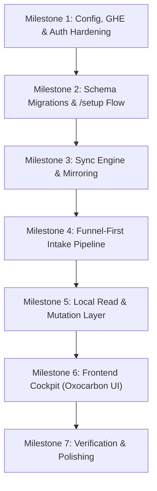

# Funnel: Implementation Analysis & Roadmap (TODO)

This document tracks the implementation status of Funnel against the authoritative [docs/SPEC.md](file:///Users/torben/Workspace/Repositories/github.com/t128n/funnel/docs/SPEC.md) and [docs/DESIGN.md](file:///Users/torben/Workspace/Repositories/github.com/t128n/funnel/docs/DESIGN.md).

---

## 1. Executive Summary

- **Architecture Maturity**: ~20% complete.
- **Implemented Foundations**: Database schema (`drizzle-orm`), SQLite initialization (`bun:sqlite`), GitHub App client management (`octokit`), in-memory ETag LRU cache, and GitHub REST passthrough endpoints with test coverage.
- **Critical Missing Pillars**:
  1. **Sync Engine**: The background polling worker (REST 304 change detection + batched GraphQL hydration) and SSE event pusher are not yet built.
  2. **Intake Staging & Routing**: Endpoints (`/api/intake`, `/submit`) and triage actions (Accept, Dismiss, Duplicate) are not yet implemented.
  3. **Frontend Triage Cockpit**: The entire SvelteKit UI (3-pane layout, Oxocarbon theme, dense streams, 480px inspector pane, 6-column board, filters) is currently just the starter template.
  4. **Enterprise / Host Configuration**: `funnel.config.yaml` parser, dynamic GitHub Enterprise host URLs (`acme.ghe.com`), and first-run `/setup` manifest flow are missing.
  5. **Security & Tokens**: Token encryption at rest and token auto-refresh for stored GitHub user tokens remain to be built.

---

## 2. Detailed Gap Analysis by Specification Area

### 2.1 Configuration & Environment (SPEC §4, §10)
| Feature | Status | Notes / Location |
| :--- | :---: | :--- |
| `src/env.ts` validation | ✅ Done | Valibot schema validates `FUNNEL_URL`, `FUNNEL_SECRET`, `FUNNEL_DB`, App ID, Private Key, Client ID/Secret, and `LOG_LEVEL`. |
| `funnel.config.yaml` loader | ✅ Done | `src/lib/server/config.ts` uses `c12` (`loadConfig`) + valibot schema; provides cached `getConfig()`. See `funnel.config.example.yaml`. |
| Enterprise GHE Host Overrides | ❌ Missing | Octokit in `app.server.ts` currently hardcodes standard GitHub URLs; needs dynamic `baseUrl` derived from config. |

---

### 2.2 Database & Schemas (SPEC §3, §5, §7)
| Feature | Status | Notes / Location |
| :--- | :---: | :--- |
| Single SQLite DB (`funnel.db`) | ✅ Done | Implemented in `src/lib/server/db/index.ts` with WAL mode, foreign keys, and busy timeout. |
| Drizzle Schemas | ✅ Done | Implemented in `src/lib/server/db/schema.ts`: `state_intake_submission`, `auth_*` tables, and all `mirror_github_*` tables. |
| Startup Auto-Migration / Schema Sync | ⚠️ Partial | Schema exists in code, but no startup initialization routine runs `drizzle-orm` migrations on boot. |
| Plain SQL Search queries (`like`) | ❌ Missing | FTS5 deferred per interview; need standard Drizzle queries for issue text filtering. |

---

### 2.3 Authentication & Token Security (SPEC §8)
| Feature | Status | Notes / Location |
| :--- | :---: | :--- |
| Better Auth Initialization | ✅ Done | Configured in `src/lib/server/auth/index.ts` with Drizzle adapter and GitHub social provider. |
| SvelteKit Auth Handler | ✅ Done | Hooked in `src/hooks.server.ts`. |
| Encryption at Rest for Tokens | ❌ Missing | Access and refresh tokens in `auth_account` must be AES-GCM encrypted using a key derived from `FUNNEL_SECRET`. |
| Short-Lived Token Refresh | ❌ Missing | Expiring GitHub App user tokens must be automatically refreshed before executing write operations. |
| Test Suite Fix (`auth.test.ts`) | ⚠️ Fix Needed | Test creates table `verification` instead of `auth_verification`, causing a test failure. |

---

### 2.4 GitHub App & Passthrough Layer (SPEC §4, §7)
| Feature | Status | Notes / Location |
| :--- | :---: | :--- |
| GitHub App Singleton | ✅ Done | Implemented in `src/lib/server/github/app.server.ts` (JWT client, installation resolution, user tokens). |
| In-Memory ETag LRU Cache | ✅ Done | Implemented in `src/lib/server/github/cache.ts` with full unit test coverage. |
| REST Passthrough Handler | ✅ Done | Implemented in `src/lib/server/github/api-passthrough.server.ts` with tests. |
| Passthrough API Routes | ✅ Done | Implemented under `src/routes/api/repos/...` and `src/routes/api/users/...`. |
| First-Run `/setup` Route | ❌ Missing | GitHub App Manifest flow generating credentials at `${github.url}/settings/apps/new`. |

---

### 2.5 Synchronization & Label Management (SPEC §5, §7)
| Feature | Status | Notes / Location |
| :--- | :---: | :--- |
| Polling Worker Loop | ❌ Missing | Staggered polling (30s active / 300s idle) using conditional REST `304 Not Modified` requests. |
| Batched GraphQL Hydrator | ❌ Missing | Batched 100-issue GraphQL queries fetching body, labels, assignees, and comments. PRs filtered out. |
| 90-Day History Window | ❌ Missing | Filter closed issues to those closed within `sync.history_days` (default 90 days). |
| Real-Time SSE Pusher (`/api/events`) | ❌ Missing | Server-Sent Events stream with mandatory 10–15s `: ping` heartbeat. |
| Self-Healing Label Provisioner | ❌ Missing | Startup check creating canonical `p1-p3`, `s/m/l`, `backlog..blocked` labels via `funnel[bot]`. |
| Bot Conflict Resolution | ❌ Missing | Automated de-duplication of multiple labels in the same group via timeline inspection. |
| Nightly Reconciliation Worker | ❌ Missing | Daily full sweep to drop purged/transferred issues and verify repo configurations. |

---

### 2.6 Intake & Staging Pipeline (SPEC §6)
| Feature | Status | Notes / Location |
| :--- | :---: | :--- |
| `POST /api/intake` | ❌ Missing | Public JSON intake endpoint with open CORS headers. |
| `/submit` Form | ❌ Missing | Plain HTML form working without JavaScript for external issue submission. |
| Staging Table Storage | ⚠️ Schema Only | `state_intake_submission` defined in schema, but insertion/query logic not hooked up. |
| Triage Actions (Accept / Dismiss / Duplicate) | ❌ Missing | Accept creates GitHub issue with provenance footer; Dismiss hard-deletes; Duplicate appends comment. |

---

### 2.7 Frontend UI & Triage Cockpit (SPEC §9, DESIGN.md)
| Feature | Status | Notes / Location |
| :--- | :---: | :--- |
| Oxocarbon CSS Design Tokens | ❌ Missing | Dark & Light theme tokens from IBM Oxocarbon palette. |
| In-App Theme Switcher | ❌ Missing | System / Dark / Light switcher in sidebar footer. |
| 3-Pane Shell Layout | ❌ Missing | 220px fixed Sidebar, flexible Main Stream, 480px fixed Inspector Pane. |
| Navigation Sidebar | ❌ Missing | Inbox, All Issues, My Issues, Status Board, source repo link. |
| 36px Fixed-Height Issue Rows | ❌ Missing | High-density list items with monospace repo badges (`repo#123`), truncated titles, priority/size chips. |
| 480px Inspector Pane | ❌ Missing | Plain text body/comments with preserved whitespace, inline title/body editing, comment posting, label pickers. |
| 6-Column Status Board | ❌ Missing | Columns: Backlog, Todo, In Progress, In Review, Blocked, Done (14 days). Status dropdown pickers on cards. |
| 6-Dimension Multi-Select Filters | ❌ Missing | Repo, Status, Assignee, Priority, Size, Labels (OR inside group, AND across groups). |
| URL State Serialization | ❌ Missing | Filter state and search terms bidirectionally bound to URL query parameters. |
| Pessimistic UI Mutations | ❌ Missing | Inline spinner states on controls until GitHub responds; no optimistic rollback logic. |

---

## 3. Implementation Plan & Milestones

### Milestone 1: Configuration, GHE Host & Auth Hardening
- [x] Create `funnel.config.yaml` schema validator and file loader (`yaml` parser). Done via `c12` + valibot in `src/lib/server/config.ts` (YAML parsed by c12's bundled `confbox`); see `funnel.config.example.yaml`.
- [ ] Update `app.server.ts` to support dynamic enterprise GitHub URLs (`acme.ghe.com`) via `github.url` and `github.api_url`.
- [ ] Implement AES-GCM token encryption and decryption at rest for `auth_account` using `FUNNEL_SECRET`.
- [ ] Implement automatic user token refresh hook in `app.server.ts` / session loader.
- [ ] Fix `auth.test.ts` to use `auth_verification` table name so the test suite passes cleanly.

### Milestone 2: Schema Initialization & Setup Flow
- [ ] Build startup database initialization script ensuring all Drizzle tables exist in `funnel.db`.
- [ ] Implement the first-run `/setup` page implementing GitHub's App Manifest creation flow.
- [ ] Build the self-healing label provisioner that creates canonical labels on configured repos at startup.

### Milestone 3: Polling Sync Engine & Live Updates

**Dependencies / Prerequisites (must land before the sync engine can run):**
- [ ] **Structured logging (pino)**: add `pino` (and `pino-pretty` for dev) and create `src/lib/server/log.ts`; drive level from `LOG_LEVEL` and emit JSON logs from every background cycle.
- [ ] **Server startup hook + SQL bootstrap**: add `export const init` (`ServerInit`) to `src/hooks.server.ts` (guarded by `building`) and `src/lib/server/db/bootstrap.server.ts` running `CREATE TABLE IF NOT EXISTS` derived from the Drizzle schema, so `mirror_github_*`/`state_*` tables exist on boot.
- [x] **Config loader**: add the `c12` dependency and `src/lib/server/config.ts` (valibot-validated `funnel.config.yaml`: `github.url`, `github.api_url`, `repos`, `sync.history_days`, `sync.poll_interval_active_seconds`, `sync.poll_interval_idle_seconds`).
- [ ] **GHE base-URL wiring**: update `app.server.ts` so Octokit REST and the GraphQL hydration endpoint derive from `github.api_url` (`acme.ghe.com/api/v3` + `/graphql`).
- [ ] **Persistent process adapter**: replace `adapter-auto` with `svelte-adapter-bun` (or `adapter-node`) so background timers and SSE are not silently killed by a serverless target.

**Sync engine:**
- [ ] Build the REST conditional polling worker (`since` + ETag 304 change detection).
- [ ] Build the GraphQL batch hydration routine for 100-issue batches (ignoring PRs).
- [ ] Implement the timeline-based label conflict resolver.
- [ ] Implement `/api/events` Server-Sent Events endpoint with the mandatory 10–15s heartbeat.
- [ ] Add the nightly reconciliation task to clean up obsolete issues.

### Milestone 4: Funnel-First Intake & Staging Pipeline
- [ ] Implement `POST /api/intake` (JSON API with open CORS).
- [ ] Implement `/submit` HTML-only web form.
- [ ] Implement server actions for Accept (with repo selector & provenance footer), Dismiss (hard-delete), and Duplicate.

### Milestone 5: Local Query & Mutation Service
- [ ] Write Drizzle queries for Inbox (pending intake + unlabelled issues), All Issues, My Issues, and Status Board.
- [ ] Build filter evaluation logic (6 multi-select dropdowns + SQL `like` search).
- [ ] Implement pessimistic mutation endpoints for issue creation, status changes, label adjustments, and comments.

### Milestone 6: High-Density UI (The Cockpit)
- [ ] Set up Oxocarbon Dark and Light CSS variables and font stacks (`Inter` + `JetBrains Mono`).
- [ ] Build the 3-pane responsive desktop shell with bits-ui.
- [ ] Implement the dense 36px issue row component.
- [ ] Build the 480px Inspector Pane (plain text rendering, inline title/body editor, comment composer).
- [ ] Build the 6-column Status Board with card dropdown pickers and the 14-day Done cutoff.
- [ ] Connect URL query parameter state to filters and search.

### Milestone 7: Verification & Final Polish
- [ ] Verify test suite passes with 100% coverage on core business logic.
- [ ] Test with enterprise GHE host and multiple repositories.
- [ ] Ensure structured JSON logging across all background cycles.
