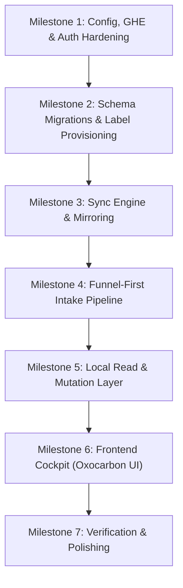

# Funnel: Implementation Analysis & Roadmap (TODO)

This document tracks the implementation status of Funnel against the authoritative [docs/SPEC.md](file:///Users/torben/Workspace/Repositories/github.com/t128n/funnel/docs/SPEC.md) and [docs/DESIGN.md](file:///Users/torben/Workspace/Repositories/github.com/t128n/funnel/docs/DESIGN.md).

---

## 1. Executive Summary

- **Architecture Maturity**: ~85% complete.
- **Implemented Foundations**: Database schema (`drizzle-orm`), SQLite initialization (`bun:sqlite`), GitHub App client management (`octokit`), in-memory ETag LRU cache, GitHub REST passthrough endpoints, and the local query/filter/mutation service (`src/lib/server/issues/`), all with test coverage.
- **Critical Missing Pillars**:
  1. **Intake Staging & Routing**: `POST /api/intake`, the Accept / Dismiss / Duplicate action logic (§2.6), the JavaScript-free `/submit` form, and the SvelteKit Inbox action wiring (M6) are all implemented.
  2. **Frontend Triage Cockpit**: The SvelteKit UI (Oxocarbon theme, 3-pane shell, dense streams, 480px inspector pane, 6-column board, URL-synced filters, login gate) is implemented (M6).
  3. **Enterprise / Host Configuration**: `funnel.config.yaml` parser and dynamic GitHub Enterprise host URLs (`acme.ghe.com`) are implemented; user OAuth flow wiring is deferred.
  4. **Security & Tokens**: ✅ Resolved. Token encryption at rest and auto-refresh are handled by Better Auth (see §2.3).

---

## 2. Detailed Gap Analysis by Specification Area

### 2.1 Configuration & Environment (SPEC §4, §10)

| Feature                       | Status  | Notes / Location                                                                                                                                                                                                          |
| :---------------------------- | :-----: | :------------------------------------------------------------------------------------------------------------------------------------------------------------------------------------------------------------------------ |
| `src/env.ts` validation       | ✅ Done | Valibot schema validates `FUNNEL_URL`, `FUNNEL_SECRET`, `FUNNEL_DB`, App ID, Private Key, Client ID/Secret, and `LOG_LEVEL`.                                                                                              |
| `funnel.config.yaml` loader   | ✅ Done | `src/lib/server/config.ts` uses `c12` (`loadConfig`) + valibot schema; provides cached `getConfig()`. See `funnel.config.example.yaml`.                                                                                   |
| Enterprise GHE Host Overrides | ✅ Done | `src/lib/server/github/app.server.ts` derives Octokit `baseUrl` (REST & GraphQL) from `github.api_url` and mirror links/`html_url`s from `github.url`. GraphQL resolves via Octokit's `/api/v3` → `/api/graphql` rewrite. |

---

### 2.2 Database & Schemas (SPEC §3, §5, §7)

| Feature                              |   Status   | Notes / Location                                                                                                            |
| :----------------------------------- | :--------: | :-------------------------------------------------------------------------------------------------------------------------- |
| Single SQLite DB (`funnel.db`)       |  ✅ Done   | Implemented in `src/lib/server/db/index.ts` with WAL mode, foreign keys, and busy timeout.                                  |
| Drizzle Schemas                      |  ✅ Done   | Implemented in `src/lib/server/db/schema.ts`: `state_intake_submission`, `auth_*` tables, and all `mirror_github_*` tables. |
| Startup Auto-Migration / Schema Sync |  ✅ Done   | Migration generated and committed under `drizzle/`; applied out-of-band via `bun run db:migrate` (no runtime initializer).  |
| Plain SQL Search queries (`like`)    | ✅ Done | FTS5 deferred per interview; standard Drizzle queries in `src/lib/server/issues/filters.ts` (`buildIssueWhere`) filter issue text (`LIKE ... ESCAPE`) and the six dimensions. |

---

### 2.3 Authentication & Token Security (SPEC §8)

| Feature                         | Status  | Notes / Location                                                                                                                                                                                                                                                                                                                                                                                                    |
| :------------------------------ | :-----: | :------------------------------------------------------------------------------------------------------------------------------------------------------------------------------------------------------------------------------------------------------------------------------------------------------------------------------------------------------------------------------------------------------------------ |
| Better Auth Initialization      | ✅ Done | Configured in `src/lib/server/auth/index.ts` with Drizzle adapter and GitHub social provider.                                                                                                                                                                                                                                                                                                                       |
| SvelteKit Auth Handler          | ✅ Done | Hooked in `src/hooks.server.ts`.                                                                                                                                                                                                                                                                                                                                                                                    |
| Encryption at Rest for Tokens   | ✅ Done | `account.encryptOAuthTokens: true` in `src/lib/server/auth/index.ts`. Better Auth encrypts `auth_account.accessToken`/`refreshToken` on write and decrypts on read, keyed off `FUNNEL_SECRET`. Cipher is XChaCha20-Poly1305 (authenticated encryption), Better Auth's built-in; the earlier "AES-GCM" wording is superseded. Callers must read tokens via `getUserAccessToken()` — the raw column holds ciphertext. |
| Short-Lived Token Refresh       | ✅ Done | `getUserAccessToken(userId)` in `src/lib/server/auth/index.ts` uses `auth.api.getAccessToken()`, which auto-refreshes (and persists) tokens within 5s of expiry. Compose with the client as `await github.asUser(await getUserAccessToken(userId))`; `hooks.server.ts` also populates `event.locals.session`/`user`.                                                                                                |
| Test Suite Fix (`auth.test.ts`) | ✅ Done | Test now creates/queries `auth_verification`; added coverage for at-rest encryption and the refresh path.                                                                                                                                                                                                                                                                                                           |

---

### 2.4 GitHub App & Passthrough Layer (SPEC §4, §7)

| Feature                  | Status  | Notes / Location                                                                                         |
| :----------------------- | :-----: | :------------------------------------------------------------------------------------------------------- |
| GitHub App Singleton     | ✅ Done | Implemented in `src/lib/server/github/app.server.ts` (JWT client, installation resolution, user tokens). |
| In-Memory ETag LRU Cache | ✅ Done | Implemented in `src/lib/server/github/cache.ts` with full unit test coverage.                            |
| REST Passthrough Handler | ✅ Done | Implemented in `src/lib/server/github/api-passthrough.server.ts` with tests.                             |
| Passthrough API Routes   | ✅ Done | Implemented under `src/routes/api/repos/...` and `src/routes/api/users/...`.                             |

---

### 2.5 Synchronization & Label Management (SPEC §5, §7)

| Feature                              | Status  | Notes / Location                                                                                                                                                                                           |
| :----------------------------------- | :-----: | :--------------------------------------------------------------------------------------------------------------------------------------------------------------------------------------------------------- |
| Polling Worker Loop                  | ✅ Done | `src/lib/server/sync/worker.ts`: conditional REST `304` polling (cursor = derived `MAX(updated_at)`, ETag on `mirror_github_repo`), staggered 30s active / 300s idle scheduler.                            |
| Batched GraphQL Hydrator             | ✅ Done | `src/lib/server/sync/hydrate.ts`: 100-`node_id` GraphQL batches for body, labels, assignees, first-page comments; PRs dropped via `... on Issue`.                                                          |
| 90-Day History Window                | ✅ Done | `sync.history_days` filter in `src/lib/server/sync/worker.ts` (`inHistoryWindow`); older closed issues pruned.                                                                                             |
| Real-Time SSE Pusher (`/api/events`) | ✅ Done | `src/routes/api/events/+server.ts` + in-process bus in `src/lib/server/sync/events.ts`; 12s `: ping` heartbeat, `X-Accel-Buffering: no`.                                                                   |
| Self-Healing Label Provisioner       | ✅ Done | `src/lib/server/github/labels.ts` (`CANONICAL_LABELS` + `provisionCanonicalLabels`), wired to SvelteKit's `init` hook; creates/patches the reserved labels via the App installation token (`funnel[bot]`). |
| Bot Conflict Resolution              | ✅ Done | `src/lib/server/sync/conflicts.ts`: timeline inspection, latest-added-wins removal via `funnel[bot]`, ambiguous timelines flagged on the issue row.                                                        |
| Nightly Reconciliation Worker        | ✅ Done | `src/lib/server/sync/reconcile.ts`: 03:00 full sweep to drop purged/transferred issues, re-hydrate, and re-verify repo label provisioning.                                                                 |

---

### 2.6 Intake & Staging Pipeline (SPEC §6)

| Feature                                       |     Status     | Notes / Location                                                                                     |
| :-------------------------------------------- | :------------: | :--------------------------------------------------------------------------------------------------- |
| `POST /api/intake`                            |    ✅ Done     | `src/routes/api/intake/+server.ts` (valibot-validated JSON, `201 {"id"}`, open CORS + `OPTIONS` preflight). |
| `/submit` Form                                |    ✅ Done     | `src/routes/submit/+page.svelte` + `+page.server.ts`: JavaScript-free HTML form validated server-side, writes to staging via `createSubmission`, publishes the SSE `intake` event. |
| Staging Table Storage                         |    ✅ Done     | `src/lib/server/intake/staging.ts`: `createSubmission`/`getSubmission`/`listSubmissions`/`deleteSubmission` over `state_intake_submission`. |
| Triage Actions (Accept / Dismiss / Duplicate) |    ✅ Done     | `src/lib/server/intake/actions.ts` (`acceptSubmission`/`dismissSubmission`/`duplicateSubmission`); repo selector + provenance footer, hard-delete on decision. SvelteKit form-action wiring lands with the M6 Inbox UI. |

---

### 2.7 Frontend UI & Triage Cockpit (SPEC §9, DESIGN.md)

| Feature                          |   Status   | Notes / Location                                                                                               |
| :------------------------------- | :--------: | :------------------------------------------------------------------------------------------------------------- |
| Oxocarbon CSS Design Tokens      |  ✅ Done   | Dark & Light theme tokens from IBM Oxocarbon palette.                                                          |
| In-App Theme Switcher            |  ✅ Done   | System / Dark / Light switcher in sidebar footer.                                                              |
| 3-Pane Shell Layout              |  ✅ Done   | 220px fixed Sidebar, flexible Main Stream, 480px fixed Inspector Pane.                                         |
| Navigation Sidebar               |  ✅ Done   | Inbox, All Issues, My Issues, Status Board, source repo link.                                                  |
| 36px Fixed-Height Issue Rows     |  ✅ Done   | High-density list items with monospace repo badges (`repo#123`), truncated titles, priority/size chips.        |
| 480px Inspector Pane             |  ✅ Done   | Plain text body/comments with preserved whitespace, inline title/body editing, comment posting, label pickers. |
| 6-Column Status Board            |  ✅ Done   | Columns: Backlog, Todo, In Progress, In Review, Blocked, Done (14 days). Status dropdown pickers on cards.     |
| 6-Dimension Multi-Select Filters |  ✅ Done   | Repo, Status, Assignee, Priority, Size, Labels (OR inside group, AND across groups).                           |
| URL State Serialization          |  ✅ Done   | Filter state and search terms bidirectionally bound to URL query parameters.                                   |
| Pessimistic UI Mutations         |  ✅ Done   | Inline spinner states on controls until GitHub responds; no optimistic rollback logic.                         |

---

## 3. Implementation Plan & Milestones

### Milestone 1: Configuration, GHE Host & Auth Hardening

- [x] Create `funnel.config.yaml` schema validator and file loader (`yaml` parser). Done via `c12` + valibot in `src/lib/server/config.ts` (YAML parsed by c12's bundled `confbox`); see `funnel.config.example.yaml`.
- [x] Update `app.server.ts` to support dynamic enterprise GitHub URLs (`acme.ghe.com`) via `github.url` and `github.api_url`. Scoped to the `/api/` mirror (REST/JWT/installation clients, Link rewriting, 404 `html_url`s); OAuth user flow deferred.
- [x] Implement token encryption at rest for `auth_account` using `FUNNEL_SECRET`. Done via Better Auth's `account.encryptOAuthTokens` (XChaCha20-Poly1305 AEAD, key derived from `FUNNEL_SECRET`); see `src/lib/server/auth/index.ts`.
- [x] Implement automatic user token refresh for write operations. Done via `getUserAccessToken()` (Better Auth lazy refresh + persist), composed as `await github.asUser(await getUserAccessToken(userId))`; session exposed on `event.locals`.
- [x] Fix `auth.test.ts` to use `auth_verification` table name so the test suite passes cleanly.

### Milestone 2: Schema Initialization & Label Provisioning

- [x] Generate and commit the Drizzle migration covering all tables; applied out-of-band via `bun run db:migrate` (no startup initializer).
- [x] Build the self-healing label provisioner that creates canonical labels on configured repos at startup. Implemented in `src/lib/server/github/labels.ts` (`CANONICAL_LABELS` + `provisionCanonicalLabels`); awaited from the SvelteKit `init` hook in `src/hooks.server.ts`, using the App installation token and restoring canonical colors/descriptions.

### Milestone 3: Polling Sync Engine & Live Updates

**Dependencies / Prerequisites (must land before the sync engine can run):**

- [x] **Structured logging (pino)**: add `pino` (and `pino-pretty` for dev) and create `src/lib/server/log.ts`; drive level from `LOG_LEVEL` and emit JSON logs from every background cycle.
- [x] **Schema migrations**: commit the generated Drizzle migration under `drizzle/`; apply out-of-band via `bun run db:migrate` before the server starts (no `init` hook).
- [x] **Config loader**: add the `c12` dependency and `src/lib/server/config.ts` (valibot-validated `funnel.config.yaml`: `github.url`, `github.api_url`, `repos`, `sync.history_days`, `sync.poll_interval_active_seconds`, `sync.poll_interval_idle_seconds`).
- [x] **GHE base-URL wiring**: `app.server.ts` derives Octokit REST and GraphQL from `github.api_url`. GraphQL goes through `github.graphql(installationId)`; `@octokit/graphql` rewrites the GHES `/api/v3` suffix to `/api/graphql` (Cloud: `api.github.com/graphql`, GHE: `acme.ghe.com/api/graphql`). `github.asUser` is now host-aware too.
- [x] **Persistent process adapter**: replaced `adapter-auto` with `@sveltejs/adapter-node` so background timers and SSE are not silently killed by a serverless target. Runs as a single long-lived process via `bun run build && bun run start` (`svelte-adapter-bun` still declares Kit 2 peer support only, so `adapter-node` was chosen).

**Sync engine:**

- [x] Build the REST conditional polling worker (`since` + ETag 304 change detection). Implemented in `src/lib/server/sync/worker.ts` (`pollRepo`/`runRepoCycle` + staggered active/idle scheduler); cursor is the derived per-repo `MAX(updated_at)`, ETag persists on `mirror_github_repo`.
- [x] Build the GraphQL batch hydration routine for 100-issue batches (ignoring PRs). Implemented in `src/lib/server/sync/hydrate.ts` (`HYDRATE_QUERY` + `hydrateNodes`/`hydrateAndStore`), keyed off REST `node_id`s with an `... on Issue` fragment that drops PRs.
- [x] Implement the timeline-based label conflict resolver. Implemented in `src/lib/server/sync/conflicts.ts` (`deriveMetadata`, `resolveWinners`, `resolveIssueConflict`); latest-added wins via the timeline, ambiguous timelines flagged (`label_conflict`).
- [x] Implement `/api/events` Server-Sent Events endpoint with the mandatory 10–15s heartbeat. Route at `src/routes/api/events/+server.ts` over the in-process bus in `src/lib/server/sync/events.ts`; 12s `: ping` heartbeat.
- [x] Add the nightly reconciliation task to clean up obsolete issues. Implemented in `src/lib/server/sync/reconcile.ts` (full sweep, prune absent/aged-out rows, re-provision labels, 03:00 daily timer).

### Milestone 4: Funnel-First Intake & Staging Pipeline

- [x] Implement `POST /api/intake` (JSON API with open CORS). `src/routes/api/intake/+server.ts`: valibot-validated `{ title, body?, source? }`, `201 {"id"}`, `OPEN_CORS` on POST + `OPTIONS` preflight, SSE publish. Staging writes in `src/lib/server/intake/staging.ts`.
- [x] Implement server actions for Accept (with repo selector & provenance footer), Dismiss (hard-delete), and Duplicate. Logic in `src/lib/server/intake/actions.ts` (`acceptSubmission`/`dismissSubmission`/`duplicateSubmission`), pessimistic (row cleared only after GitHub confirms), provenance footer `_Submitted via Funnel intake (source: …)_`. SvelteKit form-action wiring is deferred to the M6 Inbox route.

### Milestone 5: Local Query & Mutation Service

- [x] Write Drizzle queries for Inbox (pending intake + unlabelled issues), All Issues, My Issues, and Status Board. Implemented in `src/lib/server/issues/queries.ts` (`inbox`/`allIssues`/`myIssues`/`statusBoard` + `getIssueListItem`), with labels/assignees hydrated in two batched child queries. Sort is priority (`p1` first) then updated; Inbox mixes staged submissions with open status-less issues; Done is closed-completed within `board.done_days`.
- [x] Build filter evaluation logic (6 multi-select dropdowns + SQL `like` search). Implemented in `src/lib/server/issues/filters.ts` (`parseIssueFilter`/`buildIssueWhere`): OR within a group, AND across groups, `none` sentinels, `assignee=me`, and `LIKE ... ESCAPE` over title/body/comments.
- [x] Implement pessimistic mutation endpoints for issue creation, status changes, label adjustments, and comments. Transport-agnostic actions in `src/lib/server/issues/mutations.ts` behind GitHub-shaped routes: `POST /api/repos/{owner}/{repo}/issues`, `PATCH .../issues/{number}` (title/body/assignees/state + group-aware status/priority/size), `POST`/`DELETE .../issues/{number}/labels[/name]`, and `POST .../issues/{number}/comments`. Writes use the user token; each success publishes an SSE event and schedules a background `refreshIssue` (SPEC §7.2).

### Milestone 6: High-Density UI (The Cockpit)

- [x] Set up Oxocarbon Dark and Light CSS variables and font stacks (`Inter` + `JetBrains Mono`). `src/lib/styles/tokens.css` + `global.css`; self-hosted `@fontsource-variable` fonts; pre-paint theme script in `src/app.html`; `src/lib/client/theme.ts`.
- [x] Build the 3-pane responsive desktop shell with bits-ui. `src/routes/(app)/+layout.svelte` + `src/lib/components/shell/Sidebar.svelte`; `(app)` route group gates on session; collapses below 1100px/900px.
- [x] Implement the dense 36px issue row component. `src/lib/components/issue/IssueRow.svelte` (`--row-height: 36px`), mono `repo#123`, truncated title, priority/size/status chips, assignee avatars, conflict marker.
- [x] Build the 480px Inspector Pane (plain text rendering, inline title/body editor, comment composer). `src/lib/components/issue/InspectorPane.svelte` over `GET /api/mirror/issues/{owner}/{repo}/{number}` (`getIssueDetail`); pessimistic metadata pickers and comment composer.
- [x] Build the 6-column Status Board with card dropdown pickers and the 14-day Done cutoff. `src/lib/components/board/StatusBoard.svelte` + `BoardCard.svelte`; Done window from `board.done_days`.
- [x] Connect URL query parameter state to filters and search. `src/lib/url-filter.ts` + `src/lib/components/filter/FilterBar.svelte`; six multi-select dimensions + debounced search, bidirectional with the URL; inspector selection in `?issue=`.

Also landed: `/login` (GitHub OAuth via `better-auth/svelte`) and the JavaScript-free `/submit` form. See §2.6/§2.7.

### Milestone 7: Verification & Final Polish

- [ ] Verify test suite passes with 100% coverage on core business logic.
- [ ] Test with enterprise GHE host and multiple repositories.
- [ ] Ensure structured JSON logging across all background cycles.
