# Design language

Funnel is an issue cockpit: a place to answer what is broken, who owns it, and
what fits in the week. Its interface now follows **t128n**, a calm, compact,
technical system built for tools used under pressure. The visual language is
deliberately quiet; the data is the interface.

The application profile is [DESIGN.md](../DESIGN.md). The canonical values are
[`src/lib/styles/tokens.css`](../../src/lib/styles/tokens.css), bridged to
Tailwind and shadcn-svelte in
[`theme.css`](../../src/lib/styles/theme.css). The full redesign plan is
[`plans/2026-11-02-t128n-redesign.md`](../plans/2026-11-02-t128n-redesign.md).

## Density with air where it matters

A maintainer scanning forty issues needs comparison, not decoration. Rows are
2.25rem, table headers sit on `surface-2`, and every metadata column keeps its
slot. Density is carried by alignment and 1px rules, not by shrinking type:
nothing renders below 0.75rem.

Whitespace does the grouping. A page title is separated from its toolbar by
1.5rem, a toolbar from its table by a rule, and a table from its footer by a
rule. There are no cards around data. A table is the page structure.

## One accent, two themes

A single blue accent carries links, the primary action, focus, and the current
state. Selection is a 2px leading bar; vertical navigation also takes
`surface-3`. No row is filled with the accent.

Light and dark are complete palettes driven by `data-theme`. The app bar is
dark in both themes, with `accent-on-dark` for the wordmark and focus rings.
Status colours (error, warning, success) are text and icons; colour is never
the only channel.

## Structure, not elevation

Content is separated by 1px `border-subtle` rules and `surface` tints. Menus
and popovers get the `raised` shadow; dialogs and drawers get the `overlay`
shadow. Rows, inputs, cards, and buttons never cast a shadow.

Controls are 1.75rem in the cockpit and 2.25rem in focused flows, with
0.125rem radius for controls and 0.375rem for dialogs. Icons are Lucide
outline, 1rem inline and 1.25rem in controls.

## The issue page

The record opens with its identity: ref in mono, title at 1.5rem/600, and a
status/priority/assignee line. Properties are label–value rows under a top
rule; a value is still click-to-edit, but at rest it is plain text, so the
metadata compares like a table.

Description and comments use 1rem/1.6 prose, capped at 72 characters per line.
Activity is a ruled list, not chat bubbles. Internal work notes get a lock icon
and an “Internal” label on `surface`. Work notes and attachments sit inline
after Activity. The composer closes the page with comment/internal-note modes,
attachments, and a primary submit.

## Board, matrix, and plan

The board keeps its kanban function with flat cards, 1px borders, a mono ref,
and icon+text status. Dragging still works, and every drag has a keyboard and
menu equivalent. The matrix is a real table; its rating guide is a dialog. Plan
lanes are ruled sections with capacity bars and over-cap warnings, not cards.

## Feedback and motion

Feedback appears where the action happened: field errors under fields, save
confirmations beside the submit, mutation failures in the region they affect
with Retry. Floating toasts are reserved for background events with no
persistent region.

Motion is rationed: 120ms hover, 180ms expand, 240ms overlays. Row and focus
state changes are instant. `prefers-reduced-motion`, `prefers-contrast`, and
forced-colors are honored.

## The gallery

The redesigned views are captured by `scripts/screenshots/capture.ts` against
the seeded demo database, in light and dark. The committed gallery lives in
[`assets/t128n-redesign`](../assets/t128n-redesign/). It is evidence for the PR,
not a separate source of truth; the application profile and tokens decide.

| Issues | Issue detail |
| :--- | :--- |
| 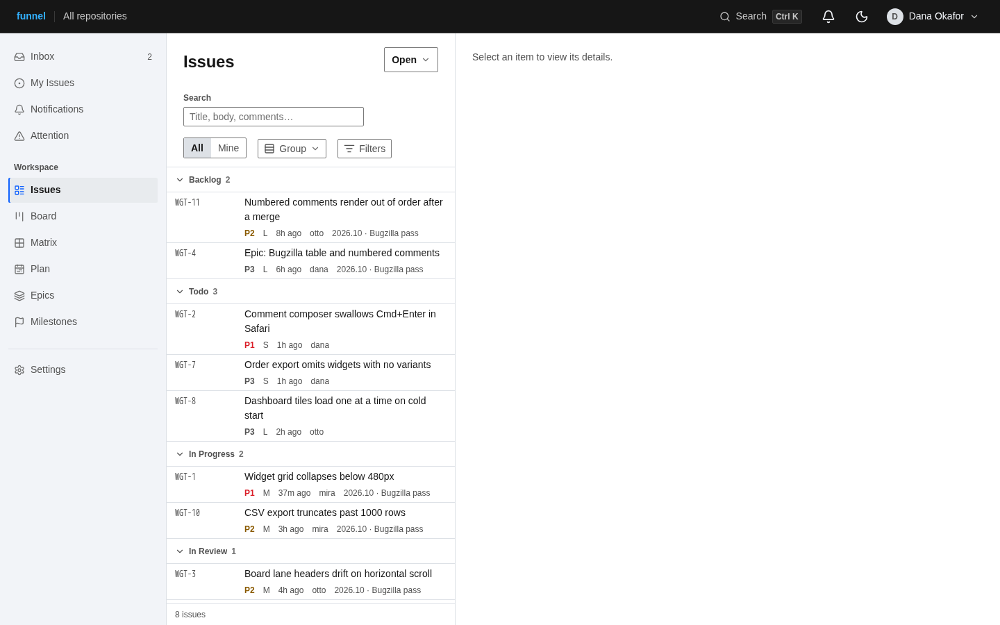 | 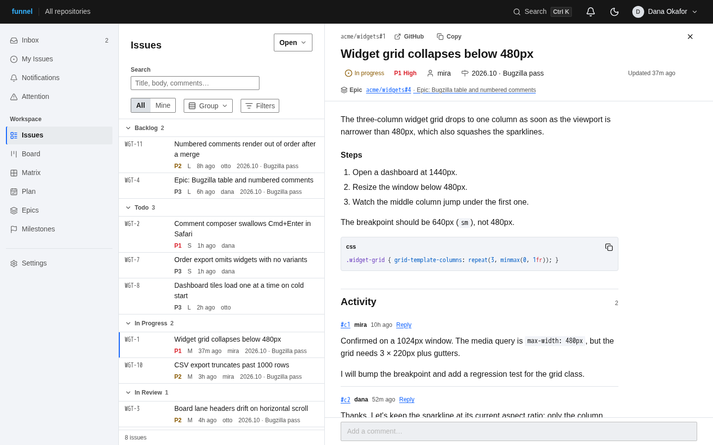 |

| Board | Plan |
| :--- | :--- |
| 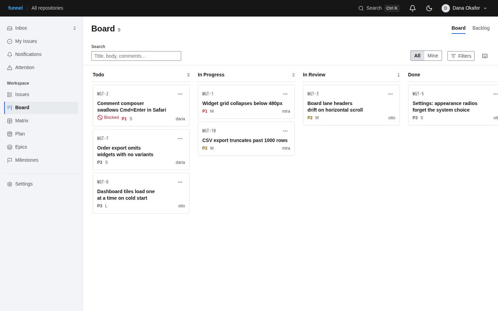 | 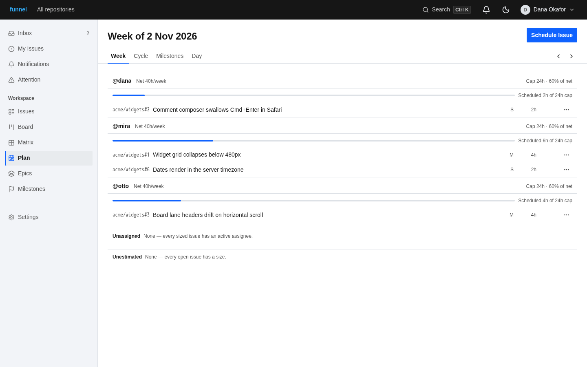 |

| Settings | Intake |
| :--- | :--- |
| 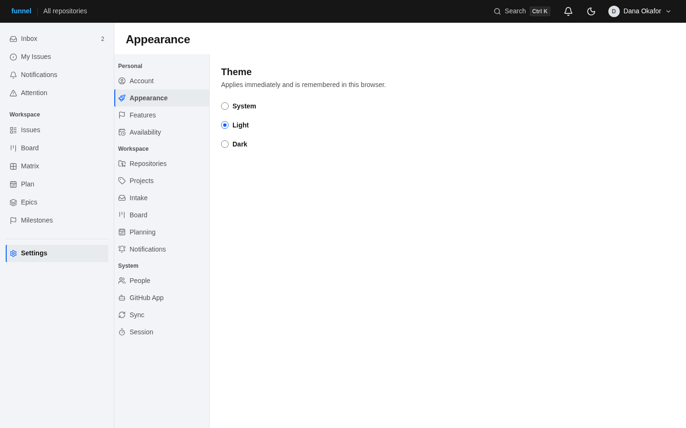 | 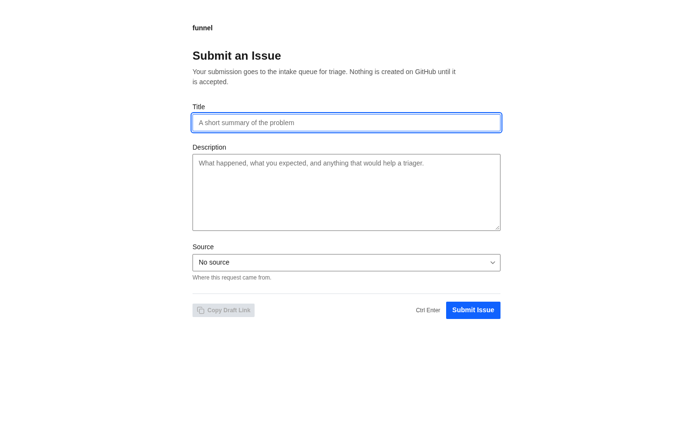 |

| Issues, dark | Issue detail, dark |
| :--- | :--- |
| 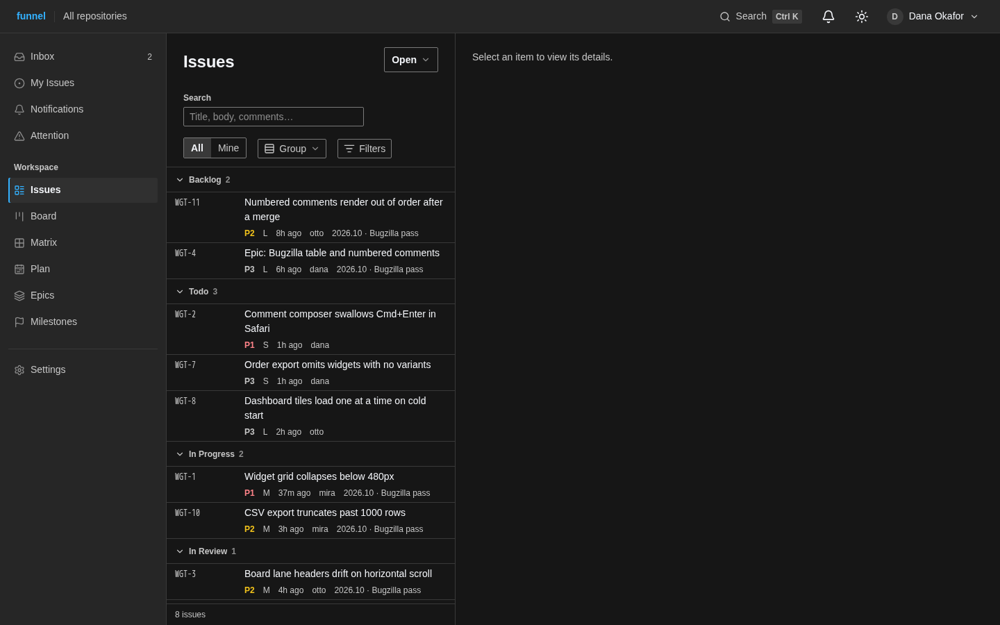 | 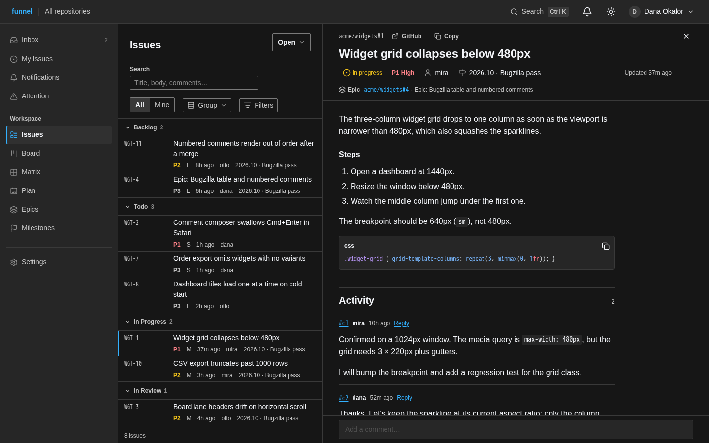 |

| Board, dark | Plan, dark |
| :--- | :--- |
| 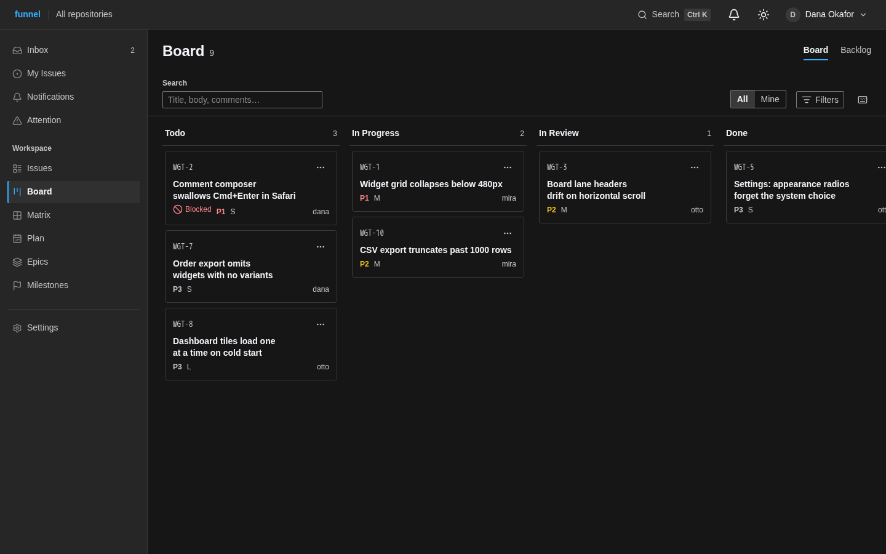 | 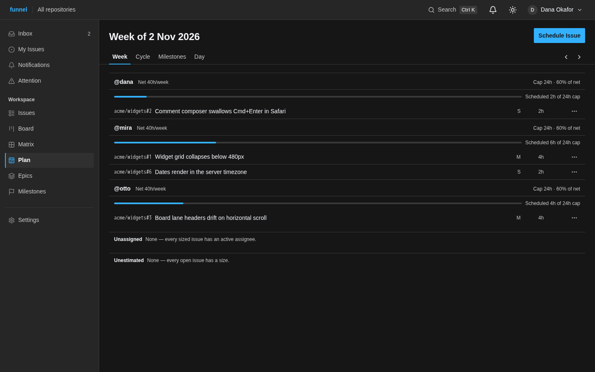 |

| Settings, dark | Intake, dark |
| :--- | :--- |
| 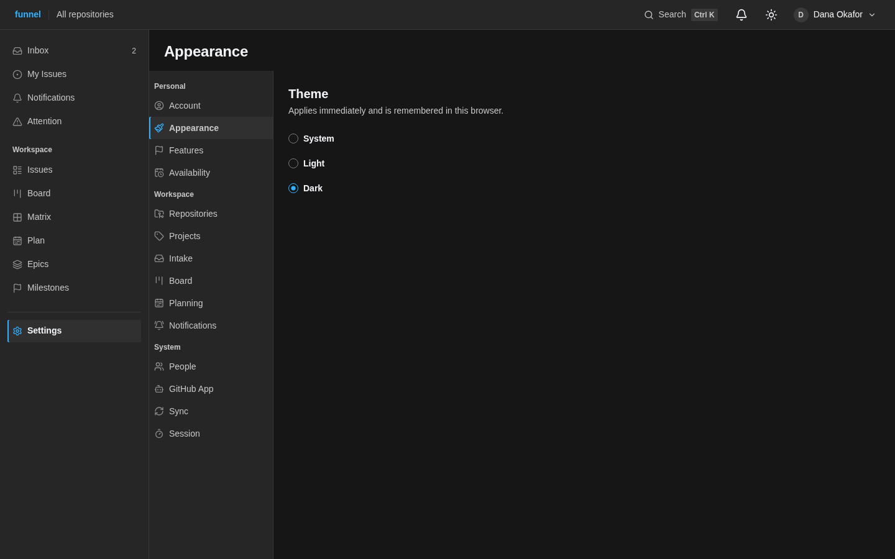 | 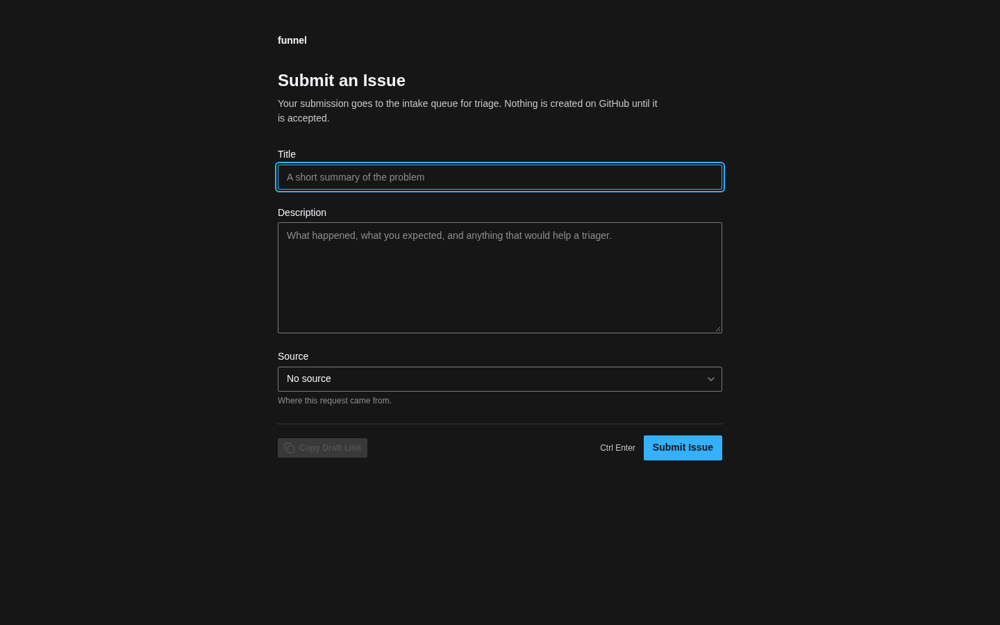 |

| Issues, mobile | Plan, mobile |
| :--- | :--- |
| 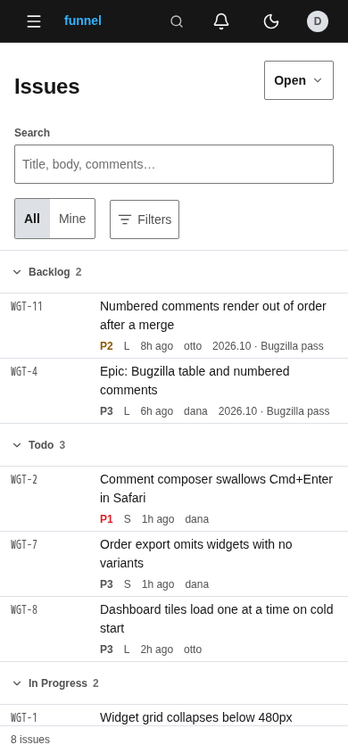 | 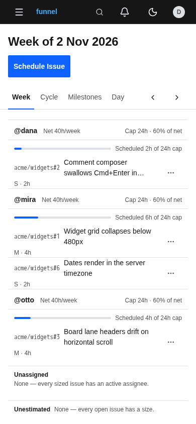 |
