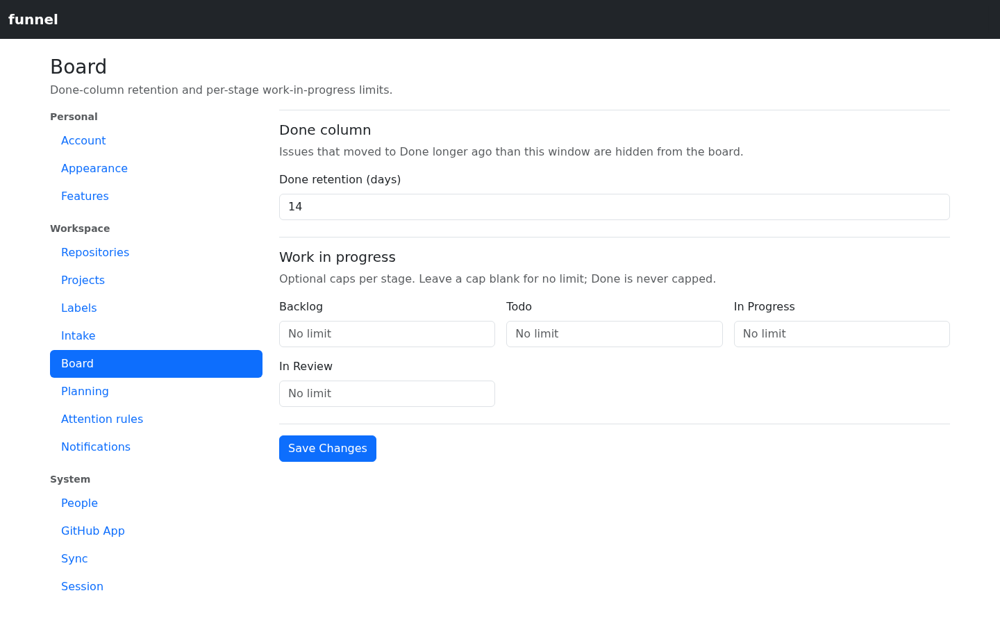

# Configure the board

Set how long completed work stays in Done and add optional Work-in-Progress caps to the open stages.

Only an administrator can open **Settings → Board**; other roles receive a 403 on a direct URL, and the save action checks the role again server-side.

## Before you start

Sign in with an administrator account. Configure and sync a repository first if you want to check the effect on existing issues; see [Add or remove repositories](repositories.md).

## Fields

- **Done retention (days)** — the window for closed, completed issues shown in the Done column. Default `14`.
- **WIP limits** — one optional cap for each open stage: Backlog, Todo, In Progress, and In Review. Blank means no limit.

The Done window and each cap accept whole numbers of zero or more. Done is not an accepted WIP stage key, so it can never be limited.

## Steps

1. Open **Settings → Board**. The retention and WIP fields show the current values.

   

   *Check the retention window and caps currently in effect.*

2. Set the Done retention window to the number of days of completed issues you want displayed.
3. Enter caps for the stages you want to limit, or clear a field to remove its cap. Blank fields have no limit.
4. Select **Save changes**, then open the board to check the Done column and limited column headers.

## Troubleshooting

If saving fails, check that retention and nonblank caps are whole numbers of zero or more. If older completed issues are missing, check the sync history window below.

## What the Done window changes

The Done column contains issues that are closed with the **completed** reason and whose close time falls inside the window. Issues closed as “not planned”/cancelled are omitted. Shortening the window removes older completed issues from the column; lengthening it brings back those that are still mirrored.

The window is presentation only. It does not delete anything from the mirror, and it does not change the history window used by sync. If the Done window is longer than the mirrored history, older completed issues may be missing because they were never collected. See [Configure sync](sync.md).

## What WIP limits change

- Each limited column header shows `count / limit`; when the count exceeds the limit the number turns to the warning colour.
- The cap is advisory: Funnel does not block a drag or reject a move that exceeds it.
- Column counts include only the cards currently visible under the active filters. Filtering the board can therefore bring a column back under its limit.
- Backlog is a separate list view rather than a board lane, so its cap is configurable but is not displayed on the board.
- Done is never capped, even when the open columns are.

## Effect on counts

Changing the Done window changes the Done column's count and the total number of cards on the board. It does not change the sidebar badges: **Inbox** counts pending submissions plus untriaged open issues, and **Attention** counts overdue or due-today re-checks. Blocked issues without a re-check date are listed on the Attention page but never counted in its badge. Those counts are computed independently of the board settings.

## After saving

Funnel validates and persists the values, drops the cached configuration, and broadcasts a `settings` event. Open boards re-query with the new window and caps; a restart is not needed.

## Related

- [Configure sync](sync.md)
- [Use the board](../use/board.md)
- [Map labels to projects](projects.md)
- [Settings reference](../../reference/settings.md)
- [Reserved labels](../../reference/reserved-labels.md)
- [Roles and permissions](../../reference/roles-and-permissions.md)
