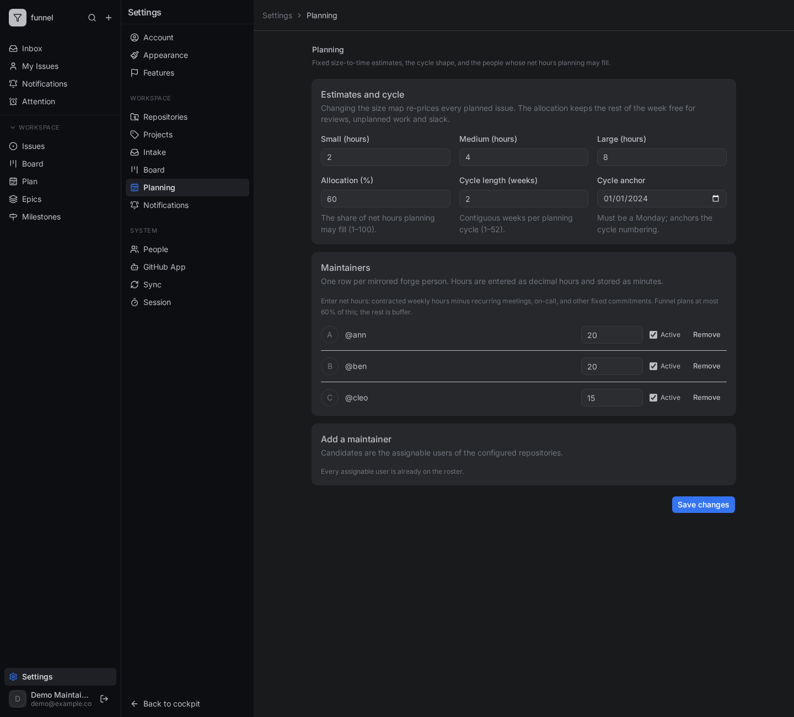

# Configure estimates and weekly plans

This guide shows an administrator how to set the instance-wide size-to-time estimates, the planning allocation, the cycle shape and the maintainer roster. The planner itself, `/plan`, is readable by every signed-in user; see [Plan a week or cycle](../use/plan-work.md) for the day-to-day task.

## Before you start

You need the `admin` role and at least one configured repository whose assignable users include the people you want to plan. Only an administrator can open **Settings → Planning**; other roles receive a 403 on a direct URL, and the save action checks the role again server-side.

## Steps

1. Open **Settings → Planning**.
2. Set the hours for **Small**, **Medium** and **Large**, or keep the 2h/4h/8h defaults. The size label is the estimate; changing the map re-prices every planned issue.
3. Set the **Allocation** percentage. It is the share of net weekly hours that plan items may fill; `60` leaves 40% for reviews, unplanned work and slack.
4. Set the **Cycle length** in weeks (`1`–`52`) and the **Cycle anchor** to a real Monday.
5. In **Maintainers**, add assignable people and enter each one's **net** weekly hours. Net means contracted hours minus recurring meetings, on-call and other fixed commitments. Funnel plans at most the allocation percentage of this value.
6. Deactivate or remove a maintainer to take them out of the capacity model.
7. Select **Save changes**.

Funnel validates and persists the values, drops the cached configuration, and broadcasts a settings event. Open planners re-query with the new estimates and caps; a restart is not needed.

## What these settings control

- **Size map** — the fixed estimate for `sm`, `md` and `lg`. An issue without a size is unestimated and cannot be scheduled.
- **Allocation** — the hard cap on plan mutations: `floor(net weekly minutes × weeks × allocation percent / 100)`.
- **Cycle shape** — how many contiguous weeks a cycle contains and which Monday anchors cycle numbering.
- **Roster** — whose net hours make up capacity. An issue's estimate is split across its assignees that are active, configured maintainers; with no match it lands in the unassigned bucket.

The exact defaults, bounds, formulas and metadata formats are in the [Planning and time reference](../../reference/planning-and-time.md). The rationale and trade-offs are in [Why planning and actuals work this way](../../explanation/planning-and-actuals.md).

## Scheduling issues

A writer schedules issues from `/plan`; the plan dialog and API enforce the same cap. A plan item schedules one open, sized issue into one Monday week and never writes to GitHub. Moving an issue frees its old week before the new cap is checked; re-scheduling to the same week is a no-op. The API equivalent is `PUT /api/repos/{owner}/{repo}/issues/{number}/plan`.

For the full task, including the week, cycle and milestone horizons, see [Plan a week or cycle](../use/plan-work.md).

## Related

- [Plan a week or cycle](../use/plan-work.md) — scheduling, moving work and handling the cap.
- [Planning and time reference](../../reference/planning-and-time.md) — every `planning.*` key, formula and contract.
- [Why planning and actuals work this way](../../explanation/planning-and-actuals.md) — the design trade-offs.
- [Plan a cycle and track it](../../tutorials/plan-and-track-a-cycle.md) — a guided first run.
- [Settings reference](../../reference/settings.md) — the full `state_setting` registry.
- [Database schema](../../reference/database-schema.md#state_plan_item) — the `state_plan_item` table.
