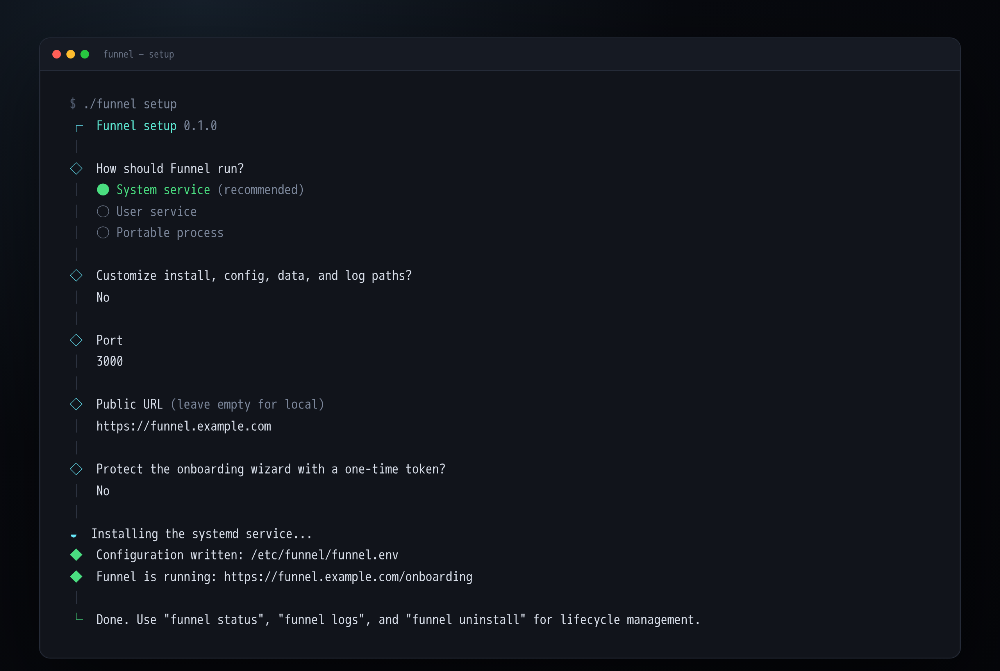

# Install Funnel

Funnel ships as one self-contained executable per platform. The same binary is
the server and the installer: run `funnel setup` to create the configuration,
install the native service, and open the first-run wizard.



The [animated preview](../../assets/setup/funnel-setup.gif) shows the full
prompt flow.

## Requirements

| Platform | Requirements |
| :--- | :--- |
| Windows | Windows 10 1903+ or Windows 11 / Server 2016+. The executable installs a WinSW service; .NET Framework 4.6.1+ is part of supported Windows versions. |
| Linux | systemd (system or user units). The release binary targets glibc. |
| macOS | launchd. System installs use a dedicated `_funnel` user; user installs use a LaunchAgent. |
| Network | Outbound HTTPS to GitHub (or your GitHub Enterprise host) for the App manifest and sync. |

Funnel is a **single instance**. It owns one SQLite database and one uploads
directory. Do not run two instances against the same data directory.

## Install

Download the archive for your platform from the GitHub release, extract it, and
run:

```sh
./funnel setup
```

On Windows, double-click `setup.cmd` or run:

```powershell
.\funnel.exe setup
```

The wizard asks how Funnel should run:

- **System service** — starts at boot. Needs administrator/sudo; setup
  auto-elevates.
- **User service** — starts at login (Linux/macOS only). No admin required.
- **Portable process** — runs now with no service; useful for a quick trial.

It then asks for the install, config, data, and log paths, the port, an optional
public URL, and an optional onboarding token. Every path has a platform default
and can be changed during setup or with flags.

```sh
funnel setup --yes \
  --mode system \
  --config-file /etc/funnel/funnel.env \
  --data-dir /var/lib/funnel \
  --log-dir /var/log/funnel \
  --port 3000
```

Windows example with data on another drive:

```powershell
.\funnel.exe setup --config-file D:\Data\Funnel\funnel.env --data-dir D:\Data\Funnel\data --log-dir D:\Data\Funnel\Logs
```

### What setup writes

- The config file from the embedded `.env.example`.
- A generated `FUNNEL_SECRET`, preserved on re-runs.
- A backup of an existing config before replacement.
- `install.json` next to the config, with the non-secret install metadata used
  by `status`, `logs`, `doctor`, `uninstall`, and `upgrade`.
- A native service definition (systemd unit, launchd plist, or WinSW XML).

The service passes `FUNNEL_ENV_FILE` to the executable. Funnel loads that file
before validation and migrations; `FUNNEL_DATA_DIR` points at the data
directory.

## Default paths

| | Linux system | Linux user | macOS system | macOS user | Windows system | Windows portable |
| :--- | :--- | :--- | :--- | :--- | :--- | :--- |
| Binary | `/usr/local/bin` | `~/.local/bin` | `/usr/local/bin` | `~/.local/bin` | `%ProgramFiles%\Funnel` | `%LOCALAPPDATA%\Funnel` |
| Config | `/etc/funnel/funnel.env` | `~/.config/funnel/funnel.env` | `/Library/Application Support/Funnel/funnel.env` | `~/Library/Application Support/Funnel/funnel.env` | `%ProgramData%\Funnel\funnel.env` | `%LOCALAPPDATA%\Funnel\funnel.env` |
| Data | `/var/lib/funnel` | `~/.local/share/funnel` | `/Library/Application Support/Funnel/data` | `~/Library/Application Support/Funnel/data` | `%ProgramData%\Funnel\data` | `%LOCALAPPDATA%\Funnel\data` |
| Logs | `/var/log/funnel` | `~/.local/state/funnel/logs` | `/Library/Logs/Funnel` | `~/Library/Logs/Funnel` | `%ProgramData%\Funnel\logs` | `%LOCALAPPDATA%\Funnel\logs` |

These are defaults only. The interactive setup and the `--install-dir`,
`--config-file`, `--data-dir`, and `--log-dir` flags override them.

## After setup

Open the onboarding URL printed by the wizard. Funnel's first-run gate sends
every route to `/onboarding` until a GitHub App exists. The wizard creates the
App through GitHub's Manifest Flow, installs it, and lets you choose
repositories. The first account to sign in becomes `admin`.

Set `FUNNEL_URL` to the exact public origin when the instance is behind a
reverse proxy or reached by a hostname. Direct HTTP installs work without it.

## Lifecycle

```sh
funnel status          # service state, health, readiness, paths
funnel logs            # journald, launchd log, or WinSW log
funnel logs --follow
funnel doctor          # config, secret, dirs, service, health
funnel uninstall       # stop/remove the service; keep config/data
funnel uninstall --purge --yes
```

### Upgrade

The repository is private, so automatic release lookup is not the default.
Download the new platform binary from the GitHub release and run:

```sh
funnel upgrade --binary /path/to/funnel
```

The command stops the service, keeps a backup of the previous binary, replaces
it, starts the service, and rolls back if the health check fails. The config,
`FUNNEL_SECRET`, database, and uploads are untouched.

Check the current version with `funnel status` or `funnel upgrade --check`.

## Platform notes

### Windows

`funnel setup` installs a WinSW 2.12.0 service. WinSW is shipped with the release
and hidden behind the Funnel CLI; do not invoke it directly. The service uses
`%ProgramData%\Funnel` for configuration/data/logs and `%ProgramFiles%\Funnel`
for the executable. Setup adds a firewall rule for the chosen port.

### Linux

System mode creates a `funnel` system user and a systemd unit. User mode writes
a user unit and enables lingering so it can start without an interactive login;
if lingering is unavailable, the service starts at login instead.

### macOS

System mode writes a LaunchDaemon and runs as `_funnel`. User mode writes a
LaunchAgent under the current account. Logs are written to
`/Library/Logs/Funnel` or `~/Library/Logs/Funnel`.

## Reverse proxy

Set the exact public origin and trust the proxy headers:

```dotenv
FUNNEL_URL=https://funnel.example.com
PROTOCOL_HEADER=x-forwarded-proto
HOST_HEADER=x-forwarded-host
```

See [Put Funnel behind a reverse proxy](reverse-proxy.md).

## Related

- [Put Funnel behind a reverse proxy](reverse-proxy.md)
- [Use GitHub Enterprise Server](github-enterprise-server.md)
- [Back up and restore](../operate/backup-and-restore.md)
- [Upgrade Funnel](../operate/upgrade.md)
- [Command-line interface](../../reference/cli.md)
- [Environment variables](../../reference/environment-variables.md)
