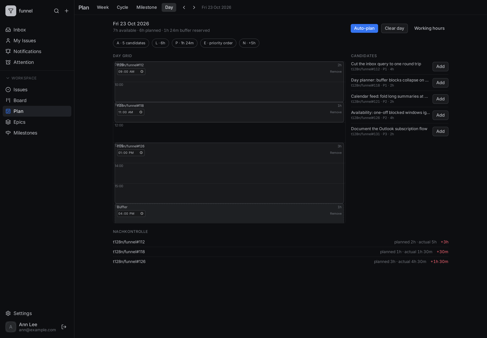
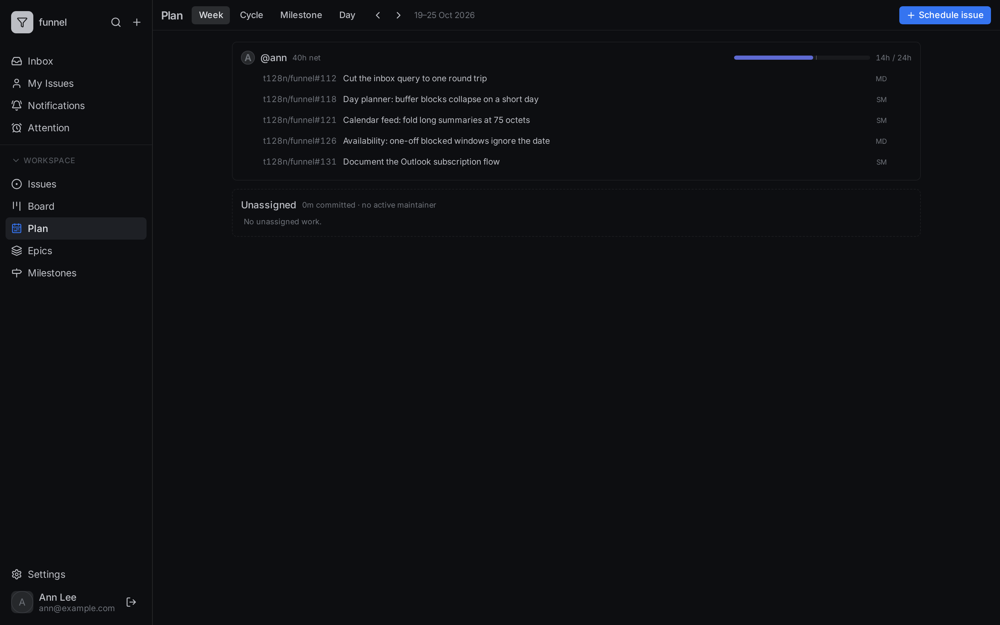
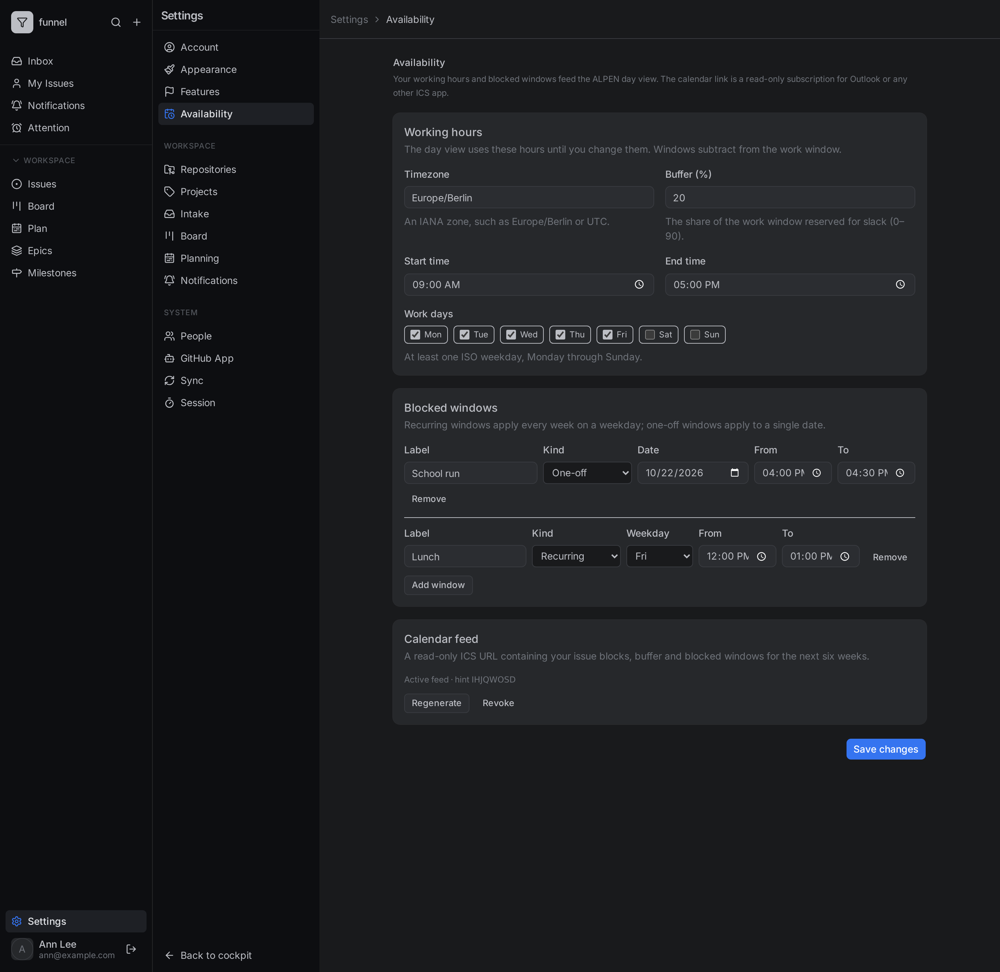

# Plan your day

Use the Day horizon of `/plan` to turn the week's plan into a timed day, using your own working hours and unavailable windows. The day view is called **ALPEN**: Aufgaben (candidates), Länge (length), Puffer (buffer), Entscheiden (decide) and Nachkontrolle (review).

The Day tab sits next to the existing week, cycle and milestone horizons; the week plan still decides *what* is scheduled, and the day only decides *when*.

Your availability and day plan are personal. Any signed-in viewer can edit their own rows; the `/api/me/*` routes need a session and never a `write` role, and they touch only the caller's data. Admin defaults in `planning.work_defaults` apply until you save your own hours.

## Set your working hours

1. Open **Settings → Availability** (`/settings/availability`).
2. Pick your IANA timezone, such as `Europe/Berlin`.
3. Enter the work window as a start and end time, for example `09:00`–`17:00`.
4. Toggle the weekdays you work (ISO 1–7, Monday through Sunday).
5. Set the buffer percentage (`0`–`90`, default `20`) that auto-plan reserves for slack.
6. Add unavailable windows:
   - **Recurring** — one weekday plus a time range, for example `Lunch` every day 12:00–13:00.
   - **One-off** — one real `YYYY-MM-DD` date plus a time range, for example a Tuesday appointment.
   - Give each window a label of at most 60 characters. Exactly one of weekday or date is set per window.
7. Select **Save changes**.

Windows subtract from the work window; overlapping windows count once. An absent per-viewer row uses the admin defaults, so the page opens prefilled with them.

## Plan a day

1. Open **Plan** and choose the **Day** tab. The URL is `/plan?horizon=day&day=YYYY-MM-DD`; a malformed date falls back to your local today.
2. Review the candidate list. Candidates come from the Monday week containing that date: open, sized issues assigned to you or unassigned, ordered P1 → P2 → P3 → unprioritized, then issue number.
3. Select **Auto-plan**. Funnel fills the available ranges in that order, spending at most `available − buffer`, and writes an explicit **buffer** block for leftover space of 15 minutes or more. A non-work day yields no blocks.
4. Adjust the plan:
   - **Add** a candidate as an issue block.
   - **Remove** a block.
   - Edit a block's start time; saving resaves the whole day.
5. Select **Clear day** to remove every block for that date.

Issue blocks carry the issue's estimate as their length. A buffer block has no issue and is excluded from per-issue review.

## Overrun the work window manually

Auto-plan never exceeds your working hours, but a manual plan may. Blocks outside the work window — early, late, on an unavailable window, or on a non-work day — are accepted and the day view flags the overrun. This is deliberate: a real day sometimes starts before the calendar or runs past it. Only auto-plan enforces the hours and the buffer, so move a block manually when you mean it.

## Review planned versus actual

The day view shows planned issue minutes, planned buffer minutes, and a per-issue review. Review compares each issue's planned minutes with its actual minutes clipped to your local day, and shows the variance as `actual − planned`. Buffer time is shown separately and never counted as issue work.

## Subscribe Outlook to the calendar feed

The calendar feed is a read-only ICS file for one viewer. Anyone holding the URL can read the feed, so treat it as a secret.

1. Open **Settings → Availability** and use the create-link action for the calendar feed.
2. Copy the URL now. It is shown once and looks like `https://funnel.example.com/api/calendar/<token>.ics`; only a hash and an eight-character hint are stored, so Funnel cannot show it again.
3. In Outlook, choose **Add calendar → Subscribe from web** (or **From internet**), paste the URL, name the calendar, and confirm.
4. Outlook polls the URL; Funnel caches the response for five minutes. The feed covers today − 7 days through today + 42 days in your timezone and contains timed issue blocks, buffer blocks and unavailable windows, all marked busy.

If you lose the URL, regenerate it rather than sharing the old one.

## Regenerate or revoke the feed

- **Regenerate** issues a new token and invalidates the previous URL immediately. Re-subscribe Outlook with the new link; the old subscription returns `404`.
- **Revoke** deletes the feed token. The current URL stops working at once, and repeating revoke is harmless. Existing Outlook subscriptions fail until you create a new link.

## Daylight saving time

Day blocks are local minutes from midnight, so they follow your wall clock across a daylight saving change rather than shifting with UTC. When converting a block to an instant:

- A wall time inside a spring-forward gap shifts forward by the gap length, so `02:30` becomes `03:30`.
- An ambiguous fall-back wall time resolves to the earlier instant.

The ICS feed always writes `DTSTART` and `DTEND` in UTC, so Outlook shows the block at the intended local time.

## Related

- [Settings reference](../../reference/settings.md) — `planning.work_defaults` and its validation.
- [Database schema](../../reference/database-schema.md#state_day_block) — `state_day_block`, `state_work_hours` and `state_calendar_feed`.
- [HTTP API](../../reference/http-api.md#availability-day-plans-and-calendar-feed) — the `/api/me/*` routes and the public ICS route.
- [Configure estimates and weekly plans](../configure/planning.md) — estimates, capacity and the week planner.
- [The workflow model](../../explanation/workflow-model.md#days-sit-inside-the-week) — why the day view is a projection, not a second backlog.
