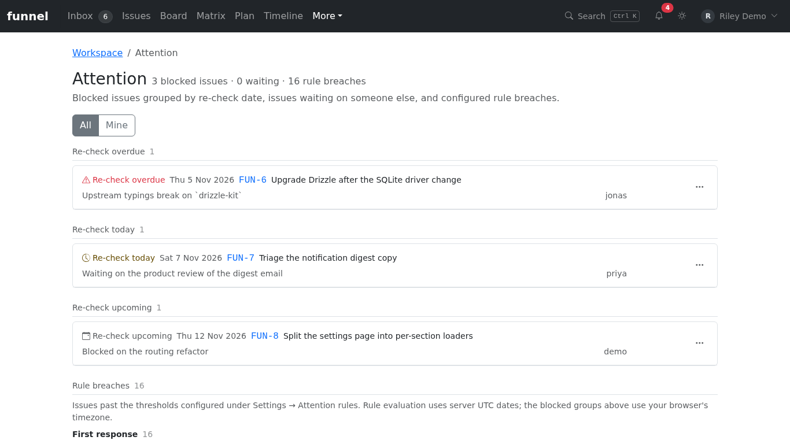

# Review work needing attention

Use **More → Attention** to find blocked work due for a re-check, work waiting on others, and issues that exceed configured attention rules. Select **Mine** to focus on your issues, or **All** to see the whole scope.

## Review blocked work

Blocked issues with a re-check date appear under **Re-check overdue**, **Re-check today**, or **Re-check upcoming**. Open an issue to inspect its blocker. The row actions allow writers to reschedule the re-check, assign the issue to themselves, or start the close flow. A re-check date does not automatically unblock or close the issue.

Blocked-date groups use the browser's local timezone; upcoming covers the next seven days. A blocked issue without a re-check date is not in those date groups. See [Close, reopen and block issues](close-reopen-block.md) to record or clear a blocker.

## Review waiting work and rule breaches

Waiting is separate from blocking: it records that a response or external action is needed. The Waiting section includes issues without a re-check date; clear waiting when the dependency has been resolved. See [Mark an issue as waiting](triage-intake.md#mark-an-issue-as-waiting).

Rule breaches show issues past the enabled first-response, stale-open, waiting or re-check thresholds. Administrators configure these thresholds in **Settings → Attention**. Unlike blocked-date groups, rules use server UTC dates. See [Attention rules](../../reference/attention-rules.md) for exact thresholds, clock boundaries and notification behavior.
