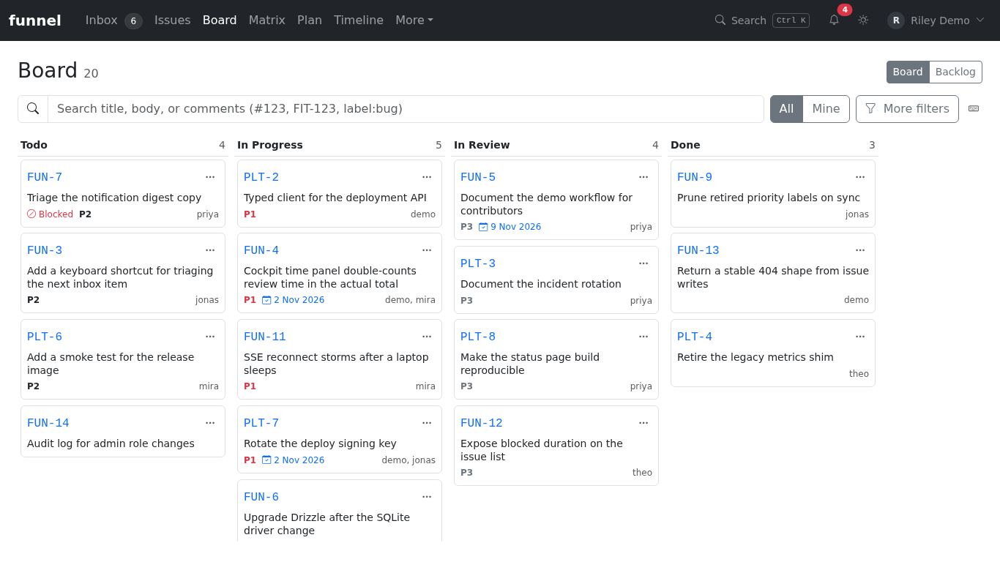
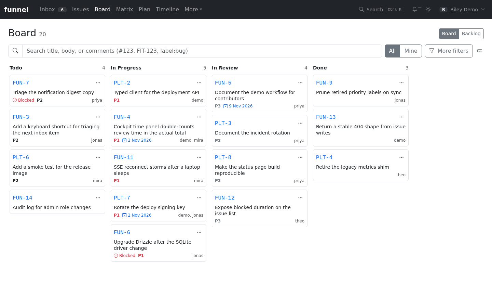

# Use the board

This guide explains how issues are arranged on the board, how to move them, and how the Done window and WIP limits behave.

Sign in and open **Board**. A `read` account can browse; moving issues requires `write` or `admin` and a GitHub token with permission to edit them.

## Stages and columns

Funnel's status board has five columns: Backlog, Todo, In Progress, In Review and Done, and the board query returns all five. In the kanban surface, Backlog is rendered as a separate list rather than a lane, so the lanes you see are Todo, In Progress, In Review and Done. The **Board / Backlog** switch in the header opens the Backlog list.

*The board's four lanes, with each card showing its reference, priority and assignee, plus blocked and planned markers.*

| Stage | Column label | Where it appears |
| :--- | :--- | :--- |
| `backlog` | Backlog | The **Backlog** list, opened with the **Board / Backlog** switch in the header |
| `todo` | Todo | Kanban lane |
| `in-progress` | In Progress | Kanban lane |
| `in-review` | In Review | Kanban lane |
| Done | Done | Kanban lane, limited to issues closed as completed inside the retention window |

Open issues need a status label to appear in a lane; an untriaged open issue lives in the Inbox instead. A closed issue appears only in Done, and only when its state reason is `completed` and its close time falls inside the Done window. Issues closed as **Not planned** are omitted from the board entirely.

Blocking is an orthogonal flag, not a column. A blocked issue stays in its stage and shows a blocked marker on its card. See [Close, reopen and block issues](close-reopen-block.md).

When the lanes contain issues from more than one repository, each card also shows the repository name next to its short reference (`FIT-12`). The full `owner/name#number` is available in the reference's tooltip.

## The Done window

Done is bounded by `board.done_days`. The default is 14 days and it is edited in **Settings → Board**. The server computes a cutoff of “now minus the configured number of days” and includes closed-completed issues whose `closedAt` is at or after that cutoff. The Done column header tooltip states the window, for example “Issues closed in the last 14 days”.

An issue that was closed as completed earlier than the window disappears from Done; it is still available in the Issues stream. Setting the window to `0` effectively leaves no completed issues in Done.

## Filter and search

The board offers repo, status, assignee, priority, size and label filters plus search, together with the **All/Mine** switch. There is no state switch: open issues appear in the open lanes and completed issues in Done. The status filter is ignored on the board because the lanes already partition by status.

## Move an issue

### Drag and drop

Drag a card from one lane to another.

- Moving between open statuses applies the new status optimistically, so the card lands in the target lane immediately. If the write fails, the card rolls back and a toast reports the error.
- Dropping into **Done** does not write a label. It opens the structured close dialog; the card moves only after you confirm a resolution and note.
- Dragging a card out of **Done** opens the structured reopen dialog with the target lane as the requested status. The card moves only after you confirm a note.
- Reordering cards within the same lane is visual only. The board does not store a rank or position; the only persisted change is the status.

A drop target accepts the card while you drag, and the source lane keeps a thin insertion shadow rather than reshuffling the whole column.

### Card menu

Each card's **Issue actions** menu contains:

- **Move to** — a radio list of Backlog, Todo, In Progress, In Review and Done. Choosing Done on an open issue raises the close dialog. Choosing another status on a closed card raises the reopen dialog.
- **Block… / Unblock…** — the structured blocker dialog.
- **Close issue / Reopen issue** — the same guarded flows as the inspector.
- **Open details** — opens the card in the inspector.

The card's priority metadata is display-only: a `P1`–`P3` token. Open the issue's Inspector **Priority** popover to set impact and urgency; priority is derived there. Size, labels and assignees are displayed on the card, not edited there. The hover tray can assign the issue to you.

`read` users can browse the board and open cards, but dragging is disabled and the per-column **New Issue** control is hidden. The server still enforces the role on every write.

## WIP limits

Work-in-progress caps are configured per stage in **Settings → Board** under `board.wip_limits`. Limits can be set for Backlog, Todo, In Progress and In Review; Done is never capped.

- A lane with a cap shows `count / limit` in its header.
- When the count exceeds the cap, the count turns to a warning colour. The limit is advisory: Funnel does not block a drop or a status change that exceeds it.
- Because Backlog has no lane, its configured cap is not displayed in the Backlog list.

## Keyboard navigation

The board uses one roving tab stop: Tab enters the board at the active card, and the arrow keys move focus.

| Key | Action |
| :--- | :--- |
| `↑` / `↓` | Move focus to the previous or next card in the same lane |
| `←` / `→` | Move to the nearest non-empty lane in that direction, keeping the same position where possible |
| `Space` | Start a keyboard drag on the focused card |
| Arrow keys during a drag | Move the dragged card |
| `Space` during a drag | Drop the card |
| `Enter` | Open the focused card's details |
| `X` | Open the focused card's details |
| `S` | Open the focused card's status menu |

While a drag is active, the drag library owns the arrow keys; the global card navigation is suspended. `X` and `S` act on whichever card currently has focus and do nothing when no card is focused.

The keyboard icon in the board header opens a shortcut legend listing **New issue**, **Search**, **Open card**, **Change status**, **Navigate cards** and **Move card**. The global shortcuts are documented in [Keyboard shortcuts](keyboard.md).

## Related

- [The workflow model](../../explanation/workflow-model.md)
- [Reserved labels](../../reference/reserved-labels.md)
- [Roles and permissions](../../reference/roles-and-permissions.md)
- [Close, reopen and block issues](close-reopen-block.md)
- [Keyboard shortcuts](keyboard.md)
- [Review work needing attention](attention.md)
- [Plan a week](plan-work.md)
