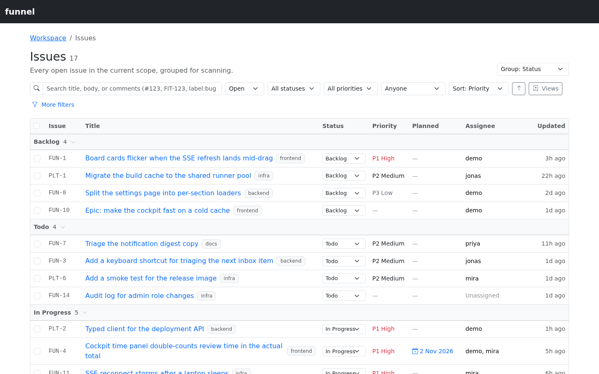
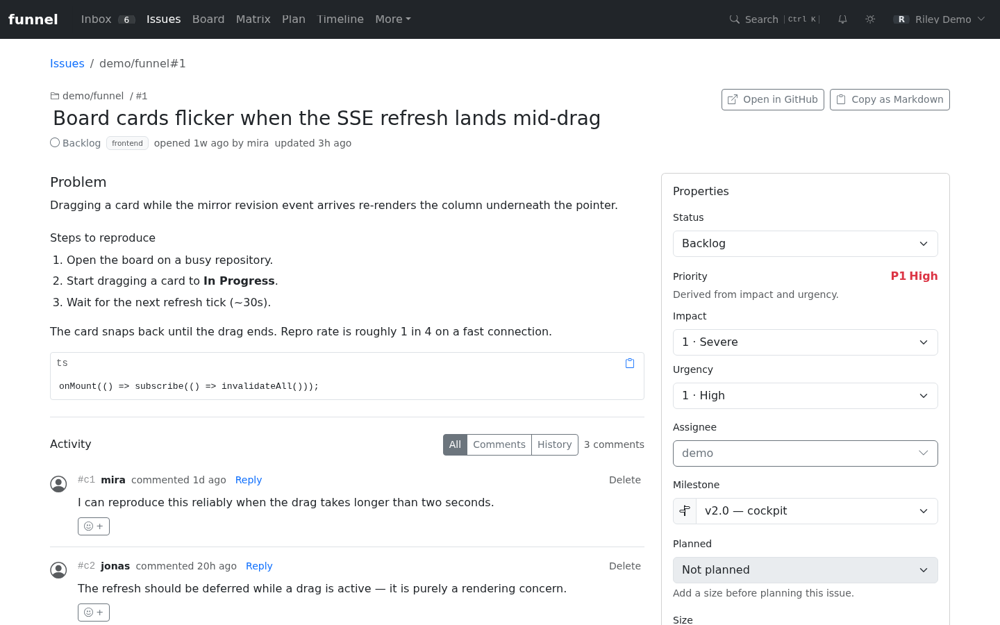

# Create and edit issues

This guide explains how issues are created in Funnel, how to create them directly through the API, and how to edit their fields in the inspector.

## Choose a creation path

| Path | Who it is for | What happens |
| :--- | :--- | :--- |
| **New issue** in the cockpit (`C`, or the **New Issue** control in an empty board column) | People working inside Funnel | Opens the in-app create dialog. Submitting creates the GitHub issue immediately with the signed-in user's token. |
| `/intake` | Reporters outside the cockpit, or anyone filing a report for triage | Public submission form. Submitting stages the report; a triager accepts it and chooses the repository. |
| `POST /api/repos/{owner}/{repo}/issues` | Integrations and automation | Creates the GitHub issue immediately, with the signed-in user's token. |

The cockpit create dialog is separate from `/intake`; it does not stage a submission. `/intake` remains the external path where a reporter submits text and a maintainer triages it later.

| What you want to set | Where it is set in the cockpit dialog |
| :--- | :--- |
| Repository | The **Repository** picker, defaulting to the instance's default repository |
| Status | The **Status** picker. A board column prefills its own status; **No status** leaves the issue untriaged (Inbox) |
| Size | The **Size** picker |
| Priority | The **Impact** and **Urgency** pickers; priority is derived from the pair |
| Labels and assignees | The **Labels** and **Assignees** pickers. Labels excludes the reserved vocabulary |
| Milestone | The inspector after creation |
| Blocked flag and blocker details | The inspector or board after creation |

### Create through the cockpit

1. Press `C`, or choose **New Issue** in an empty board column. Both open the same dialog; the column prefills that open status. **Done** is a closed window, not a status, so it does not prefill one.
2. Choose the repository. It defaults to the instance's default repository; only configured repositories are offered.
3. Enter a **Title**. It is required, trimmed, and limited to 256 characters.
4. Enter a **Description**. Markdown is supported and the body is limited to 65,536 characters.
5. Optionally choose **Status**, **Impact**, **Urgency**, **Size**, **Assignees**, and non-reserved **Labels**. When both impact and urgency are set, the dialog previews the derived priority.
6. Choose **Create issue**. The issue is created on GitHub immediately. On success the dialog closes, the mirror and feeds refresh, and a confirmation appears with an **Open on GitHub** link. A failed request keeps the dialog open with the error inline so you can correct it.

The `C` shortcut, the board control, and the dialog itself are limited to `write` users. `read` users can browse the cockpit but cannot create from it; `/intake` remains available as the external submission path.

### Submit through the public intake form

1. Open `/intake` directly (or share that URL with the reporter).
2. Enter an **Issue title**. It is required, trimmed, and limited to 256 characters.
3. Enter a **Description**. Markdown is supported and the body is limited to 65,536 characters.
4. Optionally choose a source (Email, Chat, Meeting, Walk-in, Self-Service) or leave it blank. The form submits with `⌘`/`Ctrl` + Enter.
5. Submit. The draft is staged, not created on GitHub.
6. A triager accepts it from the Inbox, choosing the repository, status and any size. The default status is `backlog`. See [Triage intake submissions](triage-intake.md).

The form keeps a shareable deeplink in the address bar as you type and shows a character counter near the title limit. A failed submission keeps your text and shows the validation error inline.

### Create through the API

`POST /api/repos/{owner}/{repo}/issues` creates a GitHub issue directly. It requires a `write` session and the signed-in user's GitHub token. The repository must be configured in Settings → Repositories; any other repository is rejected with `400 Repository … is not configured`.

| Field | Required | Rules |
| :--- | :--- | :--- |
| `title` | Yes | String, trimmed, non-empty, at most 256 characters |
| `body` | No | String, at most 65,536 characters; defaults to an empty body |
| `labels` | No | Array of non-empty, trimmed label names |
| `assignees` | No | Array of non-empty, trimmed GitHub logins |
| `status` | No | `backlog`, `todo`, `in-progress` or `in-review` |
| `impact` | No | `sev`, `mod` or `min` |
| `urgency` | No | `high`, `mid` or `low` |
| `size` | No | `sm`, `md` or `lg` |

Example:

```json
{
  "title": "Board crashes when saving a filtered view",
  "body": "Steps to reproduce…",
  "labels": ["bug", "needs-triage"],
  "assignees": ["octocat"],
  "status": "todo",
  "impact": "mod",
  "urgency": "high",
  "size": "md"
}
```

A successful request returns `201` with `{ "number": …, "htmlUrl": "…" }`. Validation failures return `400` with a `message` and an `issues` array. A GitHub rejection is passed back with GitHub's status where available. After a successful create, Funnel schedules a background refresh so the new issue appears in the mirror.

`done` is not a valid `status`: Done is the closed state, not a label. Close an issue through the structured close flow instead. `blocked` has no dedicated create field: include the `blocked` label in `labels` if you need to set the flag, but that does not write the structured blocker metadata, so use the inspector or board block flow when the issue should appear in Attention.

An issue created without a status label is untriaged and appears in the Inbox, not in All Issues or on the board.

## Reserved labels and one-per-group behaviour

Status, impact, urgency and size are represented by reserved labels. Funnel keeps at most one label from each active group. Priority is derived from impact × urgency and is not a label.

| Group | Values | Absence means |
| :--- | :--- | :--- |
| Status | `backlog`, `todo`, `in-progress`, `in-review` | Untriaged (Inbox) |
| Impact | `sev`, `mod`, `min` | Not assessed |
| Urgency | `high`, `mid`, `low` | Not assessed |
| Size | `sm`, `md`, `lg` | Unestimated |
| Flags | `blocked` | Not blocked |

For a direct API create:

- `labels` is normalised first, case-insensitively. If it contains more than one label from the same group, the first one wins.
- The `status`, `impact`, `urgency` and `size` shortcuts then replace any sibling already present in `labels`. For example, `labels: ["todo"], status: "in-progress"` creates the issue with `in-progress`, not `todo`.
- Retired `p1`–`p3` labels are dropped from the outbound set.
- Non-reserved labels are preserved.
- The `blocked` flag has no dedicated shortcut; a `blocked` entry in `labels` is kept as a flags label.

The inspector uses the same rule when you change a status, impact, urgency or size: it reads the issue's authoritative label set from GitHub, removes every label in that group, and writes the replacement in one request. See [Reserved labels](../../reference/reserved-labels.md) for the full vocabulary.

## Edit an issue

Open an issue from Issues, the Inbox, or the board. The inspector pane is the editor. Every control below requires the `write` role; `read` users see the same content with the controls disabled.



*The Issues list is the entry point to an issue; status grouping, priority and planned week are visible before you open it.*

| Field | Control | Behaviour |
| :--- | :--- | :--- |
| Title | Inline title input | Press Enter or move focus away to save, or use the **Save** button that appears while the title is dirty. The title is trimmed; it must be non-empty and at most 256 characters. |
| Description | Click the description to edit | The textarea has **Save** and **Cancel**. `⌘`/`Ctrl` + Enter saves. The body may be empty and is limited to 65,536 characters. |
| Assignees | **Assignee** multi-select | Selecting or clearing people writes the whole assignee list, because the GitHub endpoint replaces it. Options are the repository's assignable users plus anyone currently assigned. |
| Labels | **Labels** multi-select | Adds and removes non-reserved labels. Reserved status, impact, urgency, size and flag labels, and retired priority labels, are deliberately excluded from this picker. |
| Status | Status pill | Shows **No status**, Backlog, Todo, In Progress, In Review or Done. Choosing Done opens the close dialog; choosing an open status on a closed issue opens the reopen dialog. |
| Priority | **Priority** pill + popover | Shows the derived `P1 · High`, `P2 · Medium`, `P3 · Low` or **No priority**. The popover has one slider per axis; below each slider is the current level's name and definition. Moving a slider writes that axis' reserved label; the derived token updates immediately. A **Clear priority** action removes both labels. |
| Size | Size pill | `S`, `M`, `L`, or cleared to unestimated. |
| Milestone | **Milestone** pill | Attaches, clears, or lazily creates a repository milestone. GitHub scopes milestones per repository, so the picker only offers the issue's repo. See [Use milestones](milestones.md). |
| Blocked | **Blocked** pill | Opens the block or unblock dialog. See [Close, reopen and block issues](close-reopen-block.md). |

The description editor hides the trailing `funnel_metadata` envelope used for blocker state and re-attaches it verbatim when you save, so editing prose cannot silently drop structured metadata. If the body has just been saved and the mirror has not delivered a fresh render yet, the pane shows the plain text until the refresh arrives.



*The Inspector is the editor: the description and Activity sit beside the Properties card for status, priority, assignee, milestone and plan.*

Setting the first status on an issue opened from the Inbox moves it out of the queue immediately and shows a “Triaged · moved to Issues” toast with an **Undo** action.

### Label add and remove

The label picker excludes reserved labels because those belong to their own controls. When you change the selection, Funnel compares it with the current non-reserved labels:

- New labels are sent together in one add request.
- Removed labels are deleted one at a time.
- Status, size and blocked are untouched by this control.

If a label request fails, the row rolls back and the failure is reported. A partially completed sequence can leave some labels changed on GitHub even though the UI has rolled back.

## Bulk edit issues

The issue streams — All Issues, My Issues and a milestone's issue table — support multi-select for `write` users:

1. Use the row checkbox, press Space on a focused checkbox, or press `x` while focus is anywhere in the row.
2. The header checkbox selects or clears every loaded row in the current window.
3. Use the compact bulk bar to set status, impact, urgency, size, assignee or add non-reserved labels. Snooze defers every selected issue from the Inbox.

The bar runs the same per-item writes as the Inspector, at most three at a time. On a partial failure the successful writes stay applied, the failed rows stay selected, and the bar lists each failing `owner/name#number` with its error. A fully successful action clears the selection. Selection is keyed by `owner/name` plus issue number, so an SSE refresh does not clear it; navigating away or pressing **Clear** does.

Read-only users do not see the checkboxes or the bulk bar.

## Optimistic and pessimistic writes

Funnel is optimistic where it can be, and pessimistic where correctness depends on ordering.

**Optimistic writes** apply an overlay to the local view before the network request starts. This covers the title, status, derived priority (when either axis changes), size, assignees, labels and the blocked flag. If the request fails, the overlay is removed, the previous value returns, and a toast reports the error. Dialogs show their error inline instead of a toast.

The description editor is not optimistic: it stays in edit mode until the body write succeeds, then shows the plain text until a fresh render arrives from the mirror.

**Pessimistic writes** wait for the server:

- GitHub comments, work notes and attachment uploads/deletes complete before the inspector reloads.
- Intake Accept, Dismiss and Duplicate wait before the staged row is removed; the row is hidden optimistically but restored on failure.
- Close, reopen, block and unblock post their note as a comment first, then apply the state or metadata change. The optimistic overlay still applies before the write completes, and rolls back if the sequence fails.

## Post-write refresh

Issue, label, comment, work-note and attachment writes publish a local `issues` event. GitHub-backed writes also schedule a background refresh of that single issue from GitHub. The SSE client then refreshes the current streams and signals the inspector to refetch.

Overlays are dropped by value, not by refresh count: an overlay is removed only once the authoritative issue actually reflects the change. A refresh that arrives before the mirror catches up therefore leaves the optimistic value in place instead of bouncing it back.

## Related

- [The workflow model](../../explanation/workflow-model.md)
- [Reserved labels](../../reference/reserved-labels.md)
- [Roles and permissions](../../reference/roles-and-permissions.md)
- [Triage intake submissions](triage-intake.md)
- [Close, reopen and block issues](close-reopen-block.md)
