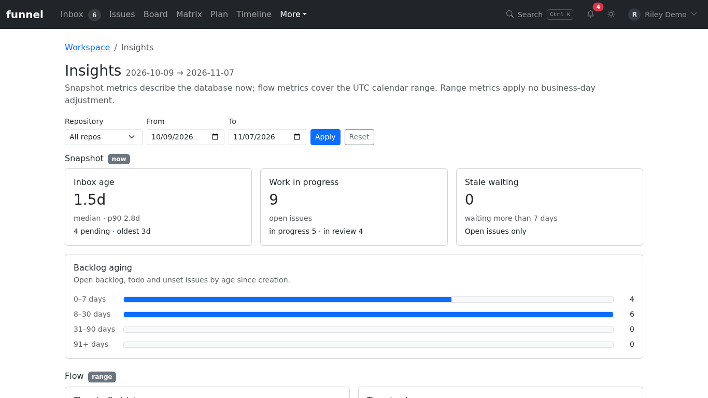
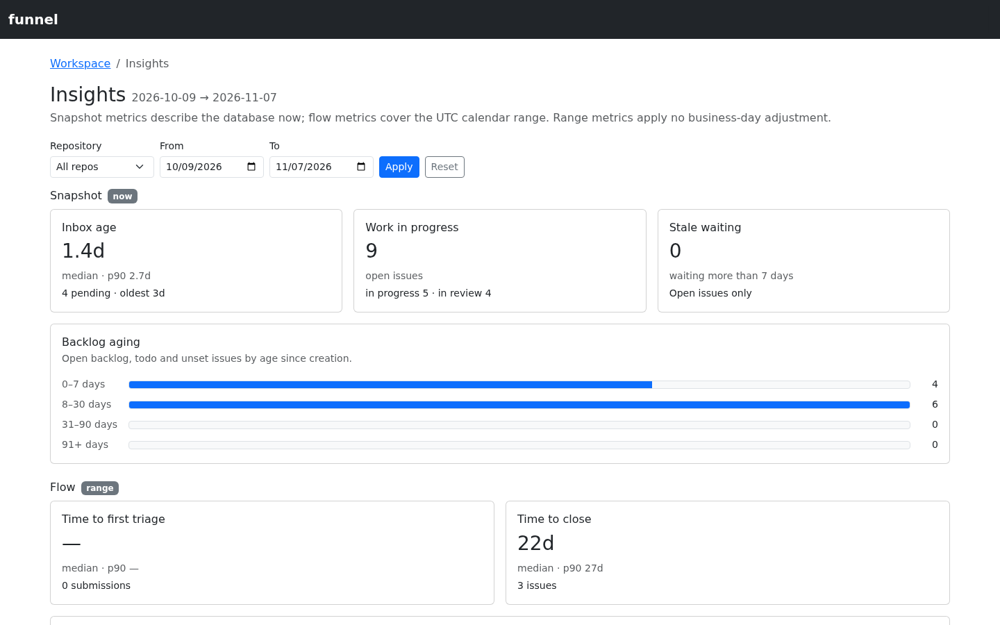

# Read insights

Use **Insights** to review the current queue and work in progress alongside activity over a date range. This is a read-only view; it does not change issues or submissions.

Sign in with at least the `read` role and allow the repository mirror to sync before comparing results.

## Choose a scope

Open **More → Insights**. Select a repository or **All repos**, choose the **From** and **To** dates, and select **Apply**. Select **Reset** to return to the default scope. The effective dates appear beside the page title.

Dates are UTC calendar days. A missing endpoint uses its default boundary; a malformed or reversed range falls back to the full default range. Check the dates shown before comparing results.

## Read the dashboard

The **Snapshot** section describes the current state, not a historical snapshot at the selected end date. It includes Inbox age, work in progress, stale waiting and backlog aging. The **Flow** section covers events in the selected range, including time to first triage, time to close and throughput.

*The Snapshot metrics describe the queue now; the Flow metrics below cover the selected date range.*

Empty or sparse data is possible, particularly after the first sync. Do not treat an empty measure as proof that no work occurred before Funnel began recording its local events. For definitions, inclusions and clock boundaries, see the [Insights reference](../../reference/insights.md).

## Next

Use [Attention](attention.md) to review work that needs follow-up, or [triage the Inbox](triage-intake.md) to act on the queue.
