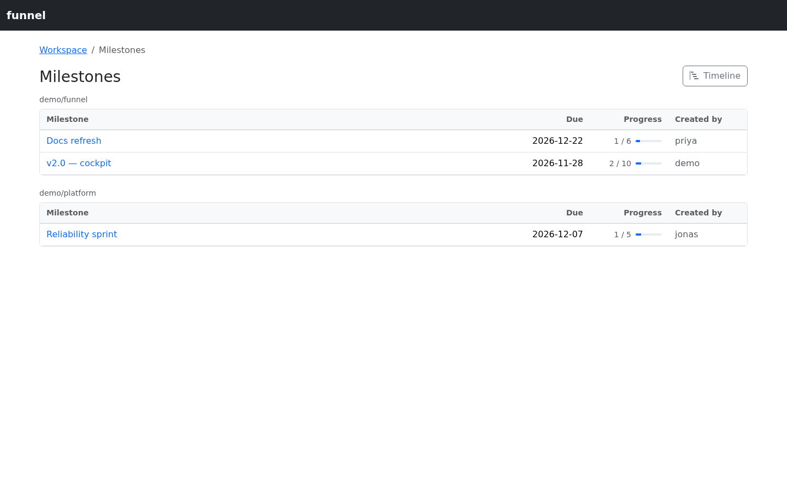
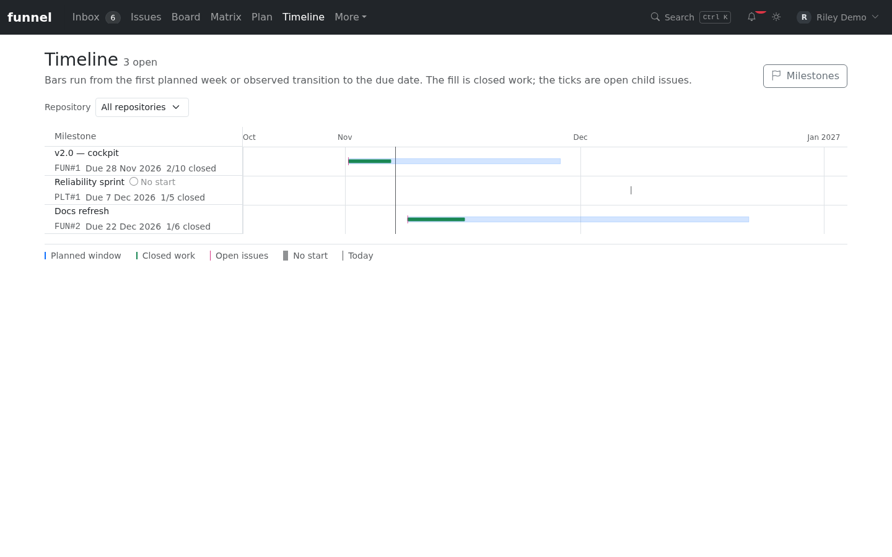

# Use milestones

This guide shows you how to browse and filter mirrored GitHub milestones, read the milestone timeline, and set or create one from an issue.

Sign in with at least `read` and ensure the repository has synced. Setting or creating a milestone requires `write` or `admin` and a GitHub token with permission for the repository.

## What a milestone is in Funnel

GitHub scopes a milestone to exactly one repository. Funnel preserves that model: a milestone is identified by `owner/name` plus its number, and the same title in two repositories is two milestones, not one cross-repo object.

The mirror is read-only apart from one lazy-create path. Funnel never renames, closes, reopens or deletes a milestone; manage those on GitHub. It can create a milestone when an issue is assigned to a title the repository does not have yet.

## Browse milestones

Select **Milestones** in the sidebar to open `/milestones`.



*Milestones are grouped by repository, with due date, progress and creator for each entry.*

- Milestones are grouped by repository, with a progress bar showing closed issues against the total (`closedIssues / (openIssues + closedIssues)`).
- Each entry shows its due date, and a `closed` marker when the milestone is closed.
- The creator is shown when the mirrored GitHub user can be resolved.
- Select an entry to open `/milestones/{owner}/{repo}/{number}`, which lists every mirrored issue attached to it — open and closed, triaged or untriaged.

If a milestone is missing, check its repository and the last successful sync. A milestone with no due date is listed separately on the timeline, not in the chart.

The list is built from the local mirror, so it reflects the last successful sync or refresh. If a milestone was created directly on GitHub, it appears after the next repository cycle; a milestone created from the Inspector is refreshed immediately.

## Filter and group issues by milestone

The issue feeds support milestones as a filter dimension and as a grouping option.

- In the filter popover, choose one or more milestones, or **No milestone**.
- The URL uses repo-scoped slugs: `?milestone=owner/name#number`. Repeat the parameter or comma-separate values to select several. `?milestone=none` selects unmilestoned issues.
- In the **Group by** control, choose **Milestone** to section the feed by milestone title. The option appears only when at least one mirrored repository has a milestone. Issues without a milestone are grouped under **No milestone**.

Milestone filtering is available in the Inbox, Issues and Board queries wherever the shared filter bar is rendered. The milestone dimension combines with the others as OR within the dimension and AND across dimensions.

## Read the timeline

Select **Timeline** in the sidebar, use the **Timeline** action on the Milestones page, or open `/timeline`.

The timeline is an Apache ECharts Gantt over open milestones with a due date. It is a projection of facts Funnel already holds; it adds no per-issue dates and has no drag, resize or save path.

- Each row is one open milestone, earliest due date first. The left column is a normal HTML list, so the title is a real link to `/milestones/{owner}/{repo}/{number}`; the canvas beside it carries the same rows.
- A bar starts at the earliest start signal Funnel has: the first Monday week planned for one of the milestone's issues, or the first observed `in-progress`/`in-review` status transition, whichever comes first. It ends at the milestone due date.
- The pale planned window is the full start-to-due span. The solid inner bar is the closed fraction of the milestone's issues, so it matches the `closed/total` count in the row.
- The small ticks inside a row are the milestone's open child issues, placed at their plan week or the moment they first moved into `in-progress`/`in-review`. Closed children are not shown.
- The legend below the chart names every series: **Planned window**, **Closed work**, **Open issues**, **No start** and **Today**. **After due** appears only when a planned window starts after its own due date.
- A milestone with no start signal still gets a row: it shows a due-date tick and a **No start** label instead of a bar.
- A milestone with no due date is not given a guessed end. It is listed in the **No due date** table below the chart with its progress and start, and stays out of the Gantt.
- If the only start signal falls after the due date, the row keeps both dates and adds **After due** rather than clamping the bar to fit.
- Use the repository selector to narrow the chart to one `owner/name`; the URL becomes `/timeline?repo=owner/name`. The selector still lists every repository that has an open milestone.



*The timeline plots each open milestone from its first start signal to its due date; the legend names every series.*

The view is read-only. To change what you see, change the inputs: plan the issue, move it through the workflow, or correct the milestone on GitHub.

## Set or clear an issue's milestone

Open an issue in the Inspector and use the **Milestone** pill.

- Select an existing milestone from the repository's list to attach it.
- Select **No milestone** to remove the milestone.
- Select **New milestone…** to create one in the issue's repository, then attach it. Enter a **title** and optional **due date** (`YYYY-MM-DD`), then select **Create**. The title is trimmed, required, and limited to 256 characters.

Creating from the Inspector only creates the milestone in that issue's repository. To make the same milestone span repositories, create or attach it separately in each repository.

Attaching or clearing a milestone requires the `write` role and a GitHub token with permission to edit the issue. GitHub remains the authority; Funnel schedules a single-issue refresh after the write, and the success or failure is reported by the Inspector.

After a successful attachment the picker shows the milestone; after clearing it shows **No milestone**. If creation fails, correct the error in the dialog and retry. Creation and attachment are separate GitHub operations: if creation succeeds but attachment fails, select the existing milestone instead of creating another one.

## API

Two endpoints cover the write paths.

`POST /api/repos/{owner}/{repo}/milestones` creates a repository milestone with the signed-in user's token:

```json
{
  "title": "v1.0",
  "description": "First public release",
  "dueOn": "2026-12-31"
}
```

`title` is required and limited to 256 characters; `description` is optional and limited to 65,536 characters; `dueOn` is an optional `YYYY-MM-DD` date or `null`. The response is `201 { "number": 3, "htmlUrl": "…" }`. The repository must be configured in Funnel.

`PATCH /api/repos/{owner}/{repo}/issues/{number}` accepts `milestone` as a positive integer to attach a repository milestone, or `null` to clear it. Omitting the field leaves the milestone untouched. See the [HTTP API reference](../../reference/http-api.md#milestones) for the full contract.

## Related

- [Create and edit issues](create-and-edit-issues.md)
- [The workflow model](../../explanation/workflow-model.md)
- [HTTP API](../../reference/http-api.md#milestones)
- [Routes and pages](../../reference/routes-and-pages.md)
- [Database schema](../../reference/database-schema.md#mirror_milestone)
- [Plan a week](plan-work.md) — commit milestone issues to a week.
