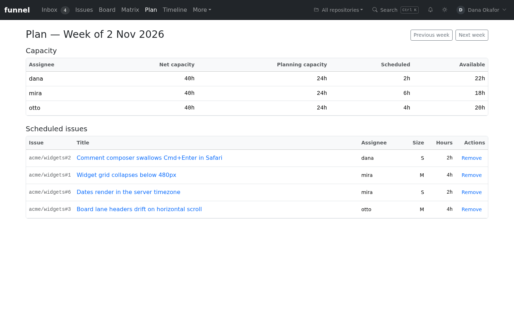
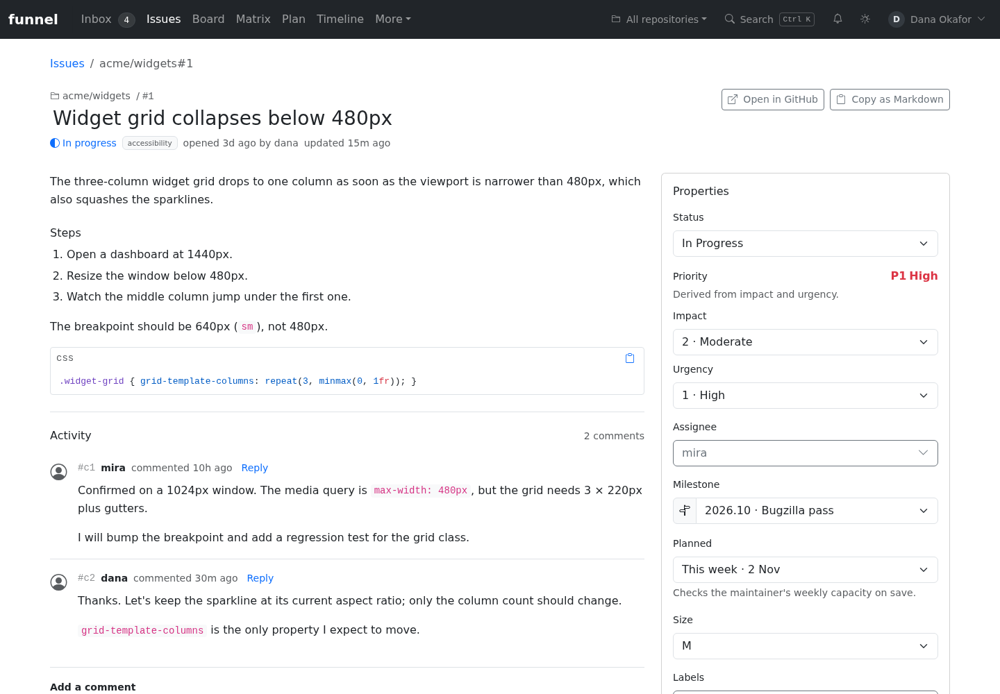
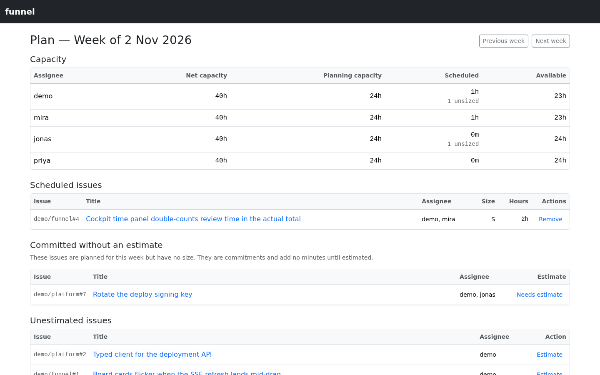
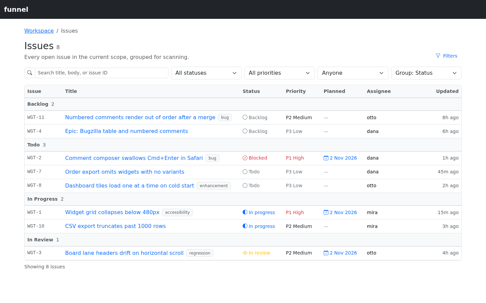

# Plan a week

This guide shows you how to commit work to a week and read the resulting capacity. Planning is a property of an issue, not a separate mode: you commit one open, sized issue to one Monday week from the issue's **Properties** panel, and `/plan` shows the capacity and the work committed to that week. It assumes planning is already configured; see [Configure estimates and weekly plans](../configure/planning.md) for the one-off setup.

Sign in with at least `read` to inspect the plan. Scheduling, moving or removing work requires `write` or `admin`. To schedule an issue it must be open, sized and assigned to an active configured maintainer.

## Open the week

Open **Plan** in the navigation bar. The page opens on the current week and reads from top to bottom:

1. the selected week;
2. a capacity summary, one row per active maintainer;
3. the issues committed to the week;
4. issues that need attention because they are unestimated or unassigned.

Use **Previous week** and **Next week** beside the heading to move through weeks. **This week** returns to the current week. The URL carries the week (`/plan?week=YYYY-MM-DD`), so it can be bookmarked or shared.

*The week planner shows capacity, the scheduled issues, and the work that still needs an estimate.*

## Schedule an issue

1. Open the issue from **Issues**, **Board**, **Inbox** or any other view.
2. In **Properties**, set **Planned** to **This week**, **Next week**, a nearby week, or a past week.
3. The issue is committed immediately. The control shows an inline error and rolls back if the server rejects it.

The issue appears in the week's scheduled-issues table. If the issue has several assignees, the estimate is split evenly across the active, configured maintainers among them; the remainder goes to the first configured assignee. Scheduling requires at least one assignee who is active and configured. The picker explains the three blockers:

- **Closed** — closed issues cannot be planned.
- **Add a size** — an issue without a size label is unestimated and cannot be scheduled.
- **Assign an active maintainer** — an issue assigned only to unconfigured or inactive people is rejected with `400`.

The **Planned** column in the Issues list and the calendar marker on each board card show the committed week without opening the issue.

## Read the capacity summary

The capacity table shows one row per active maintainer:

| Column | Meaning |
| :--- | :--- |
| **Assignee** | The configured maintainer. |
| **Net capacity** | Their net weekly hours from Planning settings. |
| **Planning capacity** | The share of net hours that commitments may fill (`net × allocation`). |
| **Scheduled** | The estimate minutes committed to them for this week. |
| **Available** | Planning capacity minus scheduled. A negative value is shown as over capacity. |

Capacity is `floor(net weekly minutes × allocation percent / 100)`. With the default 60%, a maintainer with 20 net hours has 12 hours of issue capacity per week. The table is a numerical summary; it does not draw progress bars.

## Move or remove work

- To move an issue, change **Planned** to another week. The old week is freed before the new cap is checked.
- To remove it, set **Planned** to **Not planned**, or use **Remove** in the scheduled-issues table on `/plan`.
- Removing is idempotent.

After a successful move, check the destination week for the issue and its updated capacity. After removal, the issue is no longer committed to that week. If **Remove** fails on the planner, check the error and select **Retry**.

## Handle the cap

If a write would exceed a maintainer's cap, Funnel rejects it with `409` and names the maintainer, the cap, the projected committed minutes and the excess. The same check runs through the API, so a direct call cannot bypass it. The error appears beside the **Planned** picker; move the issue, shrink it, or remove something else.

The cap applies to plan mutations only. If a later GitHub edit — a new assignee or a larger size label — pushes a maintainer over, the capacity table shows the over-cap state but does not rewrite the plan.

## Read the other tables

- **Unassigned** — work whose assignees have no active, configured capacity. It has no cap. The section is omitted when no scheduled issue is unassigned.
- **Unestimated** — open issues with no size label, with an **Estimate** action that opens the issue. They never contribute committed minutes.

## If the page is read-only

`read` viewers can see the week and all capacity but cannot change **Planned** or remove an issue. Ask an admin for `write` if you need to change the plan.

## Related

- [Configure estimates and weekly plans](../configure/planning.md) — the size map, net hours and allocation.
- [Planning and time reference](../../reference/planning-and-time.md) — formulas, periods, statuses and APIs.
- [Why planning and actuals work this way](../../explanation/planning-and-actuals.md) — the rationale and trade-offs.
- [Plan and track a week](../../tutorials/plan-and-track-a-cycle.md) — a guided first run.
- [Track time and delays](track-time-and-delays.md) — compare planned estimates with observed work.
