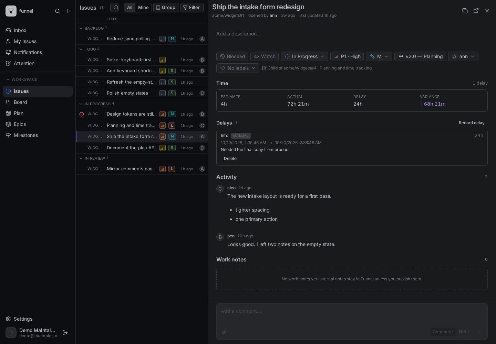
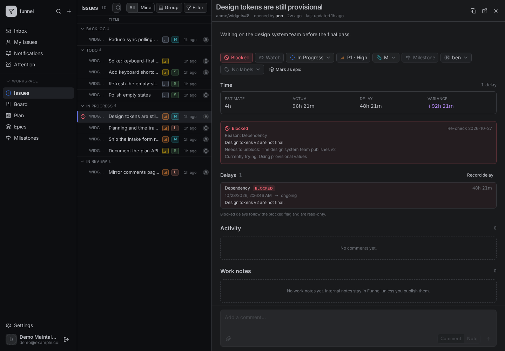

# Track time and delays

Funnel observes how long issues actually spend in flight and why work waits. This guide explains where actual time comes from, how to read it in the Inspector, and how to record a delay.

Actual time and delays are Funnel-owned: they are never written to GitHub. Every signed-in user can read them; recording or editing a delay requires the `write` role.

Open a mirrored issue in the Inspector. Blocking an issue also requires permission to make the corresponding GitHub changes; manual delays do not.

## Where actual time comes from

Funnel keeps a durable event log of the workflow transitions it observes during sync: status changes, open/closed changes and blocked-flag changes. Actual time is the union of intervals where an issue is **open** and its status is `in-progress` or `in-review`.

- `in-review` counts as active time. The work is still with the team while it waits on a reviewer.
- Closing ends the active interval at the issue's `closedAt` time when known, otherwise at the close event.
- Reopening starts a new active interval if the issue's status is still `in-progress` or `in-review`.
- Time while the issue is in `backlog`, `todo`, untriaged or closed is not actual time.

Tracking starts when Funnel first observes an issue. The migration establishes baselines at deployment and the sync worker records transitions from then on. There is **no historical backfill** from the GitHub timeline, so an issue that predates the feature shows actual time from the deployment timestamp, not from its creation date. Treat the first weeks of data as partial rather than comparing them with older issues.

## Read the time block

Open an issue's Inspector to see its time block:

| Field | Meaning |
| :--- | :--- |
| **Actual** | Union of open `in-progress` and `in-review` intervals. |
| **Estimate** | Minutes implied by the current size label (`sm`, `md`, `lg`). |
| **Variance** | Actual minus estimate. A negative value means the issue finished under its estimate; a positive value means it ran over. |
| **Delay** | Union of all delay intervals, including overlaps counted once. |
| **Lead time** | Issue creation to close/now. |
| **Cycle time** | First active interval to close/now. |

The issue detail payload exposes the same values as `time`, and epic rollups sum them across children.

## Automatic delays

A delay is a time interval with a reason, an optional note and a source of `blocked` or `manual`.

When you block an issue, Funnel opens an automatic delay. The block dialog now requires a structured **reason**:

| Reason | Use it when work waits on |
| :--- | :--- |
| `dependency` | Another issue, release or team's deliverable. |
| `info` | An answer or clarification from someone. |
| `review` | Review, approval or sign-off. |
| `external` | A vendor, customer or third party. |
| `capacity` | No one is available to start or continue. |
| `other` | Anything that does not fit the list. |

The reason is stored in the issue's `funnel_metadata` block. An older blocked issue without a reason reads as `other`. Removing the `blocked` flag closes the open blocked delay, and closing the issue closes every open delay. Reopening an issue that is still blocked opens a new blocked delay rather than reviving the old interval.

Automatic delays are read-only in the Inspector: change them by unblocking or updating the block, not by editing the delay row.

## Record a manual delay

Manual delays cover waits that are not represented by the `blocked` flag. They are local-only and never touch GitHub.

1. Open the issue in the Inspector.
2. In the delay list, select **Record delay**.
3. Choose a **Reason** from the table above.
4. Optionally adjust the start and end times and add a note.
5. Select **Record delay**.

The dialog closes and the new **Manual** row appears in **Delays**. If the button is disabled, choose a reason and a valid start time, and ensure the end is not before the start. If a request fails, correct the displayed error or check the connection and retry.

A manual delay left open keeps accruing until you select **Close** on its row. You can also select **Delete** to remove a manual row. The Inspector does not offer editing an existing row; manual delays can be edited through the API. Blocked rows are automatic and cannot be changed through these controls. A successful close shows an end time; a successful delete removes the row. If either action fails, check the displayed error and retry.

A manual delay may overlap a blocked delay. Total delay time is the union of the intervals, so the overlapping minutes are counted once.

## Access and API

Reads are part of the normal Inspector payload. Writes require `write` and use the delay endpoints:

- `POST /api/repos/{owner}/{repo}/issues/{number}/delays` creates a manual delay.
- `PATCH /api/repos/{owner}/{repo}/issues/{number}/delays/{id}` closes or edits it.
- `DELETE /api/repos/{owner}/{repo}/issues/{number}/delays/{id}` removes it.

A successful write publishes an `issues` event so open Inspectors refresh.

## Related

- [Manage epics](epics.md) — rollups across related issues.
- [Close, reopen and block](close-reopen-block.md) — the `blocked` flag and structured blocker fields.
- [Planning and time reference](../../reference/planning-and-time.md) — exact actual-time and delay rules.
- [Why planning and actuals work this way](../../explanation/planning-and-actuals.md) — why tracking starts at deployment.
- [HTTP API](../../reference/http-api.md#epics-and-delays) — the delay endpoints.
- [The workflow model](../../explanation/workflow-model.md#actual-time-is-observed-not-reconstructed) — where this sits next to labels.
- [Glossary](../../reference/glossary.md) — actual time and delay.
- [Review work needing attention](attention.md) — follow up on blocked or waiting issues.
