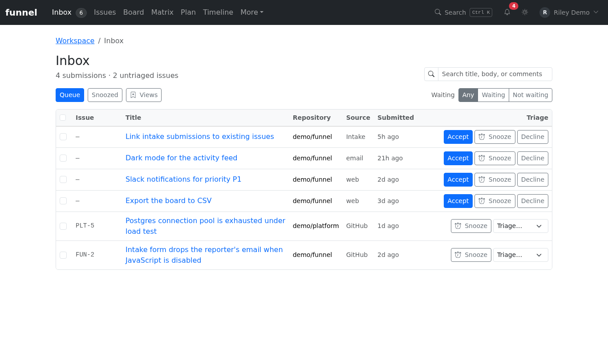

# Triage intake submissions

This guide explains how submissions reach the Inbox and how to accept, dismiss or duplicate them.

Anyone who can reach the instance can submit intake. Sign in to review the Inbox; decisions require `write` or `admin`. Accepting or duplicating also requires a GitHub user token with permission for the target repository.



## Where submissions come from

Funnel stages every external report locally before a triager decides what to do with it. There are two entry points.

| Entry point | Who can use it | Result |
| :--- | :--- | :--- |
| `/intake` form | Anyone who can reach the instance; no session is required | A staged submission, visible in the Inbox |
| `POST /api/intake` | Anonymous JSON callers, including browser clients on other origins | `201 {"id": "…"}` for a staged submission |

The `/intake` form accepts:

- **Issue title** — required, trimmed, at most 256 characters.
- **Description** — Markdown, at most 65,536 characters.
- **Add source…** — optional. The picker offers Email, Chat, Meeting, Walk-in and Self-Service; an unknown source label is preserved rather than discarded.

`GET /intake?title=…&body=…&source=…` renders a prefilled draft, and the page also writes a compact deeplink into the address bar as you type. Both forms are clamped to the limits above. The form needs no JavaScript: it posts as a plain HTML form, and submission failures render inline.

`POST /api/intake` accepts this JSON body:

```json
{
  "title": "Crash when saving a board",
  "body": "1. Open /board\n2. Drag a card\n3. See 500 in the console",
  "source": "support-portal"
}
```

`title` is required and trimmed to 1–256 characters. `body` is optional and capped at 65,536 characters. `source` is optional and trimmed. A successful request returns `201` with an opaque submission id. A malformed body returns `400` with a `message`; a body that fails validation returns `message` plus an `issues` array of human-readable reasons. The endpoint carries open CORS headers for browser callers.

Submitting creates no GitHub issue or comment. Accepting creates a new issue; marking the submission as a duplicate instead posts a comment on an existing issue without creating a new one. Dismissing writes neither. See [the workflow model](../../explanation/workflow-model.md) for why staging is separate from the GitHub mirror.

## How the Inbox is ordered

The Inbox is a single queue with two parts, always in this order:

1. **Staged** submissions, newest first. Same-millisecond ties are broken deterministically by insertion order.
2. **Untriaged issues** — open issues with no status label. These are ordered by derived priority (`P1` first, unprioritised last), then by most recently updated.

Search applies to both halves: it matches a submission's title and body, and an issue's title, body and comments. The repo, status, assignee, priority, size and label filters apply only to GitHub issues; the Inbox has no state switch. Pending submissions have no repo or workflow metadata, so they remain visible unless the search term excludes them.

The Inbox badge in the sidebar counts pending submissions plus untriaged open issues. A `read` user can browse the queue; only a `write` user can make a triage decision. See [roles and permissions](../../reference/roles-and-permissions.md).

## Snooze an Inbox item

Every Inbox row — a staged submission or an untriaged issue — has a **Snooze** control with three choices:

<video controls preload="metadata" src="../../assets/guide/cockpit-tour.mp4" aria-label="Snoozing a demo submission until tomorrow"></video>

[Watch or download the snooze walkthrough](../../assets/guide/cockpit-tour.mp4). The silent video shows a demo submission's **Snooze** menu opening, **Tomorrow** being selected, and the submission leaving the queue. The steps and alternatives follow below.

- **Tomorrow** — 09:00 local time the next day.
- **Next week** — 09:00 local time seven days later.
- **Custom date** — 09:00 local time on the date you pick.

A snoozed row leaves the queue immediately and is excluded from the sidebar badge. It returns automatically once its resurface time passes; there is no reminder or notification (those are separate roadmap work). Snoozing never archives a submission, changes a label, or touches the GitHub mirror, so the issue remains visible in All Issues, the board and the matrix.

The **Snoozed** tab on `/inbox` (`/inbox?snoozed=1`) lists deferred items with their resurface date and a **Resurface** action that clears the snooze immediately. The tab shows its own count; the queue badge never includes snoozed rows.

Snoozes are stored in `state_snooze`. Issues are keyed by `owner/name` plus issue number rather than a mirror id, so a snooze survives re-sync and mirror pruning; a pruned issue still appears in the Snoozed view so it can be resurfaced. Submissions are keyed by their staged id. The server rejects a resurface date in the past or more than one year away.

Triage clears the snooze: accepting, dismissing or duplicating a submission removes its snooze row, and writing an issue status (from the Inbox quick triage or the Inspector) removes the issue's snooze.

## Select and act on many Inbox rows

Writers can select several staged submissions and untriaged issues at once:

- Use the checkbox on each row, press Space on a focused checkbox, or press `x` while focus is anywhere in the row.
- The header checkbox selects every loaded row in the current window.
- The compact bulk bar shows how many rows are selected and splits them into issues and submissions.

From the Inbox bulk bar:

- **Issues** — set status, impact, urgency, size, assignee or add non-reserved labels. These controls apply only to the selected issues; they are disabled and labelled `Issues 0` when the selection has no issues.
- **Submissions** — **Dismiss…** opens a reason prompt. The reason is required, trimmed and limited to 500 characters, and every selected submission is archived with the same reason and its own `dismissed` event. The submission controls are disabled and labelled `Submissions 0` when none are selected.
- **Snooze** — applies the same Tomorrow, Next week or custom date to every selected issue and submission.

A mixed selection therefore never sends an issue write to a submission or a submission write to an issue. The queue removes successful dismissals and snoozes immediately, and the page status region reports the outcome.

Selection is keyed by `owner/name` plus issue number, or by the staged submission id, so an SSE refresh does not clear it. It clears when you navigate, press **Clear**, or when an action succeeds. Bulk writes run at most three at a time. If some fail, successful writes stay applied, the failed rows stay selected, and the bar lists each failing reference with its error so you can retry only those rows.

## Mark an issue as waiting

Waiting is a first-class triage state for work that is parked on someone else — the reporter, a vendor or an upstream project — rather than blocked work that is in flight.

Open an issue and use **Waiting** in the Properties card:

1. Choose a **Reason**: Needs info, Waiting on reporter, Waiting on vendor, Waiting on upstream or Other.
2. Optionally add a **Note** and a **Re-check date**.
3. Select **Mark waiting** (or **Update waiting** to revise the reason/date).

The issue's Waiting state is local to Funnel. It never edits the issue body, adds a label or posts a comment, and it does not use the `funnel_metadata` envelope. The row is stored in `state_issue_waiting`, keyed by `owner/name` plus issue number, so it survives mirror pruning and re-sync. Revising the reason or date keeps the original `waiting_since`; clearing and setting it again starts a new wait.

Waiting issues appear in **Attention** in their own **Waiting on others** section, separate from blocked re-check groups. A waiting issue without a re-check date still appears. Waits older than seven calendar days are marked **Stale** with an emphasised row and a day count.

To clear the state when a reply arrives, select **Clear waiting** on the Attention row or in the issue's Properties card. Clearing is immediate and does not post anything to GitHub. The sidebar Attention badge continues to count only blocked overdue/today re-checks; waiting items are always visible on the page even though they do not raise that badge.

The Inbox issue half has a **Waiting / Not waiting** switch beside the Queue/Snoozed tabs (URL `waiting=true|false`), so pending untriaged issues can be filtered by the same state. The switch only affects the issue half; staged submissions have no waiting state.

## Open a submission

Select a **Staged** row, or press Enter or Space while it is focused. The detail pane shows the intake tag, the source when one was recorded, the title, when it was staged, and the rendered Markdown description. An empty description is shown as “No description provided.”

The pane has three decisions: **Dismiss**, **Duplicate** and **Accept**.

## Accept a submission

Accepting creates the GitHub issue and clears the staged row.

1. Select the **Repository** pill. The options come from the repositories currently in the mirror; the server still rejects a target that is not in Settings → Repositories. The initial selection is `intake.default_repo`, falling back to the first configured repository, then to the first available option.
2. Choose a **status** (Backlog, Todo, In Progress or In Review). Backlog is the default.
3. Optionally choose a **size** (`S`, `M`, `L`), extra **labels** and one or more **assignees**. Priority is not set at intake: it is derived later in the Inspector from impact and urgency.
4. Select **Accept**.

What Funnel does:

- Requires a `write` session and a resolvable GitHub user token.
- Rejects a repository that is not in the instance settings. If no repository can be resolved, the request fails with “No target repository selected”.
- Creates the issue with the submission's title and body, plus a provenance footer such as `_Submitted via Funnel intake (source: email)_`.
- Applies the selected status label first, followed by the selected size, extra labels and assignees. Retired `p1`–`p3` labels are never written.
- Archives the staged row and appends an `accepted` triage event only after GitHub confirms the create.
- Publishes an intake event so open cockpits remove the row from the queue.

If the GitHub write fails, the submission stays staged and the Inbox shows the failure message above the queue. The detail pane remains open so you can correct the choice and retry.

## Dismiss a submission

1. Select **Dismiss**.
2. Enter why the submission is being dismissed. The reason is required free text, trimmed and limited to 500 characters.
3. Confirm **Dismiss submission**.

Dismissal requires a `write` session but no GitHub token, because it only touches local staging state. Funnel archives the row with the reason and appends a `dismissed` event that records the actor and reason; no GitHub issue or comment is created. A failure restores the row and reports the error in the Inbox.

After a dismiss, the queue and the submission page show an inline **Undo dismiss** action for the latest dismissal. Undo restores the submission to the pending queue and appends an `undone` event. Existing events are never edited or deleted, so the dismissal reason and actor remain in history.

## Duplicate a submission

Duplication records the report as a comment on an existing mirrored issue.

1. Select **Duplicate**.
2. Choose the **Repository**. The issue picker loads mirrored issues for that repository, most recently updated first. It includes open and closed issues and shows each issue's state through the label colour. The picker is limited to the 100 most recent issues by default (the API caps it at 200).
3. Choose the **Existing issue**.
4. Select **Duplicate**.

Funnel requires a `write` session and a GitHub user token. The repository and issue must already be present in the mirror. It posts a comment containing the submission title in bold, the submission body and the provenance footer, then archives the staged row with the duplicate target (`owner/name` and issue number) and appends a `duplicated` event. There is no free-text comment field: the comment is generated from the submission. If the comment fails, the row is restored and the dialog shows the error.

## Archive and audit history

Triage decisions archive the staged row instead of deleting it. Pending Inbox queries and counts only see rows with `archived_at IS NULL`, so an archived row disappears from the queue while remaining available to local history. The archive also stores the dismiss reason and duplicate target for display. `deleteSubmission` remains an explicit cleanup/test helper; no triage decision calls it.

| Decision | GitHub write | Staged row | Audit event |
| :--- | :--- | :--- | :--- |
| Accept | Creates an issue | Archived after GitHub confirms | `accepted`, with repo and issue number |
| Dismiss | None | Archived immediately with the reason | `dismissed`, with actor and reason |
| Duplicate | Posts a comment on an existing issue | Archived after GitHub confirms | `duplicated`, with target repo and number |
| Undo dismiss | None | Restored to the pending queue | `undone`, with actor |

Every event is an append-only `state_triage_event` row containing the submission id, action, actor (`auth_user.id`), repo/number where relevant, reason and timestamp. The table has no foreign key to the submission row, so the history survives the submission being archived or removed. Undo never updates or deletes an event; it appends `undone` and restores the submission.

The GitHub-backed decisions are pessimistic: Accept and Duplicate archive the row only after GitHub confirms. Dismiss archives immediately because it has no upstream write. If Funnel crashes after GitHub accepts an issue but before the row is archived, the row can remain staged; retrying Accept would create a second issue. GitHub remains the source of truth for accepted issues; the local event log is triage history, not a second issue store.

An archived submission stays viewable by id and shows its decision (dismiss reason or duplicate target); a missing or hard-deleted id returns a 404.

## Related

- [The workflow model](../../explanation/workflow-model.md)
- [Reserved labels](../../reference/reserved-labels.md)
- [Roles and permissions](../../reference/roles-and-permissions.md)
- [Create and edit issues](create-and-edit-issues.md)
- [Close, reopen and block issues](close-reopen-block.md)
- [Use the matrix](matrix.md) — assess impact and urgency after acceptance.
- [Triage a backlog](../../tutorials/triage-a-backlog.md) — follow a complete example.
