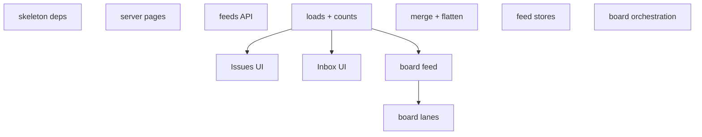

# Funnel — board scroll fix + feed pagination/virtualization

**Goal:** make board lanes scroll; paginate Issues/Inbox/Board with infinite scroll; virtualize long lists without breaking DnD.
**Architecture:** keyset pages in the local query service feed SvelteKit loads and `/api/feeds/*`; client stores merge pages; Virtua windows rows and lanes; board DnD moves to pragmatic-drag-and-drop.
**Tech stack:** Bun 1.4.3, Svelte 5.57, SvelteKit 3, TS 6, Drizzle + bun:sqlite, Tailwind 4, `virtua`, `@atlaskit/pragmatic-drag-and-drop`.
**Spec path:** docs/plans/2026-10-19-feeds-pagination.spec.md
**Detail:** contracts. **Target-min:** 30. **Orchestrator:** AI.

## Global constraints

- Page size 100 (Issues/Inbox), 50 per lane. Order: priority rank ASC, `updatedAt` DESC, `repoId` DESC, `number` DESC.
- Cursor = base64url JSON `{v:1,f:signature,k:[rank,updatedAt,repoId,number]}`; mismatched signature is rejected.
- `ListPage<T> = { items: T[]; total: number; nextCursor: string | null }`; totals always come from the server.
- SSE keeps `refreshAll()`; stores merge page 1 without truncating loaded rows; refresh caps at 500.
- Remove `svelte-dnd-action`; keep the `data-board-*` hooks. Virtua sits in the lane scroller, header outside.
- Spec coverage: §1 T1/T9, §2 T1-T10, §3 these constraints, §4 the Review Focus lines.

```mermaid
flowchart LR
  Q[keyset pages + totals] --> L[SvelteKit loads]
  Q --> A[/api/feeds/*]
  L --> S[feed stores]
  A --> S
  S --> I[Issues VList]
  S --> N[Inbox VList]
  S --> B[Board lanes + pragmatic DnD]
  E[SSE refreshAll] --> L
```






```mermaid
%% schedule
gantt
  title Predicted schedule (mm:ss)
  dateFormat X
  axisFormat %M:%S
  section lane 1
  T2 feeds API endpoints :t2, 0, 227s
  T9 board lanes  virtualization + pragmat :t9, 347, 221s
  section lane 2
  T1 server keyset pages and totals :t1, 0, 219s
  section lane 3
  T3 loads return first pages and totals :t3, 0, 210s
  T6 Issues feed virtualization :t6, 210, 176s
  section lane 4
  T10 board orchestration and keyboard mov :t10, 0, 192s
  T7 Inbox feed virtualization :t7, 210, 147s
  section lane 5
  T4 merge  flatten and URL helpers :t4, 0, 170s
  T8 board feed stores :t8, 210, 137s
  section lane 6
  T5 client feed stores :t5, 0, 142s
  section lane 7
  T0 dependencies :t0, 0, 90s
```

critical path: T3 → T8 → T9 (9.5 min) · peak width 7 · predicted build 9.5 min · predicted total ≈ 13.0 min

## Tasks

### T0 dependencies · Complexity 1 (M-1) · Est. context 8k
**Owns:** package.json, bun.lock
**Components:** 1
**LOC owned:** 8
**Tests:** fast
**Kind:** mechanical
**Model:** haiku
**Est. time:** 1.5 min
**Produces:** none
**Test code (verbatim):**
```sh
bun -e 'await Promise.all(["virtua","@atlaskit/pragmatic-drag-and-drop","@atlaskit/pragmatic-drag-and-drop-auto-scroll"].map((p) => import(p)))'
```
**Steps:** 1 install, 2 run `bun run check`, 3 commit.

### T1 server keyset pages and totals · Complexity 5 (O-1) · Est. context 40k
**Owns:** src/lib/server/issues/pagination.ts, src/lib/server/issues/queries.ts, src/lib/server/issues/queries.test.ts
**Components:** 3
**LOC owned:** 340
**Tests:** slow
**Model:** sonnet
**Est. time:** 5 min
**Produces:** `filterSignature(filter: IssueFilter, extra?: string) -> string` · `encodeCursor(signature: string, key: CursorKey) -> string` · `decodeCursor(cursor: string, signature: string) -> CursorKey | null` · `allIssues(filter: IssueFilter, opts?: PageOptions) -> ListPage<IssueListItem>` · `myIssues(filter: IssueFilter, viewerGithubId: number | null | undefined, opts?: PageOptions) -> ListPage<IssueListItem>` · `inbox(filter: IssueFilter, opts?: PageOptions) -> ListPage<InboxEntry>` · `statusBoard(filter: IssueFilter, opts?: PageOptions) -> Promise<StatusBoard>` · `boardColumnPage(filter: IssueFilter, column: StatusKey, opts?: PageOptions) -> Promise<ListPage<IssueListItem>>` · `inboxCount(filter: IssueFilter) -> number`
- e.g. allIssues(parse(""), { limit: 2 }) -> { items: [issue1, issue3], total: 3, nextCursor: "eyJ2Ijox" }
- e.g. boardColumnPage(parse(""), "in-progress", { limit: 50 }) -> { items: [issue4], total: 1, nextCursor: null }
- e.g. inboxCount(parse("")) -> 4
**Review Focus:** numeric: walking limit 2 over three rows equals the unpaged order once; tied `updatedAt` uses `repoId DESC, number DESC`; state: a cursor from `repo=orgA/web` is rejected on an empty filter; deep: `nextCursor` is null only when `items.length < limit`.
**Steps:** 1 update assertions to `.items`, 2 add page-walk tests, 3 run: FAIL, 4 implement, 5 run: PASS.
**Notes:** Fetch `limit+1`, hydrate `limit`. `inbox` pages issues only; submissions always included and counted. Reuse one `where` builder for rows and `count(*)`.

### T2 feeds API endpoints · Complexity 4 (O-1)
**Owns:** src/routes/api/feeds/issues/+server.ts, src/routes/api/feeds/inbox/+server.ts, src/routes/api/feeds/board/+server.ts, src/routes/api/feeds/feeds.test.ts
**Components:** 4
**LOC owned:** 220
**Tests:** slow
**Model:** sonnet
**Consumes:** `allIssues(filter: IssueFilter, opts?: PageOptions) -> ListPage<IssueListItem>` (T1) · `boardColumnPage(filter: IssueFilter, column: StatusKey, opts?: PageOptions) -> Promise<ListPage<IssueListItem>>` (T1)
**Produces:** `issuesPage(search: URLSearchParams, viewerGithubId: number | null) -> Promise<ListPage<IssueListItem>>` · `inboxPage(search: URLSearchParams, viewerGithubId: number | null) -> Promise<ListPage<RenderedInboxEntry>>` · `boardPage(search: URLSearchParams, viewerGithubId: number | null) -> Promise<ListPage<IssueListItem>>`
- e.g. issuesPage(new URLSearchParams("priority=p1&limit=2"), 42) -> { items: [issue1, issue2], total: 5, nextCursor: "abc" }
- e.g. inboxPage(new URLSearchParams(""), 42) -> { items: [submission, issue], total: 2, nextCursor: null }
**Review Focus:** protocol: RBAC; 400 on bad cursor/column; issues default `open`; inbox renders `bodyHtml`.

### T3 loads return first pages and totals · Complexity 3 (O-1)
**Owns:** src/routes/(app)/issues/+layout.server.ts, src/routes/(app)/inbox/+layout.server.ts, src/routes/(app)/board/+layout.server.ts, src/routes/(app)/+layout.server.ts
**Components:** 4
**LOC owned:** 90
**Tests:** slow
**Model:** sonnet
**Consumes:** `allIssues(filter: IssueFilter, opts?: PageOptions) -> ListPage<IssueListItem>` (T1) · `inboxCount(filter: IssueFilter) -> number` (T1)
**Produces:** `loadIssues(url: URL, viewerGithubId: number | null) -> Promise<{ issues: ListPage<IssueListItem> }>` · `loadInbox(url: URL, viewerGithubId: number | null) -> Promise<{ inbox: ListPage<RenderedInboxEntry> }>` · `loadBoard(url: URL, viewerGithubId: number | null) -> Promise<{ board: StatusBoard }>`
- e.g. loadIssues(new URL("http://x/issues"), 42) -> { issues: { items: [issue1], total: 431, nextCursor: "abc" } }
- e.g. loadInbox(new URL("http://x/inbox"), 42) -> { inbox: { items: [submission], total: 7, nextCursor: null } }
- e.g. loadBoard(new URL("http://x/board"), 42) -> { board: { columns: [{ key: "in-progress", total: 12, nextCursor: null }] } }
**Review Focus:** state: filter change gives a fresh first page; columns carry `total`/`nextCursor`.

### T4 merge, flatten and URL helpers · Complexity 4 (O-1) · Est. context 36k
**Owns:** src/lib/client/feed-merge.ts, src/lib/client/feed-merge.test.ts, src/lib/feeds.ts
**Components:** 3
**LOC owned:** 250
**Tests:** fast
**Model:** sonnet
**Est. time:** 4 min
**Produces:** `mergeFirstPage(loaded: unknown[], first: unknown[], keyOf: (item: unknown) => string) -> unknown[]` · `appendUnique(loaded: unknown[], page: unknown[], keyOf: (item: unknown) => string) -> unknown[]` · `flattenIssueRows(issues: IssueListItem[], groupBy: GroupKey, repoShortcodes: Record<string,string>, projects: ProjectOption[], collapsed: (key: string) => boolean) -> FeedRow<IssueListItem>[]` · `flattenInboxRows(entries: RenderedInboxEntry[], groupBy: GroupKey, repoShortcodes: Record<string,string>, projects: ProjectOption[], collapsed: (key: string) => boolean) -> FeedRow<RenderedInboxEntry>[]` · `FEED_ENDPOINTS` · `feedUrl(endpoint: string, search: URLSearchParams, cursor: string | null, extra?: Record<string,string>, limit?: number) -> string`
- e.g. mergeFirstPage([a,b,c], [a2,b], keyOf) -> [a2,b,c]
- e.g. appendUnique([a,b], [b,c], keyOf) -> [a,b,c]
- e.g. flattenIssueRows([x], "status", {}, [], () => false) -> [{kind:"group",key:"status:in-progress",label:"In Progress",count:1},{kind:"item",key:"status:in-progress:1:7",item:x}]
- e.g. feedUrl(FEED_ENDPOINTS.issues, new URLSearchParams("priority=p1"), "abc", undefined, 100) -> "/api/feeds/issues?priority=p1&cursor=abc&limit=100"
**Review Focus:** state: merge keeps the loaded tail; project grouping keeps distinct keys; collapsed groups emit no rows; encoding: cursor/filter values are URL-encoded.
**Steps:** 1 tests above, 2 run: FAIL, 3 implement, 4 run: PASS.

### T5 client feed stores · Complexity 4 (O-1) · Est. context 34k
**Owns:** src/lib/client/feed.svelte.ts
**Components:** 2
**LOC owned:** 220
**Tests:** fast
**Model:** sonnet
**Est. time:** 4.5 min
**Consumes:** `mergeFirstPage(loaded: unknown[], first: unknown[], keyOf: (item: unknown) => string) -> unknown[]` (T4) · `appendUnique(loaded: unknown[], page: unknown[], keyOf: (item: unknown) => string) -> unknown[]` (T4) · `feedUrl(endpoint: string, search: URLSearchParams, cursor: string | null, extra?: Record<string,string>, limit?: number) -> string` (T4)
**Produces:** `createFeed(config: FeedConfig) -> Feed` · `createBoardFeed(initial: StatusBoard, key: () => string) -> BoardFeed`
- e.g. createFeed({endpoint: FEED_ENDPOINTS.issues, initial: {items:[a],total:1,nextCursor:null}, key: () => search, itemKey: keyOf, query: () => params}) -> { items: [a], total: 1, nextCursor: null, loadMore: Function }
- e.g. feed.sync({items:[a2],total:1,nextCursor:null}) -> items [a2]
- e.g. boardFeed.loadMore("done") -> appends unique cards and updates the lane cursor
**Review Focus:** state: one in-flight `loadMore` per feed; a failed fetch keeps items/cursor and sets `error`; `sync` merges on the same key and resets on a new key; `refreshLoaded` requests `limit=min(items.length,500)`; board totals adjust on optimistic moves.
**Notes:** `FeedConfig = { endpoint: string; initial: ListPage<unknown>; key: () => string; itemKey: (item: unknown) => string; query: () => string | URLSearchParams }`. Keep DOM-free.
**Steps:** 1 implement with a fetch stub, 2 run: PASS, 3 run check.

### T6 Issues feed virtualization · Complexity 4 (O-1)
**Owns:** src/lib/components/issue/IssueList.svelte, src/routes/(app)/issues/+layout.svelte
**Components:** 2
**LOC owned:** 200
**Tests:** slow
**Model:** sonnet
**Consumes:** `createFeed(config: FeedConfig) -> Feed` (T5) · `flattenIssueRows(issues: IssueListItem[], groupBy: GroupKey, repoShortcodes: Record<string,string>, projects: ProjectOption[], collapsed: (key: string) => boolean) -> FeedRow<IssueListItem>[]` (T4)
**Produces:** `IssueList(props: IssueListProps) -> snippet`
- e.g. `<IssueList feed={feed} selected={selected} empty="No issues match these filters." />`
**Review Focus:** protocol: wheel scrolls the feed; near-end emits one `loadMore`; state: filter change resets page and scroll; selection routes via `selectIssue`.

### T7 Inbox feed virtualization · Complexity 3 (O-1)
**Owns:** src/routes/*app*/inbox/+layout.svelte
**Components:** 1
**LOC owned:** 160
**Tests:** slow
**Model:** sonnet
**Consumes:** `createFeed(config: FeedConfig) -> Feed` (T5)
**Produces:** `inboxQueue(entries: RenderedInboxEntry[]) -> FeedRow<RenderedInboxEntry>[]`
- e.g. inboxQueue([submission, issue]) -> [{kind:"item",key:"submission:s1",item:submission},{kind:"item",key:"status:none:1:7",item:issue}]
**Review Focus:** state: optimistic removal/triage hide rows; protocol: appends do not duplicate staged entries; totals subtract hidden entries.

### T8 board feed stores · Complexity 4 (O-1)
**Owns:** src/lib/client/board-feed.svelte.ts, src/routes/*app*/board/+layout.svelte
**Components:** 2
**LOC owned:** 180
**Tests:** fast
**Model:** sonnet
**Consumes:** `createFeed(config: FeedConfig) -> Feed` (T5)
**Produces:** `createBoardFeed(initial: StatusBoard, key: () => string) -> BoardFeed` · `BoardFeed.columns: Record<StatusKey, Feed>` · `BoardFeed.total() -> number`
- e.g. createBoardFeed(initial, key).total() -> 431
**Review Focus:** state: SSE merge keeps loaded lane pages; optimistic status change adjusts source/target totals; `projectBoard` re-buckets loaded items only.

### T9 board lanes: virtualization + pragmatic DnD · Complexity 5 (O-1)
**Owns:** src/lib/components/board/dnd.ts, src/lib/components/board/dnd.test.ts, src/lib/components/board/BoardColumn.svelte, src/lib/components/board/BoardCard.svelte
**Components:** 3
**LOC owned:** 360
**Tests:** slow
**Model:** sonnet
**Consumes:** `BoardFeed` (T8)
**Produces:** `draggableCard(node: HTMLElement, data: CardDragData) -> { destroy(): void }` · `droppableLane(node: HTMLElement, data: LaneDropData) -> { destroy(): void }` · `BoardColumn(props: BoardColumnProps) -> snippet`
- e.g. drop at rendered index 3 -> `onDrop(issueKey, 3)` exactly once
- e.g. 50 loaded cards -> mounted `[data-board-card]` count stays below 30 while scrolling
- e.g. BoardColumn({ statusKey: "in-progress", items: [], total: 0 }) -> an empty lane with its header
**Review Focus:** protocol: lane scrolls, header fixed, horizontal board scroll unaffected; state: drop index is correct at first/last rendered card and in an empty lane; auto-scroll triggers `onLoadMore` and drop-at-end; hooks preserved.
**Notes:** `BoardColumnProps = { statusKey; label; items; total; nextCursor; loading; onLoadMore; onDrop; activeKey; draggingKey; readonly }`. Indicator uses `getItemOffset`/`getScrollSize`; auto-scroll the lane.

### T10 board orchestration and keyboard moves · Complexity 5 (O-1)
**Owns:** src/lib/components/board/StatusBoard.svelte, src/lib/client/board-keyboard.svelte.ts
**Components:** 2
**LOC owned:** 320
**Tests:** slow
**Model:** sonnet
**Consumes:** `BoardColumn(props: BoardColumnProps) -> snippet` (T9) · `BoardFeed` (T8)
**Produces:** `StatusBoard(props: StatusBoardProps) -> snippet` · `createKeyboardMove(state: KeyboardMoveInput) -> KeyboardMove`
- e.g. Space, ArrowDown twice, Space -> card moves two positions locally; `moveToStatus` only on lane change
- e.g. ArrowRight from `in-progress` to `in-review` -> target index clamped to loaded length, then focused via `scrollToIndex`
**Review Focus:** state: cross-lane drop moves then calls `moveToStatus`; Done drops raise the close dialog; keyboard mode survives virtualization; `S`/Enter menus and `activeKey` still work.
