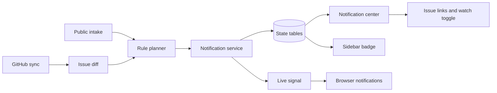
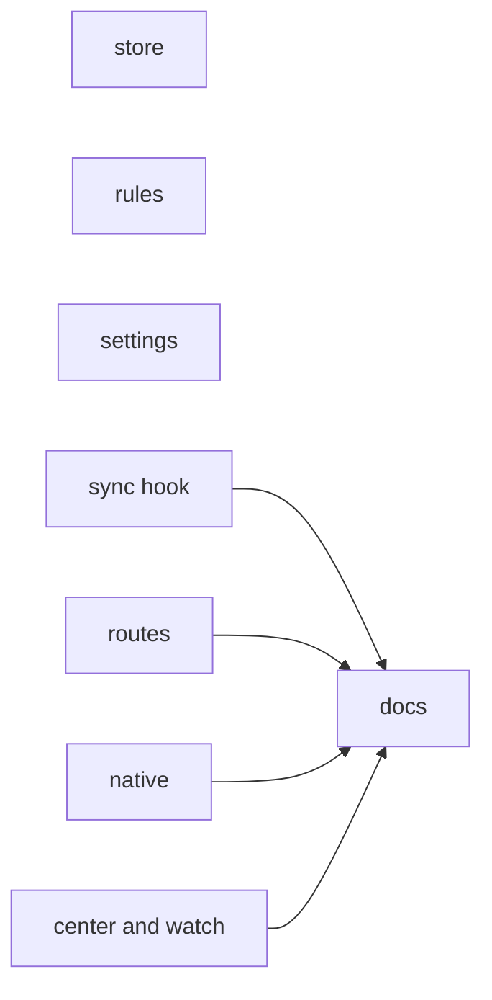

# Notification center

**Goal:** add a durable, per-user notification center with watching, unread state, a sidebar badge, and opt-in browser notifications.
**Architecture:** sync diffs and the intake hook feed a pure rule planner; a service resolves Funnel users, persists notifications and watches, and emits a payload-free SSE signal; SvelteKit loads and APIs expose the signed-in user's rows.
**Tech stack:** Bun 1.4.3, Svelte 5, SvelteKit 3, TypeScript 6, Drizzle + bun:sqlite, valibot, Tailwind 4.
**Spec path:** docs/plans/2026-10-19-notification-center.review.md
**Review plan:** docs/plans/2026-10-19-notification-center.review.md
**Detail:** contracts
**Target-min:** 30
**Orchestrator:** human (review plan approved)

## Global constraints

- New durable tables: `state_notification` and `state_issue_watch`, keyed on `org/name` + issue number so they survive mirror rebuilds.
- Notification kinds: `assigned`, `mentioned`, `comment`, `status`, `priority`, `state`, `new_intake`.
- Recipients: watchers, new assignees, mentioned Funnel users, and all admins for new intake. Never notify the actor who caused the change.
- First sight of an issue creates no notifications; only a change from an already-known issue does.
- De-duplicate by a unique per-event key; re-polling or a post-write refresh must not repeat a notification.
- Settings: `notifications.enabled`, `notifications.native`, `notifications.new_intake`, all default `true`.
- Issue links use `/issues/<owner>/<name>/<number>`; intake links use `/inbox/submission/<id>`.
- Every read is scoped by `auth_user.id`; the shared SSE event carries no titles, people, or user ids.
- Browser notifications are opt-in per browser and only while a tab is open. No service worker, mail, webhook, or SLA rules.

## Main diagram

## Task graph

```mermaid
%% schedule
gantt
  title Predicted schedule (mm:ss)
  dateFormat X
  axisFormat %M:%S
  section lane 1
  T4 sync and intake hook :t4, 0, 292s
  T8 documentation :t8, 292, 129s
  section lane 2
  T7 notification center and watch UI :t7, 0, 278s
  section lane 3
  T5 notification and watch APIs :t5, 0, 238s
  section lane 4
  T1 notification store :t1, 0, 216s
  section lane 5
  T6 browser notifications :t6, 0, 203s
  section lane 6
  T3 admin notification settings :t3, 0, 186s
  section lane 7
  T2 notification rules :t2, 0, 142s
```

critical path: T4 → T8 (7.0 min) · peak width 7 · predicted build 7.0 min · predicted total ≈ 10.5 min (target ✓)

## Tasks

### T1 notification store · Complexity 5 (O-1)
**Owns:** src/lib/server/notifications/types.ts, src/lib/server/notifications/service.ts, src/lib/server/notifications/service.test.ts, src/lib/server/db/schema.ts, drizzle
**Components:** 3
**LOC owned:** 320
**Tests:** slow
**Model:** sonnet
**Produces:** `createNotifications(drafts: readonly NotificationDraft[]) -> number` · `listNotifications(userId: string, opts?: NotificationQuery) -> NotificationItem[]` · `unreadNotificationCount(userId: string) -> number` · `markNotificationRead(userId: string, id: string) -> boolean` · `markAllNotificationsRead(userId: string) -> number` · `watchIssue(userId: string, org: string, name: string, issueNumber: number) -> void` · `isWatching(userId: string, org: string, name: string, issueNumber: number) -> boolean` · `listWatchers(org: string, name: string, issueNumber: number) -> Recipient[]` · `notifyNewIntake(submission: IntakeRef) -> number`
- e.g. `unreadNotificationCount("u1") -> 2`
- e.g. `listWatchers("orgA","core",7) -> [{ userId: "u1", githubId: 42, login: "alice", avatarUrl: "" }]`
- e.g. `listNotifications("u1", { unreadOnly: true }) -> [{ id: "n1", kind: "assigned", url: "/issues/orgA/core/7", readAt: null, createdAt: 1000 }]`
- e.g. `createNotifications([]) -> 0`
**Review Focus:** `test_unread_count_scopes_to_user`: two users, two rows, each count is 1. `test_mark_all_read_only_own`: user B rows stay unread. `test_watch_is_idempotent`: two watch calls leave one row.
**Steps:** 1 add tables and generated migration, 2 write the named tests, 3 run: FAIL, 4 implement service, 5 run: PASS.
**Notes:** `NotificationQuery = { limit?: number; unreadOnly?: boolean; after?: number }`; `IntakeRef = { id: string; title: string }`. Also export `unwatchIssue`, `markAllNotificationsRead`, `getRecipientByGithubId`, `getRecipientByLogin`, `listAdminRecipients`. Store snapshots (title, actor login/avatar, body, url); `createNotifications` inserts with `onConflictDoNothing` on `dedupe_key` and publishes one `{ type: "notifications" }` when any row lands. Resolve recipients through `mirror_github_user` + `auth_account` (`providerId = "github"`, numeric `accountId`).

### T2 notification rules · Complexity 4 (O-1)
**Owns:** src/lib/server/notifications/plan.ts, src/lib/server/notifications/plan.test.ts
**Components:** 2
**LOC owned:** 220
**Tests:** fast
**Model:** sonnet
**Produces:** `planIssueNotifications(input: PlanIssueInput) -> NotificationDraft[]` · `parseMentions(body: string) -> string[]`
- e.g. `parseMentions("hi @alice and @bob") -> ["alice","bob"]`
- e.g. `planIssueNotifications({ previous: null, next: snapshot, repo: "orgA/core", watchers: [], recipients: [], actor: null, now: 1000 }) -> []`
- e.g. `planIssueNotifications({ previous: prev, next: next, repo: "orgA/core", watchers: [], recipients: [alice], actor: null, now: 1000 }) -> [{ userId: "u1", kind: "assigned", dedupeKey: "assigned:orgA/core#7:u1:1000", createdAt: 1000 }]`
**Review Focus:** `test_initial_snapshot_is_silent`: previous null returns `[]`. `test_mention_beats_comment_for_same_comment`: exactly one `mentioned` draft. `test_self_actor_suppressed`: actor githubId 42 and assignment to 42 returns `[]`.
**Steps:** 1 write the named tests, 2 run: FAIL, 3 implement pure planner, 4 run: PASS.
**Notes:** Input carries `previous`, `next`, `watchers`, `recipients`, `actor`, `now`. New comments are those whose `githubId` is absent from `previous.comments`. Compare `status`, `priority`, and `state`. Mention wins over a plain comment for the same person and comment. Strip HTML comments and collapse whitespace before a 140-character excerpt. Mention regex is case-insensitive `@login` with `[a-z0-9-]`.

### T3 admin notification settings · Complexity 3 (O-1)
**Owns:** src/lib/server/settings/store.ts, src/lib/server/settings/store.test.ts, src/lib/server/settings/apply.test.ts, src/lib/server/config.ts, src/lib/server/config.test.ts, src/routes/(app)/settings/notifications/+page.server.ts, src/routes/(app)/settings/notifications/+page.svelte, src/lib/components/settings/sections.ts
**Components:** 4
**LOC owned:** 180
**Tests:** fast
**Model:** sonnet
**Review Focus:** `test_notifications_default_true`: empty settings read `{ enabled: true, native: true, new_intake: true }`. `test_notifications_round_trip`: a false value persists. `test_invalid_notification_value_rejected`: a string is rejected.
**Steps:** 1 extend the key registry and config schema, 2 write the named tests, 3 run: FAIL, 4 add settings section and page, 5 run: PASS.
**Notes:** Follow the existing `board` section pattern. Add a Workspace section labelled Notifications with `BellRingIcon`; three switch controls save the full `notifications` slice through `SettingsForm`. Add `notifications` to the required `SettingsInput`, `DEFAULT_CONFIG`, and the test fixtures.

### T4 sync and intake hook · Complexity 5 (O-1)
**Owns:** src/lib/server/sync/mirror.ts, src/lib/server/sync/hydrate.ts, src/lib/server/sync/hydrate.test.ts, src/lib/server/sync/worker.ts, src/lib/server/sync/worker.test.ts, src/lib/server/intake/staging.ts, src/lib/server/intake/staging.test.ts, src/lib/server/issues/http.ts, src/routes/api/repos/[owner]/[repo]/issues/{+server.ts,[number]/{+server.ts,comments/+server.ts,labels/{+server.ts,[name]/+server.ts},work-notes/[id]/publish/+server.ts}}
**Components:** 6
**LOC owned:** 340
**Tests:** slow
**Model:** sonnet
**Consumes:** `createNotifications(drafts: readonly NotificationDraft[]) -> number` (T1) · `listWatchers(org: string, name: string, issueNumber: number) -> Recipient[]` (T1) · `planIssueNotifications(input: PlanIssueInput) -> NotificationDraft[]` (T2)
**Produces:** `snapshotIssue(repoId: number, number: number) -> IssueSnapshot | null` · `notifyIssueChanges(input: IssueChangeInput) -> number`
- e.g. `snapshotIssue(1, 7) -> { status: "in-progress", priority: "p2", state: "open", updatedAt: 1000, assigneeIds: [42], comments: [] }`
- e.g. `notifyIssueChanges({ repoId: 1, org: "orgA", name: "core", number: 7, previous: null, next: snapshot }) -> 0`
**Review Focus:** `test_first_sight_is_silent`: initial hydrate stores no notification. `test_new_comment_notifies_watcher_once`: hydrate twice, one row. `test_self_write_is_silent`: actor user id suppresses their own assignment/status notice.
**Steps:** 1 snapshot + hook tests, 2 run: FAIL, 3 implement, 4 run: PASS.
**Notes:** `IssueChangeInput` carries repo id, `org`, `name`, `number`, `previous`, `next`, and optional `actorUserId`. `hydrateAndStore` snapshots before `upsertIssue` and calls `notifyIssueChanges` after; skip when `previous` is null or notifications are disabled. `refreshIssue`/`scheduleRefresh` take an optional actor id; mutation routes pass `locals.user?.id`. `createSubmission` calls `notifyNewIntake` after insert. Comments beyond the GraphQL first page stay unsupported.

### T5 notification and watch APIs · Complexity 4 (O-1)
**Owns:** src/routes/api/notifications/+server.ts, tests/notifications-routes.test.ts, src/routes/api/mirror/issues/[owner]/[repo]/[number]/watch/+server.ts, src/routes/api/mirror/issues/[owner]/[repo]/[number]/+server.ts, src/lib/server/issues/types.ts
**Components:** 4
**LOC owned:** 300
**Tests:** slow
**Model:** sonnet
**Consumes:** `listNotifications(userId: string, opts?: NotificationQuery) -> NotificationItem[]` (T1) · `markNotificationRead(userId: string, id: string) -> boolean` (T1) · `watchIssue(userId: string, org: string, name: string, issueNumber: number) -> void` (T1) · `isWatching(userId: string, org: string, name: string, issueNumber: number) -> boolean` (T1)
**Review Focus:** `test_notifications_require_read_role`: no session gives 401. `test_notifications_are_user_scoped`: user A never receives user B rows. `test_read_and_read_all`: read state persists and count drops. `test_watch_toggle_round_trip`: PUT then DELETE changes `watching`.
**Steps:** 1 write route tests, 2 run: FAIL, 3 implement handlers, 4 run: PASS.
**Notes:** `GET /api/notifications?limit=&unread=&after=` returns `{ items, unreadCount }`; `POST` accepts `{ id }` or `{ all: true }` and returns `{ unreadCount }`. Watch route accepts `GET`, `PUT`, `DELETE` with the `read` role. Add `watching: boolean` to `RenderedIssueDetail`, computed by the mirror detail handler. Validate a positive issue number and an existing mirrored repo.

### T6 browser notifications · Complexity 4 (O-1)
**Owns:** src/lib/client/native-notifications.ts, src/lib/client/native-notifications.test.ts, src/lib/client/events.ts, src/routes/(app)/+layout.svelte
**Components:** 3
**LOC owned:** 220
**Tests:** slow
**Model:** sonnet
**Produces:** `enableNativeNotifications() -> Promise<"granted" | "denied" | "unsupported">` · `startNativeNotifications(enabled: boolean) -> () => void`
- e.g. `enableNativeNotifications() -> "granted"`
- e.g. `startNativeNotifications(false) -> function cleanup`
**Review Focus:** `test_unsupported_environment_returns_unsupported`: no `Notification` global. `test_disabled_setting_never_requests_permission`: no prompt when false. `test_event_fetches_own_feed_only`: the request has no user id.
**Steps:** 1 write pure helper tests, 2 run: FAIL, 3 implement, 4 run: PASS.
**Notes:** Add `"notifications"` to `EVENT_TYPES`. On mount, call `startNativeNotifications(data.nativeNotifications)`; on an event, fetch `/api/notifications?after=<lastSeen>&unread=1`, show one native notice per row, and keep `lastSeen` in memory. Opt in via `localStorage` key `funnel.nativeNotifications`; clicking calls `window.focus()` then `goto(row.url)`. Only request permission from the page's user gesture.

### T7 notification center and watch UI · Complexity 5 (O-1)
**Owns:** src/routes/(app)/notifications/+page.server.ts, src/routes/(app)/notifications/+page.svelte, src/routes/(app)/+layout.server.ts, src/lib/components/app-sidebar.svelte, src/lib/components/issue/InspectorPane.svelte, src/lib/client/mutations.ts
**Components:** 5
**LOC owned:** 420
**Tests:** slow
**Model:** sonnet
**Consumes:** `listNotifications(userId: string, opts?: NotificationQuery) -> NotificationItem[]` (T1) · `enableNativeNotifications() -> Promise<"granted" | "denied" | "unsupported">` (T6)
**Review Focus:** `test_page_loads_own_items`: load returns only the viewer's rows. `test_unread_badge_matches_count`: sidebar prop equals the service count. `test_watch_button_calls_api`: PUT for on and DELETE for off.
**Steps:** 1 write server-load and client-helper tests, 2 run: FAIL, 3 implement page and components, 4 run: PASS.
**Notes:** Sidebar item `Notifications` under the personal group, `BellRingIcon`, badge from `data.unreadNotifications`; change Attention to `AlarmClockIcon`. Page groups unread before read, with actor, issue link, relative time, per-row and mark-all read. Watch toggle sits in the inspector property row as `Watch`/`Watching`. Add `setIssueWatching` and `markNotificationsRead` client helpers, plus `unreadNotifications` and `nativeNotifications` to the layout load.

### T8 documentation · Complexity 2 (O-1)
**Owns:** docs/how-to/use/notifications.md, docs/reference/routes-and-pages.md, docs/reference/settings.md, docs/reference/database-schema.md, docs/reference/http-api.md, docs/reference/glossary.md
**Components:** 2
**LOC owned:** 120
**Tests:** fast
**Model:** sonnet
**Review Focus:** `test_docs_name_all_new_routes`: `/notifications` and the watch API appear. `test_docs_state_native_limits`: open-tab and permission limits are documented.
**Steps:** 1 update reference tables, 2 add the how-to, 3 run `bun run check`.
**Notes:** Describe assignment, mention, watched comments, status/priority/state changes, new intake, read state, and the three settings.

## Review Focus

- notifications: deep, state, protocol
- sync: state, protocol
- settings: state, protocol
- routes: protocol, state
- ui: state, protocol
- client: state, protocol
- docs: encoding
