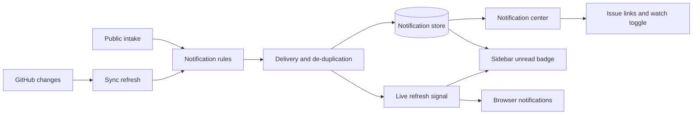
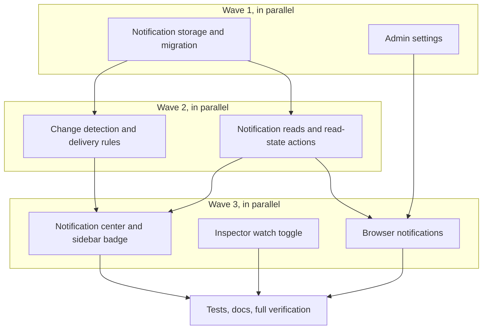

# Notification center: review plan

Issue: [#27](https://github.com/t128n/funnel/issues/27) — notification center with unread state and watching.

## Summary

Funnel currently refreshes data over a live connection and shows sidebar counts, but it has no record of what changed for a particular person. This adds a per-user notification center: assignments, mentions, comments and status changes on watched issues, and new public intake submissions. Notifications persist, have read/unread state, and drive a sidebar badge. People can watch an issue from the inspector, and can opt in to browser notifications while a Funnel tab is open. Everything is in-app plus browser-native; no mail or outbound webhook in this pass.

## What you will get

- A **Notifications** page listing your unread and read notifications, newest first, with actor, issue, and time.
- A sidebar unread badge that updates live.
- Mark one notification read, mark all read, and opening a notification takes you to the issue.
- A **Watch** toggle in the issue inspector; watching notifies you about comments and status/priority/open-closed changes on that issue.
- Notifications for: being assigned, being mentioned, comments on watched issues, status/priority/open-closed changes on watched issues, and new intake submissions (admins).
- Optional browser notifications, enabled per browser after permission, with a click-through to the issue.
- Admin settings to turn notifications off entirely, turn browser notifications off, or turn new-intake notices off.
- Migration, tests, and user/admin documentation.

## What will be built

| Part | What it does (one sentence) | Size (S/M/L) | Built by |
|---|---|---|---|
| Notification storage | Stores per-user notifications, read state, and who watches which issue, surviving mirror rebuilds | M | a careful helper for the data model |
| Change detection | Compares each refreshed issue with its previous mirror state and decides who should be told what | M | a careful helper for the rules |
| Delivery service | De-duplicates notifications, resolves GitHub people to Funnel users, and publishes a live refresh signal | M | a careful helper for the rules |
| Notification center | Lists notifications, shows unread state, marks one/all read, and links to the issue | M | a careful helper for the interface |
| Watch toggle | Adds a watch/unwatch control to the issue inspector | S | a fast helper for interface wiring |
| Browser notifications | Asks permission, shows native notifications for new events, and opens the issue on click | M | a careful helper for the interface |
| Admin settings | Adds a Notifications settings section with three switches | S | a fast helper for settings wiring |
| Tests and docs | Covers delivery rules, user scoping, read state, settings, and documents usage and limits | M | a careful helper for verification |

## How it fits together

## How it gets built

## Decisions you can change

- **Notification source:** derive from sync refreshes and the public intake hook (default) | build the full triage event log from issue #19 first.
- **Who gets notified:** watchers, new assignees, and mentioned people (default) | notify every participant on the issue.
- **New intake notices:** notify all admins (default) | leave intake out until it has its own preferences.
- **Self-actions:** never notify the person who caused the change (default) | notify everyone including the actor.
- **Watching:** explicit watch toggle (default) | automatically watch when you comment or are assigned.
- **Browser notifications:** opt-in per browser, permission requested from the Notifications page (default) | request permission on first visit.
- **Retention:** keep notifications until read, with no automatic expiry (default) | delete read notifications after 90 days.
- **Scale of preferences:** instance-wide switches only (default) | per-user, per-kind notification preferences.

## Risks

- **First sync flood.** A new repository would otherwise announce every historical issue. Initial sightings create no notifications; only a change from an already-known issue does.
- **Duplicate notifications.** GitHub polling re-sends the boundary issue and Funnel refreshes after its own writes. Change detection plus a stable per-event key keeps repeats out.
- **Comment coverage.** Funnel mirrors the first page of comments today. Mentions or comments beyond that page can be missed until comment pagination (issue #17) lands; this is documented and is not made worse.
- **Privacy.** Live refresh signals are broadcast to all connected tabs, but each browser fetches only its own notifications. No titles or people are put on the shared signal.
- **Browser permission.** Native notifications need HTTPS or localhost, a user gesture, and an open Funnel tab. The in-app center always works, and the page explains when native delivery is unavailable.
- **Intake noise.** A public form can produce many notices; admins can switch new-intake notices off.
- **Migration.** Two new durable tables and an index are added by a committed migration; existing data is untouched.

## Out of scope

- Mail, SMTP, outbound webhooks, and external alert servers.
- SLA, stale-triage, and blocked re-check reminders from issue #37.
- Background push while no Funnel tab is open; no service worker.
- Per-user, per-kind notification preferences, digests, and mentions inside work notes.
- Notifications for closed issues aging out of the mirror.

## How we will know it works

- Assign an issue to a signed-in person; their unread badge increases and the notification names the issue.
- Mention that person in a comment; they get a mention notification even without watching.
- Watch an issue, then have another person comment or change status, priority, or open/closed state; the watcher gets one notification per event.
- Mark one read and mark all read; the badge and list update, and the state survives a reload.
- A second signed-in person sees none of the first person's notifications.
- Enabling browser notifications while a Funnel tab is open shows a native notice for a new event; clicking it opens the issue.
- Turning notifications off stops new rows; turning browser notifications or new-intake notices off only affects those channels.
- A fresh repository sync does not create historical notifications.
- The project's type check, test suite, and production build pass.

## Rough time and cost

About 20 to 35 minutes of build and review, roughly $10 to $20 (rough, until the machine plan is linted).
