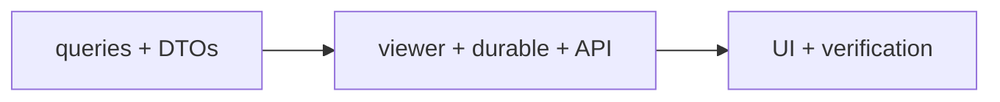
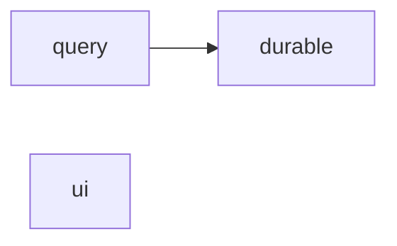

# Forge-agnostic model, slice B2 — queries, durable state and UI

**Goal:** finish the domain rename: external ids in DTOs and queries, forge-neutral durable state, and UI/client code free of `githubId`/`htmlUrl`.
**Architecture:** query service selects external ids from the new mirror joins; viewer and durable state store text external ids; UI compares external ids.
**Tech stack:** Bun, TypeScript, SvelteKit, Drizzle, bun:test, svelte-check.
**Spec path:** docs/plans/2026-10-22-forge-domain.spec.md — §1 DTOs and queries, §2 Viewer/durable/API, §3 UI/client, §4 Verification.
**Detail:** contracts. **Target-min:** 15. **Orchestrator:** AI.

## Global constraints

- The mirror from B1 is `mirror_repo`/`mirror_user`/`mirror_thread`/`mirror_comment` etc., with internal integer ids and text `external_id`.
- `UserRef.externalId` is a string; `viewer` is a string.
- Read DTOs use `url`, not `htmlUrl`. Write responses keep `htmlUrl` in this slice.
- No HTTP path or request-body change.
- Tabs, aliases, existing test style. Focused command: `bun test --preload ./tests/setup.ts --max-concurrency 1 <owned test paths>`.



## File structure

- `src/lib/server/issues/{types,queries,filters}.ts` — forge-neutral read model.
- `src/lib/server/{viewer,work-notes}.ts`, `attachments/store.ts`, `auth/index.ts` — text external ids.
- `src/routes/api/mirror/**`, `(app)/settings/people` — internal repo ids, string account ids.
- `src/lib/components/**`, `src/lib/client/**`, `src/routes/(app)/**` — `externalId`/`url`.
- Tests and docs.

## Task graph

```mermaid
%% schedule
gantt
  title Predicted schedule (mm:ss)
  dateFormat X
  axisFormat %M:%S
  section lane 1
  T17 queries and DTOs :t17, 0, 168s
  T18 viewer  durable state and API routes :t18, 168, 147s
  section lane 2
  T19 UI  client and verification :t19, 0, 142s
```





critical path: T17 → T18 (5.3 min) · peak width 2 · predicted build 5.3 min · predicted total ≈ 8.8 min

### T17 queries and DTOs · Complexity 5 (O-1) · Est. context 42k
**Owns:** src/lib/server/issues/types.ts, src/lib/server/issues/queries.ts, src/lib/server/issues/filters.ts, src/lib/server/issues/queries.test.ts, src/lib/server/issues/detail.test.ts, src/lib/server/issues/filters.test.ts
**Components:** 2
**LOC owned:** 420
**Tests:** fast
**Model:** sonnet
**Est. time:** 5 min
**Produces:** `UserRef { externalId: string; forge: string; instance: string; login: string; avatarUrl: string }` · `CommentItem { externalId: string; author: UserRef | null; body: string; createdAt: number }` · `MilestoneItem.url: string` · `IssueFilterContext { repos: Array<{ id: number; org: string; name: string }>; viewerExternalId?: string | null }`
- e.g. a query row's author -> { externalId: "101", forge: "github", instance: "github.com", login: "octocat", avatarUrl: "" }
- e.g. a milestone row -> { number: 1, title: "v1", url: "https://github.com/acme/widgets/milestone/1", ... }
- e.g. filter({ viewerExternalId: "101" }) -> only threads assigned to the user with external id 101
**Review Focus:** protocol: joins use `mirrorThread.authorId = mirrorUser.id` and `mirrorRepo.id`, while DTOs select `mirrorUser.externalId`/`forge`/`instance`; encoding: `externalId` is always a string; state: filters accept the internal repo id and the string viewer id; numeric: milestone and thread numbers stay numbers; protocol: no `mirrorGithub*` import remains.
**Test code (verbatim):**
```ts
import { expect, test } from "bun:test";
import type { UserRef } from "./types";
test("UserRef carries an external identity", () => {
  const user: UserRef = { externalId: "101", forge: "github", instance: "github.com", login: "octocat", avatarUrl: "" };
  expect(user.externalId).toBe("101");
  expect(user.forge).toBe("github");
});
```
**Steps:** 1 failing test, 2 run: FAIL, 3 implement, 4 run: PASS
**Notes:** Keep the query function names (`issueList`, `issueDetail`, `milestoneIssues`, etc.) and their parameter order; only field names/types change. `repoId` in DTOs stays the internal integer. `CommentItem.externalId` is the comment's external id. Port every existing query/filter/detail test to the new fields.

### T18 viewer, durable state and API routes · Complexity 4 (O-1) · Est. context 38k
**Owns:** src/lib/server/auth/index.ts, src/lib/server/viewer.ts, src/lib/server/work-notes.ts, src/lib/server/work-notes.test.ts, src/lib/server/attachments/store.ts, src/lib/server/attachments/store.test.ts, src/lib/server/intake/actions.ts, src/lib/server/intake/actions.test.ts, src/routes/api/mirror/issues/[owner]/[repo]/+server.ts, src/routes/api/mirror/issues/[owner]/[repo]/[number]/+server.ts, src/routes/*/settings/people/+page.server.ts, tests/mirror-issues-route.test.ts
**Components:** 2
**LOC owned:** 260
**Tests:** fast
**Model:** sonnet
**Est. time:** 4 min
**Consumes:** `UserRef { externalId: string; forge: string; instance: string; login: string; avatarUrl: string }` (T17)
**Produces:** `getViewerExternalId(userId: string) -> Promise<string | null>` · `resolveViewerRef(locals: App.Locals) -> Promise<UserRef | null>` · `addWorkNote(input) -> WorkNoteItem` · `addAttachment(input) -> AttachmentItem`
- e.g. resolveViewerRef({ user: { id: "u1" } }) -> { externalId: "101", forge: "github", instance: "github.com", login: "octocat", avatarUrl: "" }
- e.g. a stored work note -> { author: { externalId: "101", ... }, ... }
- e.g. GET /api/mirror/issues/acme/widgets -> repoIssueOptions(repo.id, ...)
**Review Focus:** protocol: `getViewerExternalId` returns the Better Auth account id as a string and `resolveViewerRef` falls back to `{ externalId: "", ... }` when absent; state: work notes and attachments copy `externalId`/`forge`/`instance` into their rows and read them back; protocol: the mirror routes pass `repo.id`, not `repo.githubId`; encoding: the people page compares string account ids; security: no token or secret is stored in the new fields.
**Test code (verbatim):**
```ts
import { expect, test } from "bun:test";
import type { UserRef } from "#lib/server/issues/types";
test("durable author records carry an external identity", () => {
  const author: UserRef = { externalId: "101", forge: "github", instance: "github.com", login: "octocat", avatarUrl: "" };
  expect(author.externalId).toBe("101");
});
```
**Steps:** 1 failing test, 2 run: FAIL, 3 implement, 4 run: PASS
**Notes:** `state_work_note`/`state_attachment` columns are already renamed in B1. `locals.viewerGithubId` becomes `locals.viewerExternalId`; update the `App.Locals` declaration if it is separate. Keep `created.value.htmlUrl` in intake; only the mirror lookup changes to `repo.id`.

### T19 UI, client and verification · Complexity 4 (O-1) · Est. context 36k
**Owns:** src/lib/components/**/*.svelte, src/lib/client/issue-actions.svelte.ts, src/lib/client/mutations.ts, src/lib/server/github/assignees.ts, src/lib/server/github/assignees.test.ts, src/routes/*/inbox/submission/[id]/+page.svelte, src/routes/*/attention/+page.svelte, src/routes/*/board/+layout.svelte, src/routes/*/board/+layout.server.ts, src/routes/*/inbox/+layout.server.ts, src/routes/*/issues/+layout.server.ts, src/routes/*/+layout.server.ts, src/routes/*/milestones/[owner]/[repo]/[number]/+page.server.ts, tests/work-notes-routes.test.ts, docs/explanation/*.md, docs/reference/*.md
**Components:** 2
**LOC owned:** 220
**Tests:** fast
**Model:** sonnet
**Est. time:** 4 min
**Consumes:** `UserRef { externalId: string; ... }` (T17) · `resolveViewerRef(locals: App.Locals) -> Promise<UserRef | null>` (T18)
**Produces:** `UI compares external ids`
- e.g. `person.externalId === viewer` -> true when both are `"101"`
- e.g. a milestone link uses `milestone.url`
- e.g. `rg "githubId|htmlUrl|mirrorGithub" src tests` -> no matches
**Review Focus:** protocol: every `githubId` in a Svelte/TS client becomes `externalId`; read-DTO `htmlUrl` becomes `url`; state: the board/attention "assigned to me" comparisons use the string viewer; encoding: keys that used `githubId` use `externalId`; protocol: no `mirrorGithub*` or `githubId` remains in `src/` or `tests/`.
**Test code (verbatim):**
```ts
import { expect, test } from "bun:test";
import { readFileSync } from "node:fs";
test("the UI has no GitHub-shaped identity field", () => {
  const text = readFileSync("src/lib/client/issue-actions.svelte.ts", "utf8");
  expect(text).not.toContain("githubId");
  expect(text).toContain("externalId");
});
```
**Steps:** 1 failing test, 2 run: FAIL, 3 implement, 4 run: PASS
**Notes:** `mutations.ts` keeps its `htmlUrl` return types (write contract unchanged). Update the docs that name `mirror_github_*` or `github_id`. Finish with `bun run check` and the full suite.
