# Forge transport, slice 2 — assignees and milestones

**Goal:** move the two remaining repo-metadata reads onto the provider layer, keeping the raw milestone shape the cockpit relies on.
**Architecture:** `assignees.ts` uses `repos.assignableUsers`; `milestones.ts` uses `provider.request` for the richer GitHub milestone payload. The sync worker obtains one installation provider per refresh.
**Tech stack:** Bun, TypeScript, SvelteKit, `forges@0.2.0`, `octokit@5` (coexisting), bun:test.
**Spec path:** docs/plans/2026-10-22-forge-reads.spec.md — §1 Assignable users, §2 Milestones, §3 Coexistence.
**Detail:** tests. **Target-min:** 6. **Orchestrator:** AI.

## Global constraints

- `forges@0.2.0` is already installed; do not change the dependency.
- The provider layer is `src/lib/server/forge/providers.server.ts` (`forge.installationProvider`, `forge.repoRef`).
- Credentials still come from `state_github_app`; no schema, DTO, route or settings change.
- `octokit` stays for the unported modules. Do not touch `createRepoMilestone`.
- Tabs, existing aliases (`#/lib/server/...`, `#lib/...`, `#tests/...`), existing test style.
- Focused test command: `bun test --preload ./tests/setup.ts --max-concurrency 1 <owned test paths>`.


## File structure

- `src/lib/server/github/assignees.ts` — provider-based assignable-user read.
- `src/lib/server/github/assignees.test.ts` — actor mapping and id guard.
- `src/lib/server/github/milestones.ts` — raw milestone list through `provider.request`; create unchanged.
- `src/lib/server/github/milestones.test.ts` — payload mapping and pagination query.
- `src/lib/server/sync/worker.ts` — `refreshRepoAssignees` and `refreshRepoMilestones` obtain providers.
- `src/lib/server/sync/worker.test.ts`, `src/lib/server/sync/reconcile.test.ts` — fetch/provider stubs if needed.

## Task graph

```mermaid
%% schedule
gantt
  title Predicted schedule (mm:ss)
  dateFormat X
  axisFormat %M:%S
  section lane 1
  T3 assignable users :t3, 0, 105s
  T4 milestones :t4, 105, 106s
```




critical path: T3 → T4 (3.5 min) · peak width 1 · predicted build 3.5 min · predicted total ≈ 7.0 min

### T3 assignable users · Complexity 3 (O-1) · Est. context 30k
**Owns:** src/lib/server/github/assignees.ts, src/lib/server/github/assignees.test.ts, src/lib/server/sync/worker.ts, src/lib/server/sync/worker.test.ts, src/lib/server/sync/reconcile.test.ts
**Components:** 1
**LOC owned:** 120
**Tests:** fast
**Model:** sonnet
**Est. time:** 3 min
**Produces:** `listRepoAssignees(provider: GitHubProvider, owner: string, repo: string) -> Promise<UserRecord[]>`
- e.g. listRepoAssignees(p, "acme", "widgets") -> [{ githubId: 1, login: "octocat", avatarUrl: "https://a/1" }]
- e.g. listRepoAssignees(p, "acme", "widgets") with actor id "not-a-number" -> []
**Review Focus:** protocol: the read calls `repos.assignableUsers` with `forge.repoRef(owner, repo)`; encoding: `githubId` is `Number(actor.id)` and non-integers are skipped; state: `refreshRepoAssignees` still replaces the repo assignee set wholesale; protocol: no Octokit import remains in `assignees.ts`.
**Test code (verbatim):**
```ts
import { afterEach, beforeEach, describe, expect, spyOn, test } from "bun:test";
import { listRepoAssignees } from "./assignees";
import { forge } from "#/lib/server/forge/providers.server";

let actors: Array<{ id: string; login: string; avatarUrl?: string }> = [];
let spy: ReturnType<typeof spyOn>;
function fakeProvider() {
  return { repos: { assignableUsers: () => ({ async *[Symbol.asyncIterator]() { for (const a of actors) yield a; } }) } };
}
beforeEach(() => {
  actors = [];
  spy = spyOn(forge, "repoRef").mockReturnValue({ forge: "github", instance: "github.com", owner: "acme", name: "widgets" });
});
afterEach(() => spy.mockRestore());

describe("listRepoAssignees", () => {
  test("maps actors to mirror users", async () => {
    actors = [{ id: "1", login: "octocat", avatarUrl: "https://a/1" }, { id: "2", login: "hubot" }];
    expect(await listRepoAssignees(fakeProvider() as never, "acme", "widgets")).toEqual([
      { githubId: 1, login: "octocat", avatarUrl: "https://a/1" },
      { githubId: 2, login: "hubot", avatarUrl: "" },
    ]);
  });
  test("skips an actor without a numeric id", async () => {
    actors = [{ id: "not-a-number", login: "ghost" }];
    expect(await listRepoAssignees(fakeProvider() as never, "acme", "widgets")).toEqual([]);
  });
});
```
**Steps:** 1 failing test, 2 run: FAIL, 3 implement, 4 run: PASS
**Notes:** `const id = Number(actor.id); if (!Number.isInteger(id)) continue;`. `refreshRepoAssignees` uses `const provider = await forge.installationProvider(installationId);`. Adapt only the fake clients in `worker.test.ts`/`reconcile.test.ts` if the installation-token mint now needs a fetch response.

### T4 milestones · Complexity 3 (O-1) · Est. context 32k
**Owns:** src/lib/server/github/milestones.ts, src/lib/server/github/milestones.test.ts, src/lib/server/sync/worker.ts, src/lib/server/sync/worker.test.ts, src/lib/server/sync/reconcile.test.ts
**Components:** 1
**LOC owned:** 130
**Tests:** fast
**Model:** sonnet
**Est. time:** 3 min
**Produces:** `listRepoMilestones(provider: GitHubProvider, owner: string, repo: string) -> Promise<RepoMilestone[]>`
- e.g. listRepoMilestones(p, "acme", "widgets") -> [{ number: 1, githubId: 11, title: "v1", state: "open", openIssues: 2, closedIssues: 3 }]
- e.g. listRepoMilestones(p, "acme", "widgets") with an empty page -> []
**Review Focus:** protocol: the read sends `GET /repos/{owner}/{repo}/milestones` with `state=all`, `sort=due_on`, `direction=desc`, `per_page=100`, `page`; numeric: every page is mapped with `toRepoMilestone` and pagination stops on a short page; encoding: `due_on`/`open_issues`/`closed_issues`/`creator` survive the raw mapping; state: `refreshRepoMilestones` still replaces the set wholesale.
**Test code (verbatim):**
```ts
import { afterEach, beforeEach, describe, expect, spyOn, test } from "bun:test";
import { listRepoMilestones } from "./milestones";
import { forge } from "#/lib/server/forge/providers.server";

const calls: Array<{ method: string; path: string; query?: Record<string, unknown> }> = [];
let pages: unknown[][] = [[]];
let spy: ReturnType<typeof spyOn>;
function fakeProvider() {
  return {
    request: async (method: string, path: string, options?: { query?: Record<string, unknown> }) => {
      calls.push({ method, path, query: options?.query });
      return { status: 200, data: pages[Number(options?.query?.page ?? 1) - 1] ?? [], headers: new Headers() };
    },
  };
}
beforeEach(() => {
  calls.length = 0;
  pages = [[]];
  spy = spyOn(forge, "repoRef").mockReturnValue({ forge: "github", instance: "github.com", owner: "acme", name: "widgets" });
});
afterEach(() => spy.mockRestore());

describe("listRepoMilestones", () => {
  test("maps the raw milestone payload", async () => {
    pages = [[{ number: 1, id: 11, title: "v1", state: "open", due_on: "2026-01-01T00:00:00Z", open_issues: 2, closed_issues: 3, html_url: "https://github.com/acme/widgets/milestone/1" }]];
    const out = await listRepoMilestones(fakeProvider() as never, "acme", "widgets");
    expect(out).toHaveLength(1);
    expect(out[0]).toMatchObject({ number: 1, githubId: 11, title: "v1", openIssues: 2, closedIssues: 3 });
    expect(calls[0]).toEqual({ method: "GET", path: "/repos/acme/widgets/milestones", query: { state: "all", sort: "due_on", direction: "desc", per_page: 100, page: 1 } });
  });
  test("returns nothing for an empty repo", async () => {
    expect(await listRepoMilestones(fakeProvider() as never, "acme", "widgets")).toEqual([]);
  });
});
```
**Steps:** 1 failing test, 2 run: FAIL, 3 implement, 4 run: PASS
**Notes:** `provider.request` takes `(method, path, { query })`; use the literal interpolated path (no `{owner}` placeholders). `refreshRepoMilestones` uses `const provider = await forge.installationProvider(installationId);`. Keep `createRepoMilestone` on its Octokit signature.
