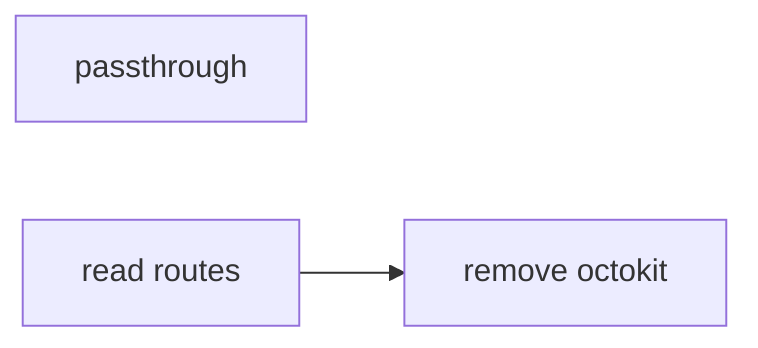

# Forge transport, slice 5 — passthrough and Octokit removal

**Goal:** move the remaining GET passthrough and app-level reads to `forges`, then delete Octokit from the project.
**Architecture:** `api-passthrough.server.ts` uses `provider.request`; read routes obtain providers from `forge`; `app.server.ts` disappears and `forge` is the only client factory.
**Tech stack:** Bun, TypeScript, SvelteKit, `forges@0.2.0`, bun:test.
**Spec path:** docs/plans/2026-10-22-forge-removal.spec.md — §1 Passthrough, §2 Read routes, §3 Remove Octokit, §4 Verification.
**Detail:** tests. **Target-min:** 12. **Orchestrator:** AI.

## Global constraints

- `forges@0.2.0` and `src/lib/server/forge/providers.server.ts` are the only client factory after this slice. No `octokit` import may remain.
- The HTTP routes keep their paths, request bodies and response bodies. Only the client wiring changes.
- The mirror schema and DTOs do not change.
- `forge.getInstallationId`, `forge.installationProvider`, `forge.appProvider`, `forge.userProvider`, `forge.webUrl`, `forge.webOrigin`, `forge.resetCaches` are the public provider API.
- Tabs, aliases, existing test style. Focused command: `bun test --preload ./tests/setup.ts --max-concurrency 1 <owned test paths>`.


## File structure

- `src/lib/server/github/api-passthrough.server.ts` — provider-based raw GET proxy with the existing cache.
- `src/routes/api/repos/**` GET handlers, `src/routes/api/users/[username]/+server.ts` — provider wiring.
- `src/lib/server/github/app.server.ts` — deleted.
- `src/lib/server/github/manifest-flow.server.ts`, `src/lib/server/sync/reconcile.ts`, `src/lib/server/sync/worker.ts` — `forge` imports.
- `package.json`, `bun.lock` — remove `octokit`.
- Tests for the passthrough, routes and removal.

## Task graph

```mermaid
%% schedule
gantt
  title Predicted schedule (mm:ss)
  dateFormat X
  axisFormat %M:%S
  section lane 1
  T11 passthrough provider :t11, 0, 110s
  section lane 2
  T12 read routes :t12, 0, 97s
  T13 remove Octokit :t13, 97, 126s
```





critical path: T12 → T13 (3.7 min) · peak width 2 · predicted build 3.7 min · predicted total ≈ 7.2 min

### T11 passthrough provider · Complexity 4 (O-1) · Est. context 36k
**Owns:** src/lib/server/github/api-passthrough.server.ts, src/lib/server/github/api-passthrough.test.ts
**Components:** 1
**LOC owned:** 160
**Tests:** fast
**Model:** sonnet
**Est. time:** 4 min
**Produces:** `passthrough(provider: GitHubProvider, installationId: number, upstreamPath: string, clientQuery: URLSearchParams, clientEtag: string | null, options?: PassthroughOptions) -> Promise<PassthroughResult>`
- e.g. passthrough(p, 7, "/repos/acme/widgets/issues", new URLSearchParams(), null) -> { status: 200, body: "[{\"number\":1}]", headers: { ETag: "\"e1\"" } }
- e.g. passthrough(p, 7, "/repos/acme/missing/issues", new URLSearchParams(), null) -> { status: 404, body: "{\"message\":\"Not Found\"}", headers: { "Content-Type": "application/json" } }
**Review Focus:** protocol: the upstream call is `provider.request("GET", upstreamPath, { query, headers })`, with `If-None-Match` from the cached etag and the GitHub accept header; encoding: query parameters are passed as an object and `Link` is rewritten from the API base; state: a fresh cache avoids the request, a 304 revalidates it, and a 404 with `htmlUrlFallback` keeps the current body; protocol: a `ForgeApiError` forwards its status and parsed body.
**Test code (verbatim):**
```ts
import { afterEach, beforeEach, describe, expect, test } from "bun:test";
import { setConfig } from "#/lib/server/config";
import { TEST_CONFIG } from "#tests/test-config";
import { clearPassthroughCache, passthrough } from "./api-passthrough.server";

beforeEach(() => { setConfig(TEST_CONFIG); clearPassthroughCache(); });

function provider(data: unknown, headers: Record<string, string> = {}) {
  return { request: async (method: string, path: string, options: unknown) => ({ status: 200, data, headers: new Headers(headers), context: { method, path, options } }) };
}

describe("passthrough", () => {
  test("returns the upstream body and rewritten link", async () => {
    const out = await passthrough(provider([{ number: 1 }], { etag: '"e1"', link: '<https://api.github.com/repos/acme/widgets/issues?page=2>; rel="next"' }) as never, 7, "/repos/acme/widgets/issues", new URLSearchParams(), null);
    expect(out.status).toBe(200);
    expect(out.body).toBe("[{\"number\":1}]");
    expect(out.headers.Link).toBe('</api/repos/acme/widgets/issues?page=2>; rel="next"');
  });
  test("maps a 404 with the fallback url", async () => {
    const p = { request: async () => { throw Object.assign(new Error("missing"), { status: 404, body: "{}" }); } };
    const out = await passthrough(p as never, 7, "/repos/acme/missing/issues", new URLSearchParams(), null, { htmlUrlFallback: "https://github.com/acme/missing/issues" });
    expect(out.status).toBe(404);
    expect(JSON.parse(out.body)).toMatchObject({ html_url: "https://github.com/acme/missing/issues" });
  });
});
```
**Steps:** 1 failing test, 2 run: FAIL, 3 implement, 4 run: PASS
**Notes:** Convert `Headers` to a record with `Object.fromEntries(res.headers.entries())` before the existing header helpers run. For errors, parse `ForgeApiError.body` (JSON) when possible; headers may be `{}`. Keep the cache key and TTL logic untouched.

### T12 read routes · Complexity 3 (O-1) · Est. context 30k
**Owns:** src/routes/api/repos/[owner]/[repo]/issues/+server.ts, src/routes/api/repos/[owner]/[repo]/issues/[number]/+server.ts, src/routes/api/repos/[owner]/[repo]/issues/[number]/comments/+server.ts, src/routes/api/repos/[owner]/[repo]/labels/+server.ts, src/routes/api/repos/[owner]/[repo]/labels/[name]/+server.ts, src/routes/api/users/[username]/+server.ts, tests/issues-routes.test.ts, tests/routes.test.ts, tests/work-notes-routes.test.ts
**Components:** 1
**LOC owned:** 60
**Tests:** fast
**Model:** sonnet
**Est. time:** 3 min
**Consumes:** `passthrough(provider: GitHubProvider, installationId: number, upstreamPath: string, clientQuery: URLSearchParams, clientEtag: string | null, options?: PassthroughOptions) -> Promise<PassthroughResult>` (T11)
**Produces:** `GET handlers wire forge providers`
- e.g. GET /api/repos/acme/widgets/issues -> passthrough(await forge.installationProvider(7), 7, ...)
- e.g. GET /api/users/octocat -> passthrough(await forge.appProvider(), 0, "/users/octocat", ...)
**Review Focus:** protocol: no route imports `github` or `webUrl` from `app.server.ts`; installation routes use `forge.getInstallationId` and `forge.installationProvider`; the users route uses `forge.appProvider`; encoding: `webUrl` fallbacks use `forge.webUrl`; state: a missing installation still returns the same fallback response.
**Test code (verbatim):**
```ts
import { expect, test } from "bun:test";
import { readFileSync } from "node:fs";
test("read routes use the forge provider", () => {
  for (const file of [
    "src/routes/api/repos/[owner]/[repo]/issues/+server.ts",
    "src/routes/api/users/[username]/+server.ts",
  ]) {
    const text = readFileSync(file, "utf8");
    expect(text).not.toContain("github/app.server");
    expect(text).toContain("forge");
  }
});
```
**Steps:** 1 failing test, 2 run: FAIL, 3 implement, 4 run: PASS
**Notes:** `installationErrorResponse` can stay in `app.server.ts` until T13, but T12 should import it from a new helper in `forge/providers.server.ts` to avoid touching `app.server.ts` twice. Keep the route tests' fetch stubs; they already speak the GitHub HTTP boundary.

### T13 remove Octokit · Complexity 4 (O-1) · Est. context 38k
**Owns:** src/lib/server/github/app.server.ts, src/lib/server/github/app.test.ts, src/lib/server/github/manifest-flow.server.ts, src/lib/server/github/manifest-flow.server.test.ts, src/lib/server/sync/reconcile.ts, src/lib/server/sync/worker.ts, src/routes/onboarding/installed/+page.server.ts, src/routes/onboarding/callback/+server.ts, src/routes/*/settings/github-app/+page.server.ts, src/lib/server/auth/index.ts, src/lib/server/github/credentials.ts, src/lib/server/http/outcome.ts, src/lib/server/log.ts, src/lib/server/sync/reconcile.test.ts, src/lib/server/sync/worker.test.ts, tests/github-app.ts, tests/issues-routes.test.ts, tests/routes.test.ts, tests/work-notes-routes.test.ts, package.json, bun.lock
**Components:** 2
**LOC owned:** 180
**Tests:** fast
**Kind:** design
**Model:** sonnet
**Est. time:** 4 min
**Produces:** `no octokit dependency or import remains`
- e.g. `rg "octokit" src package.json` -> no matches
- e.g. `resetAppCache()` -> `forge.resetCaches()`
**Review Focus:** protocol: delete `app.server.ts` and `app.test.ts`; `manifest-flow.server.ts` uses `forge.appProvider().request("GET", "/app/installations", { query: { per_page: 100 } })` or `installations.list()`; `reconcile.ts`/`worker.ts` import `forge.getInstallationId`; onboarding/settings call `forge.resetCaches()`; `package.json` and `bun.lock` drop `octokit`; state: the first-run gate still keys off `hasGithubCredentials`; encoding: `tests/github-app.ts` keeps the RSA key and loses the `@octokit` comment.
**Test code (verbatim):**
```ts
import { expect, test } from "bun:test";
import { readFileSync } from "node:fs";
test("octokit is gone from the manifest", () => {
  expect(readFileSync("package.json", "utf8")).not.toContain("octokit");
});
```
**Steps:** 1 failing test, 2 run: FAIL, 3 implement, 4 run: PASS
**Notes:** Run `bun remove octokit` so the lockfile updates. `app.server.ts` also exports `installationErrorResponse`; move it to `forge/providers.server.ts` in T12, then delete. Update every `resetAppCache` import to `forge.resetCaches`. The full suite must stay green.
