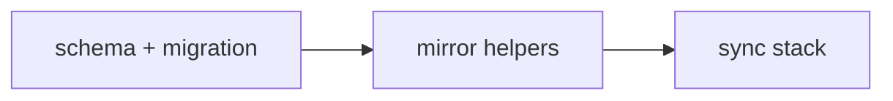
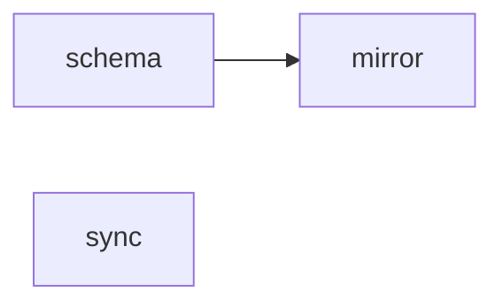

# Forge-agnostic model, slice B1 — schema, mirror and sync

**Goal:** replace the GitHub-shaped mirror with a forge-neutral one: `mirror_*` tables, `forge`/`instance`/`external_id`, internal integer ids, and `url` instead of `html_url`.
**Architecture:** schema and migration first, then the mirror helpers, then the sync stack that writes them. The mirror is disposable, so the migration drops and recreates it; durable notes and attachments are rebuilt with copied author ids.
**Tech stack:** Bun, TypeScript, Drizzle, SQLite, `forges@0.2.0`, bun:test.
**Spec path:** docs/plans/2026-10-22-forge-schema.spec.md — §1 Mirror schema, §2 Mirror helpers, §3 Sync stack, §4 Migration and compatibility.
**Detail:** contracts. **Target-min:** 18. **Orchestrator:** AI.

## Global constraints

- Internal ids are integers and are the only FK targets. `external_id` is forge-native text, unique per `(forge, instance)` for repos/users and per repo for threads/comments.
- Existing public mirror helper names stay (`upsertRepo`, `upsertUser`, `upsertIssue`, `getRepo`, `getRepoCursor`, `replaceRepoLabels`, `replaceRepoAssignees`, `replaceRepoMilestones`, `getIssueLabels`, `getIssue`, `deleteIssue`, `deleteIssuesNotIn`, `setIssueMetadata`, `replaceIssueLabels`); only their fields and some parameter types change.
- The mirror is disposable: the migration may drop `mirror_github_*` and recreate empty `mirror_*` tables. Do not try to copy mirror rows.
- Durable `state_work_note` and `state_attachment` rows survive; copy `author_github_id` / `uploaded_by_github_id` into text external ids with forge `github` and instance `''`.
- No settings, auth, HTTP route, UI or query change in this slice. Those are B2.
- Tabs, aliases, existing test style. Focused command: `bun test --preload ./tests/setup.ts --max-concurrency 1 <owned test paths>`.



## File structure

- `src/lib/server/db/schema.ts` — forge-neutral mirror tables and durable-state columns.
- `drizzle/20261022140000_forge_mirror/migration.sql` — drop/recreate the mirror, rebuild the durable tables.
- `src/lib/server/sync/mirror.ts` — record types, upserts and reads against the new tables.
- `src/lib/server/sync/{hydrate,worker,conflicts,reconcile}.ts` — build and consume the new records.
- `tests/mirror-helpers.ts` — clear the new tables.

## Task graph

```mermaid
%% schedule
gantt
  title Predicted schedule (mm:ss)
  dateFormat X
  axisFormat %M:%S
  section lane 1
  T16 sync stack :t16, 0, 160s
  section lane 2
  T14 schema and migration :t14, 0, 147s
  T15 mirror helpers :t15, 147, 168s
```





critical path: T14 → T15 (5.3 min) · peak width 2 · predicted build 5.3 min · predicted total ≈ 8.8 min

### T14 schema and migration · Complexity 5 (O-1) · Est. context 40k
**Owns:** src/lib/server/db/schema.ts, drizzle/20261022140000_forge_mirror/migration.sql, tests/mirror-helpers.ts, src/lib/server/db/schema.test.ts
**Components:** 2
**LOC owned:** 260
**Tests:** fast
**Model:** sonnet
**Est. time:** 4 min
**Produces:** `mirrorRepo` · `mirrorUser` · `mirrorMilestone` · `mirrorThread` · `mirrorRepoLabel` · `mirrorThreadLabel` · `mirrorThreadAssignee` · `mirrorRepoAssignee` · `mirrorComment` · `stateWorkNote.authorExternalId` · `stateAttachment.uploadedByExternalId`
- e.g. `pragma table_info(mirror_repo)` -> columns include `id`, `forge`, `instance`, `external_id`, `org`, `name`, `url`, `etag`
- e.g. `pragma table_info(mirror_thread)` -> columns include `repo_id`, `number`, `external_id`, `kind`, `url`, `author_id`
- e.g. the old `mirror_github_repo` table no longer exists
**Review Focus:** protocol: every mirror table has `forge`/`instance` where it owns identity (repo, user) and `external_id`; state: `mirror_repo.id` and `mirror_user.id` are autoincrement integer PKs, and every FK points at those, not at external ids; state: `mirror_thread` is keyed `(repo_id, number)` and has `kind`, `external_id`, `url`; encoding: the migration drops child tables before parents and creates children after parents; file: the durable rebuild copies `author_github_id`/`uploaded_by_github_id` as text and keeps every existing column.
**Test code (verbatim):**
```ts
import { expect, test } from "bun:test";
import { db } from "#lib/server/db/index";
const cols = (table: string) => db.$client.query(`pragma table_info(${table})`).all().map((r: any) => r.name);
test("the mirror is forge-neutral", () => {
  const repo = cols("mirror_repo");
  expect(repo).toContain("forge");
  expect(repo).toContain("instance");
  expect(repo).toContain("external_id");
  expect(repo).not.toContain("github_id");
  const thread = cols("mirror_thread");
  expect(thread).toContain("kind");
  expect(thread).toContain("external_id");
  expect(thread).toContain("url");
  expect(cols("mirror_github_repo")).toEqual([]);
});
test("durable state keeps external authors", () => {
  expect(cols("state_work_note")).toContain("author_external_id");
  expect(cols("state_work_note")).not.toContain("author_github_id");
  expect(cols("state_attachment")).toContain("uploaded_by_external_id");
});
```
**Steps:** 1 failing test, 2 run: FAIL, 3 implement, 4 run: PASS
**Notes:** `mirror_repo`/`mirror_user` each have `id integer primary key autoincrement` and unique indexes on `(forge, instance, external_id)` plus `(forge, instance, org, name)` / `(forge, instance, login)`. `mirror_thread` has unique `(repo_id, external_id)`. `mirror_comment` has `id integer primary key autoincrement` and unique `(repo_id, external_id)`. Rebuild `state_work_note` and `state_attachment` with `CREATE TABLE ..._new`, `INSERT ... SELECT ... CAST(author_github_id AS TEXT), 'github', '' ...`, `DROP`, `ALTER TABLE ... RENAME`. Update `tests/mirror-helpers.ts` to the new table names.

### T15 mirror helpers · Complexity 5 (O-1) · Est. context 40k
**Owns:** src/lib/server/sync/mirror.ts, src/lib/server/sync/mirror.test.ts
**Components:** 2
**LOC owned:** 420
**Tests:** fast
**Model:** sonnet
**Est. time:** 5 min
**Consumes:** `mirrorRepo` · `mirrorUser` · `mirrorMilestone` · `mirrorThread` · `mirrorRepoLabel` · `mirrorThreadLabel` · `mirrorThreadAssignee` · `mirrorRepoAssignee` · `mirrorComment` (T14)
**Produces:** `RepoRow` · `UserRecord` · `CommentRecord` · `IssueRecord` · `MilestoneRecord` · `upsertRepo(input: { externalId: string; forge: string; instance: string; org: string; name: string; url: string; archived: boolean }) -> RepoRow` · `upsertUser(user: UserRecord) -> UserRecord` · `upsertIssue(issue: IssueRecord, metadata: StoredMetadata) -> void` · `getRepoBySlug(forge: string, instance: string, org: string, name: string) -> RepoRow | undefined`
- e.g. upsertRepo({ externalId: "7", forge: "github", instance: "github.com", org: "acme", name: "widgets", url: "https://github.com/acme/widgets", archived: false }) -> { id: 1, externalId: "7", forge: "github", instance: "github.com", ... }
- e.g. upsertUser({ id: 0, externalId: "101", forge: "github", instance: "github.com", login: "octocat", avatarUrl: "", url: "" }) -> { id: 1, externalId: "101", ... }
- e.g. upsertIssue({ externalId: "9001", repoId: 1, number: 1, kind: "issue", author: { externalId: "101", ... }, assignees: [], comments: [] }, metadata) -> undefined
**Review Focus:** protocol: `upsertRepo` conflicts on `(forge, instance, external_id)` and returns the internal row; `upsertUser` is idempotent on `(forge, instance, external_id)` and returns the internal id; `upsertIssue` resolves author/assignee/comment authors to internal user ids before writing; numeric: `getRepoCursor` still returns the newest `updated_at`; state: `replaceRepoAssignees` and `replaceRepoMilestones` upsert their user/milestone rows before junction writes; encoding: `external_id` is always a string, including a numeric id.
**Test code (verbatim):**
```ts
import { beforeEach, describe, expect, test } from "bun:test";
import { clearMirror } from "#tests/mirror-helpers";
import { getRepoBySlug, getUser, upsertRepo, upsertUser } from "./mirror";
beforeEach(() => clearMirror());
describe("forge-neutral mirror", () => {
  test("upsertRepo returns an internal id and is idempotent", () => {
    const a = upsertRepo({ externalId: "7", forge: "github", instance: "github.com", org: "acme", name: "widgets", url: "https://github.com/acme/widgets", archived: false });
    const b = upsertRepo({ externalId: "7", forge: "github", instance: "github.com", org: "acme", name: "widgets", url: "https://github.com/acme/widgets", archived: true });
    expect(b.id).toBe(a.id);
    expect(getRepoBySlug("github", "github.com", "acme", "widgets")?.id).toBe(a.id);
  });
  test("upsertUser is keyed by external id", () => {
    const a = upsertUser({ id: 0, externalId: "101", forge: "github", instance: "github.com", login: "octocat", avatarUrl: "", url: "" });
    const b = upsertUser({ id: 0, externalId: "101", forge: "github", instance: "github.com", login: "octocat2", avatarUrl: "x", url: "" });
    expect(b.id).toBe(a.id);
    expect(getUser("101", "github", "github.com")?.login).toBe("octocat2");
  });
});
```
**Steps:** 1 failing test, 2 run: FAIL, 3 implement, 4 run: PASS
**Notes:** `upsertUser` input may carry `id: 0`; ignore it and let SQLite assign. Use `.returning()` or a follow-up select by `(forge, instance, externalId)`. `upsertIssue` builds a `Map<externalId, internalId>` from `upsertUser` and uses it for `author_id`, assignees and comment authors. `deleteIssuesNotIn` and `deleteIssue` keep taking `repoId` (internal).

### T16 sync stack · Complexity 5 (O-1) · Est. context 42k
**Owns:** src/lib/server/sync/hydrate.ts, src/lib/server/sync/hydrate.test.ts, src/lib/server/sync/worker.ts, src/lib/server/sync/worker.test.ts, src/lib/server/sync/conflicts.ts, src/lib/server/sync/conflicts.test.ts, src/lib/server/sync/reconcile.ts, src/lib/server/sync/reconcile.test.ts
**Components:** 2
**LOC owned:** 360
**Tests:** fast
**Model:** sonnet
**Est. time:** 5 min
**Consumes:** `IssueRecord` · `upsertIssue(issue: IssueRecord, metadata: StoredMetadata) -> void` (T15) · `upsertRepo(...) -> RepoRow` (T15) · `getRepo(id: number) -> RepoRow | undefined` (T15)
**Produces:** `normalizeNode(node, repoId) -> IssueRecord | null` · `ensureRepoMirror(owner: string, repo: string, installationId: number) -> Promise<RepoRow>` · `resolveConflicts(provider, repo: RepoRow, records) -> Promise<number>`
- e.g. normalizeNode({ databaseId: 9001, number: 1, url: "https://github.com/acme/widgets/issues/1", ... }, 1) -> { externalId: "9001", kind: "issue", url: "https://github.com/acme/widgets/issues/1", ... }
- e.g. ensureRepoMirror("acme", "widgets", 7) -> { id: 1, externalId: "7", forge: "github", instance: "github.com", ... }
- e.g. resolveConflicts(provider, repo, []) -> 0
**Review Focus:** protocol: `HYDRATE_QUERY` selects `url` and `normalizeNode` sets `externalId: String(node.databaseId)`, `kind: "issue"` and `url`; state: `ensureRepoMirror` stores `repo.ref.externalId`, `repo.forge`, `repo.instance` and `repo.url`; numeric: every mirror call uses `repo.id`, never `repo.githubId`; protocol: `pollRepo` and `refreshIssue` keep the ETag/cursor and node-id flow; state: conflicts and reconciliation still work after the id change.
**Test code (verbatim):**
```ts
import { beforeEach, describe, expect, test } from "bun:test";
import { clearMirror } from "#tests/mirror-helpers";
import { normalizeNode } from "./hydrate";
import { upsertRepo } from "./mirror";
beforeEach(() => clearMirror());
describe("normalizeNode", () => {
  test("maps databaseId to a text external id and keeps the url", () => {
    const record = normalizeNode({ databaseId: 9001, number: 1, title: "live", state: "OPEN", url: "https://github.com/acme/widgets/issues/1", createdAt: "2026-01-01T00:00:00Z", updatedAt: "2026-01-01T00:00:00Z", labels: { nodes: [] }, assignees: { nodes: [] }, comments: { nodes: [] } } as never, 1);
    expect(record?.externalId).toBe("9001");
    expect(record?.kind).toBe("issue");
    expect(record?.url).toBe("https://github.com/acme/widgets/issues/1");
  });
});
```
**Steps:** 1 failing test, 2 run: FAIL, 3 implement, 4 run: PASS
**Notes:** `normalizeNode`'s actor mapper uses `String(actor.databaseId)` for `UserRecord.externalId` and passes `forge: "github"`, `instance` from the repo? The node has no repo instance; use `"github"`/`"github.com"` defaults, or add a `forge`/`instance` argument. Better: `normalizeNode(node, repoId, forge = "github", instance = "github.com")` and `hydrateAndStore` passes the repo's identity. Update the signature in the plan's Produces if needed; the implementer may add the parameters.
