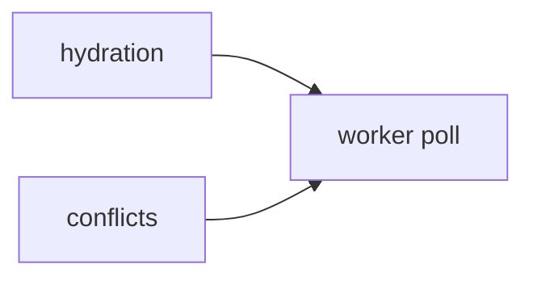
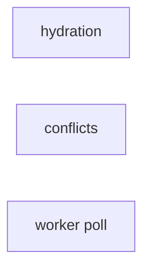

# Forge transport, slice 4 — sync poll, hydration and conflicts

**Goal:** move the background sync onto `forges`, so polling, hydration and conflict repair no longer use Octokit.
**Architecture:** the worker holds one installation provider per poll; `threads.list` supplies ETag/cursor pages; hydration stays on GitHub GraphQL through the provider; conflicts use normalized label events.
**Tech stack:** Bun, TypeScript, SvelteKit, `forges@0.2.0`, `octokit@5` (passthrough only), bun:test.
**Spec path:** docs/plans/2026-10-22-forge-sync.spec.md — §1 Polling, §2 Hydration, §3 Conflicts, §4 Coexistence.
**Detail:** tests. **Target-min:** 13. **Orchestrator:** AI.

## Global constraints

- `forges@0.2.0` and the provider layer are in place (`forge.installationProvider`, `forge.repoRef`, `forge.threadRef`).
- The mirror schema is unchanged: `mirror.RepoRow.githubId`, `mirror.IssueRecord.githubId` stay numeric. Parse `Thread.ref.externalId`/`Repo.ref.externalId` with `Number(...)`.
- `HYDRATE_QUERY` and `normalizeNode` stay byte-identical.
- `resolveWinners`, `deriveMetadata` and `parseTimeline` stay; add a normalizer for `ForgeEvent[]` next to `parseTimeline`.
- The raw passthrough, users route and `app.server.ts` stay on Octokit in this slice.
- Tabs, aliases, existing test style. Focused command: `bun test --preload ./tests/setup.ts --max-concurrency 1 <owned test paths>`.



## File structure

- `src/lib/server/sync/hydrate.ts` — provider-bound GraphQL hydration.
- `src/lib/server/sync/conflicts.ts` — normalized label events and provider label removal.
- `src/lib/server/sync/worker.ts` — `threads.list` polling, provider repo/thread reads, one provider per repo cycle.
- Tests for the three modules and the existing reconcile/worker harnesses.

## Task graph

```mermaid
%% schedule
gantt
  title Predicted schedule (mm:ss)
  dateFormat X
  axisFormat %M:%S
  section lane 1
  T8 worker polling :t8, 0, 163s
  section lane 2
  T10 conflicts :t10, 0, 106s
  section lane 3
  T9 hydration :t9, 0, 101s
```





critical path: T8 (2.7 min) · peak width 3 · predicted build 2.7 min · predicted total ≈ 6.2 min

### T9 hydration · Complexity 3 (O-1) · Est. context 30k
**Owns:** src/lib/server/sync/hydrate.ts, src/lib/server/sync/hydrate.test.ts
**Components:** 1
**LOC owned:** 90
**Tests:** fast
**Model:** sonnet
**Est. time:** 3 min
**Produces:** `hydrateAndStore(installationId: number, repoId: number, nodeIds: readonly string[], graphqlFn?: GraphqlFn) -> Promise<mirror.IssueRecord[]>`
- e.g. hydrateAndStore(7, 1, ["n1"], fakeGraphql) -> [{ githubId: 101, number: 1, title: "live", ... }]
- e.g. hydrateAndStore(7, 1, [], fakeGraphql) -> []
**Review Focus:** protocol: the default path calls `(await forge.installationProvider(installationId)).graphql(HYDRATE_QUERY, { ids })` through a bound arrow, never an unbound method; state: the injected `graphqlFn` still wins in tests; encoding: `chunk` keeps the 100-id batches; protocol: no `github` import remains.
**Test code (verbatim):**
```ts
import { describe, expect, test } from "bun:test";
import { hydrateAndStore } from "./hydrate";

const fakeGraphql = async () => ({
  nodes: [{ databaseId: 101, number: 1, title: "live", state: "OPEN", createdAt: "2026-01-01T00:00:00Z", updatedAt: "2026-01-01T00:00:00Z", labels: { nodes: [] }, assignees: { nodes: [] }, comments: { nodes: [] } }],
});

describe("hydrateAndStore", () => {
  test("stores normalized nodes from the injected graphql", async () => {
    const records = await hydrateAndStore(7, 1, ["n1"], fakeGraphql as never);
    expect(records).toHaveLength(1);
    expect(records[0]).toMatchObject({ githubId: 101, number: 1, title: "live" });
  });
  test("does nothing for an empty batch", async () => {
    expect(await hydrateAndStore(7, 1, [], fakeGraphql as never)).toEqual([]);
  });
});
```
**Steps:** 1 failing test, 2 run: FAIL, 3 implement, 4 run: PASS
**Notes:** Replace `const gql = graphqlFn ?? (await github.graphql(installationId));` with `const provider = graphqlFn ? undefined : await forge.installationProvider(installationId); const gql = graphqlFn ?? ((query, vars) => provider!.graphql(query, vars));`.

### T10 conflicts · Complexity 4 (O-1) · Est. context 34k
**Owns:** src/lib/server/sync/conflicts.ts, src/lib/server/sync/conflicts.test.ts
**Components:** 1
**LOC owned:** 130
**Tests:** fast
**Model:** sonnet
**Est. time:** 3.5 min
**Produces:** `fetchTimeline(provider: GitHubProvider, ref: ThreadRef) -> Promise<LabeledEvent[]>` · `resolveIssueConflict(provider: GitHubProvider, repo: RepoRef, number: number, labelNames: readonly string[]) -> Promise<ResolvedConflict>`
- e.g. fetchTimeline(p, ref) -> [{ label: "backlog", createdAt: 1730000000000 }]
- e.g. resolveIssueConflict(p, repo, 7, ["backlog", "in-progress"]) -> { metadata: { status: "in-progress", ... }, removed: ["backlog"], ambiguous: false }
**Review Focus:** protocol: `fetchTimeline` iterates `provider.threads.events(ref)` and keeps `kind === "label"` with `detail.type === "label"`; encoding: `occurredAt` is converted with `.getTime()`; state: a missing newest event still yields `ambiguous`; protocol: obsolete labels are removed with `provider.threads.removeLabels(ref, [name])`, one call per obsolete label; protocol: no Octokit import remains.
**Test code (verbatim):**
```ts
import { describe, expect, test } from "bun:test";
import { fetchTimeline, resolveWinners } from "./conflicts";

const ref = { forge: "github", instance: "github.com", repo: { forge: "github", instance: "github.com", owner: "acme", name: "widgets" }, kind: "issue", number: "7" } as const;

describe("fetchTimeline", () => {
  test("keeps normalized label events in order", async () => {
    const provider = { threads: { events: () => ({ async *[Symbol.asyncIterator]() {
      yield { kind: "label", action: "labelled", occurredAt: new Date(1000), detail: { type: "label", label: "backlog" } };
      yield { kind: "comment", action: "created", occurredAt: new Date(2000), detail: { type: "comment" } };
      yield { kind: "label", action: "labelled", occurredAt: new Date(3000), detail: { type: "label", label: "in-progress" } };
    } }) } };
    const events = await fetchTimeline(provider as never, ref as never);
    expect(events).toEqual([{ label: "backlog", createdAt: 1000 }, { label: "in-progress", createdAt: 3000 }]);
    expect(resolveWinners(["backlog", "in-progress"], events).winners.get("status")).toBe("in-progress");
  });
});
```
**Steps:** 1 failing test, 2 run: FAIL, 3 implement, 4 run: PASS
**Notes:** `ThreadRef` needs `repo` and `forge`/`instance` at the top level; build it with `forge.threadRef(forge.repoRef(...), "issue", number)`. Keep `parseTimeline` exported for the raw tests. `resolveIssueConflict` signature changes; update its caller in `worker.ts` in T8, not here.

### T8 worker polling · Complexity 5 (O-1) · Est. context 44k
**Owns:** src/lib/server/sync/worker.ts, src/lib/server/sync/worker.test.ts, src/lib/server/sync/reconcile.test.ts
**Components:** 2
**LOC owned:** 380
**Tests:** fast
**Model:** sonnet
**Est. time:** 5 min
**Consumes:** `hydrateAndStore(installationId: number, repoId: number, nodeIds: readonly string[], graphqlFn?: GraphqlFn) -> Promise<mirror.IssueRecord[]>` (T9) · `resolveIssueConflict(provider: GitHubProvider, repo: RepoRef, number: number, labelNames: readonly string[]) -> Promise<ResolvedConflict>` (T10)
**Produces:** `pollRepo(repo: mirror.RepoRow, installationId: number, now?: number, options?: PollOptions) -> Promise<PollResult>` · `ensureRepoMirror(owner: string, repo: string, installationId: number) -> Promise<mirror.RepoRow>` · `refreshIssue(owner: string, repo: string, number: number) -> Promise<void>`
- e.g. pollRepo(repo, 7) with an unchanged etag -> { notModified: true, changed: 0, hydrated: 0, pruned: 0, conflicts: 0, seenNumbers: [] }
- e.g. pollRepo(repo, 7) with one open issue -> { notModified: false, changed: 1, hydrated: 1, ... }
- e.g. ensureRepoMirror("acme", "widgets", 7) -> { githubId: 7, org: "acme", name: "widgets", archived: false }
**Review Focus:** protocol: `threads.list` sends `kind: "issue"`, `state: "all"`, `sort: "updated"`, `direction: "asc"`, `perPage: 100`, `since` and `cursor: { etag }`; state: `page.notModified` returns the early result and leaves the etag untouched; numeric: `ref.number`/`ref.externalId` are parsed, `closedAt` drives the history window, and PR threads are absent because of `kind`; protocol: every remaining page is read with `page.cursor`; state: `ensureRepoMirror` upserts `ref.externalId`, and `refreshIssue` hydrates `thread.ref.externalId`; protocol: no Octokit import remains in the worker.
**Test code (verbatim):**
```ts
import { describe, expect, test } from "bun:test";
import { inHistoryWindow } from "./worker";

describe("inHistoryWindow", () => {
  test("keeps open issues and recent closed issues", () => {
    const cutoff = Date.parse("2026-01-01T00:00:00Z");
    expect(inHistoryWindow({ number: 1, state: "open" } as never, cutoff)).toBe(true);
    expect(inHistoryWindow({ number: 2, state: "closed", closed_at: "2026-02-01T00:00:00Z" } as never, cutoff)).toBe(true);
    expect(inHistoryWindow({ number: 3, state: "closed", closed_at: "2025-01-01T00:00:00Z" } as never, cutoff)).toBe(false);
  });
});
```
**Steps:** 1 failing test, 2 run: FAIL, 3 implement, 4 run: PASS
**Notes:** Port the existing `worker.test.ts` harness to a fake provider with `threads.list` returning `{ page: async () => ({ items, cursor, etag, notModified }) }` and `threads.get`/`threads.events`, `repos.get`. Keep every existing assertion (ETag, 304, pagination, pruning, SSE, scheduler). `inHistoryWindow` can keep its `{ number, state, closed_at }` input or move to `Thread`; keep the exported name.
