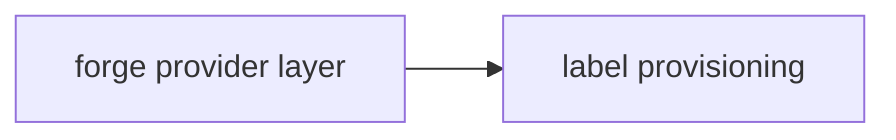
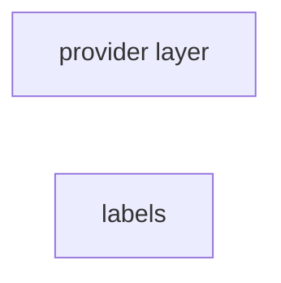

# Forge transport, slice 1 — provider layer and labels

**Goal:** add `forges` as the GitHub client for new code, with a provider layer that both github.com and GHES use, and move label provisioning onto it without changing behaviour.
**Architecture:** `src/lib/server/forge/providers.server.ts` owns every `forges` provider. `labels.ts` uses normalised `repos.*` operations and one raw request for the update that `forges` does not model. Octokit remains for the unported modules.
**Tech stack:** Bun, TypeScript, SvelteKit, `forges@0.2.0`, `octokit@5` (coexisting), bun:test.
**Spec path:** docs/plans/2026-10-22-forge-transport.spec.md — §1 Provider layer, §2 Label provisioning, §3 Coexistence and verification.
**Detail:** tests. **Target-min:** 8. **Orchestrator:** AI.

## Global constraints

- Pin `forges@0.2.0` exactly. It is ESM-only, has no runtime dependencies, and uses the global `fetch`.
- The API base is `getConfig().github.api_url`; the instance is the host of `getConfig().github.url` (so `github.com` and `acme.ghe.com` both work).
- Credentials still come from `state_github_app` via `getGithubCredentials()`; no env credentials, no schema change.
- Keep `octokit` in `package.json` and keep `app.server.ts` exports unchanged. This slice must not break unported modules.
- Do not change `provisionCanonicalLabels` or `provisionRepoLabels` public signatures; `hooks.server.ts` and `sync/reconcile.ts` must not change.
- Use tabs, existing import aliases (`#/lib/server/...`, `#lib/...`, `#tests/...`), and the existing test style.
- Run `bun test --preload ./tests/setup.ts --max-concurrency 1 <owned test paths>` during TDD.



## File structure

- `src/lib/server/forge/providers.server.ts` — the only `forges` construction site: app, installation and user providers, installation-id lookup, refs, web URLs, cache reset.
- `src/lib/server/forge/providers.test.ts` — provider construction, auth headers, caching, GHES instance.
- `src/lib/server/github/labels.ts` — label reads/creates/updates through the provider; unchanged behaviour.
- `src/lib/server/github/labels.test.ts` — fake provider, create/patch/unchanged/case-insensitivity.
- `src/lib/server/sync/worker.ts` — `refreshRepoLabels` obtains an installation provider.
- `package.json`, `bun.lock` — add `forges`.

## Task graph

```mermaid
%% schedule
gantt
  title Predicted schedule (mm:ss)
  dateFormat X
  axisFormat %M:%S
  section lane 1
  T1 :t1, 0, 102s
  T2 :t2, 102, 102s
```





critical path: T1 → T2 (3.4 min) · peak width 1 · predicted build 3.4 min · predicted total ≈ 6.9 min

### T1 provider layer · Complexity 4 (O-1) · Est. context 34k
**Owns:** src/lib/server/forge/providers.server.ts, src/lib/server/forge/providers.test.ts, package.json, bun.lock
**Components:** 1
**LOC owned:** 190
**Tests:** fast
**Model:** sonnet
**Est. time:** 3.5 min
**Produces:** `forge.appProvider() -> Promise<GitHubProvider>` · `forge.installationProvider(id: number) -> Promise<GitHubProvider>` · `forge.userProvider(token: string) -> GitHubProvider` · `forge.getInstallationId(owner: string, repo: string) -> Promise<number>` · `forge.repoRef(owner: string, name: string) -> RepoRef` · `forge.threadRef(repo: RepoRef, kind: ThreadKind, number: number) -> ThreadRef` · `forge.webOrigin() -> Promise<string>` · `forge.webUrl(path: string) -> Promise<string>` · `forge.resetCaches() -> void`
- e.g. forge.repoRef("acme", "widgets") -> { forge: "github", instance: "github.com", owner: "acme", name: "widgets" }
- e.g. forge.threadRef(forge.repoRef("acme", "widgets"), "issue", 42) -> { forge: "github", instance: "github.com", owner: "acme", name: "widgets", kind: "issue", number: "42" }
- e.g. forge.webUrl("/acme/widgets") -> "https://github.com/acme/widgets"
- e.g. forge.getInstallationId("acme", "widgets") -> 4242
- e.g. forge.installationProvider(4242) -> GitHubProvider acting as installation 4242
**Review Focus:** protocol: `github({ auth: { type: "app", appId, privateKey, installationId } })` is used for installations and the app-only provider for `/installation`; the instance host is read from `github.url` so GHES works; state: provider and installation-id caches are keyed correctly and `resetCaches()` clears both; security: the private key and installation token never appear in logs; encoding: `webUrl` normalises one slash.
**Test code (verbatim):**
```ts
import { afterEach, beforeEach, describe, expect, test } from "bun:test";
import { setConfig } from "#/lib/server/config";
import { TEST_CONFIG, GHE_CONFIG } from "#tests/test-config";
import { seedTestGithubApp } from "#tests/github-app";
import { forge } from "./providers.server";

const realFetch = globalThis.fetch;
let calls: Array<{ url: string; method: string; auth: string | null }> = [];

beforeEach(async () => {
  setConfig(TEST_CONFIG);
  forge.resetCaches();
  calls = [];
  globalThis.fetch = (async (input: any, init?: any) => {
    const url = String(input);
    calls.push({ url, method: init?.method ?? "GET", auth: new Headers(init?.headers).get("authorization") });
    if (url.endsWith("/access_tokens")) return Response.json({ token: "ghs_test", expires_at: new Date(Date.now() + 3_600_000).toISOString() });
    if (url.includes("/repos/acme/widgets/installation")) return Response.json({ id: 4242 });
    if (url.includes("/repos/acme/widgets")) return Response.json({ id: 7, full_name: "acme/widgets", name: "widgets", owner: { login: "acme" }, visibility: "private" });
    return Response.json({});
  }) as typeof fetch;
  await seedTestGithubApp(4242);
});
afterEach(() => { globalThis.fetch = realFetch; forge.resetCaches(); });

describe("refs and links", () => {
  test("refs carry the configured instance", () => {
    expect(forge.repoRef("acme", "widgets")).toEqual({ forge: "github", instance: "github.com", owner: "acme", name: "widgets" });
    const ref = forge.threadRef(forge.repoRef("acme", "widgets"), "issue", 42);
    expect(ref.kind).toBe("issue");
    expect(ref.number).toBe("42");
    expect(ref.owner).toBe("acme");
  });
  test("webUrl joins the web origin", async () => {
    expect(await forge.webUrl("/acme/widgets")).toBe("https://github.com/acme/widgets");
  });
});

describe("providers", () => {
  test("userProvider sends the token", async () => {
    await forge.userProvider("ghp_test").repos.get(forge.repoRef("acme", "widgets"));
    expect(calls.at(-1)?.url).toBe("https://api.github.com/repos/acme/widgets");
    expect(calls.at(-1)?.auth).toBe("Bearer ghp_test");
  });
  test("installationProvider mints and uses an installation token", async () => {
    await (await forge.installationProvider(4242)).repos.get(forge.repoRef("acme", "widgets"));
    expect(calls.some((c) => c.url.endsWith("/app/installations/4242/access_tokens"))).toBe(true);
    expect(calls.at(-1)?.auth).toBe("Bearer ghs_test");
  });
  test("getInstallationId caches the lookup", async () => {
    expect(await forge.getInstallationId("acme", "widgets")).toBe(4242);
    expect(await forge.getInstallationId("acme", "widgets")).toBe(4242);
    expect(calls.filter((c) => c.url.includes("/installation")).length).toBe(1);
  });
  test("GHES host becomes the instance", async () => {
    setConfig(GHE_CONFIG);
    forge.resetCaches();
    expect(forge.repoRef("acme", "widgets").instance).toBe("acme.ghe.com");
    expect(await forge.webUrl("/acme/widgets")).toBe("https://acme.ghe.com/acme/widgets");
  });
});
```
**Steps:** 1 failing test, 2 run: FAIL, 3 implement, 4 run: PASS
**Notes:** Import runtime `github` from `forges/github`; import `RepoRef`, `ThreadRef`, `ThreadKind`, `GitHubProvider`, `ForgeApiError` as types from `forges`/`forges/github`. `getInstallationId` uses `appProvider().request("GET", "/repos/{owner}/{repo}/installation")` with the literal owner/repo interpolated, and throws if `data.id` is missing. Add the dependency with `bun add forges@0.2.0`.

### T2 label provisioning · Complexity 4 (O-1) · Est. context 36k
**Owns:** src/lib/server/github/labels.ts, src/lib/server/github/labels.test.ts, src/lib/server/sync/worker.ts
**Components:** 2
**LOC owned:** 230
**Tests:** fast
**Model:** sonnet
**Est. time:** 4 min
**Consumes:** `forge.installationProvider(id: number) -> Promise<GitHubProvider>` (T1) · `forge.getInstallationId(owner: string, repo: string) -> Promise<number>` (T1) · `forge.repoRef(owner: string, name: string) -> RepoRef` (T1)
**Produces:** `listRepoLabels(provider: GitHubProvider, owner: string, repo: string) -> Promise<RepoLabel[]>` · `provisionRepoLabels(owner: string, repo: string, labels?: readonly CanonicalLabel[]) -> Promise<ProvisionSummary>` · `provisionCanonicalLabels() -> Promise<ProvisionReport>`
- e.g. listRepoLabels(p, "acme", "widgets") -> [{ name: "bug", color: "ff0000", description: "Something is wrong" }]
- e.g. provisionRepoLabels("acme", "widgets", [{ name: "backlog", color: "6f737a", description: "Status: Backlog", group: "status" }]) -> { created: ["backlog"], updated: [], unchanged: [] }
**Review Focus:** protocol: missing labels are created with `repos.createLabel({ name, colour, description })`, drift is patched at `/repos/{owner}/{repo}/labels/{existing-name}` with `{ color, description }`, and a case-insensitive match never creates a duplicate; state: a converged repo issues zero writes; encoding: colour comparison is case-insensitive and the patch uses the existing spelling; numeric: `created`, `updated` and `unchanged` counts match the writes; protocol: `provisionCanonicalLabels` still swallows per-repo failures.
**Test code (verbatim):**
```ts
import { afterEach, beforeEach, describe, expect, spyOn, test } from "bun:test";
import { CANONICAL_LABELS, provisionRepoLabels } from "./labels";
import { forge } from "#/lib/server/forge/providers.server";

const calls: Array<{ method: string; path: string; body?: unknown }> = [];
let existing: Array<{ name: string; colour?: string; description?: string }> = [];

function fakeProvider() {
  return {
    repos: {
      labels: () => ({ async *[Symbol.asyncIterator]() { for (const label of existing) yield label; } }),
      createLabel: async (_repo: unknown, input: { name: string; colour?: string; description?: string }) => {
        calls.push({ method: "POST", path: "labels", body: input });
        return input;
      },
    },
    request: async (method: string, path: string, options?: { body?: unknown }) => {
      calls.push({ method, path, body: options?.body });
      return { status: 200, data: {}, headers: new Headers() };
    },
  };
}

let providerSpy: ReturnType<typeof spyOn>;
let idSpy: ReturnType<typeof spyOn>;
beforeEach(() => {
  calls.length = 0;
  existing = [];
  providerSpy = spyOn(forge, "installationProvider").mockResolvedValue(fakeProvider() as never);
  idSpy = spyOn(forge, "getInstallationId").mockResolvedValue(777);
});
afterEach(() => { providerSpy.mockRestore(); idSpy.mockRestore(); });

test("creates every missing canonical label", async () => {
  const summary = await provisionRepoLabels("acme", "widgets");
  expect(summary.created).toEqual(CANONICAL_LABELS.map((l) => l.name));
  expect(calls.filter((c) => c.method === "POST").length).toBe(CANONICAL_LABELS.length);
  expect(calls[0]?.body).toEqual({ name: "backlog", colour: CANONICAL_LABELS[0].color, description: CANONICAL_LABELS[0].description });
});

test("patches drift under the existing spelling", async () => {
  existing = [{ name: "Backlog", colour: "000000", description: "old" }];
  const summary = await provisionRepoLabels("acme", "widgets");
  expect(summary.updated).toEqual(["backlog"]);
  expect(calls).toContainEqual({ method: "PATCH", path: "/repos/acme/widgets/labels/Backlog", body: { color: CANONICAL_LABELS[0].color, description: CANONICAL_LABELS[0].description } });
});

test("a converged label issues no write", async () => {
  existing = [{ name: "backlog", colour: CANONICAL_LABELS[0].color.toUpperCase(), description: CANONICAL_LABELS[0].description }];
  const summary = await provisionRepoLabels("acme", "widgets", [CANONICAL_LABELS[0]]);
  expect(summary.unchanged).toEqual(["backlog"]);
  expect(calls).toEqual([]);
});
```
**Steps:** 1 failing test, 2 run: FAIL, 3 implement, 4 run: PASS
**Notes:** Keep the existing `CANONICAL_LABELS` vocabulary test. `labels.ts` imports `{ forge }` and `type GitHubProvider`; delete the Octokit import and the `InstallationOctokit` type. `refreshRepoLabels` in `worker.ts` becomes `const provider = await forge.installationProvider(installationId); const labels = await listRepoLabels(provider, repo.org, repo.name);`. Error text: `error instanceof ForgeApiError ? error.status : undefined`, then `"{status} {message}"`.
