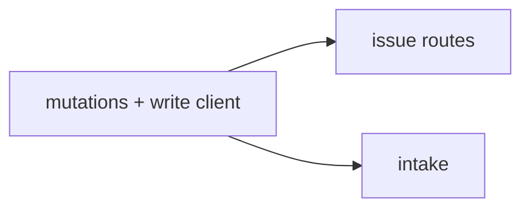
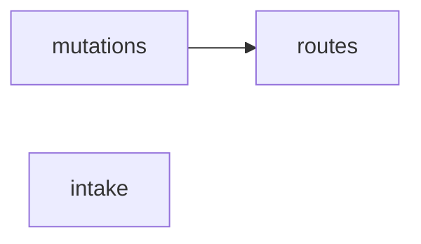

# Forge transport, slice 3 — writes and intake

**Goal:** move issue writes and intake onto the provider layer, so the only remaining Octokit users are the sync poll/hydration/conflicts and the raw passthrough.
**Architecture:** `issues/http.ts` mints a user provider; `mutations.ts` uses `threads.*` and one raw milestone request; routes and intake pass the provider through.
**Tech stack:** Bun, TypeScript, SvelteKit, `forges@0.2.0`, `octokit@5` (coexisting), bun:test.
**Spec path:** docs/plans/2026-10-22-forge-writes.spec.md — §1 Write client, §2 Issue mutations, §3 Routes and intake, §4 Coexistence.
**Detail:** tests. **Target-min:** 12. **Orchestrator:** AI.

## Global constraints

- `forges@0.2.0` and the provider layer are already in place (`forge.userProvider`, `forge.installationProvider`, `forge.repoRef`).
- Request/response bodies of the HTTP routes do not change. Only the client type behind them changes.
- Keep the `Outcome` contract: writes return `{ ok, value }` or `{ ok, status, message }`, never throw.
- `errorStatus` keeps reading a numeric `error.status`; both `ForgeApiError` and Octokit expose it.
- Sync polling, hydration, conflicts, the users route and `api-passthrough.server.ts` stay on Octokit in this slice.
- Tabs, aliases, existing test style. Focused command: `bun test --preload ./tests/setup.ts --max-concurrency 1 <owned test paths>`.



## File structure

- `src/lib/server/issues/http.ts` — `authenticate` returns a user `GitHubProvider`.
- `src/lib/server/issues/mutations.ts` — thread writes through `threads.*`; milestone create via raw `provider.request`.
- `src/lib/server/github/milestones.ts` — `createRepoMilestone` takes a provider.
- `src/lib/server/intake/actions.ts` — accept/duplicate through `threads.create`/`createComment`.
- `src/routes/api/repos/**` and the inbox page — pass `provider` instead of `octokit`.
- Tests: `issues/mutations.test.ts`, `issues-routes.test.ts`, `work-notes-routes.test.ts`, `intake/actions.test.ts`.

## Task graph

```mermaid
%% schedule
gantt
  title Predicted schedule (mm:ss)
  dateFormat X
  axisFormat %M:%S
  section lane 1
  T5 mutations and write client :t5, 0, 160s
  T6 issue route call sites :t6, 160, 92s
  section lane 2
  T7 intake actions :t7, 0, 137s
```





critical path: T5 → T6 (4.2 min) · peak width 2 · predicted build 4.2 min · predicted total ≈ 7.7 min

### T5 mutations and write client · Complexity 5 (O-1) · Est. context 42k
**Owns:** src/lib/server/issues/mutations.ts, src/lib/server/issues/mutations.test.ts, src/lib/server/issues/http.ts, src/lib/server/github/milestones.ts, src/lib/server/github/milestones.test.ts
**Components:** 2
**LOC owned:** 360
**Tests:** fast
**Model:** sonnet
**Est. time:** 5 min
**Produces:** `authenticate(userId: string | null | undefined) -> Promise<AuthResult>` · `createIssue(input: CreateIssueInput) -> Promise<Outcome<CreatedIssue>>` · `updateIssue(input: UpdateIssueInput) -> Promise<Outcome<UpdatedIssue>>` · `addIssueLabels(input: AddLabelsInput) -> Promise<Outcome<{ labels: string[] }>>` · `removeIssueLabel(input: RemoveLabelInput) -> Promise<Outcome<{ name: string }>>` · `addIssueComment(input: AddCommentInput) -> Promise<Outcome<AddedComment>>` · `createMilestone(input: CreateMilestoneInput) -> Promise<Outcome<CreatedIssue>>` · `createRepoMilestone(provider: GitHubProvider, owner: string, repo: string, input: CreateMilestoneInput) -> Promise<RepoMilestone>`
- e.g. createIssue({ provider, repo: "orgA/core", title: "Crash", status: "backlog" }) -> { ok: true, value: { number: 7, htmlUrl: "https://github.com/orgA/core/issues/7" } }
- e.g. addIssueComment({ provider, repo: "orgA/core", number: 7, body: "Deployed" }) -> { ok: true, value: { id: 9, htmlUrl: "https://github.com/orgA/core/issues/7#issuecomment-9" } }
- e.g. createRepoMilestone(provider, "orgA", "core", { title: "v1" }) -> { number: 3, title: "v1", openIssues: 0, closedIssues: 0 }
**Review Focus:** protocol: create uses `threads.create` with normalised reserved labels; update uses `threads.update` for title/body/assignees/state, `threads.close({ reason })` for a reasoned close, `threads.setMilestone` for the milestone, and `threads.setLabels` after reading `threads.get`; state: `addIssueLabels` still replaces the group sibling and never duplicates; encoding: `number`/`id` are parsed from the string ref, `url` may be absent; protocol: every write still publishes an `issues` event and returns the same `Outcome` shape; security: `authenticate` builds a user provider, never an installation provider.
**Test code (verbatim):**
```ts
import { afterEach, beforeEach, describe, expect, test } from "bun:test";
import { setConfig } from "#/lib/server/config";
import { TEST_CONFIG } from "#tests/test-config";
import { createIssue, addIssueComment, createMilestone, updateIssue } from "./mutations";
import { forge } from "#/lib/server/forge/providers.server";

const calls: Array<[string, ...unknown[]]> = [];
function provider() {
  return {
    threads: {
      create: async (repo: unknown, input: { title: string; labels?: string[] }) => { calls.push(["create", repo, input]); return { ref: { repo, kind: "issue", number: "7" }, kind: "issue", title: input.title, state: "open", labels: [], assignees: [], url: "https://github.com/orgA/core/issues/7" }; },
      get: async (ref: unknown) => { calls.push(["get", ref]); return { ref, kind: "issue", title: "x", state: "open", labels: [{ name: "backlog" }], assignees: [], url: "https://github.com/orgA/core/issues/7" }; },
      update: async (ref: unknown, input: unknown) => { calls.push(["update", ref, input]); return { ref, kind: "issue", title: "x", state: "open", labels: [], assignees: [], url: "https://github.com/orgA/core/issues/7" }; },
      close: async (ref: unknown, opts: unknown) => { calls.push(["close", ref, opts]); return { ref, kind: "issue", title: "x", state: "closed", labels: [], assignees: [], url: "https://github.com/orgA/core/issues/7" }; },
      setLabels: async (ref: unknown, labels: string[]) => { calls.push(["setLabels", ref, labels]); return labels.map((name) => ({ name })); },
      setMilestone: async (ref: unknown, milestone: unknown) => { calls.push(["setMilestone", ref, milestone]); return { id: "3", title: "v1", state: "open" }; },
      removeLabels: async (ref: unknown, labels: string[]) => { calls.push(["removeLabels", ref, labels]); return []; },
      createComment: async (ref: unknown, body: string) => { calls.push(["comment", ref, body]); return { id: "9", body, url: "https://github.com/orgA/core/issues/7#issuecomment-9" }; },
    },
    request: async (method: string, path: string, options: unknown) => { calls.push(["request", method, path, options]); return { status: 201, data: { number: 3, id: 33, title: "v1", state: "open", open_issues: 0, closed_issues: 0, html_url: "https://github.com/orgA/core/milestone/3" }, headers: new Headers() }; },
  };
}
beforeEach(() => { calls.length = 0; setConfig(TEST_CONFIG); });
afterEach(() => { for (const spy of spies) spy.mockRestore(); });
const spies: Array<{ mockRestore(): void }> = [];

describe("issue writes", () => {
  test("creates an issue with the reserved status label", async () => {
    const out = await createIssue({ provider: provider() as never, repo: "orgA/core", title: "Crash", status: "backlog" });
    expect(out).toEqual({ ok: true, value: { number: 7, htmlUrl: "https://github.com/orgA/core/issues/7" } });
    expect((calls.find((c) => c[0] === "create")?.[2] as { labels: string[] }).labels).toContain("backlog");
  });
  test("closes with a reason, sets the milestone, and replaces labels", async () => {
    const out = await updateIssue({ provider: provider() as never, repo: "orgA/core", number: 7, state: "closed", stateReason: "completed", milestone: 3, status: "backlog" });
    expect(out.ok).toBe(true);
    expect(calls.some((c) => c[0] === "close" && (c[2] as { reason?: string }).reason === "completed")).toBe(true);
    expect(calls.some((c) => c[0] === "setMilestone" && c[2] === 3)).toBe(true);
    expect(calls.some((c) => c[0] === "setLabels")).toBe(true);
  });
  test("returns the comment id and url", async () => {
    expect(await addIssueComment({ provider: provider() as never, repo: "orgA/core", number: 7, body: "Deployed" })).toEqual({ ok: true, value: { id: 9, htmlUrl: "https://github.com/orgA/core/issues/7#issuecomment-9" } });
  });
  test("creates a milestone through the raw request", async () => {
    const out = await createMilestone({ provider: provider() as never, repo: "orgA/core", title: "v1" });
    expect(out).toEqual({ ok: true, value: { number: 3, htmlUrl: "https://github.com/orgA/core/milestone/3" } });
    expect(calls.find((c) => c[0] === "request")?.[1]).toBe("POST");
  });
});
```
**Steps:** 1 failing test, 2 run: FAIL, 3 implement, 4 run: PASS
**Notes:** Rename every input field `octokit` to `provider`. `AuthResult` becomes `{ ok: true; provider: GitHubProvider }`. `fetchIssueLabels` becomes `(await provider.threads.get(ref)).labels.map((l) => l.name)`. `replaceIssueLabels` calls `provider.threads.setLabels` and returns `provider.urlFor({ thread: ref }) ?? ""`. For `state: "closed"`, call `threads.close(ref, { reason: input.stateReason ?? undefined })`; for `state: "open"`, call `threads.update(ref, { state: "open" })`. Apply `threads.update` for title/body/assignees before the close so one patch is not lost. `createRepoMilestone` posts `{ title, ...(description ? { description } : {}), ...(dueOn ? { due_on: dueOn } : {}) }`.

### T6 issue route call sites · Complexity 2 (O-1) · Est. context 24k
**Owns:** src/routes/api/repos/[owner]/[repo]/issues/+server.ts, src/routes/api/repos/[owner]/[repo]/issues/[number]/+server.ts, src/routes/api/repos/[owner]/[repo]/issues/[number]/labels/+server.ts, src/routes/api/repos/[owner]/[repo]/issues/[number]/labels/[name]/+server.ts, src/routes/api/repos/[owner]/[repo]/issues/[number]/comments/+server.ts, src/routes/api/repos/[owner]/[repo]/milestones/+server.ts, src/routes/api/repos/[owner]/[repo]/issues/[number]/work-notes/[id]/publish/+server.ts, tests/issues-routes.test.ts, tests/work-notes-routes.test.ts, tests/routes.test.ts
**Components:** 1
**LOC owned:** 40
**Tests:** fast
**Kind:** mechanical
**Model:** haiku
**Est. time:** 2 min
**Produces:** `route handlers pass auth.provider to every mutation`
- e.g. `PATCH /api/repos/orgA/core/issues/7` -> calls `updateIssue({ provider: auth.provider, ... })`
**Review Focus:** protocol: no route passes `auth.octokit`; every mutation receives `provider`; the request/response JSON is unchanged; state: a missing user token still returns 502; encoding: route params stay decoded by SvelteKit.
**Test code (verbatim):**
```ts
import { expect, test } from "bun:test";
import { readFileSync } from "node:fs";
test("issue routes no longer pass an Octokit client", () => {
  const files = [
    "src/routes/api/repos/[owner]/[repo]/issues/+server.ts",
    "src/routes/api/repos/[owner]/[repo]/issues/[number]/+server.ts",
    "src/routes/api/repos/[owner]/[repo]/milestones/+server.ts",
  ];
  for (const file of files) expect(readFileSync(file, "utf8")).not.toContain("auth.octokit");
});
```
**Steps:** 1 failing test, 2 run: FAIL, 3 implement, 4 run: PASS
**Notes:** This is a rename-only task: `auth.octokit` → `auth.provider`. Adapt route tests' fake auth result and provider fake; keep their HTTP assertions.

### T7 intake actions · Complexity 4 (O-1) · Est. context 36k
**Owns:** src/lib/server/intake/actions.ts, src/lib/server/intake/actions.test.ts, src/routes/(app)/inbox/submission/[id]/+page.server.ts
**Components:** 2
**LOC owned:** 180
**Tests:** fast
**Model:** sonnet
**Est. time:** 4 min
**Consumes:** `createIssue(input: CreateIssueInput) -> Promise<Outcome<CreatedIssue>>` (T5) · `addIssueComment(input: AddCommentInput) -> Promise<Outcome<AddedComment>>` (T5)
**Produces:** `acceptSubmission(input: AcceptInput) -> Promise<Outcome<AcceptResult>>` · `duplicateSubmission(input: DuplicateInput) -> Promise<Outcome<{ id: string }>>`
- e.g. acceptSubmission({ provider, id, repo: "orgA/core", ... }) -> { ok: true, value: { id: "sub-1", issueNumber: 7 } }
- e.g. duplicateSubmission({ provider, id, canonical: 7 }) -> { ok: true, value: { id: "sub-1" } }
**Review Focus:** protocol: accept creates the issue through `createIssue` and posts the staged body as a comment through `addIssueComment`; duplicate posts the duplicate note through `addIssueComment`; state: a failed create leaves the submission staged and returns the error; encoding: the staged body is preserved verbatim; security: the provider is the signed-in user's, not the installation.
**Test code (verbatim):**
```ts
import { beforeEach, describe, expect, test } from "bun:test";
import { setConfig } from "#/lib/server/config";
import { TEST_CONFIG } from "#tests/test-config";
import { duplicateSubmission } from "./actions";

beforeEach(() => setConfig(TEST_CONFIG));

describe("duplicateSubmission", () => {
  test("posts the duplicate note and reports success", async () => {
    const calls: unknown[] = [];
    const provider = { threads: { createComment: async (...args: unknown[]) => { calls.push(args); return { id: "1", url: "https://github.com/orgA/core/issues/7#issuecomment-1" }; } } };
    const out = await duplicateSubmission({ provider: provider as never, id: "sub-1", repo: "orgA/core", canonical: 7, note: "Duplicate of #7" } as never);
    expect(out.ok).toBe(true);
    expect(calls).toHaveLength(1);
  });
});
```
**Steps:** 1 failing test, 2 run: FAIL, 3 implement, 4 run: PASS
**Notes:** Rename `octokit` to `provider` in `AcceptInput`/`DuplicateInput`; replace the two `input.octokit.request` calls with the existing `createIssue`/`addIssueComment` helpers. Update the inbox page to pass `auth.provider`.
