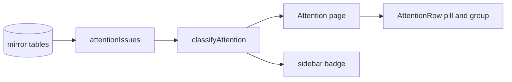
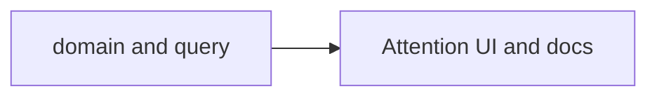

# Attention — surface blocked issues without a re-check date

**Goal:** stop open blocked issues with a missing or malformed re-check date from vanishing; show them in a "No re-check date" Attention group without inflating the badge.
**Architecture:** the query returns every open blocked issue and normalises unusable dates to `""`; a fourth `unscheduled` bucket keeps them out of the date maths; the Attention page renders them after Upcoming while the sidebar badge continues to use overdue + today only.
**Tech stack:** Bun 1.4.3, Svelte 5, SvelteKit 3, TypeScript 6, Drizzle + bun:sqlite, Tailwind 4.
**Spec path:** docs/plans/2026-10-23-attention-undated.spec.md
**Detail:** tests
**Target-min:** 8
**Orchestrator:** AI

## Global constraints

- `AttentionItem.recheck` stays `string`; `""` means missing or malformed.
- `AttentionBuckets<T>` is `{ overdue: T[]; today: T[]; upcoming: T[]; unscheduled: T[] }`.
- `actionableCount()` returns `overdue.length + today.length`; the sidebar badge is unchanged and never counts unscheduled.
- Valid calendar dates follow today's rules: overdue `< today`, today `=== today`, upcoming `> today` and `<= today + 7`; valid dates beyond +7 stay out.
- `isValidISODate(value)` is the single shape-and-calendar check shared by the client buckets and the server query; `2026-02-30` is invalid.
- `attentionIssues()` returns every open blocked issue. Unusable dates normalise to `""`; dated items sort first by date ascending then issue number, then undated by issue number ascending.
- No new table, API, route, env var, or label. Read-only users keep today's behavior.
- Spec coverage: §1 Problem → T1; §2 Required behaviour → T1, T2; §3 Fixed decisions → T1; §4 Acceptance → T1, T2; §5 Docs → T2.



## File structure

- `src/lib/attention.ts` — bucket the four groups, classify urgency, keep the actionable count.
- `src/lib/attention.test.ts` — bucket, boundary, and badge-count tests.
- `src/lib/server/issues/queries.ts` — return all open blocked issues and normalise dates.
- `src/lib/server/issues/queries.test.ts` — undated, malformed, non-blocked, and ordering tests.
- `src/lib/server/issues/types.ts` — document `recheck: ""`.
- `src/routes/(app)/attention/+page.svelte` — fourth group, copy, and empty state.
- `src/lib/components/attention/AttentionRow.svelte` — neutral "No date" pill and tone for undated rows.
- `docs/explanation/workflow-model.md`, `docs/tutorials/getting-started.md`, `docs/tutorials/triage-a-backlog.md`, `docs/how-to/configure/board.md` — group and badge semantics.

## Task graph

```mermaid
%% schedule
gantt
  title Predicted schedule (mm:ss)
  dateFormat X
  axisFormat %M:%S
  section lane 1
  T1 attention domain and query :t1, 0, 150s
  T2 Attention UI and docs :t2, 150, 121s
```





critical path: T1 → T2 (4.5 min) · peak width 1 · predicted build 4.5 min · predicted total ≈ 8.0 min (target ✗ 8.0)

## Tasks

### T1 attention domain and query · Complexity 4 · Est. context 32k
**Owns:** src/lib/attention.ts, src/lib/attention.test.ts, src/lib/server/issues/queries.ts, src/lib/server/issues/queries.test.ts, src/lib/server/issues/types.ts
**Components:** 3
**LOC owned:** 90
**Tests:** fast
**Kind:** design
**Model:** sonnet
**Est. time:** 3 min
**Produces:** `classifyAttention(items: readonly { recheck: string }[], todayISO: string, windowDays?: number) -> AttentionBuckets` · `attentionUrgency(recheck: string, todayISO: string) -> AttentionUrgency` · `isValidISODate(value: string) -> boolean` · `attentionIssues() -> AttentionItem[]` · `AttentionItem.recheck: string` · `AttentionBuckets.unscheduled: T[]`
- e.g. classifyAttention([{ recheck: "" }], "2026-10-23") -> { overdue: [], today: [], upcoming: [], unscheduled: [{ recheck: "" }] }
- e.g. classifyAttention([{ recheck: "2026-10-25" }, { recheck: "2026-10-26" }], "2026-10-18") -> { overdue: [], today: [], upcoming: [{ recheck: "2026-10-25" }], unscheduled: [] }
- e.g. attentionUrgency("not-a-date", "2026-10-23") -> "unscheduled"
- e.g. attentionIssues() -> [{ issue: { number: 8 }, blocker: "plain body", recheck: "" }]
**Review Focus:** state: empty and malformed dates both land in `unscheduled`; numeric: exactly +7 is upcoming and +8 is excluded; protocol: a blocked issue with no metadata is returned, a non-blocked issue with a date is not; encoding: malformed dates in the mirror normalise to `""`.
**Test code (verbatim):**
```ts
test("puts missing and malformed dates in unscheduled", () => {
  const buckets = classifyAttention(items("not-a-date", ""), TODAY);
  expect(buckets.unscheduled.map((i) => i.recheck)).toEqual(["not-a-date", ""]);
});
test("keeps the seven-day window for valid dates", () => {
  const buckets = classifyAttention(items("2026-10-25", "2026-10-26"), TODAY);
  expect(buckets.upcoming.map((i) => i.recheck)).toEqual(["2026-10-25"]);
});
test("actionable count ignores unscheduled", () => {
  const buckets = classifyAttention(items("2026-10-01", "2026-10-18", ""), TODAY);
  expect(actionableCount(buckets)).toBe(2);
});
test("returns blocked issues without a usable re-check date", () => {
  seedBlockedIssue(7, "107", withRecheck("2026-10-25"), true);
  seedBlockedIssue(8, "108", "plain body", true);
  seedBlockedIssue(9, "109", writeBlocked("desc", { blocker: "x", needs: "y", trying: "", recheck: "not-a-date" }), true);
  seedBlockedIssue(10, "110", withRecheck("2026-10-24"), false);
  expect(attentionIssues().map((i) => [i.issue.number, i.recheck])).toEqual([
    [7, "2026-10-25"],
    [8, ""],
    [9, ""],
  ]);
});
```
**Steps:** 1 write the tests above, 2 run: FAIL, 3 implement, 4 run: PASS.
**Notes:** Reuse `RECHECK_RE`; do not add `unscheduled` to `actionableCount`. Keep the existing `AttentionBuckets` field order and add `unscheduled` last.

### T2 Attention UI and docs · Complexity 3 · Est. context 28k
**Owns:** src/routes/(app)/attention/+page.svelte, src/lib/components/attention/AttentionRow.svelte, docs/explanation/workflow-model.md, docs/tutorials/getting-started.md, docs/tutorials/triage-a-backlog.md, docs/how-to/configure/board.md
**Components:** 2
**LOC owned:** 60
**Tests:** fast
**Kind:** design
**Model:** sonnet
**Est. time:** 3 min
**Consumes:** `AttentionBuckets.unscheduled: T[]` (T1) · `attentionUrgency(recheck: string, todayISO: string) -> AttentionUrgency` (T1) · `AttentionItem.recheck: string` (T1)
**Produces:** none
**Review Focus:** encoding: an undated row renders "No date", never `NaN` or an empty pill; state: the group renders after Upcoming and is hidden when empty; protocol: the badge copy says overdue + due today only; state: the All/Mine filter applies to unscheduled rows too.
**Test code (verbatim):**
```sh
bun run check
```
**Steps:** 1 update the page/row and docs, 2 run `bun run check`, 3 run the T1 test files once.
**Notes:** Add `unscheduled` to the `groups` array (after `upcoming`) with a muted tone and the label `No re-check date`. Give the row an `unscheduled` urgency with a neutral stripe/pill, title "No re-check date — set one", and keep the existing reschedule menu. Update the page description, sr-only text, and empty-state copy.

## Review Focus

- **Library/data pipeline** (`src/lib/attention.ts`, `src/lib/server/issues/queries.ts`): state, numeric, encoding. Risks: an undated row leaking into `actionableCount`; a valid +8 date becoming visible; a malformed mirror date crashing or showing raw text; ordering flipping between dated and undated.
- **Web UI** (`AttentionRow.svelte`, `attention/+page.svelte`): state, encoding, protocol. Risks: `NaN` in the pill; the new group appearing before Upcoming; the group rendering when empty; the badge count changing; the All/Mine scope skipping unscheduled rows.

## Self-review

- Coverage: every spec section maps to T1 or T2.
- No placeholders; both tasks are complete.
- T2's Consumes signatures match T1's Produces lines.
- One edge (`T1 --> T2`) because T2's type-check runs T1's code; no shared files.
- Both tasks have measurable fields; tests are fast; no task exceeds the size band.
- Review Focus categories and exact test values are present.
