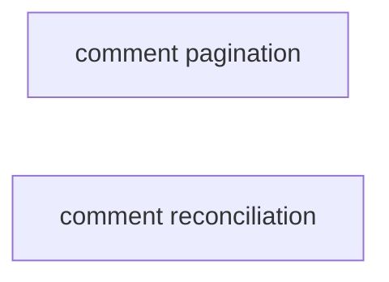

# Comment sync correctness — pagination and deletion reconciliation

**Goal:** mirror every comment on an issue and drop comments that were deleted or hidden upstream.
**Architecture:** the batched `nodes(ids:)` hydration query carries the first comment page plus `pageInfo`; `hydrateNodes` follows `node(id:)` comment pages only for issues that need it; `upsertIssue` treats the incoming comment list as complete and reconciles deletions inside the same transaction.
**Tech stack:** Bun 1.4.3, TypeScript 6, SvelteKit 3, Drizzle + bun:sqlite, bun:test.
**Spec path:** docs/plans/2026-10-23-comment-sync.spec.md — §1 Pagination, §2 Deletion reconciliation, §3 Compatibility.
**Detail:** tests. **Target-min:** 8. **Orchestrator:** AI.

## Global constraints

- No schema, route, DTO, or settings change; `mirror_comment` keeps `(repo_id, external_id)` as its identity.
- `hydrateAndStore`, `hydrateNodes`, `normalizeNode`, `IssueRecord` and `CommentRecord` keep their exported signatures.
- The first comment page stays inside the batched `nodes(ids:)` query. Only issues reporting `pageInfo.hasNextPage` issue a follow-up `node(id:)` query.
- Pagination is fail-closed: no partial comment list may reach `upsertIssue`, because `upsertIssue` now deletes comments absent from the supplied list.
- Comments are de-duplicated by `externalId`; order is chronological as returned by GitHub.
- Focused command: `bun test --preload ./tests/setup.ts --max-concurrency 1 src/lib/server/sync/hydrate.test.ts src/lib/server/sync/mirror.test.ts`.

```mermaid
flowchart LR
  B[batched nodes(ids:) first page] --> H{hasNextPage?}
  H -- yes --> F[node(id:) comments after cursor]
  F --> H
  H -- no --> U[upsertIssue complete set]
  U --> R[reconcile deleted comments]
```

## Task graph

```mermaid
%% schedule
gantt
  title Predicted schedule (mm:ss)
  dateFormat X
  axisFormat %M:%S
  section lane 1
  T1 comment pagination :t1, 0, 105s
  section lane 2
  T2 comment reconciliation :t2, 0, 98s
```





critical path: T1 (1.7 min) · peak width 2 · predicted build 1.7 min · predicted total ≈ 5.2 min

### T1 comment pagination · Complexity 4 (O-1) · Est. context 30k
**Owns:** src/lib/server/sync/hydrate.ts, src/lib/server/sync/hydrate.test.ts
**Components:** 1
**LOC owned:** 120
**Tests:** fast
**Model:** sonnet
**Est. time:** 3 min
**Produces:** `HYDRATE_QUERY` (now includes `comments.pageInfo`) · `COMMENTS_QUERY` · `hydrateNodes(graphqlFn: GraphqlFn, repoId: number, nodeIds: readonly string[], forge?: string, instance?: string) -> Promise<mirror.IssueRecord[]>`
- e.g. an issue whose first comment page reports `hasNextPage: true, endCursor: "c100"` hydrates 102 comments across three GraphQL calls, de-duplicated by `externalId`.
- e.g. an issue whose first page reports `hasNextPage: false` still hydrates in one batched call.
- e.g. `hasNextPage: true` with no `endCursor` throws and returns no record.
**Review Focus:** protocol: the first page stays in the batched `nodes(ids:)` query; follow-ups use `node(id: $id)` with `comments(first: 100, after: $after)`. state: follow up only while `pageInfo.hasNextPage` is true and stop on false. encoding: append pages in order and de-dupe by `externalId`, never by array position. deep: a missing `endCursor` or exceeding a bounded page count throws before any record is returned, so a partial set can never be persisted. numeric: batching still caps at `BATCH_SIZE` ids per query; issues with ≤100 comments issue no follow-up. offline: the injected `GraphqlFn` remains the only network seam and tests never hit GitHub.
**Test code (verbatim):**
```ts
import { describe, expect, test } from "bun:test";
import { hydrateNodes, type GraphqlFn } from "./hydrate";

const comment = (id: number) => ({
  databaseId: id,
  author: { databaseId: 7, login: "octocat", avatarUrl: "" },
  body: `c${id}`,
  createdAt: "2026-01-01T00:00:00Z",
  updatedAt: "2026-01-01T00:00:00Z",
});

const issueNode = (comments: unknown) => ({
  databaseId: 101,
  number: 1,
  url: "https://github.com/orgA/core/issues/1",
  title: "Fix the thing",
  body: "",
  state: "OPEN",
  stateReason: null,
  createdAt: "2026-01-01T00:00:00Z",
  updatedAt: "2026-01-02T00:00:00Z",
  closedAt: null,
  author: { databaseId: 7, login: "octocat", avatarUrl: "" },
  milestone: null,
  labels: { nodes: [] },
  assignees: { nodes: [] },
  comments,
});

describe("comment pagination", () => {
  test("follows every comment page and de-duplicates ids", async () => {
    const after: Array<string | null> = [];
    const graphql: GraphqlFn = async (_query, vars) => {
      const v = vars as { ids?: string[]; after?: string | null };
      if (v.ids) {
        return {
          nodes: [
            issueNode({
              pageInfo: { hasNextPage: true, endCursor: "c100" },
              nodes: Array.from({ length: 100 }, (_, i) => comment(i + 1)),
            }),
          ],
        };
      }
      after.push(v.after ?? null);
      if (v.after === "c100") {
        return {
          node: {
            comments: {
              pageInfo: { hasNextPage: true, endCursor: "c101" },
              nodes: [comment(100), comment(101)],
            },
          },
        };
      }
      return {
        node: {
          comments: {
            pageInfo: { hasNextPage: false, endCursor: null },
            nodes: [comment(102)],
          },
        },
      };
    };

    const [record] = await hydrateNodes(graphql, 1, ["n1"]);
    expect(record.comments).toHaveLength(102);
    expect(record.comments.at(-1)?.externalId).toBe("102");
    expect(new Set(record.comments.map((c) => c.externalId)).size).toBe(102);
    expect(after).toEqual(["c100", "c101"]);
  });

  test("does not follow up when the first page is complete", async () => {
    let calls = 0;
    const graphql: GraphqlFn = async () => {
      calls += 1;
      return {
        nodes: [
          issueNode({
            pageInfo: { hasNextPage: false, endCursor: null },
            nodes: [comment(1)],
          }),
        ],
      };
    };
    const [record] = await hydrateNodes(graphql, 1, ["n1"]);
    expect(record.comments).toHaveLength(1);
    expect(calls).toBe(1);
  });
});
```
**Steps:** 1 failing test, 2 run: FAIL, 3 implement, 4 run: PASS
**Notes:** Keep `HYDRATE_QUERY`'s existing fields byte-identical except for the added `pageInfo`; the existing test asserting `query === HYDRATE_QUERY` for the batch call must still pass. Reuse the comment-normalization mapping for follow-up pages instead of duplicating it. A bounded page count (for example 100 pages) guards against a misbehaving server; exceeding it throws.

### T2 comment reconciliation · Complexity 3 (O-1) · Est. context 24k
**Owns:** src/lib/server/sync/mirror.ts, src/lib/server/sync/mirror.test.ts
**Components:** 1
**LOC owned:** 70
**Tests:** fast
**Model:** sonnet
**Est. time:** 2 min
**Produces:** `upsertIssue(issue: IssueRecord, metadata: StoredMetadata) -> void` (now reconciles comments)
- e.g. upserting comments `["1","2"]` then `["1"]` leaves exactly `["1"]`, with the edited body applied.
- e.g. upserting an empty comment list clears that thread's comments.
- e.g. deleting comments on issue 1 leaves issue 2's comments intact.
**Review Focus:** state: comments absent from the incoming set are deleted after the upserts; an empty list clears the thread. protocol: deletes are scoped to `(repoId, threadNumber)`, never repo-wide or thread-agnostic. numeric: stale ids are deleted in chunks below SQLite's 999 bound-variable limit. state: an edited comment overwrites body and `updatedAt` while preserving `createdAt` and its row identity. deep: reconciliation and upserts share the existing transaction, so a throw rolls the whole issue back.
**Test code (verbatim):**
```ts
test("reconciles deleted and edited comments", () => {
  const repo = seedRepo();
  const metadata: mirror.StoredMetadata = {
    status: null,
    impact: null,
    urgency: null,
    priority: null,
    size: null,
    blocked: false,
    labelConflict: false,
  };
  const record = (comments: Array<{ externalId: string; body: string }>) => ({
    externalId: "9001",
    repoId: repo.id,
    number: 1,
    kind: "issue" as const,
    title: "issue 1",
    body: "",
    state: "open",
    stateReason: null,
    author: null,
    milestoneNumber: null,
    url: "https://github.com/orgA/core/issues/1",
    createdAt: 1,
    updatedAt: 2,
    closedAt: null,
    labels: [],
    assignees: [],
    comments: comments.map((c) => ({
      ...c,
      author: null,
      createdAt: 3,
      updatedAt: 4,
    })),
  });

  mirror.upsertIssue(
    record([
      { externalId: "1", body: "one" },
      { externalId: "2", body: "two" },
    ]),
    metadata,
  );
  mirror.upsertIssue(record([{ externalId: "1", body: "one edited" }]), metadata);

  expect(
    mirror.getIssueComments(repo.id, 1).map((c) => [c.externalId, c.body]),
  ).toEqual([["1", "one edited"]]);
});
```
**Steps:** 1 failing test, 2 run: FAIL, 3 implement, 4 run: PASS
**Notes:** Read the thread's existing `externalId`s inside the transaction, diff against the incoming set, and delete stale ids with `inArray` chunks. Handle the empty-incoming case with a plain scoped delete. Do not touch the `(repoId, externalId)` conflict target or the user upserts.
