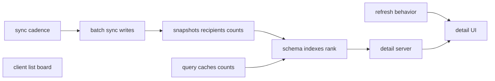

# Inefficiency fixes

**Goal:** reduce the live hot-path cost found by the second deep scan: refresh storms, per-poll metadata calls, sync N+1s, repeated full scans, missing indexes, and unbounded detail/list work.
**Architecture:** independent client and server slices; server schema work serialised through the files it shares. No product-visible route or response changes except scoped refresh timing and paged comments.
**Tech stack:** Bun 1.4.3, Svelte 5, SvelteKit 3, TypeScript 6, Drizzle, SQLite.
**Spec path:** docs/plans/2026-10-23-inefficiency-fixes.spec.md
**Detail:** tests
**Target-min:** 35
**Orchestrator:** AI

## Global constraints

- Keep all existing tests green; update tests only where a contract intentionally changes.
- Preserve route status codes, response bodies, and UI behaviour except the documented comment paging.
- No new runtime dependencies.
- Every task stages only its Owns paths.
- Conventional, atomic commits.
- Do not edit old migrations; schema changes use a new generated migration.

Spec coverage: Refresh behavior (T1); Sync cadence (T2); Sync write batching (T3a–T3b); Query caches and counts (T4); Schema and indexes (T5); Issue detail payload (T6a–T6b); Client list and board (T7).

## File structure

- `src/lib/client/events.ts`, `native-notifications.ts`, `refresh.ts`, `src/routes/*/+layout.svelte`, `InspectorPane.svelte`, `FeedSearch.svelte` — coalesced, scoped refresh.
- `src/lib/server/sync/worker.ts`, `mirror.ts` — poll cadence, batched writes.
- `src/lib/server/sync/hydrate.ts`, `src/lib/server/notifications/service.ts` — snapshots, recipients, counts.
- `src/lib/server/issues/queries.ts`, `src/lib/server/intake/staging.ts`, `src/lib/server/sync/events.ts`, `src/lib/server/sync/revision.ts`, `src/routes/*/+layout.server.ts` — caches and counts.
- `src/lib/server/db/schema.ts`, `drizzle/**`, `src/lib/server/issues/filters.ts` — indexes and priority rank.
- `src/lib/server/issues/types.ts`, `src/lib/server/markdown/render.ts`, mirror issue API, `client/mutations.ts` — detail payload.
- `src/lib/components/issue/IssueList.svelte`, `src/lib/client/feed-merge.ts`, `board-feed.svelte.ts`, `StatusBoard.svelte`, `optimistic.svelte.ts` — client churn.

## Task graph

```mermaid
%% schedule
gantt
  title Predicted schedule (mm:ss)
  dateFormat X
  axisFormat %M:%S
  section lane 1
  T4 cache query options and counts :t4, 0, 230s
  T3b batch snapshots and recipients :t3b, 264, 159s
  T5 schema indexes and priority rank :t5, 422, 234s
  T6a cache and page detail payload :t6a, 656, 206s
  T6b load earlier comments in Inspector :t6b, 862, 96s
  section lane 2
  T1 coalesce and scope client refreshes :t1, 0, 226s
  section lane 3
  T7 reduce list and board churn :t7, 0, 203s
  section lane 4
  T2 stop per-poll directory refresh :t2, 0, 127s
  T3a batch sync writes :t3a, 127, 137s
```

critical path: T2 → T3a → T3b → T5 → T6a → T6b (16.0 min) · peak width 4 · predicted build 16.0 min · predicted total ≈ 19.5 min (target ✓)

## Tasks

### T1 coalesce and scope client refreshes · Complexity 3 · Est. context 30k
**Owns:** src/lib/client/events.ts, src/lib/client/native-notifications.ts, src/lib/client/refresh.ts, src/routes/*/+layout.svelte, src/lib/components/issue/InspectorPane.svelte, src/lib/components/filter/FeedSearch.svelte
**Components:** 6
**LOC owned:** 120
**Tests:** fast
**Kind:** design
**Model:** sonnet
**Est. time:** 5 min
**Review Focus:** state: one EventSource per tab; burst events coalesce into one refresh; Inspector skips reload while editing and ignores unrelated issue signals; FeedSearch clears its timer on destroy.
**Steps:** 1 make `connectEvents` a singleton `EventSource` with a listener set; 2 add a scoped refresh payload (`repo`, `numbers`, sequence) and use it in the Inspector; 3 debounce `refreshAll` with an in-flight guard in the cockpit layout; 4 skip Inspector `load()` while `editingBody || editingTitle` and only reload for a matching or unscoped signal; 5 clear the search debounce in an effect cleanup; 6 `bun run check`.
**Notes:** Native notifications must reuse the same stream, not open a second one.

### T2 stop per-poll directory refresh · Complexity 2 · Est. context 24k
**Owns:** src/lib/server/sync/worker.ts, src/lib/server/sync/mirror.ts, src/lib/server/sync/worker.test.ts, src/lib/server/sync/mirror.test.ts
**Components:** 2
**LOC owned:** 100
**Tests:** fast
**Kind:** design
**Model:** sonnet
**Est. time:** 4 min
**Review Focus:** state: first cycle refreshes directories; later cycles skip them; nightly reconciliation still refreshes; unchanged label/assignee/milestone writes are skipped.
**Steps:** 1 in `runRepoCycle`, reuse an existing repo row and only call `ensureRepoMirror` when absent; 2 refresh labels, assignees and milestones only on the first cycle (`lastPolledAt == null`), in parallel; 3 in `refreshIssue`, reuse an existing row too; 4 add equality checks in the replace helpers or refresh callers so unchanged sets do not delete/reinsert; 5 focused worker/mirror tests; 6 `bun run check`.
**Notes:** Keep reconciliation eager: it may still force the full refresh.

### T3a batch sync writes · Complexity 3 · Est. context 30k
**Owns:** src/lib/server/sync/mirror.ts, tests/notifications-routes.test.ts
**Components:** 2
**LOC owned:** 180
**Tests:** fast
**Kind:** design
**Model:** sonnet
**Est. time:** 6 min
**Review Focus:** state: user ids are mapped once per batch; comments are upserted in one statement; one transaction covers the batch; mirror rows are identical after upsert.
**Steps:** 1 add `upsertUsers` with one multi-row upsert and a returned id map; 2 add `upsertIssues(issues, metadata)` that opens one transaction and reuses the map; 3 keep `upsertIssue` as a one-record wrapper; 4 replace per-comment inserts with one multi-row upsert using `excluded`; 5 run mirror tests; 6 `bun run check`.
**Notes:** Do not change the stored shape; this is statement count only.

### T3b batch snapshots and recipients · Complexity 3 · Est. context 28k
**Owns:** src/lib/server/sync/hydrate.ts, src/lib/server/notifications/service.ts
**Components:** 3
**LOC owned:** 160
**Tests:** fast
**Kind:** design
**Model:** sonnet
**Est. time:** 6 min
**Review Focus:** state: first-sight issues stay silent; existing issues still notify; recipient sets are unchanged; unread counts use SQL counts.
**Steps:** 1 build the post-upsert snapshot from the hydrated record and derived metadata; 2 use the batched issue upsert from T3a; 3 add batched recipient lookup by external ids and logins and use it in `collectRecipients`; 4 switch unread count to `count(*)` and mark-all to change counts; 5 focused hydrate/service tests; 6 `bun run check`.
**Notes:** Watcher lookup may remain per issue; the goal is removing the per-person N+1s.

### T4 cache query options and counts · Complexity 3 · Est. context 28k
**Owns:** src/lib/server/issues/queries.ts, src/lib/server/intake/staging.ts, src/lib/server/sync/events.ts, src/lib/server/sync/revision.ts, src/routes/*/+layout.server.ts, tests/mirror-helpers.ts
**Components:** 6
**LOC owned:** 150
**Tests:** fast
**Kind:** design
**Model:** sonnet
**Est. time:** 6 min
**Review Focus:** state: filter options reflect a mirror write after the revision bump; counts stay exact; cached totals never cross filter signatures.
**Steps:** 1 add a mirror revision counter bumped by `publish`; 2 cache `filterOptions` by revision and use `selectDistinct`/ordered queries; 3 add a SQL `count(*)` for pending submissions and use it in `inboxCount`; 4 cache issue totals by revision + filter signature for a short TTL; 5 clear caches in `clearMirror`; 6 focused query/staging tests; 7 `bun run check`.
**Notes:** Keep the public return shapes unchanged.

### T5 schema indexes and priority rank · Complexity 4 · Est. context 35k
**Owns:** src/lib/server/db/schema.ts, drizzle/, src/lib/server/issues/queries.ts, src/lib/server/sync/mirror.ts, src/lib/server/issues/filters.ts, src/lib/server/notifications/service.ts, tests/priority-migration.test.ts
**Components:** 6
**LOC owned:** 180
**Tests:** fast
**Kind:** design
**Model:** sonnet
**Est. time:** 6.5 min
**Review Focus:** protocol: existing priority order and cursors stay stable; numeric: backfilled ranks match the old CASE; state: indexes exist and login lookups are case-insensitive.
**Steps:** 1 add `priorityRank` to `mirror_thread` with an index on `(priority_rank, updated_at)`; 2 write it in `upsertIssue`/`setIssueMetadata`; 3 order and cursor on the column; 4 add `(blocked, state)` and `NOCASE` login indexes; 5 update login lookups to `COLLATE NOCASE`; 6 generate and inspect a new migration with a backfill; 7 focused query/mirror/worker tests; 8 `bun run check`.
**Notes:** Do not edit prior migrations. Keep `priority` for display and filters.

### T6a cache and page detail payload · Complexity 3 · Est. context 28k
**Owns:** src/lib/server/issues/queries.ts, src/lib/server/issues/types.ts, src/lib/server/markdown/render.ts, src/routes/api/mirror/issues/[owner]/[repo]/[number]/+server.ts, src/lib/client/mutations.ts
**Components:** 5
**LOC owned:** 150
**Tests:** fast
**Kind:** design
**Model:** sonnet
**Est. time:** 5 min
**Review Focus:** protocol: small threads return the same data; large threads report total/has-more and newest comments in order; milestone lookup uses `(repoId, number)`; rendered HTML is cached by content.
**Steps:** 1 add an LRU render cache; 2 add a bounded comment query with `commentTotal`/`hasMoreComments`; 3 accept a bounded `comments` query param in the mirror API and thread it through the client fetch; 4 query a milestone by primary key and cap milestone issue lists; 5 focused detail/queries tests; 6 `bun run check`.
**Notes:** Defaults must keep existing small-thread tests unchanged.

### T6b load earlier comments in Inspector · Complexity 2 · Est. context 20k
**Owns:** src/lib/components/issue/InspectorPane.svelte
**Components:** 1
**LOC owned:** 50
**Tests:** fast
**Kind:** design
**Model:** sonnet
**Est. time:** 3 min
**Review Focus:** state: default view shows the newest page; load-earlier increases the limit and preserves scroll; no reload loop.
**Steps:** 1 track a comment limit in the Inspector; 2 pass it to `fetchIssueDetail`; 3 render a “Load earlier comments” action when `hasMoreComments`; 4 verify small threads have no action; 5 `bun run check`.
**Notes:** Keep the existing timeline rendering and edit/publish actions.

### T7 reduce list and board churn · Complexity 3 · Est. context 28k
**Owns:** src/lib/components/issue/IssueList.svelte, src/lib/client/feed-merge.ts, src/lib/client/board-feed.svelte.ts, src/lib/components/board/StatusBoard.svelte, src/lib/client/optimistic.svelte.ts
**Components:** 5
**LOC owned:** 130
**Tests:** fast
**Kind:** design
**Model:** sonnet
**Est. time:** 5 min
**Review Focus:** state: empty overlays do not allocate a projected array; identical first pages preserve the existing array; board lane data only changes when card content changes.
**Steps:** 1 make `projectIssues`/`projectBoard` return the input when overlays are empty; 2 make `mergeFirstPage` return the loaded array when keys and objects are unchanged; 3 avoid copying in `IssueList` when no projection is needed; 4 use a cheap revision instead of the board key-join signature; 5 focused feed-merge tests; 6 `bun run check`.
**Notes:** Do not change grouping or drag behaviour.

## Review Focus

- **Client runtime** (T1, T7): state. Risks: a missed refresh, duplicate streams, lost edits, stale grouping.
- **Sync** (T2, T3a, T3b): state/protocol. Risks: first-cycle skips, notification loss, changed IDs.
- **Queries** (T4, T6a): protocol/numeric. Risks: stale cache keys, changed totals, comment ordering.
- **Schema** (T5): numeric/state. Risks: rank backfill, cursor stability, index syntax.

## Self-review

- Every spec section maps to tasks; no two parallel tasks share an Owns path.
- Shared files are serialised by the graph: T2→T3a→T3b→T5→T6a→T6b, T4→T5, T1→T6b.
- All schema changes are new migrations; no old migration edits.
- Tests remain the contract for unchanged behaviour.
