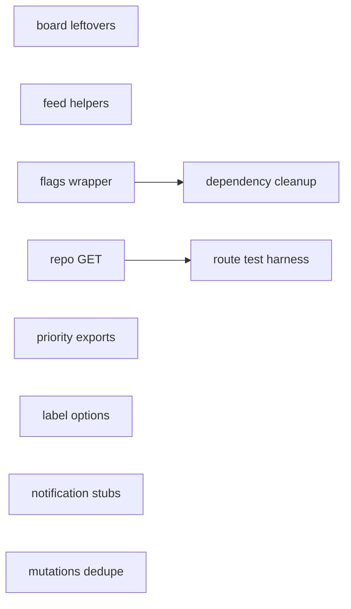

# Leanness cuts — issues #61–#69

**Goal:** remove the dead code, duplicated route boilerplate, and two unused dependencies identified by the leanness audit, without changing any route, response, or UI behaviour.
**Architecture:** nine independent cuts. Each deletes or consolidates code that has no external caller; the two dependency edits share `package.json`/`bun.lock`, so they are serialised. Every cut keeps the existing test suite green and adds no new behaviour.
**Tech stack:** Bun 1.4.3, Svelte 5, SvelteKit 3, TypeScript 6, Tailwind 4.
**Detail:** tests
**Target-min:** 15
**Orchestrator:** AI

## Global constraints

- No route, response body/status/header, UI, or database behaviour changes.
- Delete only the exports and files named in each task; no drive-by renames or formatting.
- `bun run check` passes and the named existing tests stay green after every task.
- Each commit message ends with `(#<issue>)` for its issue (61–69).
- A task stages only its **Owns** paths; leave other in-flight edits alone.

## File structure

- `src/lib/components/common/Chip.svelte`, `src/lib/components/board/item.ts`, `src/lib/styles/global.css`, `src/lib/components/common/MetaTag.svelte` — board leftovers (#61).
- `src/lib/server/issues/pagination.ts`, `src/routes/api/feeds/{issues,inbox,board}/+server.ts` — feed-route helpers (#62).
- `src/lib/server/flags.ts`, `src/lib/features.ts`, `docs/reference/feature-flags.md` — flags (#63).
- `src/lib/server/github/app.server.ts`, five `src/routes/api/repos/.../+server.ts` files — repo GET handler (#64).
- `src/lib/priority.ts` (#65), `src/lib/labels.ts` (#66), `src/lib/server/notifications/types.ts` (#67), `src/lib/server/issues/mutations.ts` (#69).
- `package.json`, `bun.lock` — dependency cleanup (#68, after #63).

## Task graph

```mermaid
%% schedule
gantt
  title Predicted schedule (mm:ss)
  dateFormat X
  axisFormat %M:%S
  section lane 1
  T64 share the repo GET handler :t64, 0, 230s
  section lane 2
  T62 share feed-route helpers :t62, 0, 174s
  section lane 3
  T63 drop the OpenFeature wrapper :t63, 0, 144s
  T68 remove unused dependencies :t68, 144, 90s
  section lane 4
  T61 delete Chip and DnD leftovers :t61, 0, 124s
  section lane 5
  T66 delete dead label-option exports :t66, 0, 93s
  section lane 6
  T65 delete dead priority exports :t65, 0, 92s
  section lane 7
  T67 delete notification Wave-0 stubs :t67, 0, 91s
  section lane 8
  T69 dedupe the label-group helper :t69, 0, 90s
```

critical path: T63 → T68 (3.9 min) · peak width 8 · predicted build 3.9 min · predicted total ≈ 7.4 min (target ✓)

## Tasks

### T61 delete Chip and DnD leftovers · Complexity 1 · Est. context 8k
**Owns:** src/lib/components/common/Chip.svelte, src/lib/components/board/item.ts, src/lib/styles/global.css, src/lib/components/common/MetaTag.svelte
**Components:** 2
**LOC owned:** 78
**Tests:** fast
**Kind:** design
**Model:** sonnet
**Est. time:** 2 min
**Review Focus:** state: no importer of the deleted files remains; encoding: no `#dnd-action-dragged-el` rule remains.
**Steps:** 1 delete `Chip.svelte` and `board/item.ts`; 2 delete the `#dnd-action-dragged-el` comment and rule from `global.css`; 3 reword the `MetaTag.svelte` doc comment to "Deliberately quieter than a shared chip so a row's title stays the focal point."; 4 `grep -rn "Chip\|board/item\|dnd-action" src` shows only prose/comment references; 5 `bun run check`.
**Notes:** Issue #61. `item.ts` still mentions `svelte-dnd-action`; nothing imports it. Do not touch `board/dnd.ts`.

### T62 share feed-route helpers · Complexity 2 · Est. context 10k
**Owns:** src/lib/server/issues/pagination.ts, src/routes/api/feeds/issues/+server.ts, src/routes/api/feeds/inbox/+server.ts, src/routes/api/feeds/board/+server.ts
**Components:** 4
**LOC owned:** 90
**Tests:** fast
**Kind:** design
**Model:** sonnet
**Est. time:** 2 min
**Review Focus:** protocol: malformed or filter-mismatched cursors still return 400 with `{ message: "Invalid cursor" }`; state: unknown board columns still return 400.
**Steps:** 1 move the identical `FeedRequestError` class, `pageOptions(search: URLSearchParams): PageOptions`, and `requireCursor(cursor: string | null, signature: string): void` into `pagination.ts`, exported, with `requireCursor` throwing `FeedRequestError`; 2 delete the three local copies and import the helpers in each route; 3 prune now-unused route imports (`decodeCursor`, `PageOptions`); 4 `bash "$SL" run_tests --fast src/routes/api/feeds/feeds.test.ts --background` then `--wait`; 5 `bun run check`.
**Notes:** Issue #62. Behaviour is byte-identical: the class name, message, and 400 mapping stay the same.

### T63 drop the OpenFeature wrapper · Complexity 2 · Est. context 14k
**Owns:** src/lib/server/flags.ts, src/lib/features.ts, docs/reference/feature-flags.md, package.json, bun.lock
**Components:** 3
**LOC owned:** 50
**Tests:** fast
**Kind:** design
**Model:** sonnet
**Est. time:** 3 min
**Review Focus:** state: an override still wins over the instance default, and every registered flag is still present; protocol: `resolveFeatures()` keeps its callable signature.
**Steps:** 1 delete the provider configuration, `OpenFeature.setProvider`, the `client`, and the `Promise.all` block from `flags.ts`; `resolveFeatures` returns the `values` map it already builds (keep it `async` so callers do not change); 2 delete `FEATURES_CONTEXT_KEY` and the `@openfeature/server-sdk` import; 3 update the module doc comment and the `src/lib/features.ts` comments that claim OpenFeature evaluation; 4 rewrite `docs/reference/feature-flags.md` to describe direct `overrides[key] ?? flagDefault(key)` resolution and remove the provider section; 5 `bun remove @openfeature/server-sdk`; 6 `bash "$SL" run_tests --fast tests/flags.test.ts --background` then `--wait`; 7 `bun run check`.
**Notes:** Issue #63. Keep `COMMENT_BUBBLES_FLAG` and `flagDefault` unchanged. T68 follows this task because both own `package.json`.

### T64 share the repo GET handler · Complexity 4 · Est. context 24k
**Owns:** src/lib/server/github/app.server.ts, src/routes/api/repos/[owner]/[repo]/issues/+server.ts, src/routes/api/repos/[owner]/[repo]/issues/[number]/+server.ts, src/routes/api/repos/[owner]/[repo]/issues/[number]/comments/+server.ts, src/routes/api/repos/[owner]/[repo]/labels/+server.ts, src/routes/api/repos/[owner]/[repo]/labels/[name]/+server.ts
**Components:** 6
**LOC owned:** 150
**Tests:** fast
**Kind:** design
**Model:** sonnet
**Est. time:** 5 min
**Review Focus:** protocol: the read-role check still runs before any installation lookup; auth failures still return the enriched 404; numeric: the allowlisted query string and `if-none-match` are forwarded unchanged; encoding: the labels fallback URL still percent-encodes the label name.
**Produces:** `repoGet(params: { owner: string; repo: string; number?: string; name?: string }, request: Request, path: string, options?: { query?: ReadonlySet<string>; filterPullRequests?: boolean; fallbackPath?: string }) -> Promise<Response>`
- e.g. repoGet({owner: "acme", repo: "app"}, request, "/repos/acme/app/labels", { query: new Set(["per_page"]) }) -> Response with the passthrough body and status
**Steps:** 1 add `repoGet` to `app.server.ts`: resolve the installation (mapping failure through `installationErrorResponse`), rebuild `URLSearchParams` from `new URL(request.url).searchParams` filtered by `options.query`, call `passthrough(..., request.headers.get("if-none-match"), { filterPullRequests, htmlUrlFallback: options.fallbackPath ? await forge.webUrl(options.fallbackPath) : undefined })`, return `toResponse`; 2 rewrite each of the five `GET` handlers to the role check plus one `repoGet` call, passing the same path, allowlist set, `filterPullRequests` for the issues lists, and `fallbackPath` for issue/comment/label detail; 3 `bash "$SL" run_tests --fast tests/mirror-issues-route.test.ts tests/issues-routes.test.ts --background` then `--wait`; 4 `bun run check`.
**Notes:** Issue #64. `app.server.ts` may import from `api-passthrough.server.ts`; there is no cycle. Keep each route's `ALLOWED` constant. Do not change the `POST`/`PATCH` handlers.

### T65 delete dead priority exports · Complexity 2 · Est. context 12k
**Owns:** src/lib/priority.ts
**Components:** 1
**LOC owned:** 25
**Tests:** fast
**Kind:** design
**Model:** sonnet
**Est. time:** 2 min
**Review Focus:** state: `parseUrgency` and `isPriorityMatrix` still reject invalid values after their exported helpers are removed.
**Steps:** 1 delete `PRIORITY_FILTER_VALUES`, `priorityName`, `PRIORITY_MATRIX`, `isUrgency`, `isPriority`, `parsePriority`, `priorityLabelName`, `legacyPriorityLabels`; 2 inline the deleted checks: `parseUrgency` uses `typeof numeric === "number" && URGENCY_SET.has(numeric)`, and `isPriorityMatrix` uses `typeof cells[urgency] === "string" && PRIORITY_SET.has(cells[urgency])`; 3 `bash "$SL" run_tests --fast src/lib/priority.test.ts tests/priority-migration.test.ts --background` then `--wait`; 4 `bun run check`.
**Notes:** Issue #65. Keep `RETIRED_PRIORITY_LABELS`, `retiredPriority`, `isRetiredPriorityLabel`, `legacyPriorityFromLabels`, `retiredPriorityConflict`, `DEFAULT_PRIORITY_MATRIX`, `priorityMeta`, `priorityRank`, and `PRIORITY_SET`.

### T66 delete dead label-option exports · Complexity 1 · Est. context 8k
**Owns:** src/lib/labels.ts
**Components:** 1
**LOC owned:** 30
**Tests:** fast
**Kind:** design
**Model:** sonnet
**Est. time:** 2 min
**Review Focus:** state: `STATUS_OPTIONS`, `SIZE_OPTIONS`, `BOARD_COLUMNS`, `canonicalLabel`, and `labelTint` are unchanged.
**Steps:** 1 delete `IMPACT_OPTIONS`, `URGENCY_OPTIONS`, `FLAG_OPTIONS`, `IMPACT_DISPLAY`, `URGENCY_DISPLAY`, `FLAG_DISPLAY`, `isHiddenLabel`, `BLOCKED_LABEL`, and the `isRetiredPriorityLabel` import; 2 `grep -rn "IMPACT_OPTIONS\|URGENCY_OPTIONS\|FLAG_OPTIONS\|isHiddenLabel\|BLOCKED_LABEL" src tests` is empty; 3 `bun run check`.
**Notes:** Issue #66. Keep the `options()` helper (`STATUS_OPTIONS`/`SIZE_OPTIONS` still use it) and the whole canonical label table.

### T67 delete notification Wave-0 stubs · Complexity 1 · Est. context 6k
**Owns:** src/lib/server/notifications/types.ts
**Components:** 1
**LOC owned:** 13
**Tests:** fast
**Kind:** design
**Model:** sonnet
**Est. time:** 1 min
**Review Focus:** state: no reference to the deleted symbols remains.
**Steps:** 1 delete `NotImplementedError` and `notImplemented` from `types.ts`; 2 `grep -rn "NotImplementedError\|notImplemented" src tests` is empty; 3 `bun run check`.
**Notes:** Issue #67. Keep every other type in the file.

### T68 remove unused dependencies · Complexity 2 · Est. context 10k
**Owns:** package.json, bun.lock
**Components:** 1
**LOC owned:** 4
**Tests:** fast
**Kind:** design
**Model:** sonnet
**Est. time:** 2 min
**Review Focus:** protocol: `bun install` completes with no peer error and the lockfile stays in sync.
**Steps:** 1 remove `@internationalized/date` (`bun remove @internationalized/date`); 2 move `@types/node` from `dependencies` to `devDependencies` in `package.json`, then `bun install` to refresh `bun.lock`; 3 `grep -rn "internationalized/date" src tests scripts` is empty; 4 `bun install --frozen-lockfile` succeeds; 5 `bun run check`.
**Notes:** Issue #68. Depends on T63: both tasks edit `package.json`, and T63 removes `@openfeature/server-sdk`. Keep the existing `@types/node` version.

### T69 dedupe the label-group helper · Complexity 1 · Est. context 6k
**Owns:** src/lib/server/issues/mutations.ts
**Components:** 1
**LOC owned:** 7
**Tests:** fast
**Kind:** design
**Model:** sonnet
**Est. time:** 1 min
**Review Focus:** state: `GROUP_VALUES` still contains the same impact, urgency, and flag members.
**Steps:** 1 delete `namesIn`; 2 use `groupMembers` in the `GROUP_VALUES` entries for `impact`, `urgency`, and `flags`; 3 `bash "$SL" run_tests --fast src/lib/server/issues/mutations.test.ts --background` then `--wait`; 4 `bun run check`.
**Notes:** Issue #69. `groupMembers` is a hoisted function declaration, so using it above its definition is safe.

### T70 align repo GET route tests · Complexity 1 · Est. context 6k
**Owns:** tests/routes.test.ts
**Components:** 1
**LOC owned:** 63
**Tests:** fast
**Kind:** design
**Model:** sonnet
**Est. time:** 1 min
**Review Focus:** protocol: the harness passes query params on `request.url`, and all five repo GET routes still assert delegation to `repoGet`.
**Steps:** 1 (review fix, already applied) send query params in the fabricated request URL instead of only the event `url`; 2 add coverage for the labels `per_page`/`page` allowlist and the percent-encoded label 404 `html_url`; 3 `bash "$SL" run_tests --fast tests/routes.test.ts --background` then `--wait`.
**Notes:** Follow-up to the T64 package review; `repoGet` now reads `request.url`, matching SvelteKit's production contract.

## Review Focus

- **Server/data** (`src/lib/server/issues/pagination.ts`, `src/lib/server/github/app.server.ts`, `src/lib/priority.ts`, `src/lib/labels.ts`, `src/lib/server/issues/mutations.ts`): protocol, state, numeric. Risks: a cursor error becoming a 500; a role check moving after the installation lookup; an inlined guard widening acceptance; `GROUP_VALUES` losing a member.
- **Routes** (`src/routes/api/**`): protocol, encoding. Risks: dropping an allowlisted query param; an unencoded label name in the fallback URL; a changed status/header.
- **Dependencies** (`package.json`, `bun.lock`): protocol. Risks: a peer warning or a stale lockfile.

## Self-review

- Every issue #61–#69 maps to exactly one task; each task's Owns list covers its whole change.
- The only shared file (`package.json`, `bun.lock`) is serialised by `T63 --> T68`; no other pair shares an Owns path.
- Every deletion has a grep check; every code change names the existing test that guards it.
- No placeholders; no new interfaces except `repoGet`, which has a signature and an e.g. line.
