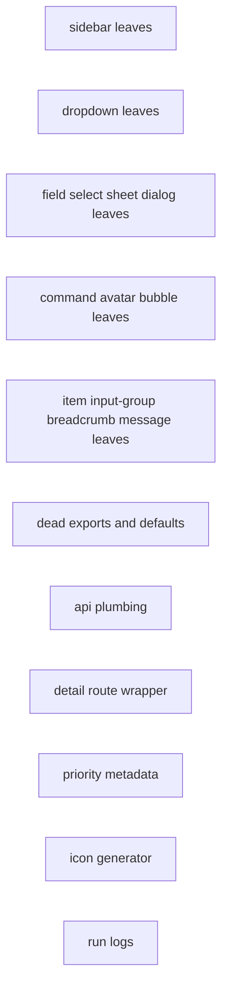

# Leanness pass 2

**Goal:** remove the remaining dead UI leaves, dead exports, duplicated route wrappers, and one-off repository artifacts identified by the second leanness audit, without changing product behaviour.
**Architecture:** independent deletions and three small consolidations. No new runtime abstraction; the only new shared component is a presentational issue-detail wrapper.
**Tech stack:** Bun 1.4.3, Svelte 5, SvelteKit 3, TypeScript 6, Tailwind 4.
**Spec path:** docs/plans/2026-10-23-leanness-pass-2.spec.md
**Detail:** tests
**Target-min:** 10
**Orchestrator:** AI

## Global constraints

- No route, response, UI, database, or build-output behaviour changes.
- Delete only the paths named in each task. No renames, no formatting sweeps.
- `bun run check` passes after every task; the full suite stays green after every commit.
- A task stages only its **Owns** paths.
- Every commit is conventional and atomic; no issue number is required for this pass.
- Update tests only when the task deletes the code those tests exercise.
- Do not edit old migrations or delete committed raster assets.

Spec coverage: Unused UI components (T1–T5); Dead exports and duplicate config (T6); API route plumbing (T7); Issue detail routes (T8); Priority-in-body metadata (T9); Repository cleanup (T10–T11).

## File structure

- `src/lib/components/ui/{sidebar,dropdown-menu,field,dialog,select,sheet,command,avatar,bubble,item,input-group,breadcrumb,message}/` — unused shadcn leaves and barrels.
- `src/lib/server/auth/guard.ts`, `src/lib/server/config.ts`, `src/lib/server/config.test.ts` — dead export and duplicate defaults.
- `src/lib/server/issues/http.ts`, `src/routes/api/repos/**`, `src/routes/api/mirror/**` — shared write auth and issue-number parsing.
- `src/lib/components/issue/IssueDetailView.svelte`, three detail `+page.svelte` files — shared detail wrapper.
- `src/lib/funnel-metadata.ts`, `src/lib/funnel-metadata.test.ts` — retired priority-in-body helpers.
- `scripts/generate-icons.ts`, `package.json`, `scripts/README.md`, `docs/reference/build-tasks.md` — one-off icon generator.
- `docs/plans/*.incidents.jsonl`, `docs/plans/*.progress.md` — completed run logs.

## Task graph

```mermaid
%% schedule
gantt
  title Predicted schedule (mm:ss)
  dateFormat X
  axisFormat %M:%S
  section lane 1
  T7 share write auth and issue-number par :t7, 0, 289s
  section lane 2
  T5 delete unused item/input-group/breadc :t5, 0, 201s
  section lane 3
  T3 delete unused field/select/sheet/dial :t3, 0, 193s
  section lane 4
  T10 delete the one-off icon generator :t10, 0, 193s
  section lane 5
  T8 share the issue detail wrapper :t8, 0, 171s
  section lane 6
  T4 delete unused command/avatar/bubble l :t4, 0, 170s
  section lane 7
  T11 delete completed plan run logs :t11, 0, 166s
  section lane 8
  T1 delete unused sidebar leaves :t1, 0, 149s
  section lane 9
  T6 delete dead exports and duplicate def :t6, 0, 142s
  section lane 10
  T2 delete unused dropdown-menu leaves :t2, 0, 138s
  T9 delete retired priority-in-body helpe :t9, 138, 131s
```

critical path: T7 (4.8 min) · peak width 10 · predicted build 4.8 min · predicted total ≈ 8.3 min (target ✓)

## Tasks

### T1 delete unused sidebar leaves · Complexity 2 · Est. context 28k
**Owns:** src/lib/components/ui/sidebar/
**Components:** 2
**LOC owned:** 273
**Tests:** fast
**Kind:** design
**Model:** sonnet
**Est. time:** 2 min
**Review Focus:** state: no consumer of the nine removed exports remains; the barrel still exports the used Content, Footer, Group, GroupContent, Header, Inset, Menu, MenuBadge, MenuButton, MenuItem, Provider, Rail, Root, Trigger, and useSidebar.
**Steps:** 1 delete `sidebar-group-action`, `sidebar-menu-sub`, `sidebar-separator`, `sidebar-menu-skeleton`, `sidebar-menu-sub-button`, `sidebar-group-label`, `sidebar-input`, `sidebar-menu-action`, and `sidebar-menu-sub-item`; 2 remove their imports and aliases from `index.ts`; 3 `grep -R "GroupAction\\|MenuSub\\|SidebarSeparator\\|MenuSkeleton\\|SidebarInput\\|MenuAction" src` shows no imports; 4 `bun run check`.
**Notes:** Do not remove `context.svelte.ts` or `constants.ts`.

### T2 delete unused dropdown-menu leaves · Complexity 2 · Est. context 26k
**Owns:** src/lib/components/ui/dropdown-menu/
**Components:** 2
**LOC owned:** 186
**Tests:** fast
**Kind:** design
**Model:** sonnet
**Est. time:** 1.8 min
**Review Focus:** state: the barrel still exports Content, Item, Label, RadioGroup, RadioItem, Root, Separator, and Trigger; no removed export is imported.
**Steps:** 1 delete `group-heading`, `sub-trigger`, `checkbox-group`, `sub-content`, `shortcut`, `group`, `sub`, and `checkbox-item`; 2 remove their imports and aliases from `index.ts`; 3 `grep -R "DropdownMenuSub\\|DropdownMenuCheckbox\\|DropdownMenuShortcut\\|DropdownMenuGroupHeading" src` shows no usage; 4 `bun run check`.
**Notes:** Keep `dropdown-menu-content.svelte`.

### T3 delete unused field/select/sheet/dialog leaves · Complexity 2 · Est. context 28k
**Owns:** src/lib/components/ui/field/, src/lib/components/ui/select/, src/lib/components/ui/sheet/, src/lib/components/ui/dialog/
**Components:** 4
**LOC owned:** 235
**Tests:** fast
**Kind:** design
**Model:** sonnet
**Est. time:** 2 min
**Review Focus:** state: each barrel keeps its used exports; no removed leaf is imported.
**Steps:** 1 delete field `separator`, `error`, `content`, `title`; select `label`, `group-heading`; sheet `footer`, `close`, `trigger`; dialog `overlay`; 2 remove their imports/exports from the four barrels; 3 `grep -R "FieldSeparator\\|FieldError\\|FieldContent\\|FieldTitle\\|SelectLabel\\|SelectGroupHeading\\|SheetFooter\\|SheetClose\\|SheetTrigger\\|DialogOverlay" src` shows no imports; 4 `bun run check`.
**Notes:** Keep `Dialog.Close`; it is used.

### T4 delete unused command/avatar/bubble leaves · Complexity 2 · Est. context 28k
**Owns:** src/lib/components/ui/command/, src/lib/components/ui/avatar/, src/lib/components/ui/bubble/
**Components:** 3
**LOC owned:** 244
**Tests:** fast
**Kind:** design
**Model:** sonnet
**Est. time:** 2 min
**Review Focus:** state: the three barrels keep their used exports; no removed export is referenced.
**Steps:** 1 delete command `link-item`, `loading`, `shortcut`, `dialog`; avatar `badge`, `group-count`, `group`; bubble `reactions`, `group`; 2 remove their imports/exports from the three barrels; 3 `grep -R "CommandDialog\\|CommandLinkItem\\|CommandLoading\\|CommandShortcut\\|AvatarBadge\\|AvatarGroup\\|BubbleReactions\\|BubbleGroup" src` shows no imports; 4 `bun run check`.
**Notes:** Keep command root/input/list/item/group/empty/separator.

### T5 delete unused item/input-group/breadcrumb/message leaves · Complexity 2 · Est. context 29k
**Owns:** src/lib/components/ui/item/, src/lib/components/ui/input-group/, src/lib/components/ui/breadcrumb/, src/lib/components/ui/message/
**Components:** 4
**LOC owned:** 298
**Tests:** fast
**Kind:** design
**Model:** sonnet
**Est. time:** 2.4 min
**Review Focus:** state: the four barrels keep their used exports; no removed export is referenced.
**Steps:** 1 delete item `separator`, `media`, `header`, `group`, `footer`; input-group `button`, `text`; breadcrumb `ellipsis`, `link`; message `footer`, `group`; 2 remove their imports/exports from the four barrels; 3 `grep -R "ItemSeparator\\|ItemMedia\\|ItemHeader\\|ItemGroup\\|ItemFooter\\|InputGroupButton\\|InputGroupText\\|BreadcrumbEllipsis\\|BreadcrumbLink\\|MessageFooter\\|MessageGroup" src` shows no imports; 4 `bun run check`.
**Notes:** Keep `Item.Root`, `Actions`, `Content`, `Description`, `Title`.

### T6 delete dead exports and duplicate defaults · Complexity 2 · Est. context 22k
**Owns:** src/lib/server/auth/guard.ts, src/lib/server/config.ts, src/lib/server/config.test.ts
**Components:** 3
**LOC owned:** 35
**Tests:** fast
**Kind:** design
**Model:** sonnet
**Est. time:** 1.5 min
**Review Focus:** state: no caller of `requireWrite` remains; config tests still assert every default section; `DEFAULT_CONFIG` is gone.
**Steps:** 1 delete `requireWrite`; 2 delete `DEFAULT_CONFIG`; 3 update `config.test.ts` to compare explicit objects or the settings-store defaults; 4 `bash "$SL" run_tests --fast src/lib/server/config.test.ts --background` then `--wait`; 5 `bun run check`.
**Notes:** `requireAdmin` and `requireRole` stay.

### T7 share write auth and issue-number parsing · Complexity 3 · Est. context 30k
**Owns:** src/lib/server/issues/http.ts, src/routes/api/repos/[owner]/[repo]/issues/[number]/, src/routes/api/mirror/issues/[owner]/[repo]/[number]/
**Components:** 9
**LOC owned:** 45
**Tests:** fast
**Kind:** design
**Model:** sonnet
**Est. time:** 3 min
**Review Focus:** protocol: `Invalid issue number` is still 400 with the same body; unauthenticated is still 401 and missing write role still 403; the order remains role check, then token, then number where it is today.
**Steps:** 1 add `authenticateWrite(locals)` delegating to `apiRole(locals, "write")` then `authenticate`, and `issueNumberParam(value)` returning the number or the same 400 response; 2 replace the repeated blocks in the owned routes; 3 `bash "$SL" run_tests --fast tests/issues-routes.test.ts tests/mirror-issues-route.test.ts tests/work-notes-routes.test.ts --background` then `--wait`; 4 `bun run check`.
**Notes:** Do not change `readJson` or `scheduleRefresh`.

### T8 share the issue detail wrapper · Complexity 3 · Est. context 23k
**Owns:** src/lib/components/issue/IssueDetailView.svelte, src/routes/*/issues/[owner]/[repo]/[number]/+page.svelte, src/routes/*/inbox/[owner]/[repo]/[number]/+page.svelte, src/routes/*/board/[owner]/[repo]/[number]/+page.svelte
**Components:** 4
**LOC owned:** 70
**Tests:** fast
**Kind:** design
**Model:** sonnet
**Est. time:** 2.5 min
**Review Focus:** protocol: each route still produces the same title suffix (`Issues`, `Inbox`, `Board`), malformed params still show the placeholder only where it did before, and `fill` stays true only on issues/inbox.
**Steps:** 1 add `IssueDetailView.svelte` with props for `issue`, `githubUrl`, `commentBubbles`, `titleSuffix`, `fill`, and `showPlaceholder`; 2 replace the three page bodies; 3 `bash "$SL" run_tests --fast tests/routes.test.ts tests/error-routes.test.ts --background` then `--wait`; 4 `bun run check`.
**Notes:** Do not change the three `+page.server.ts` guards.

### T9 delete retired priority-in-body helpers · Complexity 2 · Est. context 25k
**Owns:** src/lib/funnel-metadata.ts, src/lib/funnel-metadata.test.ts
**Components:** 2
**LOC owned:** 135
**Tests:** fast
**Kind:** design
**Model:** sonnet
**Est. time:** 2 min
**Review Focus:** state: no production caller remains; `readBlocked`, `writeBlocked`, `splitFunnelMetadata`, and `composeFunnelMetadata` keep their behaviour.
**Steps:** 1 delete `PriorityInputs`, `PriorityAxes`, `readPriorityInputs`, `writePriorityInputs`, `readImpactUrgency`, `readPriorityAxes`, `writeImpactUrgency`, `writePriorityAxes`; 2 delete the priority test block and its imports; 3 `bash "$SL" run_tests --fast src/lib/funnel-metadata.test.ts --background` then `--wait`; 4 `bun run check`.
**Notes:** Keep the YAML envelope and blocked metadata path.

### T10 delete the one-off icon generator · Complexity 1 · Est. context 27k
**Owns:** scripts/generate-icons.ts, package.json, scripts/README.md, docs/reference/build-tasks.md
**Components:** 4
**LOC owned:** 235
**Tests:** fast
**Kind:** design
**Model:** sonnet
**Est. time:** 1.8 min
**Review Focus:** file: no `icons` script or `generate-icons` reference remains; committed static icons stay untouched.
**Steps:** 1 delete `scripts/generate-icons.ts`; 2 remove the `"icons"` script; 3 remove the generator row from `scripts/README.md` and `docs/reference/build-tasks.md`; 4 `grep -R "generate-icons\\|bun run icons" README.md docs scripts package.json mise.toml` is empty; 5 `bun run check`.
**Notes:** Outputs are committed; recover from git if the mark changes.

### T11 delete completed plan run logs · Complexity 1 · Est. context 36k
**Owns:** docs/plans/
**Components:** 1
**LOC owned:** 588
**Tests:** fast
**Kind:** design
**Model:** sonnet
**Est. time:** 2.4 min
**Review Focus:** file: no plan or doc links to a deleted run log; keep every plan and spec.
**Steps:** 1 delete the eight `*.incidents.jsonl` / `*.progress.md` run logs listed in the spec; 2 `grep -R "feeds-pagination.incidents\\|feeds-pagination.progress\\|notification-center.incidents\\|notification-center.progress\\|comment-sync.incidents\\|comment-sync.progress\\|leanness-cuts.incidents\\|leanness-cuts.progress" docs README.md` is empty; 3 `bun run check`.
**Notes:** Keep `2026-10-19-notification-center.review.md`.

## Review Focus

- **UI barrels** (T1–T5): state. Risk: deleting a leaf that is still exported or imported; grep and `bun run check` catch both.
- **Server config/auth** (T6): state. Risk: changing a default or a guard.
- **Routes** (T7, T8): protocol. Risk: changing 400/401/403 order or dropping a detail placeholder.
- **Metadata** (T9): state. Risk: touching blocked metadata while removing priority metadata.
- **Repository files** (T10, T11): file. Risk: deleting a referenced doc or asset.

## Self-review

- Every spec section maps to a task; no two parallel tasks share an Owns path.
- Every deletion has a grep check; every code change names the test suite that guards it.
- All tasks are independent; there are no taskgraph edges.
