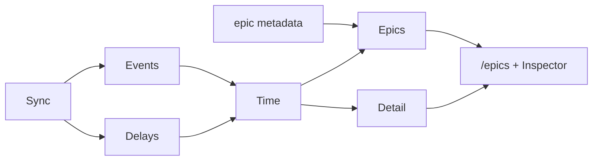
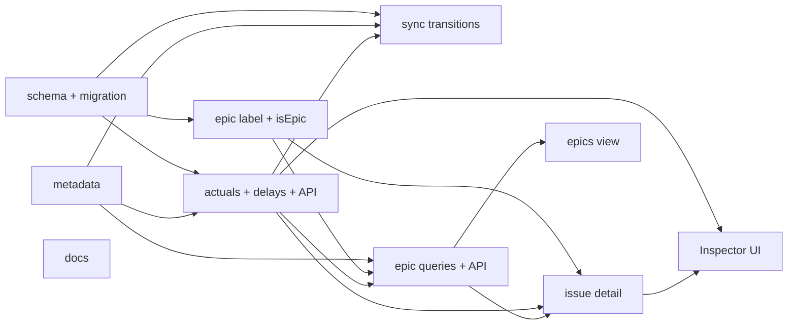

# Actual time, structured delays and epics

**Goal:** observe real workflow time, record structured delays, and track epics as label-marked issues whose children live in `funnel_metadata`.
**Architecture:** a durable event log records status/state/blocked transitions observed by sync; delay intervals come from blocked transitions and manual entries; actual time is the union of open intervals whose status is `in-progress` or `in-review`; epics are issues with the `epic` label and a `children` list in their body metadata; `/epics` and the Inspector read rollups from the mirror and the event/delay stores.
**Spec path:** docs/plans/2026-10-24-actuals-delays-epics.spec.md — §1 Observed events and actual time, §2 Delay records, §3 Epic label and metadata, §4 Epic queries and rollups, §5 Inspector surfaces, §6 Epics views, §7 APIs and access, §8 Persistence and migration, §9 Documentation.
**Detail:** contracts
**Target-min:** 30

## Global constraints

- Actual statuses are exactly `in-progress` and `in-review`; closing ends the active interval at `closedAt`.
- Tracking starts at migration/first observation; there is **no** timeline backfill.
- Delay reasons are `dependency`, `info`, `review`, `external`, `capacity`, `other`.
- Epic children are a comma-separated `owner/name#number` scalar in the epic body's `epic:` metadata section; no membership table.
- Focused tests: `bun test --preload ./tests/setup.ts --max-concurrency 1 <paths>`.

**Files:** schema/migration → label+mirror flag → metadata+actuals+epics → APIs → Inspector+epics UI.

## Task graph

```mermaid
%% schedule
gantt
  title Predicted schedule (mm:ss)
  dateFormat X
  axisFormat %M:%S
  section lane 1
  T1 persistence and migration :t1, 0, 142s
  T4 actuals  delays and delay API :t4, 142, 228s
  T6 epic queries  mutations and API :t6, 370, 231s
  T9 epics views and navigation :t9, 601, 258s
  section lane 2
  T10 documentation :t10, 0, 137s
  T2 epic label and isEpic cache :t2, 142, 191s
  T5 sync transitions :t5, 370, 140s
  T7 issue detail integration :t7, 601, 161s
  T8 Inspector time  delays and epic :t8, 762, 255s
  section lane 3
  T3 metadata  block reason and epic child :t3, 0, 134s
```

critical path: T1 → T4 → T6 → T7 → T8 (17.0 min) · peak width 3 · predicted build 17.0 min · predicted total ≈ 20.5 min (target ✓)

### T1 persistence and migration · Complexity 5 · Est. context 32k
**Owns:** src/lib/server/db/schema.ts, drizzle/20261024170000_actuals_epics/migration.sql, drizzle/20261024170000_actuals_epics/snapshot.json, src/lib/server/db/schema.test.ts
**Components:** 2
**LOC owned:** 220
**Tests:** fast
**Model:** sonnet
**Produces:** `stateIssueEvent` · `stateIssueDelay` · `mirrorThread.isEpic` column · baseline migration
**Review Focus:** `test_event_columns`: event table has `org,name,issue_number,kind,from_value,to_value,at,source`. `test_delay_columns`: delay table has `reason,started_at,ended_at,note,source`. `test_mirror_is_epic_default_zero`. `test_baseline_seed`: a seeded open issue yields three baseline events; a blocked issue yields one open `source=blocked` delay.
**Notes:** Event PK text, index `(org,name,issue_number,at)`; delay PK text, indexes `(org,name,issue_number,started_at)` and `(ended_at)`. `is_epic` integer default 0. Migration seeds baselines at `strftime('%s','now')*1000` for every mirrored issue and a blocked delay with reason `other` for every blocked issue.

### T2 epic label and isEpic cache · Complexity 4 · Est. context 26k
**Owns:** src/lib/labels.ts, src/lib/server/sync/conflicts.ts, src/lib/server/sync/conflicts.test.ts, src/lib/server/sync/mirror.ts, src/lib/server/sync/mirror.test.ts, src/lib/server/issues/types.ts, src/lib/server/issues/queries.ts
**Components:** 4
**LOC owned:** 220
**Tests:** fast
**Model:** sonnet
**Produces:** `epic` canonical label/group · `DerivedMetadata.isEpic` · `StoredMetadata.isEpic` · `IssueListItem.isEpic`
**Review Focus:** `test_epic_label_is_canonical`: `CANONICAL_LABELS` has `{name:"epic",group:"epic"}`. `test_derive_epic`: `deriveMetadata(["epic","backlog"])` gives `isEpic:true,status:"backlog"`. `test_mirror_round_trip`: `is_epic=1` reads back as `isEpic:true`. `test_epic_does_not_set_blocked`: `deriveMetadata(["epic"]).blocked` is false.
**Notes:** Add `epic` to `LabelGroup` and `GROUP_ORDER`; set `mirror_thread.is_epic` on insert/update; add `isEpic` to `issueColumns` and `hydrate`. No conflict handling: one canonical name.

### T3 metadata: block reason and epic children · Complexity 4 · Est. context 24k
**Owns:** src/lib/funnel-metadata.ts, src/lib/funnel-metadata.test.ts, src/lib/server/actuals/reasons.ts, src/lib/server/actuals/reasons.test.ts
**Components:** 2
**LOC owned:** 160
**Tests:** fast
**Model:** sonnet
**Produces:** `DelayReason` · `DELAY_REASONS` · `BlockInfo.reason` · `readEpicChildren` · `writeEpicChildren` · `parseEpicRef` · `formatEpicRef`
**Review Focus:** `test_block_reason_round_trip`: `reason:"dependency"` survives `writeBlocked`→`readBlocked`. `test_missing_reason_is_other`. `test_epic_children_round_trip`: `["orgA/core#1","orgA/web#2"]` round-trips in order. `test_invalid_epic_refs_dropped`: `"nope"`, `"orgA/core#0"` and self are dropped. `test_preserves_blocked_section`.
**Notes:** `BlockInfo.reason` is required on write; reads default to `other`. `readEpicChildren` splits the `epic.children` scalar on commas; `writeEpicChildren` removes the section when empty and preserves others. `parseEpicRef` accepts `^[\w.-]+/[\w.-]+#\d+$`.

### T4 actuals, delays and delay API · Complexity 5 · Est. context 34k
**Owns:** src/lib/server/actuals/time.ts, src/lib/server/actuals/time.test.ts, src/lib/server/actuals/store.ts, src/lib/server/actuals/store.test.ts, src/routes/api/repos/[owner]/[repo]/issues/[number]/delays/+server.ts, src/routes/api/repos/[owner]/[repo]/issues/[number]/delays/[id]/+server.ts, tests/delay-routes.test.ts
**Components:** 5
**LOC owned:** 320
**Tests:** fast
**Model:** sonnet
**Produces:** `IssueTime` · `activeIntervals` · `mergeIntervals` · `totalMinutes` · `computeIssueTime` · `openDelay` · `closeOpenDelays` · `createManualDelay` · `updateDelay` · `deleteDelay` · `listDelays` · `batchIssueTime` · `POST` · `PATCH` · `DELETE`
**Review Focus:** `test_active_includes_review`: in-progress `[0,60]` + in-review `[60,120]` gives 120. `test_close_ends_active`: close at 90 gives 90. `test_delay_union`: overlapping blocked/manual delays count once. `test_estimate_variance`: estimate 240, actual 120 gives -120. `test_open_delay_closes_on_unblock`. `test_manual_delay_crud`. `test_delay_write_role`: read gets 403. `test_delay_event_published`: success publishes an `issues` event.
**Notes:** Walk sorted events; active statuses are `in-progress`/`in-review`; closed state ends at `closedAt ?? event.at`. `mergeIntervals` merges overlaps. `computeIssueTime` returns `{actualMinutes,delayMinutes,estimateMinutes,varianceMinutes,leadMinutes,cycleMinutes,delayCount}`. Manual rows only are editable/deletable.

### T5 sync transitions · Complexity 5 · Est. context 32k
**Owns:** src/lib/server/actuals/transitions.ts, src/lib/server/actuals/transitions.test.ts, src/lib/server/sync/hydrate.ts
**Components:** 2
**LOC owned:** 200
**Tests:** fast
**Model:** sonnet
**Produces:** `IssueSnapshot.blocked` · `recordIssueTransitions`
**Review Focus:** `test_first_sight_baselines`: previous null writes three baseline rows at one timestamp. `test_status_change_appends`: backlog→in-progress writes one status row. `test_no_change_writes_nothing`. `test_blocked_opens_delay`: false→true opens a `source=blocked` delay with the body reason. `test_unblock_closes_delay`. `test_close_closes_active_and_delays`: closes delays at `closedAt`. `test_reopen_blocked_opens_new_delay`.
**Notes:** Extend `IssueSnapshot`/snapshots with `blocked`. Call `recordIssueTransitions` from `hydrateAndStore` after upsert with previous, next metadata, body, `at=Date.now()`, `source="sync"`; use `closedAt ?? at` for close. First sight baselines; blocked opens a delay. No backfill.

### T6 epic queries, mutations and API · Complexity 5 · Est. context 36k
**Owns:** src/lib/server/epics/queries.ts, src/lib/server/epics/queries.test.ts, src/lib/server/epics/mutations.ts, src/lib/server/epics/mutations.test.ts, src/routes/api/repos/[owner]/[repo]/issues/[number]/epic/+server.ts, src/routes/api/repos/[owner]/[repo]/issues/[number]/epic/children/+server.ts, tests/epic-routes.test.ts
**Components:** 5
**LOC owned:** 340
**Tests:** fast
**Model:** sonnet
**Produces:** `EpicRef` · `EpicSummary` · `EpicDetail` · `listEpics` · `getEpicDetail` · `setEpicLabel` · `setEpicChildren` · `PUT` (epic) · `PUT` (children)
**Review Focus:** `test_list_epics_open_before_closed`. `test_progress_and_rollups`: two children, one closed, estimates 120+240, actuals 60+0 gives progress 0.5 and estimate 360. `test_missing_child_skipped`. `test_set_epic_label_toggles`. `test_set_children_writes_body`: replacement preserves `blocked`. `test_duplicate_child_rejected`: already in another epic returns 409. `test_nested_epic_rejected`. `test_epic_write_role`: read gets 403.
**Notes:** `listEpics` selects `is_epic=1`, parses children, resolves them and sums `batchIssueTime`. `getEpicDetail` returns ordered children and rollups; missing children are skipped. `setEpicChildren` validates, rejects self/nested/duplicate, edits the body with the user token and publishes `issues`. `setEpicLabel` uses label mutations; removing the label leaves the body.

### T7 issue detail integration · Complexity 4 · Est. context 28k
**Owns:** src/lib/server/issues/types.ts, src/lib/server/issues/queries.ts, src/lib/server/issues/detail.test.ts, src/routes/api/mirror/issues/[owner]/[repo]/[number]/+server.ts
**Components:** 3
**LOC owned:** 180
**Tests:** fast
**Model:** sonnet
**Produces:** `IssueDetail.time` · `IssueDetail.delays` · `IssueDetail.epic` · `RenderedIssueDetail` fields
**Review Focus:** `test_detail_time`: estimate 240, actual 120 returns variance -120. `test_detail_delays`: two delays oldest first. `test_detail_epic_parent`: a child returns its epic ref. `test_detail_is_epic`: epic issue returns `isEpic:true`. `test_detail_missing`: unknown issue returns undefined.
**Notes:** Add `time: IssueTime`, `delays: DelayItem[]`, `epic: EpicRef | null`. `getIssueDetail` computes time from `listDelays` + `listIssueEvents` and finds the parent via a T6 helper. The mirror detail route returns the fields unchanged.

### T8 Inspector time, delays and epic · Complexity 5 · Est. context 36k
**Owns:** src/lib/components/issue/InspectorPane.svelte, src/lib/components/issue/IssueTimeCard.svelte, src/lib/components/issue/DelayList.svelte, src/lib/components/issue/RecordDelayDialog.svelte, src/lib/components/issue/EpicProperty.svelte, src/lib/components/board/BlockActionDialog.svelte
**Components:** 6
**LOC owned:** 340
**Tests:** fast
**Model:** sonnet
**Produces:** time card · delay list/dialog · block reason · epic property
**Review Focus:** `test_time_card_formats`: 240→`4h`, 90→`1h 30m`, 0→`0m`. `test_delay_list_splits_auto_and_manual`: blocked rows read-only, manual rows closable. `test_block_reason_required`: dialog payload includes the reason. `test_epic_property_states`: epic badge+link, child parent link, otherwise writer-only mark action. `test_read_only_hides_controls`.
**Notes:** Use `formatMinutes` from `#lib/planning`. Delay dialog posts to `/api/.../delays`; close uses PATCH, delete uses DELETE, then `invalidateAll`. Extend the block payload with reason. Epic property links to `/epics/{owner}/{repo}/{number}`; mark/remove calls `PUT /epic`.

### T9 epics views and navigation · Complexity 5 · Est. context 36k
**Owns:** src/routes/*/epics/+page.server.ts, src/routes/*/epics/+page.svelte, src/routes/*/epics/[owner]/[repo]/[number]/+page.server.ts, src/routes/*/epics/[owner]/[repo]/[number]/+page.svelte, src/lib/components/epics/*, src/lib/components/app-sidebar.svelte, tests/epics-page.test.ts
**Components:** 6
**LOC owned:** 360
**Tests:** fast
**Model:** sonnet
**Produces:** `/epics` · `/epics/{owner}/{repo}/{number}` · sidebar `Epics` item
**Review Focus:** `test_epics_list_open_first`. `test_epics_list_rollups`: progress, estimate, actual and delay from `listEpics`. `test_epic_detail_children`: rows and rollups. `test_add_child_replaces_list`: dialog sends the full array. `test_remove_child`: sends the list without the child. `test_sidebar_epics_active`. `test_read_only_hides_edit`.
**Notes:** `/epics` lists open then closed; detail shows header, rollups and child table. Add-child searches open issues not already in another epic and sends the full list to `PUT /epic/children`. Add `Epics` under Workspace with `LayersIcon`.

### T10 documentation · Complexity 2 · Est. context 20k
**Owns:** docs/how-to/use/track-time-and-delays.md, docs/how-to/use/epics.md, docs/reference/reserved-labels.md, docs/reference/database-schema.md, docs/reference/routes-and-pages.md, docs/reference/http-api.md, docs/reference/glossary.md, docs/explanation/workflow-model.md, docs/README.md, tests/docs-actuals-epics.test.ts
**Components:** 2
**LOC owned:** 180
**Tests:** fast
**Model:** sonnet
**Produces:** actuals/delays/epics documentation
**Review Focus:** `test_reserved_labels_has_epic`: fifteenth label and `epic` group. `test_schema_docs`: event/delay tables and `is_epic`. `test_routes_docs`: `/epics` and the APIs. `test_glossary`: Actual time, Delay, Epic. `test_no_backfill_is_documented`.
**Notes:** Document the child list format, one-epic-per-issue guidance, delay reasons, and that in-review counts as active time. Update routes, HTTP API, schema and workflow model.

## Review Focus

**Actuals/delays** — numeric, state. Risks: overlapping intervals, close/reopen, blocked/manual overlap, missing baseline, duplicate events.
**Epics** — protocol, state. Risks: malformed/self/nested/duplicate refs, missing children, body edits losing sections, label removal, cross-repo, write failure.
**UI** — protocol, encoding. Risks: read-only controls, formatting, 409 surface, stale detail.
**Probe entry:** call=actuals.time.computeIssueTime · run=bun test --preload ./tests/setup.ts --max-concurrency 1 --coverage src tests
**Probe entry:** call=epics.queries.listEpics · run=bun test --preload ./tests/setup.ts --max-concurrency 1 --coverage src tests
