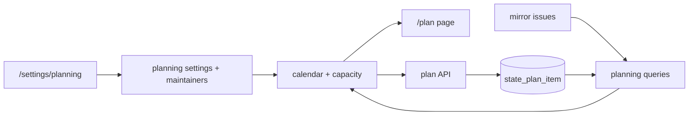
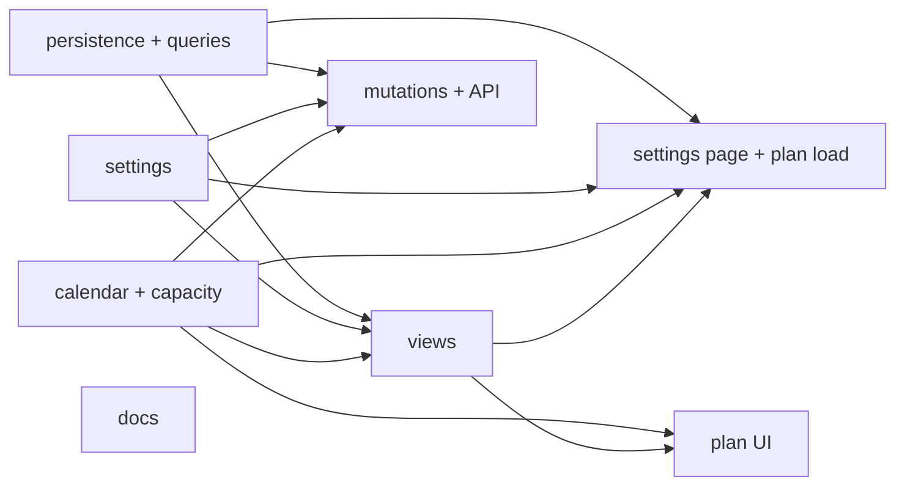

# Time planning, estimates and capacity

**Goal:** add a planning layer to Funnel: fixed size-to-time estimates, week and cycle plans, per-maintainer net capacity, and a hard 60% issue-allocation cap.
**Architecture:** settings own estimates, cycle shape and the maintainer roster; a durable `state_plan_item` schedules one issue to one Monday week; pure calendar and capacity modules compose week, cycle and milestone views; a guarded API enforces the cap on every plan mutation. GitHub stays authoritative for size, assignees, state and milestones.
**Spec path:** docs/plans/2026-10-24-time-planning.spec.md — §1 Estimates and settings, §2 Week and cycle calendar, §3 Capacity model, §4 Scheduling and hard cap, §5 Planning views, §6 Maintainer roster and net hours, §7 API and access control, §8 Durable plan state, §9 Documentation and operations.
**Detail:** contracts
**Target-min:** 36

## Global constraints

- Weeks are ISO Monday weeks in UTC as `YYYY-MM-DD`; time is integer minutes internally, decimal hours in the UI.
- `planning.size_minutes` defaults to `{ sm: 120, md: 240, lg: 480 }`; `allocation_percent` defaults to `60`; capacity is `floor(weekly_minutes * weeks * percent / 100)`.
- Plan items are durable, keyed `(org, name, issue_number)`, never written to GitHub. Only open, sized issues can be scheduled.
- The net-hours hint is verbatim from spec §6. No new dependency or service.
- Each task: failing test, implement, pass. Focused command: `bun test --preload ./tests/setup.ts --max-concurrency 1 <paths>`.

## File structure

- `src/lib/server/db/schema.ts`, `drizzle/20261024160000_plan_items/migration.sql` — `state_plan_item` + week index.
- `src/lib/server/planning/{store,queries}.ts` — plan CRUD and mirror joins; `tests/planning-helpers.ts` — seed.
- `src/lib/server/settings/store.ts`, `src/lib/server/config.ts` — planning settings and roster validation.
- `src/lib/server/planning/{calendar,capacity,plans,milestones,mutations}.ts`, `src/lib/planning.ts` — time, capacity, views, schedule.
- `src/routes/api/repos/[owner]/[repo]/issues/[number]/plan/+server.ts` — PUT/DELETE.
- `src/routes/(app)/settings/planning/*`, `src/routes/(app)/plan/*`, `src/lib/components/plan/*` — UI.

## Task graph

```mermaid
%% schedule
gantt
  title Predicted schedule (mm:ss)
  dateFormat X
  axisFormat %M:%S
  section lane 1
  T1 plan persistence and queries :t1, 0, 204s
  T5 schedule mutation and API :t5, 204, 224s
  section lane 2
  T3 calendar  capacity and formatting :t3, 0, 174s
  T4 week  cycle and milestone views :t4, 204, 204s
  T7 plan UI :t7, 408, 312s
  section lane 3
  T2 planning settings :t2, 0, 166s
  T6 settings page and plan load :t6, 408, 260s
  section lane 4
  T8 documentation :t8, 0, 134s
```

critical path: T1 → T4 → T7 (12.0 min) · peak width 4 · predicted build 12.0 min · predicted total ≈ 15.5 min (target ✓)

### T1 plan persistence and queries · Complexity 5 · Est. context 34k
**Owns:** src/lib/server/db/schema.ts, drizzle/20261024160000_plan_items/migration.sql, src/lib/server/planning/store.ts, src/lib/server/planning/store.test.ts, src/lib/server/planning/queries.ts, src/lib/server/planning/queries.test.ts, tests/planning-helpers.ts
**Components:** 4
**LOC owned:** 320
**Tests:** fast
**Model:** sonnet
**Est. time:** 4.5 min
**Produces:** `PlanItemRecord` · `listPlanItems` · `getPlanItem` · `setPlanItem` · `clearPlanItem` · `PlanningIssue` · `listPlannedIssues` · `listPlanCandidates` · `listMilestoneIssues` · `listAssigneeCandidates` · `getPlanningIssue`
**Review Focus:** `test_plan_item_unique_per_issue`: setting `2026-10-19` then `2026-10-26` leaves one row at `2026-10-26`. `test_plan_items_survive_mirror_clear`: `clearMirror()` leaves the row. `test_planned_join`: one row yields `{repo:"orgA/core",repoId:1,number:1,title:"Issue 1",state:"open",size:"md",assignees:[{login:"ann"}],milestone:null,priority:null,weekStart:"2026-10-19"}`. `test_candidates_exclude_planned_and_unsized`: planned, closed and size-less omitted. `test_closed_issue_is_absent`. `test_assignee_candidates_scoped`: only assignable users in configured repos.
**Notes:** `week_start` TEXT; PK `(org,name,issue_number)`; `idx_state_plan_item_week`. Join plan rows to `mirror_thread`/`mirror_repo` by `(org,name,number)`; batch assignees once. Candidates: open, `status IS NOT NULL`, `size IS NOT NULL`, no plan row, priority-rank order, limit 300. `getPlanningIssue` returns closed issues too.

### T2 planning settings · Complexity 5 · Est. context 30k
**Owns:** src/lib/server/settings/store.ts, src/lib/server/settings/store.test.ts, src/lib/server/config.ts, src/lib/server/config.test.ts, src/lib/server/settings/apply.test.ts, tests/test-config.ts
**Components:** 3
**LOC owned:** 220
**Tests:** fast
**Model:** sonnet
**Est. time:** 3.5 min
**Produces:** `SizeKey` · `MaintainerInput` · `DEFAULT_SIZE_MINUTES` · `Settings.planning` · `FunnelConfig.planning`
**Review Focus:** `test_planning_defaults`: empty table gives `{size_minutes:{sm:120,md:240,lg:480},allocation_percent:60,cycle_weeks:2,cycle_anchor:"2024-01-01",maintainers:[]}`. `test_monday_anchor_rejected`: `2024-01-02` throws `SettingsError`. `test_duplicate_maintainer_rejected`: two rows with `(github,github.com,"7")` fail config validation. `test_allocation_bounds`: `0` and `101` rejected.
**Notes:** Keys `planning.size_minutes|allocation_percent|cycle_weeks|cycle_anchor|maintainers`; snake_case roster; validate Monday in `configSchema`; update `BASE` and `TEST_CONFIG`.

### T3 calendar, capacity and formatting · Complexity 5 · Est. context 32k
**Owns:** src/lib/server/planning/calendar.ts, src/lib/server/planning/calendar.test.ts, src/lib/server/planning/capacity.ts, src/lib/server/planning/capacity.test.ts, src/lib/planning.ts, src/lib/planning.test.ts
**Components:** 3
**LOC owned:** 280
**Tests:** fast
**Model:** sonnet
**Est. time:** 3.5 min
**Produces:** `weekStartOf` · `addWeeks` · `isMondayISO` · `weekLabel` · `CycleWindow` · `cycleForWeek` · `weeksUntilDue` · `CapacityMaintainer` · `CapacityIssue` · `CapacityTotal` · `CapacityViolation` · `maintainerKey` · `estimateMinutes` · `capMinutes` · `splitMinutes` · `distributeIssues` · `overCapacity` · `minutesToHours` · `hoursToMinutes` · `formatMinutes` · `barPercent`
**Review Focus:** `test_week_start_is_monday_utc`: Sunday `2026-10-25` and Monday `2026-10-19` map to `2026-10-19`; `addWeeks("2026-12-28",1)="2027-01-04"`. `test_cycle_boundaries`: `cycleForWeek("2026-10-19","2024-01-01",2)` gives `{key:"2026-10-19",start:"2026-10-19",end:"2026-11-01",weeks:["2026-10-19","2026-10-26"]}`. `test_past_due_is_zero`. `test_cap_floors`: `capMinutes(599,60,1)=359`; `(600,60,null)=0`; `(600,60,2)=720`. `test_remainder_to_first`: `splitMinutes(241,2)=[121,120]`. `test_inactive_is_unassigned`. `test_null_weeks_never_over`. `test_over_capacity`: 240 committed + 240 candidate against 360 gives `{login:"ann",capMinutes:360,committedMinutes:480,excessMinutes:120}`. `test_hours_round_trip`: `hoursToMinutes(7.5)=450`. `test_format_minutes`: `120→"2h"`, `90→"1h 30m"`, `null→"—"`. `test_bar_clamps`: `barPercent(480,360)=100`.
**Notes:** UTC arithmetic only; `cycleForWeek` floors pre-anchor weeks; every active maintainer gets a lane; null estimates are separate; `weeks:null` caps at 0 and never reports over.

### T4 week, cycle and milestone views · Complexity 5 · Est. context 34k
**Owns:** src/lib/server/planning/plans.ts, src/lib/server/planning/plans.test.ts, src/lib/server/planning/milestones.ts, src/lib/server/planning/milestones.test.ts
**Components:** 4
**LOC owned:** 320
**Tests:** fast
**Model:** sonnet
**Est. time:** 4.5 min
**Produces:** `PlanLane` · `PlanUnassigned` · `WeekPlan` · `CyclePlan` · `weekPlan` · `cyclePlan` · `MilestonePlan` · `milestonePlans`
**Review Focus:** `test_week_lane_uses_60_percent`: 600 weekly minutes + one `md` issue gives cap `360`, committed `240`, remaining `120`. `test_cycle_aggregates_two_weeks`: aggregate cap `720`. `test_unassigned_and_unestimated`. `test_due_window`: due two weeks out gives `capacityWeeks:2` and cap `720`. `test_no_due_date_has_no_cap`: `capacityWeeks:null`, no lane over. `test_groups_by_repo_and_number`: equal titles in two repos stay separate.
**Notes:** Week uses `weeks:1`; cycle groups its weeks and aggregates with `weeks:cycle.weeks.length`; milestones use `capacityWeeks = dueOn === null ? null : weeksUntilDue(dueOn, now)`; map `issueIndexes` back to issues.

### T5 schedule mutation and API · Complexity 5 · Est. context 34k
**Owns:** src/lib/server/planning/mutations.ts, src/lib/server/planning/mutations.test.ts, src/routes/api/repos/[owner]/[repo]/issues/[number]/plan/+server.ts, src/lib/client/events.ts, tests/planning-routes.test.ts
**Components:** 5
**LOC owned:** 290
**Tests:** fast
**Model:** sonnet
**Est. time:** 4.5 min
**Produces:** `ScheduleResult` · `scheduleIssue` · `unscheduleIssue` · `PUT` · `DELETE`
**Review Focus:** `test_over_cap_409`: two `md` issues against cap `360` reject the second and leave one row. `test_unestimated_rejected`: size-less issue → 400. `test_move_frees_old_week`. `test_same_week_is_noop`. `test_write_role_required`: read session → 403. `test_invalid_body_400`: missing week. `test_delete_clears`: `200 {cleared:true}`. `test_planning_event_published`: success publishes `{type:"planning"}`.
**Notes:** Reject bad Monday, missing/closed, unestimated, no active-capacity assignee, and over-cap projection; exclude the issue itself. API: `apiRole(...,"write")`, only `week_start`, add `"planning"` to `EVENT_TYPES`.

### T6 settings page and plan load · Complexity 5 · Est. context 36k
**Owns:** src/lib/components/settings/sections.ts, src/routes/(app)/settings/planning/+page.server.ts, src/routes/(app)/settings/planning/+page.svelte, src/routes/(app)/plan/+page.server.ts, src/lib/components/app-sidebar.svelte, tests/planning-page.test.ts
**Components:** 6
**LOC owned:** 380
**Tests:** fast
**Model:** sonnet
**Est. time:** 5 min
**Produces:** `/settings/planning` · `load` · sidebar `Plan` item
**Review Focus:** `test_planning_defaults_load`: settings load returns `allocation_percent:60` and the empty roster. `test_default_horizon_is_current_week`: no query returns the current Monday and `weekPlan.weekStart === week`. `test_cycle_horizon`: `?horizon=cycle&cycle=2026-10-19` returns that cycle. `test_requires_user`: no session redirects to login. `test_sidebar_has_plan`: nav source contains `/plan`. `test_net_hours_hint`: settings page contains the verbatim hint.
**Notes:** Add `Planning` (admin, `CalendarRangeIcon`) and `Plan` nav items. Settings posts one `planning` payload with hours→minutes and the verbatim hint. Load validates `horizon|week|cycle`, defaults to the current week, returns week/cycle/candidates plus `previous`/`next`.

### T7 plan UI · Complexity 5 · Est. context 36k
**Owns:** src/routes/(app)/plan/+page.svelte, src/lib/components/plan/PlanLanes.svelte, src/lib/components/plan/CapacityBar.svelte, src/lib/components/plan/ScheduleDialog.svelte, src/lib/components/plan/MilestonePlans.svelte, src/lib/components/plan/format.ts, src/lib/components/plan/format.test.ts, src/lib/components/plan/schedule.ts, src/lib/components/plan/schedule.test.ts
**Components:** 8
**LOC owned:** 400
**Tests:** fast
**Model:** sonnet
**Est. time:** 5.5 min
**Produces:** `capacityTone` · `scheduleRequest` · `PlanLanes` · `CapacityBar` · `ScheduleDialog` · `MilestonePlans` · `/plan` page
**Review Focus:** `test_tone_thresholds`: `capacityTone(0,360)="empty"`, `(320,360)="near"`, `(400,360)="over"`; `(10,0)="over"`. `test_schedule_request_encodes_path`: `scheduleRequest("orgA/core",7,"2026-10-19")` → `/api/repos/orgA/core/issues/7/plan`, method `PUT`, body exactly `{"week_start":"2026-10-19"}`. `test_milestone_without_due_shows_no_bar`: null `capacityWeeks` renders hours without a cap bar. `test_dialog_errors_surface`: a 409 message is shown. `test_week_page_renders_lanes`.
**Notes:** Dense header with horizon tabs, prev/next and a writer-only `Schedule issue` button. Lane rows show avatar, `@login`, `committed / cap` and a 60% marker bar; week adds unassigned/unestimated, cycle adds per-week summaries, milestone adds due/weeks. Dialog uses `scheduleRequest`, then `invalidateAll()`, and surfaces 409 inline.

### T8 documentation · Complexity 2 · Est. context 20k
**Owns:** docs/how-to/configure/planning.md, docs/reference/settings.md, docs/reference/database-schema.md, docs/reference/routes-and-pages.md, docs/reference/http-api.md, docs/reference/glossary.md, docs/explanation/workflow-model.md, tests/docs-planning.test.ts
**Components:** 2
**LOC owned:** 160
**Tests:** fast
**Model:** sonnet
**Est. time:** 2 min
**Produces:** planning documentation
**Review Focus:** `test_settings_docs_have_all_keys`: all five `planning.*` keys appear. `test_routes_docs_name_plan`: `/plan` and `/settings/planning` appear. `test_api_docs_name_plan_endpoint`: the PUT/DELETE path appears. `test_net_hours_is_defined`: "net hours" appears with the meetings subtraction.
**Notes:** Settings rows for five keys; `state_plan_item`; routes; plan endpoint; glossary **Estimate/Net hours/Cycle/Plan item**; workflow-model paragraph.

## Review Focus

**Planning server package** — HTTP service/data pipeline; categories: protocol, numeric, state, encoding. Risks: UTC drift; floor vs round; remainder loss; double counting a move; closed/pruned issues; inactive maintainers; unestimated/unassigned buckets; missing due dates; plan rows surviving `clearMirror`.
**Plan API** — protocol, state. Risks: read-role bypass; malformed week; issue not mirrored; cap bypass for unassigned or unconfigured assignees; stale plan rows.
**Web UI** — protocol via its API, encoding. Risks: escaped titles; controls hidden from `read`; 409 surfaced; hours/minutes drift; net-hours hint missing; no-due milestone not shown as over.
**Probe entry:** call=planning.plans.weekPlan · run=bun test --preload ./tests/setup.ts --max-concurrency 1 --coverage src tests
**Probe entry:** call=planning.capacity.distributeIssues · run=bun test --preload ./tests/setup.ts --max-concurrency 1 --coverage src tests
**Probe entry:** call=planning.mutations.scheduleIssue · run=bun test --preload ./tests/setup.ts --max-concurrency 1 --coverage src tests

