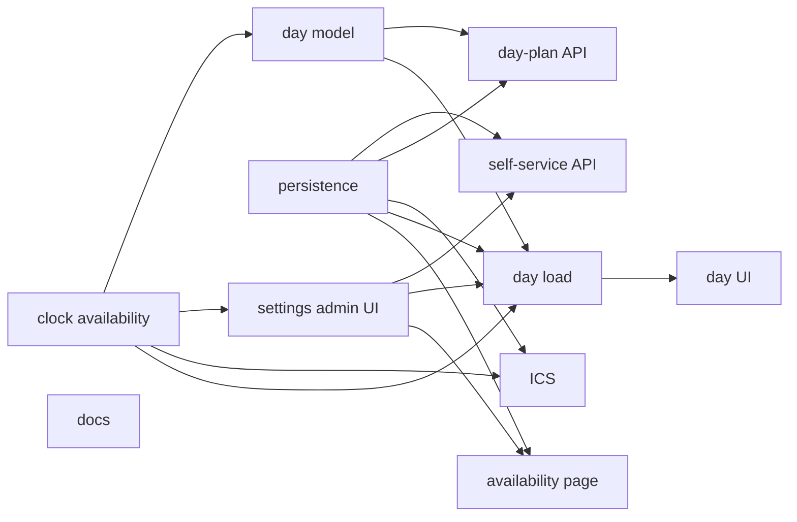

# ALPEN day planning, working hours and calendar feed

**Goal:** a per-viewer ALPEN day planner over week/cycle planning: working hours with an IANA timezone, recurring and one-off blocked windows, timed day blocks with a reserved buffer, planned-vs-actual review, and a tokenized read-only ICS feed for Outlook.
**Architecture:** pure clock/availability → pure day model → durable per-user tables → `/api/me/*` + public tokenized ICS → Day horizon in `/plan` and `/settings/availability`.
**Spec path:** docs/plans/2026-10-25-alpen-day-planning.spec.md — §1 clock/availability, §2 day model, §3 persistence, §4 settings, §5 API, §6 ICS, §7 day load, §8 availability page, §9 day UI, §10 docs.
**Detail:** full
**Target-min:** 50

**Ruling:** AI orchestrator (hands off). **Ruling:** ICS token 32 random bytes, hash-at-rest, no expiry, regenerate to revoke — secret-URL hygiene. **Ruling:** DST gap clamps forward, overlap picks the earlier instant. **Ruling:** feed window today−7d…today+42d.

## Global constraints

- Minutes are integers `0..1440` from local midnight; dates are real `YYYY-MM-DD`; instants are unix ms; weeks stay ISO Monday weeks in UTC.
- New tables are durable `state_*`, keyed by `auth_user.id` `ON DELETE CASCADE`, snake_case, no FK to `mirror_*`.
- `planning.work_defaults` default `{ "timezone": "UTC", "start_minute": 540, "end_minute": 1020, "work_days": [1,2,3,4,5], "buffer_percent": 20 }`.
- `/api/me/*` needs a session only (`apiSession`), never `write`; ICS headers and folding follow spec §6.
- No new dependency. Tests: `bun test --preload ./tests/setup.ts --max-concurrency 1 <paths>`.

## Task graph

```mermaid
%% schedule
gantt
  title Predicted schedule (mm:ss)
  dateFormat X
  axisFormat %M:%S
  section lane 1
  T3 persistence and candidates :t3, 0, 205s
  T7 ICS feed :t7, 205, 186s
  T10 day UI :t10, 454, 180s
  section lane 2
  T1 clock  DST and availability :t1, 0, 153s
  T4 settings and admin UI :t4, 153, 163s
  T5 self-service API :t5, 315, 175s
  section lane 3
  T11 documentation :t11, 0, 118s
  T2 day model :t2, 153, 146s
  T6 day-plan API :t6, 299, 173s
  section lane 4
  T9 availability page :t9, 315, 169s
  section lane 5
  T8 day horizon load :t8, 315, 138s
```

critical path: T1 → T4 → T8 → T10 (10.6 min) · peak width 5 · predicted build 10.6 min · predicted total ≈ 14.1 min (target ✓)

### T1 clock, DST and availability · C5
**Owns:** src/lib/time/zoned.{ts,test.ts}, src/lib/planning/availability.{ts,test.ts}
**Components:** 2
**LOC owned:** 300
**Tests:** fast
**Model:** sonnet
**Produces:** `isValidTimeZone(tz) -> boolean` · `zonedParts(instant,tz) -> ZonedParts` · `zonedToInstant(date,minute,tz) -> number` · `localDateOf(instant,tz) -> string` · `addDaysISO(date,days) -> string` · `weekdayOf(date) -> number` · `isDateISO(value) -> boolean` · `parseClock(value) -> number|null` · `formatClock(minute) -> string` · `mergeRanges(ranges) -> MinuteRange[]` · `minutesInRanges(ranges) -> number` · `clipRanges(ranges,start,end) -> MinuteRange[]` · `availableRanges(hours,date,windows) -> MinuteRange[]` · `availableMinutes(hours,date,windows) -> number` · `bufferMinutes(hours,available) -> number` · `normalizeWorkHours(input) -> WorkHours` · `hoursFromDefaults(input) -> WorkHours` · `defaultsFromHours(hours) -> WorkDefaultsInput` · `clipMinutes(intervals,start,end) -> number` · `issueRefKey(org,name,number) -> string` · `DEFAULT_WORK_HOURS -> WorkHours` · `WorkHours` · `DayWindow` · `WorkDefaultsInput` · `MinuteRange` · `TimeSpan` · `WorkHoursError`
**Review Focus:** `test_round_trip`: Berlin 2026-10-25 09:30 → 9:30 same date. `test_dst`: NY gap `("2026-03-08",150)` → `Date.UTC(2026,2,8,7,30)`; overlap `("2026-11-01",90)` → `Date.UTC(2026,10,1,5,30)`. `test_clock`: `parseClock("9:05")===545`, `parseClock("24:00")===null`, `formatClock(545)==="09:05"`. `test_lunch`: 540–1020 minus 720–780 → `[{540,720},{780,1020}]`; Sunday → `[]`. `test_buffer`: 480×20% → 96. `test_invalid`: start≥end or a bad zone throws.

### T2 day model · C5
**Owns:** src/lib/planning/day-plan.{ts,test.ts}
**Components:** 2
**LOC owned:** 250
**Tests:** fast
**Model:** sonnet
**Consumes:** `availableRanges` · `bufferMinutes` · `issueRefKey` (T1)
**Produces:** `validateDayBlocks(input) -> DayBlockInput[]` · `autoDayPlan(input) -> DayBlockInput[]` · `dayReview(input) -> DayReview` · `DayBlock` · `DayBlockInput` · `DayCandidate` · `DayReview` · `DayBlockInputSet` · `AutoDayInput` · `DayReviewInput` · `DayBlockError`
**Review Focus:** `test_overlap`: `[540,60]`,`[570,30]` → `DayBlockError("Blocks overlap at 09:30")`. `test_bounds_kinds`: `minutes:4`, end>1440, 41 blocks throw; issue without `org` throws; buffer with `org` throws. `test_sorted_copy`: ascending, input untouched. `test_auto_buffer`: 480/20% + two P1 240s → 300 issue + 180 buffer, second omitted. `test_auto_split`: window split 660–720, 300-min issue → `540+120`,`660+180`. `test_auto_priority`: P1, P2, null; non-work day → `[]`. `test_review`: planned 240/actual 300 → variance 60; buffer excluded.

### T3 persistence and candidates · C5
**Owns:** src/lib/server/db/schema.ts, drizzle/, src/lib/server/planning/{day-store,day-queries}.ts, src/lib/server/planning/{day-store,day-queries}.test.ts
**Components:** 4
**LOC owned:** 330
**Tests:** fast
**Model:** sonnet
**Consumes:** `WorkHours` · `DayWindow` · `issueRefKey` (T1), `DayBlock` · `DayBlockInput` · `DayCandidate` (T2, types only)
**Produces:** `readWorkHours(userId) -> WorkHours|null` · `writeWorkHours(userId,hours) -> void` · `listWindows(userId) -> DayWindow[]` · `replaceWindows(userId,windows) -> void` · `listDayBlocks(userId,from,to) -> DayBlock[]` · `replaceDayBlocks(userId,date,blocks) -> void` · `readCalendarFeed(userId) -> CalendarFeed|null` · `rotateCalendarFeed(userId) -> CalendarFeedToken` · `revokeCalendarFeed(userId) -> void` · `findCalendarFeed(token) -> CalendarFeedOwner|null` · `listDayCandidates(userId,date) -> DayCandidate[]` · `listIssueTitles(refs) -> Map<string,IssueTitle>` · `WindowInput` · `CalendarFeed` · `CalendarFeedToken` · `CalendarFeedOwner` · `IssueRef` · `IssueTitle`
**Review Focus:** `test_hours_round_trip`: write→read equal; absent → `null`. `test_windows_replace`: `[lunch]`→`[school]` leaves one. `test_blocks_range`: `from=to` returns one date; replace deletes old. `test_token`: 43 chars, hint = first 8, raw token absent, rotate invalidates. `test_candidates`: open+sized in that Monday week, viewer or unassigned, priority order.
**Notes:** `bun run db:generate`, commit folder + snapshot; SHA-256 via `node:crypto`; candidates limit 50.

### T4 settings and admin UI · C4
**Owns:** src/lib/server/settings/store.{ts,test.ts}, src/lib/server/config.{ts,test.ts}, src/lib/server/settings/apply.test.ts, tests/test-config.ts, src/routes/*/settings/planning/+page.svelte, tests/planning-page.test.ts
**Components:** 3
**LOC owned:** 190
**Tests:** fast
**Model:** sonnet
**Consumes:** `isValidTimeZone` · `DEFAULT_WORK_HOURS` · `WorkDefaultsInput` (T1)
**Produces:** `DEFAULT_WORK_DEFAULTS -> WorkDefaultsInput` · `workDefaultsInput -> valibot.ObjectSchema` · `Settings.planning.work_defaults -> WorkDefaultsInput` · `FunnelConfig.planning.work_defaults -> WorkDefaultsInput`
**Review Focus:** `test_default`: exact default JSON equals `DEFAULT_WORK_HOURS`. `test_bad_timezone`: `"Mars/Base"` → `SettingsError`. `test_bounds`: start≥end, buffer 91, duplicate/empty days rejected. `test_patch_round_trip`: planning-only save keeps other sections. `test_form_payload`: emits `planning.work_defaults`; saved values reload. `test_inputs`: timezone, two `type="time"`, seven weekday toggles, buffer `0..90`.

### T5 self-service API · C4
**Owns:** src/routes/api/me/availability/+server.ts, src/routes/api/me/calendar-feed/+server.ts, tests/availability-routes.test.ts
**Components:** 2
**LOC owned:** 190
**Tests:** slow
**Model:** sonnet
**Consumes:** `normalizeWorkHours` · `isDateISO` (T1), `writeWorkHours` · `replaceWindows` · `rotateCalendarFeed` · `revokeCalendarFeed` · `findCalendarFeed` (T3), `FunnelConfig.planning.work_defaults` (T4)
**Produces:** `PUT /api/me/availability -> 204` · `POST /api/me/calendar-feed -> {token,url,hint,createdAt}` · `DELETE /api/me/calendar-feed -> 204`
**Review Focus:** `test_session_required`: 401 on all three. `test_read_role`: `read` gets 204. `test_saves`: hours + two windows persisted. `test_bad_payload`: bad timezone, start≥end, both weekday and date, out of bounds, empty label → 400. `test_feed_url`: `http://x/api/calendar/<token>.ics`; second POST invalidates the first. `test_revoke`: DELETE → `findCalendarFeed` null, repeat 204.

### T6 day-plan API · C4
**Owns:** src/routes/api/me/day-plan/+server.ts, src/routes/api/me/day-plan/auto/+server.ts, tests/day-plan-routes.test.ts
**Components:** 2
**LOC owned:** 180
**Tests:** slow
**Model:** sonnet
**Consumes:** `validateDayBlocks` · `autoDayPlan` (T2), `replaceDayBlocks` · `listDayCandidates` · `readWorkHours` · `listWindows` (T3), `hoursFromDefaults` (T1)
**Produces:** `PUT /api/me/day-plan -> {blocks}` · `POST /api/me/day-plan/auto -> {blocks}`
**Review Focus:** `test_session_required`: 401. `test_save_replaces`: two blocks then one leaves one. `test_overlap_400`: message verbatim. `test_unknown_issue_400`: unmirrored issue rejected. `test_auto_persists`: readable via `listDayBlocks`, buffer reserved, hours respected. `test_bad_date`: `"2026-02-30"` → 400.

### T7 ICS feed · C5
**Owns:** src/lib/server/calendar/ics.{ts,test.ts}, src/routes/api/calendar/[token]/+server.ts, tests/calendar-feed-route.test.ts
**Components:** 2
**LOC owned:** 280
**Tests:** slow
**Model:** sonnet
**Consumes:** `zonedToInstant` · `addDaysISO` · `localDateOf` · `issueRefKey` (T1), `listDayBlocks` · `listWindows` · `readWorkHours` · `findCalendarFeed` · `listIssueTitles` (T3)
**Produces:** `escapeText(value) -> string` · `foldLine(line) -> string` · `formatUtc(instant) -> string` · `buildCalendar(input) -> string` · `buildFeedEvents(input) -> CalendarEvent[]` · `CalendarEvent` · `CalendarInput` · `FeedInput`
**Review Focus:** `test_escape`: `"a,b;c\\d\n"` → `"a\\,b\\;c\\\\d\\n"`. `test_fold`: 200-char line → ≤75 octets, unfolds identical. `test_utc`: `formatUtc(Date.UTC(2026,9,25,9,0))==="20261025T090000Z"`. `test_shape`: CRLF + VEVENT with UID/DTSTAMP/DTSTART/DTEND/SUMMARY/TRANSP:OPAQUE. `test_local_to_utc`: Berlin 09:00 on 2026-10-25 → `20261025T070000Z`. `test_route`: unknown 404; headers, `.ics` scope, no-session 200.

### T8 day horizon load · C4
**Owns:** src/routes/*/plan/+page.server.ts, tests/planning-day-load.test.ts, tests/planning-helpers.ts
**Components:** 2
**LOC owned:** 190
**Tests:** fast
**Model:** sonnet
**Consumes:** `readWorkHours` · `listWindows` · `listDayBlocks` · `listDayCandidates` · `readCalendarFeed` (T3), `dayReview` (T2), `availableRanges` · `availableMinutes` · `bufferMinutes` · `hoursFromDefaults` · `clipMinutes` · `zonedToInstant` (T1), `FunnelConfig.planning.work_defaults` (T4)
**Produces:** `dayView(userId,date) -> Promise<DayView>` · `DayView` · `PlanHorizon`
**Review Focus:** `test_day_param`: `?horizon=day&day=2026-10-25`; bad date → viewer-local today. `test_totals`: 120+60 issue + 90 buffer → `plannedMinutes:180`, `bufferPlannedMinutes:90`. `test_actuals_clipped`: an interval spanning midnight counts the overlap. `test_sunday`: `availableMinutes:0`. `test_feed_flag`: hint iff a token exists. `test_week_payload_unchanged`.

### T9 availability page · C4
**Owns:** src/routes/*/settings/availability/{+page.server.ts,+page.svelte}, src/routes/*/settings/+layout.server.ts, src/lib/components/settings/sections.ts, tests/availability-page.test.ts
**Components:** 3
**LOC owned:** 240
**Tests:** fast
**Model:** sonnet
**Consumes:** `readWorkHours` · `listWindows` · `readCalendarFeed` (T3), `hoursFromDefaults` · `formatClock` (T1), `FunnelConfig.planning.work_defaults` (T4)
**Produces:** `AvailabilityData` · `loadAvailability(userId) -> AvailabilityData`
**Review Focus:** `test_read_role`: loads for `read`; admin paths 403. `test_nav`: personal group has `availability`, `minRole:"read"`. `test_defaults`: no row → `DEFAULT_WORK_HOURS`, `feed:null`. `test_posts_to_api`: source contains the three API URLs. `test_secret_once`: URL only from the POST response.
**Notes:** add to `PERSONAL_PATHS`; timezone `datalist`; copy via `navigator.clipboard`.

### T10 day UI · C5
**Owns:** src/lib/components/plan/DayPlan.svelte, src/lib/components/plan/day-plan-request.{ts,test.ts}, src/routes/*/plan/+page.svelte, tests/day-page.test.ts
**Components:** 3
**LOC owned:** 320
**Tests:** fast
**Model:** sonnet
**Consumes:** `DayView` · `PlanHorizon` (T8, types only), `DayBlock` · `DayBlockInput` · `DayCandidate` (T2, types only)
**Produces:** `saveDayRequest(date,blocks) -> DayRequest` · `autoPlanRequest(date) -> DayRequest` · `dayErrorMessage(status,payload) -> string` · `DayRequest`
**Review Focus:** `test_day_tab`: Day tab links `/plan?horizon=day`, passes `dayView`. `test_requests`: save → `/api/me/day-plan` `{date,blocks}`; auto → `.../auto` `{date}`. `test_errors`: 400 verbatim; 401 "Sign in again". `test_alpen_chips`: A/L/P/E/N values. `test_actions`: auto-plan, clear, add, remove, `/settings/availability` link.

### T11 documentation · C3
**Owns:** docs/how-to/plan/plan-your-day.md, docs/reference/{settings,database-schema,routes-and-pages,http-api,glossary}.md, docs/explanation/workflow-model.md, docs/how-to/configure/planning.md, docs/README.md, tests/docs-alpen.test.ts
**Components:** 1
**LOC owned:** 220
**Tests:** fast
**Model:** sonnet
**Produces:** —
**Review Focus:** `test_settings`: key + exact default JSON. `test_schema`: four tables. `test_routes`: `/settings/availability`, `/plan`, `day`. `test_api`: five endpoints, token shown once. `test_glossary`: `**ALPEN**`, `**Working hours**`, `**Buffer**`, `**Day plan**`, `**Calendar feed**`. `test_how_to`: Outlook subscribe, revoke, DST, manual overrun. `test_index`: link present.

## Review Focus

- availability+day model (library): deep, numeric, state — DST, overlaps, buffer rounding, tie ordering.
- persistence+routes (HTTP service): protocol, encoding, state — token leakage, cross-user rows, replace semantics.
- ICS (generator): file, encoding — multi-byte folding, CRLF, escaping, absolute times.
- day UI (web UI): protocol via its API, encoding — overbooked day, non-work day, long titles.
- **Probe entry:** call=availability.availableMinutes · run=bun test src/lib/planning · serve=src/routes/api/calendar/[token]/+server.ts
