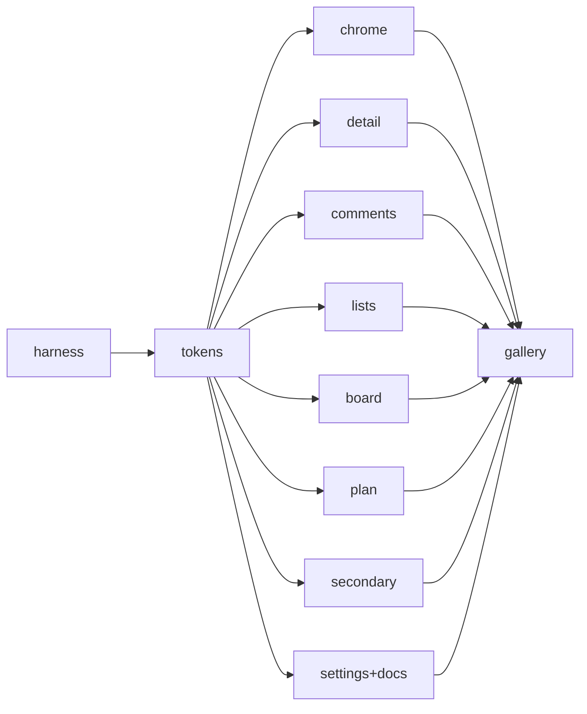

# Bugzilla design language — design + implementation plan

**Goal:** pivot Funnel from "Linear density in JetBrains Islands colours" to **modern Bugzilla (bugzilla.mozilla.org)**: table-first, text-first, data-honest — 1px borders instead of translucent tone, Mozilla-blue links, numbered monospace comments, plain-text nav.

**Architecture:** one token layer (`src/lib/styles/global.css`) plus four primitives (`.bug-table`, `.bug-meta`, `.bug-comment`, `.bug-chrome`). No route, data-model, mutation or vocabulary change.

**Tech stack:** SvelteKit 3, Svelte 5, Tailwind 4 (`@theme`), shadcn-svelte `nova`, Lucide.

**Spec path:** this file, §1–§8. §9+ is the plan.
**Detail:** tests
**Target-min:** 34

**Global constraints**
- Radius `0` for cells/inputs/buttons/selects, `4px` (`--radius: 0.25rem`) for cards/popovers. Nothing above 8px.
- Every structural edge is a real 1px `var(--border)`. Delete every `--surface-*` token and its consumers.
- One accent: `#0060df` light / `#8cb4ff` dark. Delete the Linear indigo `#5e6ad2`.
- Body ≥13px; micro floor 10px (`text-2xs`, counts only). No `text-[9px]`, no `text-[0.625rem]`.
- Fonts: `system-ui` stack; mono `ui-monospace, "SFMono-Regular", "Cascadia Mono", "Liberation Mono", Menlo, Consolas, monospace`. Remove Inter.
- Comment bodies: mono, `white-space: pre-wrap`, numbered `#cN` anchor.
- Unchanged: label vocabulary, priority derivation, routes, SSE/optimistic writes, drag, RBAC.
- Captures: Chromium 1440×900, `deviceScaleFactor: 2`, `<name>-{light,dark}.png`.

## 1. Colour

Light: `background #ffffff, foreground #15141a, card #ffffff, popover #ffffff, muted #f0f0f4, muted-foreground #5b5b66, border #cfcfd8, input #b1b1bd, primary #0060df, accent #e0eaff, destructive #d70022, success #058b00, warning #a47f00, sidebar #f9f9fb, comment-header #f0f0f4, comment-reporter #fffbe6, radius 0.25rem`.

Dark: `background #1c1b22, foreground #fbfbfe, card #2b2a33, popover #2b2a33, muted #2b2a33, muted-foreground #bfbfc9, border #52525e, input #6f6f7b, primary #8cb4ff, accent #3a3944, destructive #ff6a75, success #3fe1b0, warning #ffd567, sidebar #23222a, comment-header #2b2a33, comment-reporter #2e2b22`.

Green = done/fixed, red = blocker/sev, amber = in-progress/review/pending, grey = backlog/closed/minor. Links underlined in `--primary`.

## 2. Typography

System sans. Scale: `2xs 10px`, `xs 11px`, `sm 13px`, `base 14px`, `lg 15px`, `xl 17px`, `2xl 20px`. Page title 17px/600; table header 11px/600 uppercase; meta 11px; comment body mono 13px/1.55; IDs and flags mono.

## 3. Shape

1px borders and zebra striping carry rows. Shadows only on popover/dialog. Buttons look native: 1px border, `--muted` fill, 2px radius; the primary action is a `--primary` fill.

## 4. Chrome

Sidebar kept, de-iconised: text links, 11px/600 uppercase section label, active = 600 + `--primary` + 3px left rule, counts as `(3)`. A **footer nav** repeats sections as pipe-separated text links with `Funnel 0.0.1`. Mobile sheet trigger stays.

## 5. Issue page

`Bug 1 – Widget grid collapses below 480px (IN PROGRESS)` — 17px/600. Then a **metadata table**: right-aligned 11px/600 muted labels, 13px values, 1px rules, no pills — Status, Resolution, Product/Component, Milestone, Priority, Severity, Size, Assignee, Reporter, Labels, Blocked, Watching, CC. Values stay click-to-edit but render as plain text. Then description, attachments, then **comments**: `#c1` anchor, grey header bar (author, time, `reply`), mono body, reporter tint, internal notes with an amber rule and `Internal` flag. Composer: plain textarea, `Save Changes`.

## 6. Lists

11px uppercase header on `--muted`, zebra rows, 1px rules, closed rows struck through and muted, severity colour only on the P/sev token. Footer: `N bugs · Edit Search`.

## 7. Board and plan

Bordered lanes with a grey header cell (name + count). Cards: 1px border, mono ref, title, plain token row. Drag stays; tilt/shadow replaced by a 2px insertion line. Plan lanes reuse the header cell; day blocks become bordered rows.

## 8. Accepted distance

No kanban/calendar/SSE in Bugzilla; board and plan keep function, lose Linear chrome. Sidebar kept against Bugzilla's top nav (user decision), offset by the footer nav. Priority stays derived, displayed `P1`–`P3`; severity shown as `blocker`/`major`/`minor`.

## 9. Files and task graph

`global.css` (tokens + primitives), `nav/footer-nav.svelte`, `issue/bug-vocabulary.ts`, `scripts/screenshots/{seed,capture}.ts`, `docs/explanation/design-language.md`; other tasks edit existing surfaces.

```mermaid
%% schedule
gantt
  title Predicted schedule (mm:ss)
  dateFormat X
  axisFormat %M:%S
  section lane 1
  T1 screenshot harness :t1, 0, 151s
  T2 tokens and primitives :t2, 151, 127s
  T9 secondary views :t9, 277, 199s
  T11 gallery and captures :t11, 477, 127s
  section lane 2
  T3 shell chrome :t3, 277, 151s
  section lane 3
  T6 list views :t6, 277, 151s
  section lane 4
  T7 board :t7, 277, 151s
  section lane 5
  T8 plan :t8, 277, 151s
  section lane 6
  T10 settings and design docs :t10, 277, 151s
  section lane 7
  T4 issue metadata table :t4, 277, 127s
  section lane 8
  T5 comment thread :t5, 277, 127s
```

critical path: T1 → T2 → T9 → T11 (10.1 min) · peak width 8 · predicted build 10.1 min · predicted total ≈ 13.6 min (target ✓)

Ruling: T1→T2 gates the "before" capture on the unmodified tree; T2→surfaces is a primitives-contract edge. Cost if wrong: one re-capture wave.

### T1 screenshot harness · Complexity 6 (O-1) · Est. context 30k
**Owns:** `scripts/screenshots/{seed,capture}.ts`, `scripts/screenshots/README.md`, `package.json`, `bun.lock`, `docs/assets/design-pivot/before/*.png`
**Components:** 3 · **LOC owned:** 260 · **Tests:** fast · **Model:** sonnet · **Est. time:** 5 min
**Produces:** `seed(opts: { dbPath: string; secret: string }) -> { cookie: string; token: string }` · `captureAll(opts: { baseUrl?: string; outDir: string; cookie: string }) -> Promise<{ files: string[] }>`
**Review Focus:** encoding — cookie URL-encoded once; state — refuses an existing DB; file — creates `outDir` recursively.
**Test code (verbatim):** `test("seed creates one repo, six threads and twelve comments", ...)` on row counts; `test("capture refuses an existing db", ...)` expecting a throw.
**Notes:** no `$app/*` imports: `bun:sqlite`, `drizzle/*/migration.sql` sorted, AES-256-GCM keyed by `scryptSync(secret, "funnel/github-app/secret", 32)`, cookie from `serializeSignedCookie`. Spawns `vite dev --port 5199` when `--base-url` is absent; each view has a `ready` selector.

### T2 tokens and primitives · Complexity 6 (O-1) · Est. context 30k
**Owns:** `src/lib/styles/global.css`, `src/app.html`, `tests/design-tokens.test.ts`, `package.json`, `bun.lock`
**Components:** 2 · **LOC owned:** 240 · **Tests:** fast · **Model:** sonnet · **Est. time:** 5 min
**Produces:** `tokens(--background,--foreground,--muted,--muted-foreground,--border,--input,--primary,--accent,--destructive,--success,--warning,--sidebar,--comment-header,--comment-reporter,--radius) -> classes(.bug-table,.bug-meta,.bug-comment,.bug-chrome,.flag,.mono)` · `@theme --text-2xs..--text-2xl`, `--font-sans`, `--font-mono`
**Review Focus:** encoding — no `dark:` override reintroduces a hairline; state — `.dark` defines every light token.
**Test code (verbatim):** `test("light palette matches Bugzilla", ...)` for `--primary: #0060df`, `--border: #cfcfd8`; `test("no translucent hairline tokens remain", ...)`; `test("radius is at most 4px", ...)`; `test("Inter is removed", ...)`.
**Notes:** delete `.surface-shell` and all `--surface-*`; `.bug-meta` labels right-aligned; `.issue-grid` selection becomes an `--accent` fill.

### T3 shell chrome · Complexity 4 (O-1) · Est. context 22k
**Owns:** `src/lib/components/app-sidebar.svelte`, `src/lib/components/nav/nav-item.svelte`, `src/lib/components/nav/nav-section.svelte`, `src/lib/components/nav/nav-user.svelte`, `src/lib/components/nav/footer-nav.svelte`, `src/routes/(app)/+layout.svelte`, `src/lib/components/ui/sidebar/sidebar-menu-button.svelte`
**Components:** 3 · **LOC owned:** 130 · **Tests:** fast · **Model:** sonnet · **Est. time:** 3 min
**Consumes:** `.bug-chrome`, `.flag` (T2)
**Produces:** `FooterNav(props: { version: string }) -> markup`
**Review Focus:** protocol — mobile sheet trigger still reachable below `md`.
**Test code (verbatim):** `test("nav items carry no icon components", ...)` asserts no `@lucide` import.
**Notes:** counts `(3)`; icon buttons become `New Issue` / `Search` text links; keep `Sidebar.Rail`.

### T4 issue metadata table · Complexity 6 (O-1) · Est. context 30k
**Owns:** `src/lib/components/issue/InspectorPane.svelte`, `src/lib/components/issue/bug-vocabulary.ts`, `src/lib/components/issue/bug-vocabulary.test.ts`
**Components:** 2 · **LOC owned:** 210 · **Tests:** fast · **Model:** sonnet · **Est. time:** 5 min
**Consumes:** `.bug-meta`, `.flag` (T2)
**Produces:** `statusToken(status: string | null, state: string) -> string` · `resolutionFor(stateReason: string | null) -> string` · `severityWord(impact: number | null) -> string`
**Review Focus:** encoding — the title heading escapes user titles; state — a closed thread always shows a resolution.
**Test code (verbatim):** `expect(statusToken("in-progress","open")).toBe("IN PROGRESS")`, `expect(statusToken(null,"open")).toBe("UNCONFIRMED")`, `expect(resolutionFor("completed")).toBe("FIXED")`, `expect(resolutionFor("not_planned")).toBe("WONTFIX")`, `expect(severityWord(1)).toBe("blocker")`, `expect(severityWord(3)).toBe("minor")`.
**Notes:** values stay click targets; leave dialogs, delays, time card, notes and attachments alone.

### T5 comment thread · Complexity 5 (O-1) · Est. context 24k
**Owns:** `src/lib/components/issue/ActivityTimeline.svelte`, `src/lib/components/detail/Composer.svelte`
**Components:** 2 · **LOC owned:** 150 · **Tests:** fast · **Model:** sonnet · **Est. time:** 3 min
**Consumes:** `.bug-comment`, `.flag` (T2)
**Produces:** `commentNumber(index: number) -> string` (returns `#c{index + 1}`) · `ActivityTimeline(props) -> markup with #cN anchors`
**Review Focus:** encoding — comment HTML stays sanitizer output; state — `bubbles` still switches layout.
**Test code (verbatim):** `expect(commentNumber(0)).toBe("#c1")`, `expect(commentNumber(11)).toBe("#c12")`.
**Notes:** compact mode loses avatars; composer button reads `Save Changes`.

### T6 list views · Complexity 5 (O-1) · Est. context 24k
**Owns:** `src/lib/components/issue/IssueRow.svelte`, `src/lib/components/issue/IssueListHeader.svelte`, `src/lib/components/issue/IssueList.svelte`
**Components:** 3 · **LOC owned:** 150 · **Tests:** fast · **Model:** sonnet · **Est. time:** 3 min
**Consumes:** `.bug-table`, `.flag` (T2)
**Produces:** `IssueRow -> table row with severity token`
**Review Focus:** state — a closed row keeps its title readable when struck through.
**Test code (verbatim):** `test("closed rows are struck through", ...)` asserting `line-through` in the row class list.
**Notes:** no hover translation, no inset bar; footer `N bugs · Edit Search`.

### T7 board · Complexity 5 (O-1) · Est. context 24k
**Owns:** `src/lib/components/board/BoardCard.svelte`, `src/lib/components/board/BoardColumn.svelte`, `src/lib/components/board/StatusBoard.svelte`
**Components:** 3 · **LOC owned:** 150 · **Tests:** fast · **Model:** sonnet · **Est. time:** 3 min
**Consumes:** `.bug-table`, `.flag` (T2)
**Produces:** `BoardColumn.header -> grey header cell with count`
**Review Focus:** protocol — `draggableCard` still registers the same payload.
**Notes:** no tilt/shadow; 2px `--primary` insertion line.

### T8 plan · Complexity 5 (O-1) · Est. context 22k
**Owns:** `src/lib/components/plan/DayPlan.svelte`, `src/lib/components/plan/PlanLanes.svelte`, `src/routes/(app)/plan/+page.svelte`
**Components:** 3 · **LOC owned:** 140 · **Tests:** fast · **Model:** sonnet · **Est. time:** 3 min
**Consumes:** `.bug-table`, `.bug-chrome` (T2)
**Produces:** `PlanLanes.lane -> bordered lane with grey header cell`
**Review Focus:** state — empty lanes keep header and height.
**Notes:** reuse the board header; drop shadows and `rounded-full`.

### T9 secondary views · Complexity 5 (O-1) · Est. context 26k
**Owns:** `src/lib/components/epics/EpicList.svelte`, `src/lib/components/epics/EpicChildTable.svelte`, `src/lib/components/attention/AttentionRow.svelte`, `src/lib/components/inbox/SubmissionRow.svelte`, `src/routes/(app)/milestones/+page.svelte`
**Components:** 5 · **LOC owned:** 160 · **Tests:** fast · **Model:** sonnet · **Est. time:** 4 min
**Consumes:** `.bug-table`, `.flag` (T2)
**Produces:** `EpicChildTable -> bordered table` · `AttentionRow -> zebra table row`
**Review Focus:** encoding — submission titles stay escaped; state — urgency colour only on its token.
**Notes:** drop avatars on list rows; keep every action.

### T10 settings and design docs · Complexity 5 (O-1) · Est. context 24k
**Owns:** `docs/DESIGN.md`, `src/routes/(app)/settings/+layout.svelte`, `src/routes/(app)/settings/appearance/+page.svelte`
**Components:** 3 · **LOC owned:** 150 · **Tests:** fast · **Model:** sonnet · **Est. time:** 3 min
**Consumes:** tokens (T2)
**Produces:** `docs/DESIGN.md rewritten as the Bugzilla standard`
**Review Focus:** encoding — no leftover Linear values in the doc.
**Test code (verbatim):** `test("DESIGN.md documents the Bugzilla palette", ...)` asserting `#0060df` present, `#5e6ad2` and `Linear` absent.
**Notes:** appearance switcher becomes radios.

### T11 gallery and captures · Complexity 4 (O-1) · Est. context 20k
**Owns:** `docs/explanation/design-language.md`, `docs/assets/design-pivot/README.md`, `tests/docs-diataxis.test.ts`
**Components:** 2 · **LOC owned:** 120 · **Tests:** fast · **Model:** sonnet · **Est. time:** 2 min
**Consumes:** all surfaces (T3–T10)
**Produces:** `docs/explanation/design-language.md with a before/after gallery`
**Review Focus:** file — every referenced PNG exists.
**Notes:** coordinator writes the PNGs first.

## 10. Review Focus: probe plan

- **web UI** — protocol (pickers keep the same mutations), encoding (comment/title output), state (selection, closed rows, empty lanes).
- **tokens** — encoding (`dark:` reintroducing a hairline), state (`.dark` completeness).
- **scripts** — file (existing DB, out dir), encoding (cookie double-encoding).
- **Probe entry:** `run=bun scripts/screenshots/capture.ts` · `serve=bun --bun vite dev --port 5199`

Ruling: sequential [chain-3723] - T1 gates before-capture, T2 gates the token consumers, T11 gates after-capture - wrong gate costs one re-capture.
