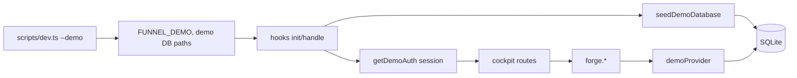
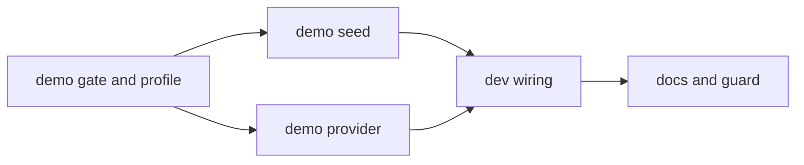

# Native demo mode

**Goal:** `bun run dev:demo` starts the dev server against a seeded SQLite database with an emulated signed-in GitHub admin and local issue writes, while `bun run dev` keeps the real GitHub integration.
**Architecture:** dev-only gate → idempotent seed → mirror-backed `GitHubProvider` → forge/auth/hooks wiring → docs.
**Tech stack:** SvelteKit 3, Bun, Drizzle/SQLite, `forges` provider types; no new dependency.
**Spec path:** docs/plans/2026-10-25-demo-mode.spec.md — §1 gate, §2 seed, §3 provider, §4 wiring, §5 docs.
**Detail:** contracts
**Target-min:** 15

**Ruling:** AI orchestrator (hands off) — the user chose it; no approval gate.
**Ruling:** Demo is enabled only when `dev === true`; production builds ignore `FUNNEL_DEMO` — avoids a fake-auth backdoor.
**Ruling:** Demo writes are emulated in SQLite — the user chose full interactivity over a read-only demo.
**Ruling:** Seed once and keep edits; reset by deleting `data/demo.db*` — avoids wiping work on every dev restart.
**Ruling:** Fake GitHub App credentials are generated only when the `state_github_app` row is absent — tests keep their fixture App.

## Global constraints

- No new dependency. No network call in any demo path.
- `isDemoMode()` is `true` only when `dev` is `true` and `FUNNEL_DEMO` is one of `1|true|yes` (trimmed, case-insensitive).
- Demo data lives in the normal tables: `state_*`, `auth_*`, `mirror_*`. Never add a demo-only table.
- The seed marker is `state_setting["demo.seeded"]`; it is written last.
- Repositories are `demo/funnel` (`FUN`), `demo/platform` (`PLT`); demo person is `demo` / external id `1001` / role `admin`.
- Times are unix milliseconds; dates are real `YYYY-MM-DD`; the seed clock defaults to `Date.now()`.
- Tests: `bun test --preload ./tests/setup.ts --max-concurrency 1 <paths>`. Type check: `bun run check`.

## Main diagram

## File structure

| File | Responsibility |
| :--- | :--- |
| `src/lib/server/demo/mode.ts` | Dev-only flag gate. |
| `src/lib/server/demo/profile.ts` | Demo identities, repos, labels. |
| `src/lib/server/demo/seed.ts` | Idempotent settings/auth/mirror/state seed and demo session read. |
| `src/lib/server/demo/provider.ts` | Mirror-backed user write provider. |
| `scripts/dev.ts` | `--demo` environment and Vite spawn. |
| `src/hooks.server.ts` | Demo startup and session override. |
| `src/lib/server/forge/providers.server.ts` | Return the demo provider in demo mode. |
| `src/lib/server/auth/index.ts`, `src/lib/server/issues/http.ts` | Demo token and no post-write refresh. |

## Task graph

```mermaid
%% schedule
gantt
  title Predicted schedule (mm:ss)
  dateFormat X
  axisFormat %M:%S
  section lane 1
  T1 demo gate and profile :t1, 0, 127s
  T2 demo seed :t2, 127, 212s
  T4 dev wiring :t4, 338, 182s
  T5 docs and guard :t5, 520, 150s
  section lane 2
  T3 demo provider :t3, 127, 123s
```

critical path: T1 → T2 → T4 → T5 (11.2 min) · peak width 2 · predicted build 11.2 min · predicted total ≈ 14.7 min (target ✓)

### T1 demo gate and profile · C3
**Owns:** src/lib/server/demo/mode.ts, src/lib/server/demo/profile.ts, src/lib/server/demo/mode.test.ts
**Components:** 2
**LOC owned:** 100
**Tests:** fast
**Model:** sonnet
**Produces:** `mode.demoModeEnabled(flag: string | undefined, isDev: boolean) -> boolean` · `mode.isDemoMode() -> boolean` · `DEMO_USER_ID -> "demo-user"` · `DEMO_USER_NAME -> "Riley Demo"` · `DEMO_USER_EMAIL -> "demo@funnel.local"` · `DEMO_USER_EXTERNAL_ID -> "1001"` · `DEMO_USER_LOGIN -> "demo"` · `DEMO_FORGE -> "github"` · `DEMO_INSTANCE -> "github.com"` · `DEMO_REPO_SLUGS -> readonly ["demo/funnel", "demo/platform"]` · `DEMO_USERS -> readonly DemoUser[]` · `DEMO_EXTRA_LABELS -> readonly { name: string; color: string; description: string }[]` · `DemoUser -> { externalId: string; login: string; name: string }`
**Review Focus:** `test_truthy`: `demoModeEnabled("1", true)`, `" true "`, `"YES"` are true. `test_falsy`: `undefined`, `""`, `"0"`, `"false"`, `"no"` are false. `test_dev_gate`: `demoModeEnabled("1", false)` is false. `test_is_demo_reads_process`: set `process.env.FUNNEL_DEMO="1"` then `isDemoMode()` is true; unset it in `afterEach`. `test_profile`: repo slugs are `demo/funnel` and `demo/platform`; the demo user has id `1001`; extras include `frontend`, `backend`, `docs`, `infra`.
**Steps:** 1 write failing tests, 2 run FAIL, 3 implement, 4 run PASS.
**Notes:** `isDemoMode` reads `process.env.FUNNEL_DEMO` dynamically so tests can toggle it; import `dev` from `$app/env`.

### T2 demo seed · C4
**Owns:** src/lib/server/demo/seed.ts, src/lib/server/demo/seed.test.ts
**Components:** 4
**LOC owned:** 380
**Tests:** fast
**Model:** sonnet
**Consumes:** `DEMO_USER_ID` · `DEMO_USER_EXTERNAL_ID` · `DEMO_USER_LOGIN` · `DEMO_FORGE` · `DEMO_INSTANCE` · `DEMO_REPO_SLUGS` · `DEMO_USERS` · `DEMO_EXTRA_LABELS` · `DemoUser` (T1)
**Produces:** `DEMO_SEED_MARKER -> "demo.seeded"` · `seed.seedDemoDatabase(options?: { now?: number }) -> { seeded: boolean }` · `seed.getDemoAuth() -> DemoAuth | null` · `DemoAuth -> { user: { id: string; name: string; email: string; image: string | null; role: string }; session: { id: string; token: string; userId: string; expiresAt: number } }`
**Review Focus:** `test_once`: first call `{seeded:true}`, second `{seeded:false}`, thread count unchanged. `test_identity`: `getDemoAuth()` returns role `admin`, subject 1001, future `expiresAt`; an `auth_session` row exists. `test_settings`: repos include both demo slugs, shortcodes `FUN`, `PLT`, `intake.default_repo === "demo/funnel"`, four maintainers. `test_mirror`: two repos, ≥20 threads, every status bucket (`null`, backlog, in-progress, in-review, and the remaining open status) plus closed, three blocked with valid recheck dates (overdue, today, future), one `epic` label with child refs, ≥2 milestones, one issue with ≥3 comments. `test_queues`: ≥3 submissions, ≥3 unread notifications, ≥2 work notes, ≥2 plan items, ≥1 issue event and ≥1 delay. `test_offline`: stub `globalThis.fetch` to throw; seed still succeeds. `test_cleanup`: after each test delete the marker, demo auth user, mirror rows, demo intake/notifications/plan/work-note/event/delay rows and `clearSettings()`; re-seed only within the file.
**Steps:** 1 write failing tests, 2 run FAIL, 3 implement, 4 run PASS.
**Notes:** use `upsertRepo`, `replaceRepoLabels`, `replaceRepoAssignees`, `replaceRepoMilestones`, `upsertIssues` and `deriveMetadata`; use `writeBlocked`/`writeEpicChildren` for bodies; generate the RSA key with `node:crypto` only when `getGithubCredentials()` is null; write the marker last; deterministic ids make re-seeding safe.

### T3 demo provider · C4
**Owns:** src/lib/server/demo/provider.ts, src/lib/server/demo/provider.test.ts
**Components:** 1
**LOC owned:** 260
**Tests:** fast
**Model:** sonnet
**Consumes:** `DEMO_USER_ID` · `DEMO_USER_EXTERNAL_ID` · `DEMO_USER_LOGIN` · `DEMO_FORGE` · `DEMO_INSTANCE` (T1)
**Produces:** `provider.demoProvider() -> GitHubProvider`
**Review Focus:** `test_get`: an existing mirrored issue returns title/body/labels/state/url and throw-shaped 404 for a missing issue. `test_labels`: `setLabels(["in-progress","sev","high"])` persists labels, sets `status="in-progress"`, `impact=1`, `urgency=1`, `priority="P1"`; `removeLabels(["high"])` clears urgency/priority. `test_comment`: `createComment` inserts one comment authored `demo`, returns a positive numeric id. `test_update_close`: update title/body, then close sets `state="closed"`, `stateReason="completed"`, future `closedAt`; reopen clears `closedAt`. `test_create`: creates the next number, requested labels, author `demo`, and is readable back. `test_milestone`: `request("POST", "/repos/demo/funnel/milestones", ...)` inserts the next milestone and returns its REST payload; `GET` lists it. `test_offline`: fetch stub throws; every call succeeds.
**Steps:** 1 write failing tests, 2 run FAIL, 3 implement, 4 run PASS.
**Notes:** cast the object to `GitHubProvider`; only implement the provider surface Funnel calls. `urlFor()` builds `https://github.com/<owner>/<repo>/issues/<n>`. Re-derive metadata through `deriveMetadata` and `setIssueMetadata` after every label change.

### T4 dev wiring · C4
**Owns:** scripts/dev.ts, package.json, src/hooks.server.ts, src/lib/server/forge/providers.server.ts, src/lib/server/auth/index.ts, src/lib/server/issues/http.ts, tests/demo-wiring.test.ts
**Components:** 4
**LOC owned:** 150
**Tests:** fast
**Model:** sonnet
**Consumes:** `isDemoMode` (T1) · `seedDemoDatabase` · `getDemoAuth` (T2) · `demoProvider` (T3)
**Produces:** package script `dev:demo` → `bun scripts/dev.ts --demo`; demo startup in `src/hooks.server.ts`; `demo-token` from `getUserAccessToken`; no-op `scheduleRefresh`; mirror-backed `forge` accessors; installation id `1`.
**Review Focus:** `test_demo_token`: with `FUNNEL_DEMO=1`, `getUserAccessToken("missing")` is `"demo-token"` and fetch is never called. `test_real_token`: with the flag unset, the same call throws `No GitHub account linked`. `test_refresh_noop`: with the flag set and a throwing fetch stub, `scheduleRefresh("demo","funnel",1)` records no fetch after a 20 ms wait. `test_script`: `scripts/dev.ts` sets demo DB/upload/secret defaults only when `--demo` is present and passes the inherited env to `bun --bun vite dev`.
**Steps:** 1 write failing tests, 2 run FAIL, 3 implement, 4 run PASS.
**Notes:** `init` in demo runs `runMigrations({dbPath: FUNNEL_DB})`, calls the seed, resets the config cache and returns before label provisioning/sync. `handle` applies `getDemoAuth()` before the auth session lookup; keep `svelteKitHandler` mounted. `scripts/dev.ts` must forward SIGINT/SIGTERM to the child and exit with its code.

### T5 docs and guard · C3
**Owns:** docs/how-to/contribute/development.md, docs/reference/cli.md, .env.example, tests/docs-demo.test.ts
**Components:** 3
**LOC owned:** 90
**Tests:** fast
**Model:** sonnet
**Consumes:** package script `dev:demo` (T4)
**Produces:** documentation for `bun run dev:demo`, `--demo`, `data/demo.db`, reset, seeded views, real-mode alternative, and the dev-only `FUNNEL_DEMO` block.
**Review Focus:** `test_dev_doc`: the development page contains `bun run dev:demo`, `--demo`, `data/demo.db`, `bun run dev` (real integration), and the reset command. `test_cli_doc`: the CLI package-script table lists `bun run dev:demo`. `test_env_example`: `.env.example` mentions `FUNNEL_DEMO` and says it is ignored by production builds.
**Steps:** 1 write failing doc test, 2 run FAIL, 3 update docs, 4 run PASS.
**Notes:** do not document a packaged `--demo` flag; this is the dev entrypoint only.

## Review Focus

| Package | App type | Categories | Specific risks | Probe entry |
| :--- | :--- | :--- | :--- | :--- |
| T1–T2 demo core | HTTP service | state, protocol, encoding | seed twice, partial seed, stale auth subject, missing fetch isolation | `run=bun run dev:demo · call=src/lib/server/demo/seed.ts:seedDemoDatabase` |
| T3 provider | HTTP service | protocol, state, numeric | unknown repo, missing issue 404, label/metadata drift, next issue number race | `call=src/lib/server/demo/provider.ts:demoProvider` |
| T4 wiring | CLI + HTTP service | protocol, state | flag on in production build, refresh leaking to GitHub, child process signal | `run=bun run dev:demo` |
| T5 docs | file I/O | encoding, file | stale paths, undocumented reset, production-enabled claim | `run=bun test --preload ./tests/setup.ts tests/docs-demo.test.ts` |

## Self-review

- Coverage: gate (§1), seed contents (§2), local writes (§3), startup/session (§4), docs/guards (§5); out-of-scope items are untouched.
- Every Consumes matches a Produces line; no two tasks that can run at once share a file.
- No placeholders; tests name inputs and asserted values.
- Size: largest task 380 LOC / 4 components; critical path T1→T3→T4→T5 is about 9.7 min.
