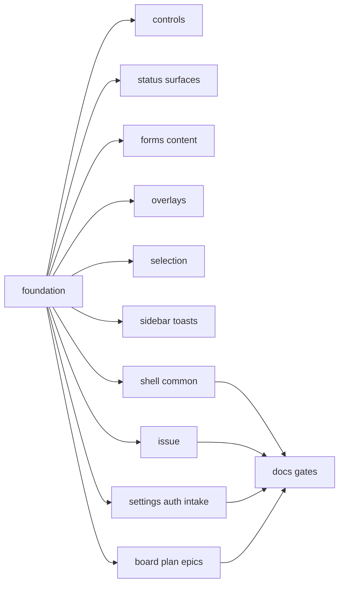

# Bits UI primitives — implementation plan

**Goal:** replace the vendored shadcn-svelte layer with our own bits-ui wrappers under `#lib/components/primitives`, styled from `docs/DESIGN.md`.

**Architecture:** one thin wrapper family per primitive. bits-ui supplies behaviour, focus and ARIA; our `.svelte` files supply the Bugzilla chrome; call sites stop passing visual classes. No route, data-model, mutation or vocabulary change.

**Tech stack:** SvelteKit 3, Svelte 5, Tailwind 4, bits-ui 2.19, `clsx`, `tailwind-merge`.

**Spec path:** `docs/plans/2026-10-26-bits-ui-primitives.spec.md`, §1–§8.
**Detail:** contracts
**Target-min:** 18

**Global constraints**
- `#lib/components/primitives/<family>/index.ts`; no `#lib/components/ui`.
- Radii: cells 0, controls 2px (`rounded-xs`), cards/popovers/dialogs 4px (`rounded-lg`); avatars `rounded-full`.
- Tokens only; one accent; no gradients/blur; shadows only popovers/dialogs. Type scale `2xs`–`xl`; mono IDs/flags/comments.
- 1px `border-border` edges; `border-input` fields; default `--primary` button, outline `--muted`.
- No `dark:` in primitives; no animation classes. Keep bits-ui bindings and composition.

**Spec:** §1 Scope, §2 API, §3 Recipes, §4 Inventory, §5 Tooling, §6 Migration, §7 Verification, §8 Distance.

## 9. File structure

- `src/lib/components/primitives/<family>/` — wrapper family and barrel.
- `src/lib/components/primitives/styles.ts` — shared recipes and `triggerClass`.
- `src/lib/utils.ts` — `cn` via `clsx` + `tailwind-merge`; element types stay.
- `src/lib/styles/global.css` — tokens, `.bug-*` primitives, `no-scrollbar`; no shadcn import.
- `docs/reference/primitives.md` — primitive reference table and examples.
- `tests/primitives-*.test.ts` — source contracts.

## 10. Task graph

```mermaid
%% schedule
gantt
  title Predicted schedule (mm:ss)
  dateFormat X
  axisFormat %M:%S
  section lane 1
  T1 foundation :t1, 0, 151s
  T2 controls :t2, 151, 272s
  section lane 2
  T4 forms and content :t4, 151, 248s
  section lane 3
  T3 status and surfaces :t3, 151, 199s
  section lane 4
  T5 overlays :t5, 151, 199s
  section lane 5
  T6 selection :t6, 151, 175s
  section lane 6
  T7 sidebar and toasts :t7, 151, 127s
  section lane 7
  T8 shell  common and detail migration :t8, 151, 102s
  T12 docs and final gates :t12, 253, 127s
  section lane 8
  T9 issue surface migration :t9, 151, 102s
  section lane 9
  T10 settings  auth  onboarding  intake a :t10, 151, 102s
  section lane 10
  T11 board  plan  epics  attention  miles :t11, 151, 102s
```

critical path: T1 → T2 (7.1 min) · peak width 10 · predicted build 7.1 min · predicted total ≈ 10.6 min (target ✓)

## 11. Tasks

### T1 foundation · Complexity 6 · Est. context 34k
**Owns:** `src/lib/components/primitives/`, `src/lib/components/ui/`, `src/routes/`, `src/lib/components/`, `src/lib/utils.ts`, `src/lib/styles/global.css`, `package.json`, `bun.lock`, `components.json`, `tests/primitives-conventions.test.ts`
**Components:** 3 · **LOC owned:** 200 · **Tests:** fast · **Model:** sonnet
**Produces:** `cn(...inputs: ClassValue[]) -> string` · `focusRing: string` · `control: string` · `panel: string` · `menuItem: string` · `labelText: string` · `triggerClass(variant: "default" | "ghost" | "pill", className?: string) -> string` · `triggerChevron: string`
e.g. `cn("rounded-sm", "rounded-none") -> "rounded-none"` · `cn("px-2", false, "text-sm") -> "px-2 text-sm"`
**Review Focus:** file — move keeps barrels; encoding — imports rewritten once; state — `cn` merge and dark tokens.
**Tests:** `test("shadcn tooling is gone")` asserts package.json omits `shadcn-svelte`, `tailwind-variants`, `tw-animate-css` and `components.json` is absent. `test("cn merges conflicting utilities")` asserts `cn("rounded-sm","rounded-none") === "rounded-none"`. `test("namespace is primitives")` asserts `primitives/button/index.ts` exists and `components/ui` does not.
**Notes:** `git mv` `ui` to `primitives`; delete `breadcrumb`, `skeleton`; rewrite `#lib/components/ui/` imports; drop both shadcn CSS imports; add `no-scrollbar`; remove the four packages, add `clsx`+`tailwind-merge`; own `cn`; keep element types.

### T2 controls · Complexity 5 (O-1) · Est. context 34k
**Owns:** `src/lib/components/primitives/{button,input,textarea,label,native-select,kbd,separator,spinner}/`, `tests/primitives-controls.test.ts`
**Components:** 8 · **LOC owned:** 320 · **Tests:** fast · **Model:** sonnet
**Consumes:** `cn(...inputs: ClassValue[]) -> string` (T1) · `control` (T1) · `focusRing` (T1) · `labelText` (T1)
**Review Focus:** state — primary/default and muted/outline fills; encoding — no `rounded-lg`, `ring-*`, `shadow-*`, `dark:`; protocol — `href` and refs.
**Tests:** `test("button is native")` asserts `rounded-xs` present, `rounded-lg`/`tailwind-variants` absent. `test("text controls share recipe")` asserts `border-input` present, `rounded-lg` absent in input/textarea/native-select.
**Notes:** `Input`/`Textarea` gain `variant="ghost"`; heights `h-7`/`h-6`; flat native chevron; kbd mono on `--muted`; separator 1px; spinner `size-4 animate-spin`.

### T3 status and surfaces · Complexity 4 (O-1) · Est. context 30k
**Owns:** `src/lib/components/primitives/{badge,alert,card,empty,item}/`, `tests/primitives-surfaces.test.ts`
**Components:** 5 · **LOC owned:** 260 · **Tests:** fast · **Model:** sonnet
**Consumes:** `cn(...inputs: ClassValue[]) -> string` (T1) · `panel` (T1) · `labelText` (T1)
**Review Focus:** state — destructive alert colours the token; encoding — no pills or tinted shells; file — card slots render.
**Tests:** `test("card is a flat 4px panel")` asserts `rounded-lg`/`border-border` present, `ring-1` absent. `test("badge is a token")` asserts `rounded-none` present, `rounded-4xl` absent.
**Notes:** Card `p-3`, flat header/title/footer; destructive Alert `border-l-2 border-l-destructive`; Badge mono 10px uppercase on `--muted`; Item hover `bg-muted`; Empty muted media.

### T4 forms and content · Complexity 5 (O-1) · Est. context 36k
**Owns:** `src/lib/components/primitives/{field,input-group,avatar,message,bubble,code-block,collapsible}/`, `tests/primitives-content.test.ts`
**Components:** 7 · **LOC owned:** 380 · **Tests:** fast · **Model:** sonnet
**Consumes:** `cn(...inputs: ClassValue[]) -> string` (T1) · `control` (T1) · `menuItem` (T1) · `labelText` (T1)
**Review Focus:** encoding — label/description scale; state — disabled/error pass through; protocol — collapsible bindings and code copy.
**Tests:** `test("field labels")` asserts `text-xs`/`font-semibold` in field-label. `test("bubbles flat")` asserts `border-border` present, `bg-primary` absent.
**Notes:** InputGroup composes a ghost input/textarea in one shell; Avatar keeps `rounded-full`; Message/Bubble flat bordered boxes; CodeBlock `font-mono text-sm`; Collapsible behaviour-only.

### T5 overlays · Complexity 5 (O-1) · Est. context 36k
**Owns:** `src/lib/components/primitives/{dialog,sheet,popover,tooltip,dropdown-menu}/`, `tests/primitives-overlays.test.ts`
**Components:** 5 · **LOC owned:** 420 · **Tests:** fast · **Model:** sonnet
**Consumes:** `cn(...inputs: ClassValue[]) -> string` (T1) · `panel` (T1) · `menuItem` (T1) · `focusRing` (T1)
**Review Focus:** protocol — escape/outside-click/focus; encoding — no animation/ring/blur; state — `open` and `child`.
**Tests:** `test("flat panels")` asserts dialog/popover content have `rounded-lg`, no `animate-in`. `test("flat menu rows")` asserts `rounded-none` in dropdown-menu-item.
**Notes:** overlay `bg-foreground/25`, no blur; dialog title `text-xl font-semibold`; sheet bordered; tooltip inverted flat; keep bits-ui data attributes.

### T6 selection · Complexity 5 (O-1) · Est. context 34k
**Owns:** `src/lib/components/primitives/{select,command,toggle,toggle-group}/`, `tests/primitives-selection.test.ts`
**Components:** 4 · **LOC owned:** 360 · **Tests:** fast · **Model:** sonnet
**Consumes:** `cn(...inputs: ClassValue[]) -> string` (T1) · `triggerClass(variant: "default" | "ghost" | "pill", className?: string) -> string` (T1)
**Review Focus:** protocol — item value and command `onSelect`; encoding — one trigger geometry; state — highlight/selected/disabled.
**Tests:** `test("select trigger")` asserts `triggerClass` present, `rounded-lg` absent. `test("command input")` asserts `border-0` present.
**Notes:** `Select.Trigger` exposes `variant`; content `panel` `p-1`; items `menuItem` + check; command list `no-scrollbar max-h-72`; toggle group one bordered control with `data-[state=on]:bg-accent`.

### T7 sidebar and toasts · Complexity 5 (O-1) · Est. context 36k
**Owns:** `src/lib/components/primitives/{sidebar,sonner}/`, `tests/primitives-chrome.test.ts`
**Components:** 2 · **LOC owned:** 480 · **Tests:** fast · **Model:** sonnet
**Consumes:** `cn(...inputs: ClassValue[]) -> string` (T1) · `menuItem` (T1) · `panel` (T1)
**Review Focus:** protocol — cookie, hotkey, rail, mobile sheet; encoding — active 600 `--primary` + 3px rule; state — collapsed targets.
**Tests:** `test("sidebar active rule")` asserts `--sidebar-primary`/`font-semibold`. `test("toaster tokens")` asserts `--color-popover` present, `cn-toast` absent.
**Notes:** replace `tv` in sidebar-menu-button with a variant map; keep context/provider; hide floating radius/shadow; Sonner keeps `svelte-sonner` and tokens.

### T8 shell, common and detail migration · Complexity 4 (O-1) · Est. context 40k
**Owns:** `src/lib/components/app-sidebar.svelte`, `src/lib/components/nav-user.svelte`, `src/lib/components/nav/`, `src/lib/components/shell/`, `src/lib/components/common/`, `src/lib/components/detail/`, `src/lib/components/markdown/`, `src/lib/components/filter/`, `src/lib/components/hotkeys/`, `src/routes/+layout.svelte`, `src/routes/(app)/+layout.svelte`, `tests/shell-common-primitives.test.ts`
**Components:** 1 · **LOC owned:** 420 · **Tests:** fast · **Model:** sonnet
**Review Focus:** encoding — no `components/ui` imports or visual overrides; protocol — mobile trigger, select values, code copy; state — active counts and filter scopes.
**Tests:** `test("shell and common use primitives")` asserts `app-sidebar.svelte`, `common/SingleSelect.svelte`, `detail/Composer.svelte` contain `primitives/` and omit `components/ui/`. `test("trigger helper")` asserts `select-trigger.ts` contains `triggerClass`.
**Notes:** `select-trigger.ts` delegates to `triggerClass`; composer uses `Input variant="ghost"`; count badges lose `rounded-full`; keep code-block and nav behaviour.

### T9 issue surface migration · Complexity 5 (O-1) · Est. context 44k
**Owns:** `src/lib/components/issue/`, `src/routes/(app)/issues/`, `tests/issue-primitives.test.ts`
**Components:** 1 · **LOC owned:** 420 · **Tests:** fast · **Model:** sonnet
**Review Focus:** protocol — pickers keep the same mutations; encoding — titles/comments stay escaped; state — click-to-edit, delays and time cards open the same dialogs.
**Tests:** `test("issue surface uses primitives")` asserts `issue/InspectorPane.svelte` contains `primitives/` and omits `components/ui/`. `test("inline title editor is a ghost input")` asserts the same source contains `variant="ghost"`.
**Notes:** pickers use `variant="pill"`; keep `.bug-meta`, `.bug-comment`, `.flag`; no grouping, drag or dialog change.

### T10 settings, auth, onboarding, intake and inbox · Complexity 5 (O-1) · Est. context 44k
**Owns:** `src/lib/components/settings/`, `src/lib/components/onboarding/`, `src/lib/components/inbox/`, `src/routes/(app)/settings/`, `src/routes/intake/`, `src/routes/login/`, `src/routes/onboarding/`, `src/routes/(app)/inbox/`, `tests/forms-primitives.test.ts`
**Components:** 1 · **LOC owned:** 560 · **Tests:** fast · **Model:** sonnet
**Review Focus:** encoding — forms keep labels, errors, disabled states and intake escaping; protocol — save/test-connection/duplicate actions unchanged; state — native selects, avatars and onboarding steps bound.
**Tests:** `test("settings use primitives")` asserts `settings/projects/+page.svelte` has `primitives/`, no `components/ui/`. `test("intake ghost title")` asserts `intake/+page.svelte` has `variant="ghost"`.
**Notes:** strip visual overrides from Card/Field/Input/Button; keep `self-start`, grid, width; intake heading keeps `text-lg`/`font-medium`; radios stay native.

### T11 board, plan, epics, attention, milestones and notifications · Complexity 5 (O-1) · Est. context 42k
**Owns:** `src/lib/components/board/`, `src/lib/components/plan/`, `src/lib/components/epics/`, `src/lib/components/attention/`, `src/routes/(app)/board/`, `src/routes/(app)/plan/`, `src/routes/(app)/epics/`, `src/routes/(app)/milestones/`, `src/routes/(app)/attention/`, `src/routes/(app)/notifications/`, `tests/board-plan-primitives.test.ts`
**Components:** 1 · **LOC owned:** 420 · **Tests:** fast · **Model:** sonnet
**Review Focus:** protocol — drag payload, card actions and dialog mutations; encoding — severity colour only on its token; state — empty lanes keep headers and height.
**Tests:** `test("board uses primitives")` asserts `BoardCard.svelte` has `primitives/`, no `components/ui/`. `test("insertion line")` asserts `BoardColumn.svelte` has `--primary`.
**Notes:** menu/tooltip/dialog via primitives; keep `.bug-table`, 2px insertion line, drag and actions.

### T12 docs and final gates · Complexity 3 (O-1) · Est. context 28k
**Owns:** `docs/DESIGN.md`, `docs/reference/primitives.md`, `src/lib/styles/markdown.css`, `tests/design-doc.test.ts`, `tests/primitives-conventions.test.ts`
**Components:** 2 · **LOC owned:** 180 · **Tests:** fast · **Model:** sonnet
**Review Focus:** file — every primitive documented with its import path; encoding — no shadcn/tailwind-variants references in docs; state — DESIGN.md radius rule consistent.
**Tests:** `test("no shadcn imports")` runs `grep -r '#lib/components/ui/' src` and expects empty. `test("DESIGN.md documents primitives")` asserts `#lib/components/primitives` and `rounded-xs` present, `shadcn` absent.
**Notes:** add the reference; fix §4 radii and §10 imports; update `markdown.css`; assert `tailwind-variants` absent.

## 12. Review Focus: probe plan

- **web UI** — protocol (same mutations), encoding (escaped titles/comments), state (selection, closed rows, empty lanes, dark tokens).
- **primitives** — encoding (no shadcn classes), state (focus/disabled/highlighted), protocol (bits-ui bindings).
- **docs** — file (reference page exists), encoding (no shadcn references).
- **Probe entry:** `run=bun test --preload ./tests/setup.ts` · `serve=bun --bun vite dev --port 5199`

## 13. Self-review

- Coverage: §1–§8 map to T1–T12; 31 families in T2–T7; all call sites in T8–T11.
- No placeholders; every test names an assertion.
- T1 produces every shared symbol by name; T1 is the only root, T12 the only sink; no parallel tasks share a file.

Ruling: radius conflict - DESIGN.md §4 says controls are 0 but also buttons are 2px; we use 0 for table cells, 2px for controls, 4px for panels, and T12 fixes the doc - cost if wrong: one doc edit.
Ruling: agent skill files - `.agents/skills/shadcn-svelte/` is tooling, not a project dependency, so it stays while runtime imports and packages go - cost if wrong: a future agent might suggest shadcn CLI.
