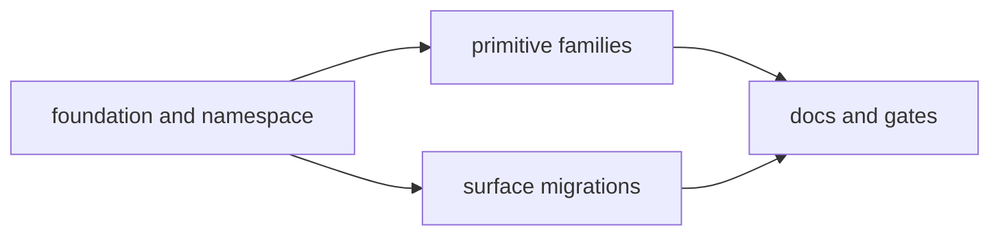

# Bits UI primitives — design spec

**Companion plan:** `docs/plans/2026-10-26-bits-ui-primitives.md`
**Status:** approved by the user on 2026-10-26 (AI orchestrator).

## 1. Scope

Replace all 31 imported shadcn-svelte families (3,661 LOC) with owned bits-ui wrappers under `#lib/components/primitives`; delete the two unused families (`breadcrumb`, `skeleton`). Keep the exported component names call sites use, so migration is an import-path change plus visual-class cleanup, not an API rewrite. `docs/DESIGN.md` stays binding; this spec adds the primitive layer that enforces it.

## 2. Namespace and API

Each family keeps a directory and an `index.ts` barrel. Exports keep both naming styles used today (`Button`, `Card.Root`, `Card.Header`, `Select.Trigger`, `Sidebar.MenuButton`, `useSidebar`). Curated additions:

- `Input` and `Textarea` gain `variant: "default" | "ghost"`; `ghost` is the borderless inline editor.
- `Select.Trigger` and the shared trigger helper gain `variant: "default" | "ghost" | "pill"`.
- `Button` keeps `variant: default | outline | ghost | secondary | destructive` and `size: default | sm | xs | lg | icon | icon-sm | icon-xs`.
- `Badge` keeps `default | secondary | outline | destructive`; `Alert` keeps `default | destructive`; `Item` keeps `default | outline`; `Bubble` keeps `default | muted`.
- `Toggle`/`ToggleGroup` keep `outline` only; they become a flat segmented control.
- Drop unused variants (`Button.link`, `Bubble.secondary/tinted/outline/ghost/destructive`, `Item.muted`) rather than carry dead styling.

## 3. Style recipes

`src/lib/components/primitives/styles.ts` is the single source:

- `focusRing` — `outline-none focus-visible:outline-2 focus-visible:outline-offset-1 focus-visible:outline-[var(--ring)]`.
- `control` — `h-7 w-full min-w-0 rounded-xs border border-input bg-background px-2 text-sm text-foreground placeholder:text-muted-foreground transition-colors disabled:cursor-not-allowed disabled:opacity-60`, composed with `focusRing`.
- `panel` — `rounded-lg border border-border bg-popover text-popover-foreground shadow-sm`.
- `menuItem` — flat row, `rounded-none`, `px-2 py-1.5`, `data-[highlighted]:bg-accent`, `data-[disabled]:opacity-50`.
- `labelText` — `text-xs font-semibold text-muted-foreground`.
- `triggerClass(variant, className?)` — one geometry shared by `Select.Trigger`, `SingleSelect`, `MultiSelect`, `PriorityPicker` and `MilestonePicker`; `triggerChevron` is the 16px muted chevron.

`cn` stays in `#lib/utils` but is ours: `clsx` plus `tailwind-merge`, so a call-site class can still override a primitive default when layout demands it.

## 4. Component inventory

- Controls: `button`, `input`, `textarea`, `label`, `native-select`, `kbd`, `separator`, `spinner`.
- Status and surfaces: `badge`, `alert`, `card`, `empty`, `item`.
- Forms and content: `field`, `input-group`, `avatar`, `message`, `bubble`, `code-block`, `collapsible`.
- Overlays: `dialog`, `sheet`, `popover`, `tooltip`, `dropdown-menu`.
- Selection: `select`, `command`, `toggle`, `toggle-group`.
- Chrome: `sidebar`, `sonner`.

All families use the recipes above; `.bug-table`, `.bug-meta`, `.bug-comment`, `.bug-chrome` and `.flag` stay for data surfaces. `sidebar` keeps the cookie-backed open state, mobile sheet, rail and `useSidebar`; its active row is 600 weight in `--primary` with a 3px left rule.

## 5. Tooling

Remove `shadcn-svelte`, `tailwind-variants`, `cn`, `tw-animate-css`, `components.json` and `@import "shadcn-svelte/tailwind.css"`. Add `clsx` and `tailwind-merge`. Replace shadcn's `data-open`/`data-closed`/`data-checked` variants with raw `data-[state=…]` / `data-[highlighted]` selectors. Keep `@import "tailwindcss"` and the `dark` custom variant. The agent skill under `.agents/` is tooling history, not a project dependency, and stays.

## 6. Migration rules

Call sites change only three things: the import path, visual classes, and primitive props that replace those classes.

- Remove colour, radius, border, shadow, ring, focus, dark, font-size and font-weight utilities from primitive call sites.
- Keep layout, spacing, positioning, truncation and accessibility classes (`flex`, `grid`, `gap-*`, `w-*`, `min-w-0`, `max-w-*`, `self-*`, `items-*`, `justify-*`, `absolute`, `relative`, `sr-only`, `truncate`).
- Use `variant="ghost"` for inline editors and `Trigger variant="pill"` for toolbar tokens instead of re-creating them with classes.
- Keep `class="rounded-full"` on avatars only. Keep a semantic `text-lg`/`text-xl` on a page-title editor when it is the heading, not a control.
- Do not change markup structure, event handlers, bindings, ARIA or route behaviour.

## 7. Verification

`bun test` stays green; `bun run check` and `bun run build` pass; the conventions test proves no shadcn dependency, no `components/ui` import, no `tailwind-variants`, and that `cn` merges conflicts. Dark mode is part of every surface check because the token flip is the only theme switch.

## 8. Accepted distance

This is a styling and ownership pivot, not a redesign: layout, density, routes, labels and behaviour stay. bits-ui's headless behaviour is deliberately reused; only the visual contract is ours. The old plan documents in `docs/plans/` are historical and keep their shadcn references.

