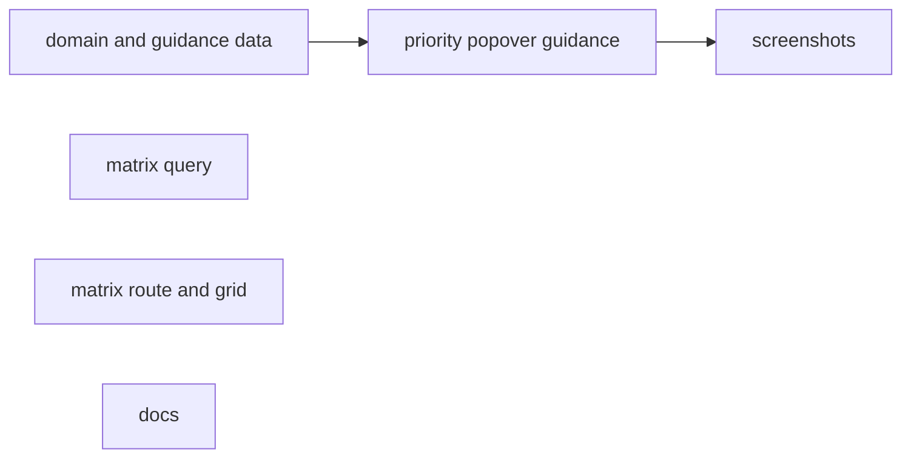

# Priority matrix and assessment guidance

**Goal:** add a 4×4 impact × urgency matrix over the mirrored issues, show partial assessments as **Needs assessment** instead of hiding them in P3, and give triagers concrete criteria for both axes.
**Architecture:** `src/lib/priority.ts` stays canonical and gains criteria plus cell metadata. `matrixBoard(filter)` returns 16 counted cells with four previews each. `/matrix` renders the grid, a how-to-rate guide, standard filters and a docked Inspector; the Priority popover reuses the criteria.
**Tech stack:** Bun 1.4.3, Svelte 5, SvelteKit 3, TypeScript 6, Drizzle + bun:sqlite, Tailwind 4, Playwright.
**Spec path:** docs/plans/2026-10-28-priority-matrix.spec.md
**Detail:** tests
**Target-min:** 14
**Orchestrator:** AI

## Global constraints

- Axis order is fixed: impact rows `[1, 2, 3, null]`, urgency columns `[1, 2, 3, null]`.
- Both axes assessed → `DEFAULT_PRIORITY_MATRIX` (`P1 · High`, `P2 · Medium`, `P3 · Low`). Both absent → `No priority`. Exactly one → `Needs assessment`; the matrix UI never labels a partial cell `P3`.
- `mirror_thread.priority`/`priority_rank` keep the existing derivation, including the P3 fallback for a partial pair. No write path, label, schema, migration, HTTP API or SSE feed changes.
- `/matrix` includes triaged and untriaged issues and defaults to `state=open`. It reuses `parseIssueFilter`, `FilterPopover`, `FeedSearch`, `ViewSegment`; no new filter keys.
- Every cell always exists; totals come from SQL; previews are capped at `MATRIX_PREVIEW_LIMIT = 4`.
- Guidance is copy only: five criteria per level per axis. Exact copy: spec §3.
- Nav order: Issues, Board, **Matrix**, Plan, Epics, Milestones.
- Spec coverage: §1 → T1–T4; §2 → T1–T5; §3 → T1–T4; §4 → T2–T6; §5 → T5; §6 → T6.

```mermaid
flowchart LR
  P[priority.ts criteria and cell meta] --> G[matrixGrid]
  P --> I[PriorityPicker]
  DB[(mirror_thread)] --> Q[matrixBoard]
  Q --> L[/matrix load]
  G --> M[MatrixGrid]
  L --> M
  M --> D[/matrix detail]
  M --> S[screenshots]
  I --> S
```

## File structure

- `src/lib/priority.ts` — criteria, axis order, `matrixCellMeta`, `scaleLevel`; matrix unchanged.
- `src/lib/server/issues/{queries,types}.ts` — `matrixBoard(filter)` and its DTOs.
- `src/lib/components/matrix/{matrix-grid.ts,MatrixGrid.svelte}` — 4×4 projection and table.
- `src/routes/(app)/matrix/**` — load, header/guide, empty page, docked detail.
- `src/lib/components/issue/PriorityPicker.svelte` — criteria under each slider.
- `src/lib/issue-url.ts`, `src/lib/components/app-sidebar.svelte` — view id and nav.
- `scripts/screenshots/**`, `docs/assets/screenshots/**` — seed, capture, PNGs.
- `docs/**` — reference, explanation, how-to, index.

## Task graph

```mermaid
%% schedule
gantt
  title Predicted schedule (mm:ss)
  dateFormat X
  axisFormat %M:%S
  section lane 1
  T3 matrix route and grid :t3, 0, 199s
  T6 screenshots and seed :t6, 229, 175s
  section lane 2
  T5 documentation :t5, 0, 199s
  section lane 3
  T2 matrix query :t2, 0, 151s
  section lane 4
  T1 domain and guidance data :t1, 0, 127s
  T4 priority popover guidance :t4, 127, 102s
```





critical path: T1 → T4 → T6 (6.7 min) · peak width 4 · predicted build 6.7 min · predicted total ≈ 10.2 min (target ✓)

## Tasks

### T1 domain and guidance data · Complexity 4 · Est. context 30k
**Owns:** src/lib/priority.ts, src/lib/priority.test.ts
**Components:** 2 · **LOC owned:** 150 · **Tests:** fast · **Kind:** design · **Model:** sonnet · **Est. time:** 2.5 min
**Produces:** `ScaleCriterion.label: string` · `ScaleCriterion.anchor: string` · `ScaleLevel<T>.criteria: readonly ScaleCriterion[]` · `MATRIX_IMPACT_VALUES: readonly (Impact | null)[]` · `MATRIX_URGENCY_VALUES: readonly (Urgency | null)[]` · `matrixCellMeta(impact: unknown, urgency: unknown) -> MatrixCellMeta` · `MatrixCellMeta.priority: Priority | null` · `MatrixCellMeta.assessment: "both" | "partial" | "none"` · `MatrixCellMeta.label: string` · `MatrixCellMeta.tone: "p1" | "p2" | "p3" | "partial" | "none"` · `scaleLevel<T extends number>(scale: readonly ScaleLevel<T>[], value: unknown) -> ScaleLevel<T> | null`
- e.g. matrixCellMeta(1, 1) -> { priority: "P1", assessment: "both", label: "P1 · High", tone: "p1" }
- e.g. matrixCellMeta(1, null) -> { priority: null, assessment: "partial", label: "Needs assessment", tone: "partial" }
- e.g. matrixCellMeta(null, null) -> { priority: null, assessment: "none", label: "No priority", tone: "none" }
- e.g. scaleLevel(IMPACT_SCALE, 2) -> { value: 2, name: "Moderate", … }
**Review Focus:** partial/none never collapse to P3; `"1"` coerces and `9` is absent; all nine pairs follow the matrix; every level has five non-empty criteria.
**Test code (verbatim):** spec §7 T1.
**Steps:** 1 write tests, 2 run: FAIL, 3 implement, 4 run: PASS.
**Notes:** Keep `definition` and `DEFAULT_PRIORITY_MATRIX` unchanged; add `criteria` after the definition. Copy is in spec §3; criteria labels are impact `Reach/Data/Money/Locations/Workaround` and urgency `Harm/Exposure/Spread/Dependencies/Deadline`.

### T2 matrix query · Complexity 4 · Est. context 34k
**Owns:** src/lib/server/issues/queries.ts, src/lib/server/issues/types.ts, src/lib/server/issues/queries.test.ts, tests/planning-helpers.ts
**Components:** 3 · **LOC owned:** 170 · **Tests:** fast · **Kind:** design · **Model:** sonnet · **Est. time:** 3.5 min
**Produces:** `MATRIX_PREVIEW_LIMIT: number` · `MatrixCell.impact: number | null` · `MatrixCell.urgency: number | null` · `MatrixCell.total: number` · `MatrixCell.issues: IssueListItem[]` · `MatrixBoard.cells: MatrixCell[]` · `MatrixBoard.total: number` · `matrixBoard(filter: IssueFilter) -> MatrixBoard`
- e.g. matrixBoard({ ...EMPTY_FILTER, states: ["open"] }).cells.length -> 16
- e.g. cell(1, 1) -> { impact: 1, urgency: 1, total: 6, issues: [6, 5, 4, 3] }
- e.g. cell(null, null) -> { impact: null, urgency: null, total: 1, issues: [4] }
**Review Focus:** every filter dimension applies, including search and status; open/closed and triaged/untriaged are not special-cased; counts exact, previews capped at four; null axes partition correctly.
**Test code (verbatim):** spec §7 T2.
**Steps:** 1 extend `PlanningIssueSeed` with `impact`/`urgency` and pass them through; 2 write tests; 3 run: FAIL; 4 implement; 5 run: PASS.
**Notes:** `upsertIssue` derives `priority_rank` from `priority`, so seeds pass `priority: "P3"` for partials and `null` for both-absent. Counts: `select impact, urgency, count(*) group by impact, urgency` over `buildIssueWhere(filter)`. Previews: one window query over the `issueColumns` joins with `row_number() over (partition by impact, urgency order by priority_rank, updated_at desc, repo_id desc, number desc)`, keep `rn <= MATRIX_PREVIEW_LIMIT`, hydrate with `hydrate()`. Build all 16 cells from T1's axis arrays; missing pairs are `{ total: 0, issues: [] }`.

### T3 matrix route and grid · Complexity 5 · Est. context 48k
**Owns:** src/lib/issue-url.ts, src/lib/issue-url.test.ts, src/lib/components/matrix/matrix-grid.ts, src/lib/components/matrix/matrix-grid.test.ts, src/lib/components/matrix/MatrixGrid.svelte, src/routes/*/matrix/**/*, src/lib/components/app-sidebar.svelte, tests/matrix-route.test.ts
**Components:** 5 · **LOC owned:** 300 · **Tests:** fast · **Kind:** design · **Model:** sonnet · **Est. time:** 5 min
**Consumes:** `matrixBoard(filter: IssueFilter) -> MatrixBoard` (T2) · `MatrixBoard`/`MatrixCell` (T2) · `matrixCellMeta(impact: unknown, urgency: unknown) -> MatrixCellMeta` (T1) · `MATRIX_IMPACT_VALUES`/`MATRIX_URGENCY_VALUES` (T1) · `IMPACT_SCALE`/`URGENCY_SCALE` (T1)
**Produces:** `matrixGrid(board: MatrixBoard) -> MatrixGridCell[][]` · `ViewId` includes `"matrix"`
- e.g. matrixGrid({ total: 0, cells: [] })[0][0].meta.label -> "P1 · High"
- e.g. matrixGrid({ total: 0, cells: [] })[3][3].meta.label -> "No priority"
- e.g. issuePath("matrix", "acme/web", 12) -> "/matrix/acme/web/12"
**Review Focus:** `/matrix` defaults to open and keeps every filter; partial/none render distinct labels; long titles truncate; detail docked and nav active; empty board still renders 16 cells.
**Test code (verbatim):** spec §7 T3.
**Steps:** 1 add the view id and grid helper with tests; 2 write the load test; 3 run: FAIL; 4 implement; 5 run: PASS; 6 `bun run check`.
**Notes:** Use a board-style shell, not `SplitView` (384px feed). Header: `Matrix`, total, `FeedSearch`, `ViewSegment`, `FilterPopover`, and `<details>` **How to rate** mapping both scales to level/definition/criteria. Table 5×5 including headers, `overflow-x-auto`, `min-w-[860px]`. Header cells: `Impact ↓` / `How much does it hurt?`, `Urgency →` / `How soon must it be fixed?`, `Not assessed`. Cells: `data-matrix-cell="{impact ?? 'na'}-{urgency ?? 'na'}"`, meta label, total, up to four `issuePath('matrix', …)` links (`repo#number` + truncated title). Tones: P1 danger, P2 warning, P3 muted, partial dashed + muted, none muted. Detail route copies `/issues/...` and passes `titleSuffix="Matrix"`, `fill`. Nav item after Board, active on `viewOf(path) === "matrix"`. `+page.svelte` is an empty placeholder comment like Board.

### T4 priority popover guidance · Complexity 2 · Est. context 33k
**Owns:** src/lib/components/issue/PriorityPicker.svelte
**Components:** 1 · **LOC owned:** 60 · **Tests:** fast · **Kind:** design · **Model:** sonnet · **Est. time:** 2 min
**Consumes:** `ScaleLevel<T>.criteria: readonly ScaleCriterion[]` (T1) · `scaleLevel<T extends number>(scale: readonly ScaleLevel<T>[], value: unknown) -> ScaleLevel<T> | null` (T1)
**Review Focus:** criteria render as text, not HTML; unselected axes name the criteria; commit/clear and `aria-label` unchanged; the popover scrolls.
**Test code (verbatim):** spec §7 T4.
**Steps:** 1 replace the local `level` helper with `scaleLevel`; 2 widen the popover and render criteria; 3 run the commands.
**Notes:** `w-80 max-h-[70vh] overflow-y-auto`. Under each definition render the selected level's `criteria` as `label — anchor`; when unselected, name the criteria (`Reach, data loss, money, locations, workaround` / `Harm now, data or money at risk, spread, blocked people, deadline`). Keep the live Result preview and Clear priority.

### T5 documentation · Complexity 3 · Est. context 28k
**Owns:** docs/reference/priority.md, docs/reference/routes-and-pages.md, docs/explanation/workflow-model.md, docs/how-to/use/matrix.md, docs/README.md, tests/docs-priority-matrix.test.ts
**Components:** 5 · **LOC owned:** 170 · **Tests:** fast · **Kind:** design · **Model:** sonnet · **Est. time:** 3 min
**Produces:** none
**Review Focus:** the how-to stays a how-to; the reference keeps tables; the partial rule says the view shows Needs assessment while the cache stays P3; route/nav docs match `/matrix`.
**Test code (verbatim):** spec §7 T5.
**Steps:** 1 update the priority reference; 2 add the route row and workflow bullet; 3 write the how-to; 4 index it; 5 run the docs test.
**Notes:** Reference tables: Criterion / Severe / Moderate / Minor and Criterion / High / Mid / Low, using spec §3 copy. State: "The matrix shows a partial pair as Needs assessment; the stored priority cache still holds the P3 fallback." How-to sections: open the matrix, read a cell, find unassessed work, use How to rate, open an issue. Workflow model: add Matrix as a read-only lens.

### T6 screenshots and seed · Complexity 4 · Est. context 30k
**Owns:** scripts/screenshots/seed.ts, scripts/screenshots/capture.ts, scripts/screenshots/README.md, tests/screenshots-matrix.test.ts, docs/assets/screenshots/matrix-light.png, docs/assets/screenshots/matrix-dark.png, docs/assets/screenshots/priority-guidance-light.png
**Components:** 4 · **LOC owned:** 140 · **Tests:** slow · **Kind:** design · **Model:** sonnet · **Est. time:** 5 min
**Consumes:** `matrixGrid(board: MatrixBoard) -> MatrixGridCell[][]` (T3) · `data-testid="matrix-grid"` (T3) · `data-slot="popover-content"` (T4)
**Produces:** `matrix-light.png`, `matrix-dark.png`, `priority-guidance-light.png`
**Review Focus:** PNGs exist and are non-trivial; seeded partials land in partial cells and both-absent in the corner; capture waits for the popover; dark mode uses the existing theme path.
**Test code (verbatim):** spec §7 T6.
**Steps:** 1 allow null axes in `DemoIssue` and add #7 `(1,null)`, #8 `(null,1)`, #9 `(null,null)`, #10 `(1,3)`, #11 `(3,1)`; 2 add the two capture views; 3 seed and capture; 4 copy the PNGs; 5 run the test.
**Notes:** `rm -rf /tmp/matrix-shots && COOKIE="$(bun scripts/screenshots/seed.ts --out /tmp/matrix-shots)" && FUNNEL_DB=/tmp/matrix-shots/funnel.db FUNNEL_SECRET=funnel-screenshots-secret-0123456789abcdef bun scripts/screenshots/capture.ts --out /tmp/matrix-shots/out --cookie "$COOKIE"`, then copy `matrix-light.png`, `matrix-dark.png`, `priority-guidance-light.png` into `docs/assets/screenshots/`. `matrix`: path `/matrix`, ready `[data-testid="matrix-grid"]`. `priority-guidance`: path `/issues/acme/widgets/1`, ready `[aria-label="Issue inspector"] h2`, click `[title="Change priority"]`, wait for `[data-slot="popover-content"]`. Extend `VIEWS` with optional `click`/`readyAfter` and implement in `waitForView`. Update the README view list.

## Review Focus

- **Library** (`priority.ts`): deep, numeric, encoding, state. Risks: partial → P3 in cell meta; string numerics; short criteria; matrix drift.
- **Data pipeline** (`queries.ts`): protocol, numeric, state. Risks: a dropped filter dimension; previews over four; null groups split; closed defaults.
- **Web UI** (`matrix/*`, `PriorityPicker.svelte`): protocol, encoding, state. Risks: 3×3 plus a stray cell; partial indistinguishable from none; overflow; inactive nav.
- **Docs** (`docs/*`): encoding. Risks: how-to written as explanation; P3 fallback contradicted.
- **Screenshots** (`scripts/screenshots/*`): file, state. Risks: empty seeded cells; shots before hydration/popover.

**Probe entries:** `call=priority.matrixCellMeta` · `call=server.issues.queries.matrixBoard` · `serve=bun --bun vite dev --port 5199` · `run=bun scripts/screenshots/capture.ts`

## Self-review

- Coverage: §1–§6 map to T1–T6; every route, query, guidance and delivery requirement has an owner.
- No placeholders; exact criteria copy is in spec §3.
- T3's Consumes match T1/T2; T4 matches T1; T6 matches T3/T4 names.
- Edges are execution dependencies: T3's load test runs `matrixBoard`; T6 renders the real grid and popover.
- All tasks carry Components, LOC owned, Tests and Model; T6 is the only slow suite.
