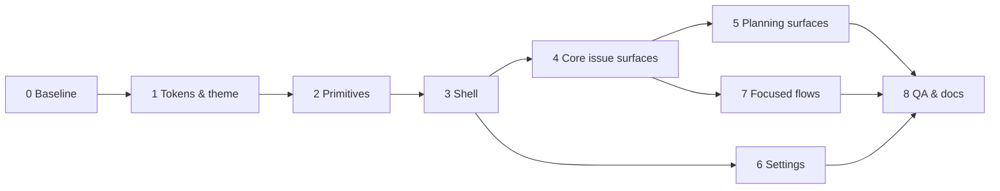

# Funnel — full t128n redesign

**Goal:** Rebuild every Funnel surface on the t128n design language using the
existing bits-ui / shadcn-svelte primitive layer, without changing routes, the
data model, the sync pipeline, or the issue workflow.

**Status:** Plan, ready for phase 0.

**Scope:** The app shell, 12 cockpit views, 14 settings sections, the public
intake and auth/onboarding flows, and the shared component layer. Light and
dark themes, 320 px through wide desktop, keyboard and screen-reader paths.

**Tech stack:** SvelteKit 3, Svelte 5, Tailwind 4, shadcn-svelte (bits-ui 2),
Geist Sans / Geist Mono, Lucide icons, Virtua, pragmatic-drag-and-drop.

**Non-goals:** No API, schema, auth, or sync changes. No new workflow features.
No new UI framework. No global command palette. No route renames.

---

## 1. What the redesign fixes

Funnel currently mixes two visual systems:

- shadcn-svelte's `nova` defaults — `rounded-lg`, `h-8`, `ring-3`, gradient
  hovers, `dark:` overrides, floating toasts.
- A hand-written Bugzilla layer — `.bug-table`, `.bug-meta`, `.bug-comment`,
  `.flag`, `.issue-grid`, uppercase headings, blue selection fills.

The result is inconsistent rather than merely dated. Concrete evidence from the
current tree:

| Problem | Evidence |
| --- | --- |
| Two component systems | 153 shadcn imports; `global.css` still defines `.bug-*` and `.issue-grid` primitives |
| Type below the floor | 50 uses of sub-12 px text, down to 8 px (`text-[10px]`, `text-[11px]`, `text-2xs`) |
| Ad-hoc depth | 86 shadow/rounding utilities across Svelte files |
| Selection by fill | `.issue-row.is-selected { background: var(--accent) }` |
| Severity carried by color alone | `.flag-danger` / `.flag-warning` text; overdue vs today is only red vs yellow |
| Hidden primary filters | Status, assignee, label, and milestone filtering live in a popover |
| Inconsistent page headers | `text-base`, `text-lg`, and `text-xl` h1s across views |
| Hard-coded dark mode | `app.html` ships `class="dark"`; theme-color meta follows the OS, not the selected theme |
| Toasts for user actions | 16 `notifyFailure` paths and settings success use floating notifications |
| No shell semantics | No app bar, skip link, single `main` landmark, or stable page header |
| Inconsistent vocabulary | “Issues” in the product, “bugs” in the list footer and tables |

## 2. Target direction

Funnel is a triage and planning tool, so the t128n **compact app shell** is the
right frame:

- 3 rem dark app bar, 15 rem `surface` sidebar, fluid canvas.
- Compact density: 1.75 rem controls, 2.25 rem rows, 0.75 rem row actions.
- Geist Sans 400/600; Geist Mono only for refs, identifiers, and aligned
  numerals. No type below 0.75 rem.
- One accent: `primary` in content, `accent-on-dark` on the app bar. Selection
  is a 2 px `primary` leading bar, never a blue fill; vertical navigation also
  takes `surface-3` and 600 weight, table rows keep 400 weight.
- Structure from alignment, whitespace, and 1 px `border-subtle` rules. No
  shadows on rows, cards, inputs, or buttons.
- Status is always icon + text. Color is a second channel, never the only one.
- Feedback is inline. Floating toasts remain only for background events that
  have no persistent region (SSE disconnect, browser-notification errors).
- Filters live in the list toolbar. The long tail stays in a `Filters` popover.

The focused shell is used for intake, login, and onboarding: no navigation, one
centered column (25–40 rem), one primary action.

### Density

| Context | Control | Row | Notes |
| --- | --- | --- | --- |
| Cockpit (default) | 1.75 rem | 2.25 rem | Issues, Inbox, Board, Matrix, Plan, Settings tables |
| Forms in settings | 1.75 rem | 2.25 rem | Same declaration; fields stay comfortable via spacing |
| Focused flows | 2.25 rem | 2.75 rem | Intake, login, onboarding |
| Below 768 px | 2.75 rem min | 2.75 rem min | Token override referencing `--size-control-lg` / `--size-row-default` |

### Type scale

| Role | Size | Weight | Use |
| --- | --- | --- | --- |
| Caption | 0.75 rem | 400/600 | Metadata, table headers, helper text |
| Body | 0.875 rem | 400/600 | App UI, table cells, navigation |
| Body content | 1 rem / 1.6 | 400 | Issue and comment prose |
| Heading sm | 1.25 rem / 1.3 | 600 | Section headings, dialog titles |
| Heading md | 1.5 rem / 1.25 | 600 | Page title in the app shell |
| Mono | 0.8125 rem | 400 | Refs, identifiers, code; 0.75 in cells |

Title Case for names (page titles, buttons, nav, table headers); sentence case
for descriptions, errors, and status messages. No all-caps.

## 3. Foundation: tokens, theme, and Tailwind bridge

### Files

- **New** `src/lib/styles/tokens.css` — the canonical t128n file, plus a small
  project-extension block at the end (layout feed width, inspector measure,
  settings nav, board lane, timeline, code block).
- **New** `src/lib/styles/theme.css` — maps t128n roles onto shadcn variables
  and exposes semantic Tailwind utilities. Contains no literal color or size.
- **Rewrite** `src/lib/styles/global.css` — document reset, focus ring,
  selection, scrollbars, prose defaults. Delete the Bugzilla layer entirely.
- **Update** `src/lib/styles/markdown.css` — 1 rem prose, token colors, 1 px
  rules, code blocks on `surface`, no raw hex.
- **Update** `src/app.html`, `src/lib/client/theme.ts`.

### Token → shadcn → Tailwind

| t128n role | shadcn variable | Utility | Use |
| --- | --- | --- | --- |
| `--color-canvas` | `--background`, `--card`, `--popover` | `bg-canvas` | Page, cards, overlays |
| `--color-surface` | `--muted`, `--sidebar` | `bg-surface` | Sidebar, zebra rows |
| `--color-surface-2` | `--accent`, `--secondary` | `bg-surface-2` | Hover, table headers |
| `--color-surface-3` | — | `bg-surface-3` | Selected vertical nav |
| `--color-border-subtle` | `--border` | `border-border-subtle` | Structural rules |
| `--color-border-strong` | `--input` | `border-border-strong` | Inputs and buttons |
| `--color-text-primary` | `--foreground` | `text-fg` | Body, headings |
| `--color-text-secondary` | `--muted-foreground` | `text-fg-secondary` | Metadata |
| `--color-text-muted` | `--muted-foreground` | `text-fg-muted` | Helpers |
| `--color-primary` | `--primary`, `--ring` | `bg-primary`, `ring-primary` | Action, focus |
| `--color-primary-hover` | — | `bg-primary-hover` | Primary hover |
| `--color-error` | `--destructive` | `text-error`, `bg-error` | Danger |
| `--color-warning` | `--warning` | `text-warning` | Caution |
| `--color-success` | `--success` | `text-success` | Success |

Additional rules:

- `--accent` becomes `surface-2`, not blue. This alone removes the current
  blue hover/selection fills.
- `--radius: var(--radius-md)` for compatibility; components use the explicit
  radius tokens.
- `@theme inline` maps `--color-*`, `--font-*`, `--text-*`, `--radius-*`,
  `--shadow-*`, `--z-*`, and `--motion-*` to the t128n names. Legacy
  `text-sm`/`text-xs` map to body/caption during migration; new code uses
  `text-body`, `text-caption`, `text-heading-sm`, `text-heading-md`.
- Numeric Tailwind spacing utilities are the same 4 px scale as `--space-*`.
  Named gaps use `gap-(--space-group)`, `gap-(--space-block)`, etc.
- Only allowed literals outside `tokens.css`: 1 px hairlines, 2 px focus rings
  and selection bars, breakpoints, shadow geometry, and the theme-color meta.

### Theme bootstrap

Replace the hard-coded `class="dark"` with:

- `data-theme="light|dark"` on `<html>`, resolved before first paint from
  `funnel:theme` or `prefers-color-scheme`.
- `color-scheme` set to match.
- `<meta name="theme-color">` switched between `--color-canvas` values.
- `theme.ts` writes `data-theme`, keeps `classList.toggle("dark")` as a
  temporary compatibility alias, and listens for OS and cross-tab changes.
- Tailwind's `dark:` variant points at `[data-theme="dark"]`; the final pass
  removes all `dark:` utilities from feature code in favor of tokens.

### Project extension tokens

Append to `tokens.css` (referencing other tokens, never literals):

```css
--layout-feed: 26rem;
--layout-inspector: 48rem;
--layout-settings-nav: 12.5rem;
--layout-board-lane: 18rem;
--layout-timeline-hour: 3.5rem;
--size-timeline-block: 1.5rem;
--size-capacity-bar: 0.25rem;
```

## 4. Component layer

All feature code imports from `#lib/components/ui/*`; only those wrappers may
import `bits-ui`. Restyle wrappers to t128n instead of forking primitives.

### Existing primitives to restyle

| Component | Change |
| --- | --- |
| `button` | 1.75 rem compact, `radius-sm`, 0.875/600, primary/secondary/ghost/danger/icon. Remove `translate-y`, `ring-3`, `rounded-lg`, gradient hovers, `dark:` variants. Danger is solid `error` with `on-error`, not a tint. |
| `input`, `textarea` | 1.75 rem, canvas, 1 px `border-strong`, `radius-sm`, 2 px focus ring with 2 px offset. Textarea min 3 rows, vertical resize. |
| `label`, `field` | Persistent label above the field, 0.875/400, 0.25 rem gap; helper text 0.75 muted; error text 0.75 with a 1 rem icon. |
| `select`, `native-select`, `command`, `popover` | Trigger matches input; content `radius-md`, `raised` shadow, `surface`/`canvas`, 0.75 rem padding. |
| `dialog`, `sheet` | `radius-lg`, `overlay` shadow, 30/40/50 rem by content, 1.5 rem padding, title 1.25/600. Max 80 vh with internal scroll and `overscroll-behavior: contain`. |
| `dropdown-menu`, `tooltip` | `radius-md`, `raised`, 2 rem items, 0.5 rem horizontal padding, icon 1 rem. Tooltips never the only label. |
| `toggle-group` | Segmented control: 1.75 rem, surface-2 selected, 600, no accent fill. |
| `avatar` | 1.5 rem in rows, full radius, fallback initials. Never used as decoration. |
| `empty` | Title + one description + at most one action. No container border. |
| `alert` | Only for persistent page-level failures; variant maps to error/warning/success text + icon. |
| `kbd` | 0.75 rem, `surface-2`, 1 px rule, radius-sm. |
| `skeleton` | `surface-2`, 180 ms, only where layout is already known. |
| `card` | Remove from operational screens. Keep only for a genuinely discrete artifact; do not use for settings, stats, or lists. |
| `badge` | Remove. Counts are text; state is icon + text. |
| `breadcrumb` | Use only for genuine hierarchy (repo → milestone → issue), not as chrome. |
| `bubble`, `message` | Remove in favor of ruled activity entries. |

### Primitives to add

Generate or hand-write bits-ui wrappers as needed:

- `switch` — feature flags, notification settings.
- `radio-group` — theme choice, account type.
- `progress` — capacity bars, epic child progress.
- `alert-dialog` — destructive confirmations (clear day, remove repo, revoke
  sessions).
- `checkbox` — multi-select filters, table selection if added later.

### Shared app components

Create local components, not a design-system package:

- `shell/AppShell.svelte`, `AppBar.svelte`, `SidebarNav.svelte`,
  `MobileNav.svelte`, `PageHeader.svelte`, `Toolbar.svelte`, `Section.svelte`.
- `data/StatusText.svelte` (icon + word), `PriorityText.svelte`,
  `RefText.svelte`, `TableHeader.svelte`, `TableEmpty.svelte`.
- `feedback/InlineStatus.svelte` (polite/assertive live region),
  `EmptyState.svelte`, `ErrorState.svelte`.
- `settings/SettingsNav.svelte`, `FieldRow.svelte`, `DangerZone.svelte`.

### Feedback model

- Field errors under the field, announced, focus moves to the first invalid
  field on submit.
- Mutation failures render in the view's toolbar status line or beside the
  control that changed. They persist until the next change and offer Retry.
- Success is a short inline confirmation beside the action (“Saved.” with
  Check icon); it clears on the next edit.
- Loading replaces the control label with a spinner and keeps the width and
  accessible name stable.
- Keep `svelte-sonner` only for global background failures: SSE reconnect,
  native-notification permission errors. Do not use it for issue writes,
  settings saves, or publish actions.

## 5. Shell and navigation

```
┌────────────────────────────────────────────────────────────────────────┐
│ ☰  funnel │ All repositories        Search ⌘K   ●  ☾  avatar          │ 3rem app bar
├──────────────────┬─────────────────────────────────────────────────────┤
│ PERSONAL         │ Issues                        1,284   [New Issue]   │
│  Inbox        3  │ [Search…] [Status ▾] [Assignee ▾] [Filters] [All|Mine]│
│  My Issues       │ ┌─────────────────────────────────────────────────┐ │
│  Notifications 2 │ │ Ref     Title                  Status  P  Upd  │ │
│  Attention    4  │ │ FIT-13  Fix mirror retry…      Open    P1  2h  │ │
│ WORKSPACE        │ │ FIT-12  Add cycle capacity…    In rev  P2  1d  │ │
│  Issues          │ └─────────────────────────────────────────────────┘ │
│  Board           │ 1,284 issues · 100 shown                            │
│  Matrix          │                                                     │
│  Plan            │                                                     │
│  Epics           │                                                     │
│  Milestones      │                                                     │
│ ─────────────    │                                                     │
│  Settings        │                                                     │
└──────────────────┴─────────────────────────────────────────────────────┘
```

### App bar

- 3 rem, `app-bar`, 1 px `app-bar-divider` bottom edge, sticky.
- Slots: mobile menu, wordmark (`accent-on-dark`), divider, workspace context
  (“All repositories” or the configured instance name), spacer, search button,
  notifications, theme toggle, account menu.
- Search is a button with a 1 rem icon and a `⌘ K` / `Ctrl K` hint; it focuses
  the active view's search or navigates to Issues and focuses it. Not a fake
  input.
- Notifications: bell icon + numeric count; accessible name includes the count.
- Account: 1.5 rem avatar + name at ≥ 768 px; menu contains Account, Settings,
  Sign out. No role badge.
- Every icon-only control has an accessible name and reveals it on hover/focus.
- `New Issue` is a page action, not an app-bar action, so the screen keeps one
  primary action.

### Sidebar

- 15 rem, `surface`, 1 px right rule; starts below the app bar.
- Groups: Personal (Inbox, My Issues, Notifications, Attention), Workspace
  (Issues, Board, Matrix, Plan, Epics, Milestones), then a divider and Settings.
- Items: 2.25 rem, 1 rem Lucide icon, 0.875 label, count as muted text.
- Selected: `surface-3` fill, full-height 2 px `primary` leading bar, 600
  weight. Hover: `surface-2`, only behind `(hover: hover) and (pointer: fine)`.
  Selected items take no hover fill.
- Group headings: 0.75 rem, `text-secondary`, 600, sentence case. No uppercase,
  no collapsible `+`/`−` controls.
- Remove the icon rail, `Sidebar.Provider`, rail toggle, and
  `sidebar-prefs` state. The shell is fixed on desktop and a drawer below
  1024 px.
- Footer: version and environment move to Settings → Session. The sidebar ends
  at Settings; it is not a junk drawer.

### Mobile

- Below 1024 px the sidebar becomes a bits-ui `Sheet` below the 3 rem app bar.
  Focus is trapped, Escape/backdrop/toggle close it, and focus returns to the
  menu button.
- Page padding 1 rem; controls and rows 2.75 rem.
- Split views become one route at a time: the feed is full width; opening an
  issue renders the detail full width with a “← Issues” link. No floating
  shadowed panel.

### Document semantics

- Skip link to `#main` on every app screen.
- One `<main id="main" tabindex="-1">`, one `h1` per screen, no skipped heading
  levels.
- Page header: h1 1.5/600, optional description 0.875 `text-secondary` capped
  at 72 ch, primary action right-aligned, 1.5 rem gap to content.
- `<PageHead>` stays metadata-only; visible descriptions are written only when
  they change a decision.

## 6. Screen plans

### 6.1 Issues (`/issues`, `/issues/:owner/:repo/:number`)

**Job:** scan and triage the mirrored issue stream, then edit one issue without
losing the list.

- h1 `Issues`, or `My Issues` for `assignee=me`. A live line below the title
  reports the active scope: `Open · Assigned to you · 2 filters` with `Clear`.
- Toolbar: labeled `Search`, `Status`, `Assignee`, `Priority`, `Sort`, plus
  `Filters` for labels/milestones/repos/state and the `All | Mine` segmented
  control.
- Table: `Ref`, `Title`, `Status`, `Priority`, `Size`, `Updated`, `Assignee`.
  Header 2.25 rem on `surface-2`; sort buttons show an arrow icon and change
  the label (“Updated, newest first”).
- Rows 2.25 rem, zebra `surface` on even rows, hover `surface-2`. Selected row:
  2 px `primary` leading bar, no fill.
- Status = icon + word (`Open`, `In progress`, `In review`, `Done`, `Blocked`).
  Priority = `P1`–`P3` + accessible name (“P1, Urgent”). Size stays a letter
  with a title. Closed rows are muted and struck through.
- Keep Virtua virtualization, keyboard selection, URL-backed filters, and the
  optimistic overlay. Remove hover transitions on rows; state changes are
  instant.
- Empty: “No issues match these filters.” + `Clear filters`. Zero-data: “No
  issues yet.” + `Submit an issue` (writers) / `View intake` (readers).
- Errors: inline toolbar status with `Retry`; load-more failure in the footer.

**Inspector**

- One document column, max `--layout-inspector` (48 rem), 1 rem prose.
- Header: ref (mono) + GitHub link, editable h1, status/priority/assignee line.
- Properties as a label–value grid under a top rule: Status, Priority,
  Severity, Size, Milestone, Assignee, Reporter, Labels, Parent epic, Blocked,
  Watching. Values are buttons that open the existing bits-ui pickers; no
  inline form fields that look permanently editable.
- Body: sanitized Markdown at 1 rem/1.6, max 72 ch. Links `primary` underlined;
  code on `surface` with mono; tables 0.875.
- Activity: ruled list. Author + time header (caption), comment prose. Internal
  notes use `surface` and a “Internal” lock icon + word; no yellow reporter
  background.
- Work notes and attachments move inline after Activity instead of a second
  column. If a right rail is kept at ≥ 1440 px, it must contain only live work
  notes/attachments and collapse inline below that width.
- Composer at the end of the pane: 3-row textarea, `Comment | Internal note`
  segmented control, attachment icon+label, primary `Comment`, `⌘ Enter` hint.
  Sticky footer with a 1 px top rule is allowed.
- Read-only: values render as text; no wall of disabled controls. Loading:
  skeleton for title/meta/body with the real header preserved. Error: inline
  with `Retry`.
- Remove the docked shadow panel below 1100 px; use the full-width route.

### 6.2 Inbox (`/inbox`)

**Job:** clear staged submissions and untriaged issues.

- h1 `Inbox`; live count `3 submissions · 12 untriaged issues`.
- Two ruled sections with their own table header: **Submissions** (source,
  title, received) and **Untriaged Issues** (the standard issue columns).
  Do not interleave two object types in one grid.
- Row actions (triage, mark duplicate, dismiss) appear on hover/focus and are
  always present in the row menu.
- Submission detail: title, source, body, received time; primary `Triage as
  issue`; secondary `Mark duplicate`; destructive `Dismiss`.
- Empty: “Inbox zero” + “Nothing staged or untriaged.” + `View all issues`.
- Form errors render above the list, not in a card.

### 6.3 Attention (`/attention`)

**Job:** work the blocked queue by re-check date.

- h1 `Attention`; `All | Mine` scope; live total.
- Groups: `Overdue`, `Due Today`, `Upcoming 7 Days`, `No Re-check Date`.
  Group headings are sentence case, 0.75/600 secondary, with a count.
- Row: urgency icon + word + date, ref mono, title, blocker summary, assignee.
  Overdue uses `error` icon+text; today uses `warning`; upcoming uses
  secondary. No colored group headings.
- Actions: reschedule (quick dates + custom), assign/unassign, mark done, more.
  Visible on hover/focus on desktop; in a menu on touch.
- Empty: “No blocked issues need attention.” + `View all issues`; for Mine,
  “No blocked issues assigned to you.” + `Show all`.
- Dialogs: block/update and close keep the existing structured forms, restyled
  as t128n dialogs with inline errors.

### 6.4 Notifications (`/notifications`)

**Job:** read and clear event notifications.

- h1 `Notifications`; unread count; secondary `Mark all read`.
- Groups `Unread` and `Read`; rows are ruled, not cards. Row: kind icon + word,
  actor, target link, relative time. Unread = dot + 600 weight + sr-only
  “Unread”, not a colored fill.
- Opening an unread row marks it read and navigates; modified clicks preserve
  browser behavior.
- Native notification permission moves to Settings → Notifications. If an
  in-page prompt is kept, it appears only when unread > 0 and permission is
  undecided, with `Enable` and `Not now`.
- Empty: “You’re all caught up.” + `View issues`.

### 6.5 Board (`/board`)

**Job:** move work through workflow lanes and inspect a card.

- h1 `Board`; count; `Board | Backlog` underline tabs; toolbar as Issues.
- Lanes: `--layout-board-lane` wide, horizontal scroll with snap on mobile.
  Header on `surface-2`: stage, count, `3 / 5` WIP. Over WIP = warning icon +
  “Over WIP” text.
- Cards: canvas, 1 px `border-subtle`, `radius-md`, no shadow. Ref mono,
  title 0.875/600 (two lines), metadata caption: priority, size, labels,
  assignee. Blocked = icon + word. Hover changes border to `border-strong`;
  selected uses the 2 px leading bar. Drag dims to 50% and the target lane
  takes `surface-2`.
- Retain pragmatic-drag-and-drop, keyboard pick-up (Space/arrows/Escape),
  roving focus, and the live-region announcement of moves.
- Every drag has a menu equivalent: `Move to…` lists stages.
- Backlog uses the Issues table with `groupable={false}`.
- Empty lane: “No issues” + ghost `New issue` (writers). Empty board:
  “No issues in this view.” + `Clear filters`.
- Done/close still raises the structured dialog; failures are inline.

### 6.6 Matrix (`/matrix`)

**Job:** compare impact × urgency and open work in a cell.

- h1 `Matrix`; filter toolbar; total count.
- Rating methodology moves out of the toolbar `details` element into a
  bits-ui dialog (`Rating guide`, 50 rem, scrollable) opened by a secondary
  button. Headers carry short level names (`1 · Minimal`, `Urgent`, `Not
  assessed`).
- Table: `surface-2` header, sticky first column, 1 px `border-subtle` grid.
  Cell header = priority token + name (icon/text, not color alone) and count
  right-aligned tabular. Up to four issue links per cell, then `+ n more`.
  Empty cell shows `—`.
- Horizontal scroll on narrow screens with the row header sticky.
- Errors inline; empty grid still renders all cells with zeros.

### 6.7 Plan (`/plan?horizon=week|cycle|milestone|day`)

**Job:** decide what fits in a horizon and commit work to people.

- h1 names the horizon state: `Week of 2 Nov 2026`, `Cycle 2026-W45`,
  `Day: Monday 2 Nov`, `Milestones`.
- Horizon switch is horizontal navigation with a 2 px `primary` underline;
  previous/next are icon buttons with names; `Today` appears when not current.
  Primary `Schedule issue` for writers.
- Week/cycle: ruled lane sections, not cards. Header on `surface-2`: `@login`,
  net capacity, `committed / cap`, over-cap warning icon + “Over by 2 h”.
  Issue rows 2.25 rem with ref, title, size, estimate, remove (ghost on
  hover/focus, always in a menu).
- Capacity bar: 4 px track `surface-2`, fill `primary`; over uses `error` plus
  text. No shadow.
- Unassigned and Unestimated are separate ruled sections with explanations.
- Milestone horizon: table of milestones with state, due date, open/closed
  children, committed/cap.
- Day: h1 date; ALPEN summary becomes a definition list with full words
  (`Tasks`, `Planned`, `Buffer`, `Priority order`, `Variance`), not A/L/P/E/N
  letters. Timeline uses 1 px hour rules, block cards with a 2 px `primary`
  leading edge. `Auto-plan` primary; `Clear day` moves to a danger confirm
  dialog; `Working hours` is a link to settings.
- States: no plan (“Nothing planned for this window.” + `Schedule issue`),
  over capacity, unestimated, no maintainers, saving (`Saving…`), inline error.
  Day overbooked and outside-hours warnings sit beside the summary.

### 6.8 Epics (`/epics`, `/epics/:owner/:repo/:number`)

- h1 `Epics`; `7 open · 12 total`.
- Table: Epic (ref + title + milestone), Status (icon+text), Progress (right,
  `3 / 8` + small bar), Estimate, Actual, Delay (right, tabular). No card
  wrapper; header `surface-2`.
- Detail: h1 epic title; ref + milestone + state line; rollups as four
  unboxed stats separated by rules; children table; primary `Add child`.
- Empty: “No epics yet.” + “Mark an issue as an epic from its Inspector.” with
  a link to Issues. No fake create button.
- Remove row on hover/focus and in the row menu; confirm only if it removes
  child links irreversibly.

### 6.9 Milestones (`/milestones`, `/milestones/:owner/:repo/:number`)

- h1 `Milestones`; grouped by repo with sentence-case h2 (no uppercase).
- Table: Milestone, Due (right), Progress (right, `closed / total` + bar),
  Created by. Closed rows muted with `Closed` icon+text. `No due date` is
  explicit. Rows link.
- Detail: h1 milestone title; metadata (repo, due, state, progress); the issue
  table reuses `IssueRow` and its toolbar.

### 6.10 Settings (`/settings/*`)

- Settings is a two-pane surface inside the app shell: 12.5 rem section nav
  (`surface`), form column max 50 rem. Below 1024 px the nav becomes a labeled
  `NativeSelect` under the page header.
- Section nav groups `Personal`, `Workspace`, `System` (sentence case). Active
  = `surface-3` + 2 px leading bar + 600.
- h1 is the section name (`Account`, `Repositories`, `Sync`). Description
  0.875 secondary. Sections use fieldsets with 1.25 rem h2 and a top rule; no
  cards.
- Every form is one column, max 40 rem for fields. Save sits at the end of the
  form, not in the page header. Inline `Saved.` / `Saving…`; validation summary
  at the top with links to fields and field-level messages.
- Account: identity label-value rows, GitHub profile link, `Sign out`
  secondary, `Back to Issues` text link.
- Appearance: radio group System / Light / Dark with descriptions; show the
  resolved theme. No decorative previews.
- Features: Switch rows with name, consequence, and current state; inline
  confirmation on change.
- Repositories / Projects / People: ruled tables with inline add/edit and
  row-menu removal. Admin-only sections are filtered from nav; direct URLs get
  a permission state page.
- GitHub App / Sync / Session: label-value facts (this is the right home for
  constants), status icon+text, one action per section, and a final danger zone
  with `AlertDialog` for disconnect/revoke.
- Remove `Card` from every settings page. `toast.success('Settings saved')`
  becomes inline feedback.

### 6.11 Intake (`/intake`)

- Focused shell: no app bar/sidebar; wordmark at the top of a 40 rem column.
- h1 `Submit an issue`; sentence-case explanation only if it changes the
  decision. Fields: Title (required; counter near the limit), Description,
  Source (optional; unknown sources preserved).
- Prefill strip: one line “Prefilled from a shared link” + `Clear`; disappears
  on edit. No marketing hero.
- Submit primary bottom-right with a `⌘ Enter` hint. Pending label
  “Submitting…”, width stable. Errors inline above the form and focus moves to
  Title.
- Success replaces the form: h1 `Issue submitted`, ref + link, `Copy link`,
  `Submit another` secondary. No toast.
- Dirty state warns before leaving; the address bar continues to mirror the
  draft.
- Mobile controls 2.75 rem; no horizontal scroll at 320 px.

### 6.12 Login and onboarding

- Focused shell, 25–40 rem, no navigation.
- Login: h1 `Sign in`; one line about GitHub organization access; primary
  `Continue with GitHub`; pending `Redirecting…`; auth errors inline.
- Onboarding: wordmark; step list (Create app → Install → Ready) with current
  step; h1 names the current state (`Create the GitHub App`, `Token required`,
  `Funnel is ready`). Ruled sections instead of cards. Success screen has
  `Open Issues` as the single primary action.
- Onboarding errors (manifest callback, install) inline beside the action.

### 6.13 Error page (`+error.svelte`)

- Focused shell. h1 by status: `Page not found`, `Not allowed`, `Something went
  wrong`. One sentence with the next step. Primary `Back to Issues`; status
  code as caption. No stack trace.

## 7. Cross-cutting behavior

### Status and priority

- Status is an icon + word. Mapping: Open `circle`, Backlog `circle-dashed`,
  Todo `circle`, In progress `circle-dot`, In review `eye`, Done/Closed
  `check-circle`, Blocked `ban`.
- Priority keeps the `P1`–`P3` token but always carries an accessible name
  (`P1, Urgent`). It never relies on red/yellow alone.
- Overdue/over-cap/over-budget are warning or error icon + text. The only solid
  status fill is the danger button.

### Dates, numbers, identifiers

- ISO `2026-11-02` in tools and logs; localized in prose.
- Relative times keep an absolute value in `title` and on focus.
- Tabular numerals in tables, counts, capacity, and time; dates stay sans.
- Refs, shas, and IDs use mono 0.8125 (0.75 in cells). Labels never use mono.

### Interaction states

- Hover only behind `(hover: hover) and (pointer: fine)`.
- Focus: 2 px `primary` ring, 2 px offset, instant. On the app bar:
  `accent-on-dark`.
- Press: `surface-2` for neutral controls; primary/danger use their hover
  color. No `translate-y`.
- Disabled: `surface-2` fill + `text-disabled` + a visible reason nearby.
- Loading: label replaced, width stable, interaction disabled, name preserved.
- Motion: 120 ms hover, 180 ms expand/view, 240 ms overlays; exits ~70%.
  Remove transitions from row and focus states. Honor reduced motion.
- No stacked dialogs. A flow that needs two is a page.

### Tables and lists

- Table header 2.25 rem on `surface-2`, 0.875/600, left-aligned; numerics
  right-aligned.
- Rows 2.25 rem, zebra `surface`, hover `surface-2`; 1 px rule below the header
  only. Selected rows use the 2 px leading bar and keep 400 weight. Lists
  (Attention, Notifications, Activity) use rules and no zebra.
- Row actions appear on hover/focus and are always in a menu.
- Sort state is an icon plus a label change, never color alone.
- Horizontal scroll on mobile for comparison tables; the issue feed switches to
  a stacked list presentation instead of a 7-column scroll.

### Copy rules

- One term: **issue**, never “bug” in UI. “Intake” is the submission queue;
  “Inbox” is the triage surface. “Work note” is internal; “Comment” is GitHub.
- Buttons are verb-first and 1–3 words: `New Issue`, `Save Changes`,
  `Clear Filters`, `Delete Repository`.
- Destructive buttons name the object and consequence (`Delete 3 Files`,
  `Clear Day`, `Revoke Sessions`), never `Yes`/`OK`.
- Errors: what happened, why, next step. Two sentences max.
- Loading labels end with `…`; use curly quotes and `⌘`/`Ctrl` with a
  non-breaking space.

## 8. Implementation phases



| Phase | Scope | Key files | Exit criteria |
| --- | --- | --- | --- |
| 0. Baseline | Screenshot the 12 views in both themes; record check/test results; audit raw values | `scripts/screenshots/*`, `docs/assets/redesign/before/` | Green baseline; gallery committed |
| 1. Tokens & theme | Add `tokens.css`, `theme.css`; rewrite `global.css`, `markdown.css`; Geist; `app.html`; `theme.ts` | `src/lib/styles/*`, `src/app.html`, `src/lib/client/theme.ts`, `package.json` | Existing screens render on new tokens; both themes; no theme flash; no raw hex outside tokens |
| 2. Primitives | Restyle used shadcn/bits-ui wrappers; add switch/radio/progress/alert-dialog; inline feedback; shared data components | `src/lib/components/ui/*`, new `common/`, `feedback/` | All primitives tokenized; focus/hover/disabled/loading defined; toasts limited |
| 3. Shell | App bar, sidebar, mobile sheet, skip link, main landmark, page header, split view | `src/routes/(app)/+layout.svelte`, new `shell/*`, `nav/*` | Every view has shell semantics; drawer works; no rail; 320 px pass |
| 4. Core surfaces | Issues list + Inspector; Inbox; Attention; Notifications; Board/Backlog | route files + `issue/*`, `inbox/*`, `attention/*`, `board/*` | All list/detail/drag/keyboard states work; screenshots match the spec |
| 5. Planning | Matrix; Plan week/cycle/milestone/day; Epics; Milestones | `matrix/*`, `plan/*`, `epics/*`, milestone routes | Tables, capacity, empty/over states pass; mobile scroll |
| 6. Settings | Section nav; 14 sections; remove cards; inline save; danger zones | `settings/*` | Single form column; validation/inline outcomes; admin gating |
| 7. Focused flows | Intake, login, onboarding, error page | `intake/*`, `login/*`, `onboarding/*`, `+error.svelte` | Focused shell; one action; success/error/unsaved states |
| 8. QA & docs | Update screenshot views/tests; contrast/a11y pass; docs; delete Bugzilla references | `scripts/screenshots/capture.ts`, tests, docs | `check`, `test`, `build`; gallery; audits clean |

Estimated effort: ~18–22 engineering days for one developer, with phase 4 as
the critical path.

## 9. State coverage matrix

| Surface | Empty | Loading | Error | Partial / long | Permission |
| --- | --- | --- | --- | --- | --- |
| Issues | No results / no data | Skeleton rows | Toolbar retry | Load-more, 10k rows, long title/labels | Read: no create, Inspector read-only |
| Inbox | Inbox zero | Skeleton rows | Inline form/list error | Submissions-only, issues-only | Read: no triage actions |
| Attention | None / none mine | Skeleton | Retry | Long blocker text, no date | Read: no actions |
| Notifications | Caught up | Skeleton | Inline retry | Unread+read, long target | — |
| Board | Empty lane/board | Lane pager | Lane retry | WIP over, long title, drag active | Read: no drag/create |
| Matrix | Cells with zero | Skeleton grid | Retry | 16 cells, long titles, horizontal scroll | — |
| Plan | No plan | Inline saving | Inline error | Over cap, unestimated, no maintainers, day overbooked | Read: no schedule/remove |
| Epics | No epics | Skeleton | Inline retry | Closed, zero rollups, long title | Read: no add/remove |
| Milestones | No milestones | Skeleton | Inline retry | Closed, no due, long title | — |
| Settings | Zero rows | Saving | Validation summary | Long values, many rows | Admin-only + 403 state |
| Intake | Idle | Submitting | Inline | Prefilled, dirty, max length | Public |
| Login | Idle | Redirecting | Auth error | — | Public |
| Onboarding | Locked / create / ready | Submitting | Manifest/install error | Long app name, org | Token gate |

## 10. Verification

Run for every phase:

```bash
bun run check
bun test
bun run build
```

Visual and manual:

- Capture the gallery at 1440×900 and 390×844, light and dark:
  Issues, Issue detail, Issue activity, Inbox, Board, Backlog, Matrix, Plan
  (week/day), Epics, Milestones, Attention, Notifications, Settings
  (account/appearance/repositories), Intake (idle/success/error), Login,
  Onboarding.
- Check 320 px, 400% zoom, and 200% text size: no horizontal page scroll, no
  clipping, no overlap.
- Keyboard pass on every screen: skip link, nav, toolbar, table rows, row
  menus, dialogs, drawer, board pick-up/move/drop, composer.
- Screen-reader pass: one h1, table headers associated, status changes
  announced, live regions polite, form errors tied to fields.
- Contrast: body ≥ 4.5:1, large ≥ 3:1, boundaries/focus ≥ 3:1 on the actual
  layer.
- Reduced motion, forced colors, and `prefers-contrast: more`.
- Automated audits (add as dev dependency if wanted):
  `grep` for raw hex in Svelte/CSS outside `tokens.css`; no `text-[10px]`,
  `text-[11px]`, `text-2xs`; no `.bug-*`; no `toast.` outside the background
  allowlist; no `rounded-lg` on controls; no `shadow` on cards/rows.

Tests to update in the same phase as their components:

- `src/lib/components/issue/activity-timeline.test.ts` currently asserts
  `bug-comment-head` / `bug-comment-body`.
- `src/lib/components/plan/day-plan.test.ts` asserts `bug-table-head`.
- `scripts/screenshots/capture.ts` selectors (`div.issue-grid`,
  `[data-board-card] h3`, `[data-testid="plan-lanes"]`, etc.).
- Any selector depending on `.issue-grid`, `.flag`, or `surface-shell`.

Keep the `data-testid` and `data-board-*` hooks stable unless a test is updated
in the same change.

## 11. Risks and decisions

| Risk / decision | Choice | Mitigation |
| --- | --- | --- |
| shadcn defaults fight t128n | Restyle the local wrappers once | Use `data-slot` hooks; never fork bits-ui internals; feature code imports only `ui/*` |
| Sidebar replacement regresses mobile | Replace `ui/sidebar` with local shell + bits-ui `Sheet` | Copy the drawer’s focus-trap/return behavior; keyboard test at 1024 px |
| Removing toasts hides failures | Scoped inline status store | Persistent until next change, Retry, announced; keep toast only for background events |
| Compact density hurts touch | Mobile token override to 2.75 rem | Verify 320 px and touch targets |
| Geist adds a dependency | Self-host variable font | `font-display: swap`, fallback stack, preload the critical face |
| Large diff breaks tests | Update tests with components | Phase gate: `check` + `test` green before moving on |
| Bugzilla vocabulary remains | Delete `.bug-*` classes, `.flag`, `.issue-grid` in phase 1–2 | Grep audit; update copy from “bugs” to “issues” |
| Scope grows into features | No new routes, APIs, or workflow behavior | Visible filters reuse existing `filterOptions`; rating guide reuses existing scale data |
| Dark theme flash | Pre-paint `data-theme` + `color-scheme` + meta | Test with JS disabled and storage blocked |

### Decisions made in this plan

1. **Compact density** for the cockpit; default density for focused flows.
2. **Fixed 15 rem sidebar**, no icon rail or collapsible section controls.
3. **Selection is a 2 px primary bar**, never an accent fill.
4. **Inspector is one document column**; work notes and attachments move
   inline. A second column is not added for static metadata.
5. **Settings use a section nav + single form column**, no cards.
6. **Primary filters are visible**; the popover holds the long tail.
7. **Toasts are not for user-initiated actions.**
8. **No route, API, or data-model changes.**

## 12. Done criteria

- [ ] Every screen uses the t128n app or focused shell, with skip link, one
      main landmark, and one h1.
- [ ] `tokens.css` is the only file with literal colors and sizes; components
      consume tokens.
- [ ] Both themes are complete, pre-paint, and testable without JS.
- [ ] Every state in the matrix has a designed empty/loading/error/partial/
      permission treatment.
- [ ] Every status, priority, selection, and sort has a non-color channel.
- [ ] All user-initiated feedback is inline; toasts are background-only.
- [ ] No `.bug-*`, `.flag`, `.issue-grid`, `Card` in operational screens, or
      type below 0.75 rem.
- [ ] Keyboard, screen-reader, 320 px, 200% text, reduced-motion, and
      forced-colors passes are recorded.
- [ ] `bun run check`, `bun test`, `bun run build`, and the screenshot gallery
      pass.
- [ ] README screenshots and design notes point at the new gallery.
