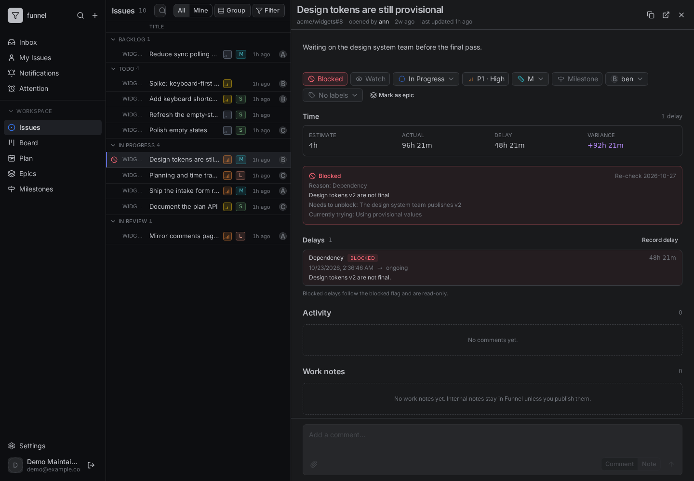
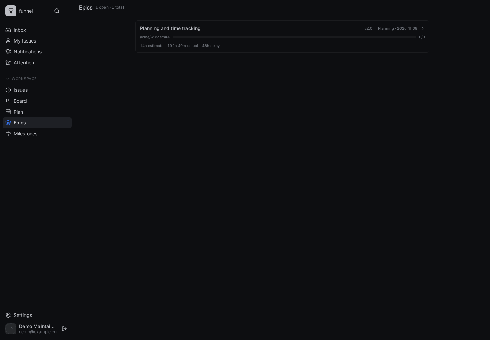
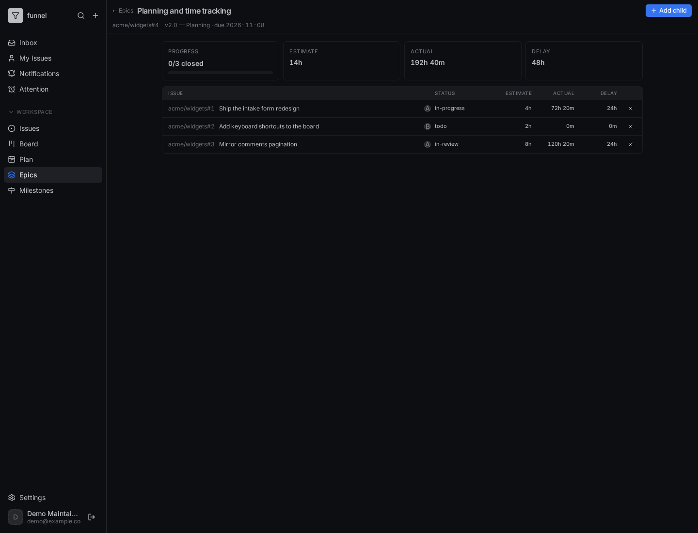

# Plan and track a week

In this tutorial we will configure estimates and net capacity, commit an issue to a week, block an issue, and read the epic rollup. Everything happens in Funnel; nothing is written to GitHub except the `epic` label and the issue body metadata.

The screenshots use a small demo instance with three maintainers and a handful of issues. Your names and numbers will differ.

## Before you start

You need:

- an admin account, to configure estimates and maintainers;
- at least one configured repository with mirrored issues;
- a `write` account, to plan issues, block them and edit epics.

If the planner is already configured, skip to [step 3](#3-open-the-week).

## 1. Set the estimate map

Open **Settings → Planning**.


Set the hours for **Small**, **Medium** and **Large**. The defaults are 2, 4 and 8 hours. An issue's size label is the estimate, so changing the map re-prices every planned issue at once.

## 2. Add maintainers with net hours

In the **Maintainers** section, add the people whose capacity you want to plan. Enter **net** hours — contracted hours minus recurring meetings, on-call and other fixed commitments. Funnel plans at most 60% of that by default; the rest is buffer.

Notice the hint under the roster. Keep the roster to people who are actually assignable in the configured repositories.

Select **Save changes**. Funnel validates the values and broadcasts a settings event, so open planners pick up the new map without a restart.

## 3. Open the week

Open **Plan** in the navigation bar. The page opens on the current week.


Each lane shows a maintainer, their net hours, the committed hours against the 60% cap, and the issues committed to that week. The **Unassigned** section holds issues with no active, configured maintainer; **Unestimated** holds issues with no size label.

Use the arrows beside the week to move to the previous or next week.

## 4. Commit an issue to the week

Open an issue from **Issues**, then set **Planned** in its **Properties** panel to **This week** (or another nearby week).

If the issue would push a maintainer over the 60% cap, Funnel rejects the write with a message naming the maintainer, the cap and the excess. Move the issue to another week or unschedule something first. The picker explains the other blockers: a closed issue, an issue without a size, or an issue with no active maintainer assignee.

Notice that planning changes only the commitment. The issue keeps its GitHub assignees, size and milestone.

## 5. Block an issue and record a delay

With the issue open, choose **Block issue** in **Properties**. Choose a structured **reason** — for example `dependency` — and fill in the blocker and what is needed to unblock it.



Blocking opens an automatic delay. The delay row is read-only because it follows the `blocked` flag; unblocking closes it. A manual delay is for waits that are not represented by that flag.

The time card shows estimate, actual time, delay and variance. Actual time counts both `in-progress` and `in-review`.

## 6. Create an epic and add children

Open the issue that should be the epic, then choose **Mark as epic**. Or add the `epic` label directly.

Open **Epics** from the navigation menu.



Select the epic, then **Add child** and choose open issues. The children are recorded in the epic issue's `funnel_metadata`:

```yaml
epic:
  children: "acme/widgets#1,acme/widgets#2,acme/widgets#3"
```

The epic page resolves the children and sums their estimate, actual and delay time.



Notice that progress counts closed children over resolved children. A child that was pruned or is no longer mirrored is shown as unavailable and excluded from the rollups.

## 7. What you have built

You have configured a capacity model, committed an issue to a week, blocked an issue with a structured delay, and grouped related work into an epic with live rollups.

From here:

- [Plan a week](../how-to/use/plan-work.md) for the day-to-day task.
- [Plan your day](../how-to/plan/plan-your-day.md) for the personal time box and the Outlook feed.
- [Track time and delays](../how-to/use/track-time-and-delays.md) for the delay rules.
- [Manage epics](../how-to/use/epics.md) for the child-list workflow.
- [Planning and time reference](../reference/planning-and-time.md) for exact values and contracts.
- [Why planning and actuals work this way](../explanation/planning-and-actuals.md) for the design trade-offs.
