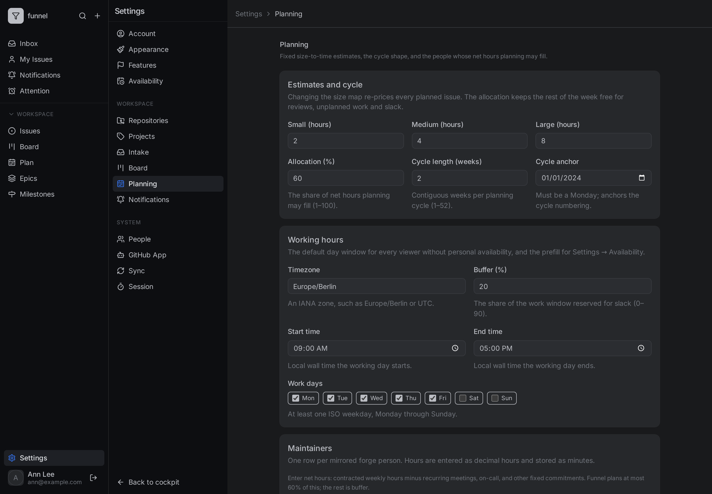
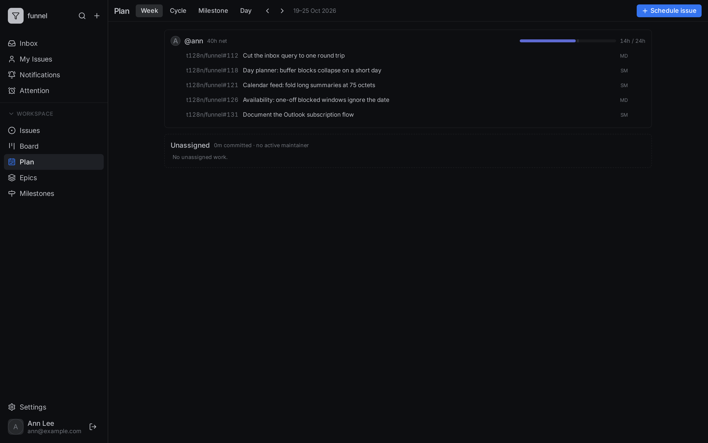
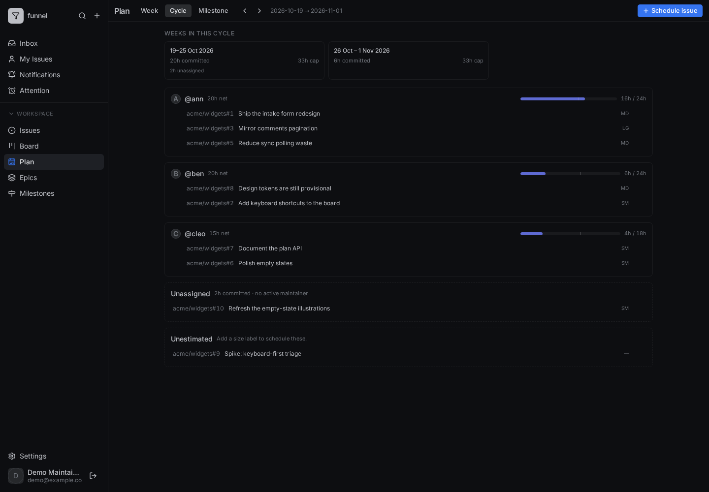

# Plan a cycle and track it

In this tutorial we will configure estimates and net capacity, plan one cycle, block an issue, and read the epic rollup. Everything happens in Funnel; nothing is written to GitHub except the `epic` label and the issue body metadata.

The screenshots use a small demo instance with three maintainers and a handful of issues. Your names and numbers will differ.

## Before you start

You need:

- an admin account, to configure estimates and maintainers;
- at least one configured repository with mirrored issues;
- a `write` account, to schedule issues, block them and edit epics.

If the planner is already configured, skip to [step 3](#3-open-the-plan).

## 1. Set the estimate map

Open **Settings → Planning**.



Set the hours for **Small**, **Medium** and **Large**. The defaults are 2, 4 and 8 hours. An issue's size label is the estimate, so changing the map re-prices every planned issue at once.

## 2. Add maintainers with net hours

In the **Maintainers** card, add the people whose capacity you want to plan. Enter **net** hours — contracted hours minus recurring meetings, on-call and other fixed commitments. Funnel plans at most 60% of that by default; the rest is buffer.

Notice the hint under the roster. Keep the roster to people who are actually assignable in the configured repositories.

Select **Save changes**. Funnel validates the values and broadcasts a settings event, so open planners pick up the new map without a restart.

## 3. Open the plan

Open **Plan** in the workspace sidebar. The page opens on the current week.



Each lane shows a maintainer, their net hours, the committed hours against the 60% cap, and the issues scheduled into that week. The **Unassigned** section holds issues with no active, configured maintainer; **Unestimated** holds issues with no size label.

## 4. Look at the cycle

Select the **Cycle** tab.



The cycle aggregates the weeks in the configured cycle length. The lane capacity is the weekly cap multiplied by the number of weeks, and the per-week summaries show where the work sits inside the cycle.

Use the arrows beside the period to move to the previous or next week or cycle.

## 5. Schedule an issue

Select **Schedule issue**. Search for an open, sized issue that is not already planned, choose a Monday week and confirm.

If the issue would push a maintainer over the 60% cap, Funnel rejects the write with a message naming the maintainer, the cap and the excess. Move the issue to another week or unschedule something first.

Notice that scheduling changes only the plan. The issue keeps its GitHub assignees, size and milestone.

## 6. Block an issue and record a delay

Open an issue from the plan or from **Issues**. In the Inspector, select **Blocked**. Choose a structured **reason** — for example `dependency` — and fill in the blocker and what is needed to unblock it.


Blocking opens an automatic delay. The delay row is read-only because it follows the `blocked` flag; unblocking closes it. A manual delay is for waits that are not represented by that flag.

The time card shows estimate, actual time, delay and variance. Actual time counts both `in-progress` and `in-review`.

## 7. Create an epic and add children

Open an issue that should be the epic, then choose **Mark as epic** in the Inspector. Or add the `epic` label directly.

Open **Epics** in the sidebar.


Select the epic, then **Add child** and choose open issues. The children are recorded in the epic issue's `funnel_metadata`:

```yaml
epic:
  children: "acme/widgets#1,acme/widgets#2,acme/widgets#3"
```

The epic page resolves the children and sums their estimate, actual and delay time.


Notice that progress counts closed children over resolved children. A child that was pruned or is no longer mirrored is shown as unavailable and excluded from the rollups.

## 8. What you have built

You have configured a capacity model, planned a cycle, blocked an issue with a structured delay, and grouped related work into an epic with live rollups.

From here:

- [Plan a week or cycle](../how-to/use/plan-work.md) for the day-to-day task.
- [Track time and delays](../how-to/use/track-time-and-delays.md) for the delay rules.
- [Manage epics](../how-to/use/epics.md) for the child-list workflow.
- [Planning and time reference](../reference/planning-and-time.md) for exact values and contracts.
- [Why planning and actuals work this way](../explanation/planning-and-actuals.md) for the design trade-offs.
